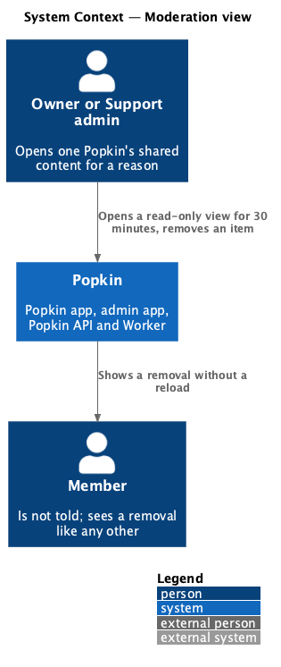
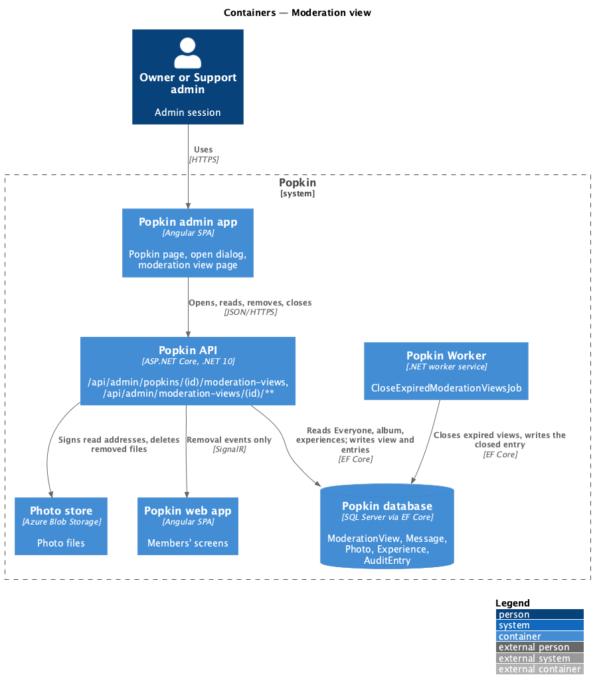
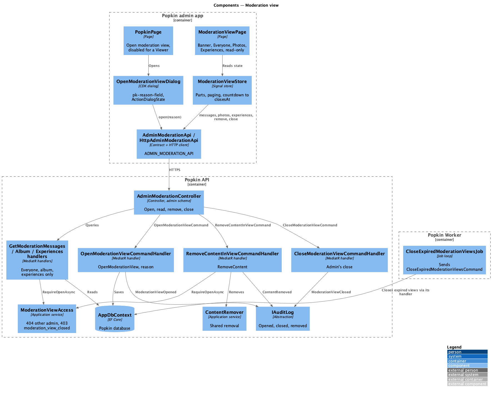
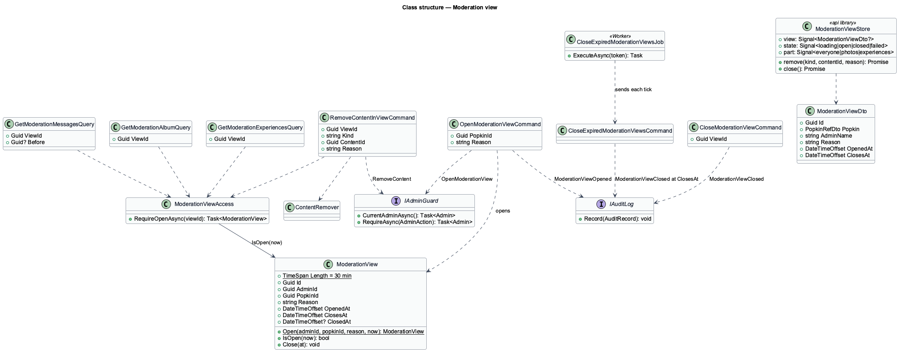
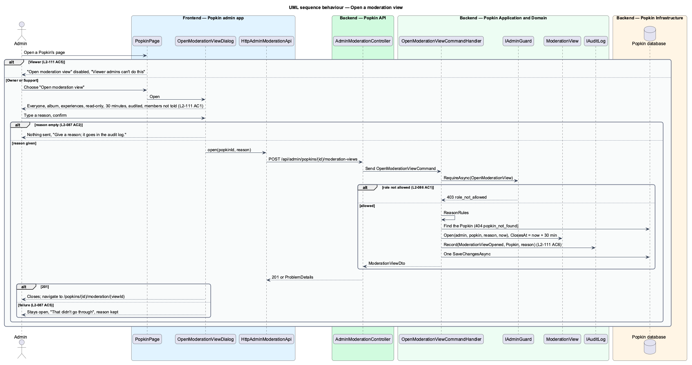
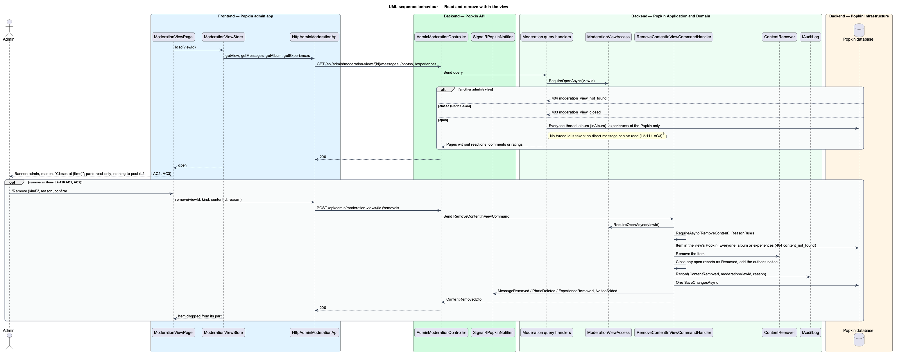
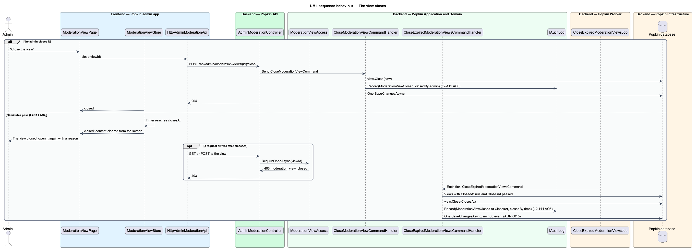

# Moderation view

## Overview

A report shows one item and the messages around it ([Reports](../review-reports/README.md)).
Some cases need more: a pattern across a Popkin, or a report that points at content nobody else
reported. For such a serious case an Owner or a Support admin opens a *moderation view*: one
Popkin's Everyone thread, album and experiences, read-only, for 30 minutes, opened with a reason
that the audit log records.

- **moderation view** — Owner's or Support admin's read-only look at one Popkin's Everyone
  thread, album and experiences, opened with a reason and closed after 30 minutes
  (`docs/specs/L1.md`, Terms)
- **open view** — moderation view whose 30 minutes have not passed and that its admin has not
  closed
- **closed view** — moderation view past its 30 minutes or closed by its admin; every request to
  it is refused with `403` `moderation_view_closed`

The view is the widest reach the admin app has into a Popkin, so its limits are strict. It never
shows a direct message (L2-111 AC3, L2-078 AC4). Nothing can be posted, reacted to or changed in
it; the one action it offers is the removal of an item, as for a report (L2-110 AC1, AC2). The
members are not told that a view was opened. The audit log records both its opening and its
closing, with the admin, the Popkin and the reason (L2-111 AC6).

ADR 0016 ended with the consequence that "an admin feature that needs to see inside a Popkin
would need a new decision record". [ADR 0024](../../../adr/0024-admins-moderation-and-switches-in-the-database.md)
is that record. It is *Proposed*, not yet accepted; this design follows it and shall not be built
until it is accepted.

This feature is designed, not built.

## Description

### Screens and states

The mocks in `docs/mocks/admin/` settle the copy the design left open:

- `pages/popkin/` — every state with its content gains a "Shared content" panel: what members
  share stays private, a moderation view opens it read-only for 30 minutes on the record, and
  "Open moderation view"; disabled for a Viewer with "Viewer admins can't do this" (L2-111 AC5).
- `dialogs/moderation-view-open/` — `default`, `busy`, `invalid`, `failed`. "Open a moderation view
  of Lakeside Weekend?", the sentence of AC1 (adding that direct messages stay private), "Reason,
  for the audit log" with focus, "Open view" (primary) and "Cancel".
- `pages/moderation-view/` — `default` (Everyone), `album`, `experiences`, `removed`, `closed`,
  `loading`, `error`. A warning `pk-alert` "Moderation view, on the record." names the admin, the
  time it opened, the reason and when it closes (AC2); a "Closes 11:12" status; the three parts as
  tabs; each item with "Remove {kind}" and nothing else (AC3). `closed` replaces the content with
  "This moderation view has closed" and "Open again" (AC4). No `viewer` state: a Viewer cannot open
  a view.
- `dialogs/moderation-remove/` — `default`, `busy`, `invalid`, `failed`: the removal of
  [Remove reported content](../decide-report/README.md) over the view, its last sentence "Any open
  report on it closes." since the item may have none.

### API

All under `AdminModerationController` (new, `Popkin.Api/Controllers/Admin/`),
`[Authorize(AuthenticationSchemes = AdminSessionCookie.Scheme)]`:

- `POST /api/admin/popkins/{popkinId}/moderation-views` — body `{ reason }`. `201`
  `ModerationViewDto { id, popkin { id, name, emoji }, admin { name }, reason, openedAt, closesAt
  }`. Failures: `400` `reason_required`, `reason_too_long`; `403` `role_not_allowed`
  (`AdminAction.OpenModerationView`, L2-111 AC5); `404` `popkin_not_found`.
- `GET /api/admin/moderation-views/{viewId}` — `200` `ModerationViewDto`.
- `GET /api/admin/moderation-views/{viewId}/messages?before={messageId}` — `200`
  `ModerationMessagePageDto { items, hasMore }`, the Everyone thread only, newest page first;
  each item `{ messageId, author { name, avatar }, sentAt, text, imageUrl?, photoRemoved,
  removedByPopkin }`.
- `GET /api/admin/moderation-views/{viewId}/photos` — `200` the album: `{ photoId, uploader,
  addedAt, caption, thumbnailUrl, imageUrl }[]`. A photo of a direct message is never in it.
- `GET /api/admin/moderation-views/{viewId}/experiences` — `200` `{ experienceId, sharer, kind,
  title, when, place, pictureUrl? }[]`.
- `POST /api/admin/moderation-views/{viewId}/removals` — body `{ kind, contentId, reason }`. `200`
  `ContentRemovedDto { kind, contentId, reportsClosed }`. Failures: `400` `reason_required`,
  `reason_too_long`; `403` `role_not_allowed` (`AdminAction.RemoveContent`); `404`
  `content_not_found` for an item outside the view's Popkin, outside Everyone, the album and its
  experiences (a direct message's message or photo), or already gone.
- `POST /api/admin/moderation-views/{viewId}/close` — `204`.
- Every request to a view: `404` `moderation_view_not_found` for a view another admin opened or
  that does not exist; `403` `moderation_view_closed` for a closed view (L2-111 AC4).

The view's reads leave out reactions, photo comments, ratings and their comments, and keen:
L2-111 names the thread, the album and the experiences, and L2-078 AC4 lists comments and
reactions apart from them. Whether the view shows them is `<TO SUPPLY>`.

### Backend (`backend/src/`)

- **`ModerationView`** (Domain, new) — `Id`, `AdminId`, `PopkinId`, `Reason`, `OpenedAt`,
  `ClosesAt`, `ClosedAt?`. `Length = TimeSpan.FromMinutes(30)`; `Open(adminId, popkinId, reason,
  now)` sets `ClosesAt = now + Length`; `IsOpen(now)` is `ClosedAt is null && now < ClosesAt`;
  `Close(at)` sets `ClosedAt` once. `IAppDbContext.ModerationViews`.
- **`OpenModerationViewCommand`** (Application, `Admin/Moderation/OpenModerationView.cs`, new) —
  `IAdminGuard.RequireAsync(AdminAction.OpenModerationView)`, `ReasonRules`, the Popkin found by
  id (wrapped-up or not), the view added, and `IAuditLog.Record` with
  `AuditAction.ModerationViewOpened`, `TargetKind.ModerationView`, `TargetId` the view,
  `TargetName` the Popkin's name, `Reason`, `Details { popkinId, closesAt }`, in one save
  (L2-111 AC6).
- **`ModerationViewAccess.RequireOpenAsync(viewId)`** (Application, new) — loads the view of the
  current admin, refuses another admin's with `404` `moderation_view_not_found` and a closed one
  with `403` `moderation_view_closed`, reading the time from `TimeProvider`. Every query and
  command of an open view calls it first.
- **`GetModerationMessagesQuery`**, **`GetModerationAlbumQuery`**,
  **`GetModerationExperiencesQuery`** (Application, new) — read the Popkin's one Everyone
  `ChatThread` (`ChatThreadKind.Everyone`), its photos with `InAlbum` true, and its experiences.
  No query reads a direct thread or a photo with `InAlbum` false: the queries take no thread id,
  so a direct message cannot be asked for (L2-111 AC3, L2-078 AC4). Image addresses come from
  `IPhotoStore.GetReadUrl` and expire as every photo address does.
- **`RemoveContentInViewCommand`** (Application, new) — `ViewId`, `Kind`, `ContentId`, `Reason`.
  It calls `RequireOpenAsync`, `IAdminGuard.RequireAsync(AdminAction.RemoveContent)` and
  `ReasonRules`, checks that the item is in the view's Popkin and in reach of the view, removes it
  with `ContentRemover`, closes any open reports on it as `Removed`, adds a
  `ContentRemovalNotice` for the author, and records `AuditAction.ContentRemoved` with `Details {
  kind, contentId, moderationViewId, reportsClosed }`, all in one save. The files and the events
  follow the commit as in [decide-report](../decide-report/README.md). The notice of an item no
  member reported carries no report reason; what it names is `<TO SUPPLY>`.
- **`CloseModerationViewCommand`** (Application, new) — the admin's own close: `Close(now)` and
  `AuditAction.ModerationViewClosed` with `Details { closedBy: "admin" }`, one save. A view
  already closed is answered `204` and changes nothing.
- **`CloseExpiredModerationViewsCommand`** (Application, new) and
  **`CloseExpiredModerationViewsJob`** (Worker, `Popkin.Worker/Jobs/`, new) — the closing that
  happens with nobody asking. On each tick the job sends the command; its handler closes every
  view whose `ClosesAt` has passed with `Close(ClosesAt)` and writes, per view,
  `AuditAction.ModerationViewClosed` at `ClosesAt`, naming the view's admin, Popkin and reason,
  with `Details { closedBy: "time" }` (L2-111 AC6). The job sends no hub event (ADR 0015). Its
  tick interval is `<TO SUPPLY>`; until it runs, `RequireOpenAsync` already refuses the view, so
  the audit entry may lag its `ClosesAt` by at most one tick, while its `At` is exact.
- **Telemetry** — the counter `popkin.moderation.views_opened`, no dimension. No log line, metric
  or span carries the reason, the admin's name, the Popkin's name or any content (ADR 0012).

### Frontend (Popkin admin app)

- **`PopkinPage`** (admin, `pages/popkin/`) — gains "Open moderation view" in `pk-page-head`'s
  actions, a `pk-button` disabled from `AdminSessionStore.allowed` with "Viewer admins can't do
  this" (L2-111 AC5, L2-086 AC2). It opens **`OpenModerationViewDialog`**
  (`dialogs/moderation-view-open/`), `pk-dialog` with the sentence of L2-111 AC1 and
  `pk-reason-field`, run by `ActionDialogState`. On success it navigates to
  `/popkins/:popkinId/moderation/:viewId`.
- **`ModerationViewPage`** (new, `pages/moderation-view/`), route
  `/popkins/:popkinId/moderation/:viewId`, route data `page: 'moderation-view'`. It composes
  `pk-admin-shell`, `pk-page-head`, `pk-banner` (the admin, the reason and "Closes at {time}",
  copy `<TO SUPPLY>`), `pk-segmented-control` for Everyone, Photos and Experiences, and the
  Popkin app's presentation components in their read-only form: `pk-thread` with `pk-message`,
  `pk-photo-grid`, `pk-experience-card`. No composer, react bar, comment field, rating or keen is
  rendered. Each item offers "Remove {kind}"; both roles that may open a view may also remove
  (L2-086). The page offers "Close the view" (copy `<TO SUPPLY>`).
- **`ModerationViewStore`** (new, `api` library, `admin/moderation/moderation-view-store.ts`) —
  the view, the three parts, paging of the thread, and the countdown: a timer set from
  `closesAt` switches the store to `closed`, empties the content it holds and stops every read
  (L2-111 AC4). A `403` `moderation_view_closed` from any read does the same. Unit-tested with
  fake timers (ADR 0011).
- **`AdminModerationApi`** contract, `ADMIN_MODERATION_API` token and `HttpAdminModerationApi`
  (new, `api` library), provided in the admin app's `app.config.ts`. `ADMIN_REPORTS_API` keeps
  the queue; this contract keeps the view.
- Removal inside the view reuses `RemoveReportedContentDialog` with data that names the view;
  after it closes, the store drops the item from its part.

### Popkin web app

Nothing is shown to the members when a view opens or closes. A removal from the view reaches
their screens through the events of [decide-report](../decide-report/README.md).

### Decisions

- A view belongs to the admin who opened it. Another admin, even an Owner, opens their own with
  their own reason, so each reading of a Popkin has its own entry.
- The thirty minutes are enforced by the API on every request, not by the screen alone; the
  screen's timer only hides what the API would refuse.
- The expiry is recorded by a Worker job, because a view whose browser closed would otherwise
  never be recorded as closed (L2-111 AC6). L2-113 lists four Worker jobs; this is a further
  one (conflict, reported to the index).
- The view's reads have no thread parameter, so no request can name a direct message.

### Testing

- API: `Popkin.Api.Tests/Admin/Moderation/ModerationViewTests` — open with a reason (`201`, the
  opened entry in the same save), a Viewer refused (`403` `role_not_allowed`), an empty reason
  (`400`); the three reads, with a direct message's message and photo absent; a read after
  `FakeTimeProvider` passes 30 minutes (`403` `moderation_view_closed`); another admin's view
  (`404`); a removal in the view (the item gone, the event sent, a direct message's item `404`
  `content_not_found`); the admin's close (the closed entry). No test sleeps (ADR 0010).
- Application: `ModerationViewTests` for `IsOpen`, one case per row: before 30 minutes, at 30
  minutes, after, closed by the admin. Worker: `CloseExpiredModerationViewsJobTests` with
  `FakeTimeProvider`, the entry dated `ClosesAt`.
- Frontend unit: `moderation-view-store.spec.ts` (the countdown, a `403` closing the view).
- Playwright (admin project): `e2e/tests/admin/moderation-view.spec.ts` through
  `e2e/pages/admin/moderation-view.page.ts` and `open-moderation-view.dialog.ts`.

## Requirements

| L2 ID | Refines (L1) | Requirement |
|-------|--------------|-------------|
| `L2-111` | `L1-024` | Moderation view: For a serious case, an Owner or Support admin looks at one Popkin's shared content, on the record. (AC1–AC6) |
| `L2-110` | `L1-024` | Remove reported content or dismiss the report: An admin decides. (AC1, AC2, within a view) |
| `L2-078` | `L1-012` | Admin access: Only admins reach the admin app, and the admin app reaches a Popkin's content only as moderation allows. (AC4) |
| `L2-103` | `L1-023` | A Popkin: One Popkin's length, members, invite and activity, never its content. (AC6) |
| `L2-087` | `L1-028` | A reason for every change: An admin says why they change something, and the audit log keeps it. (the reason to open a view) |
| `L2-120` | `L1-028` | Audit log: Every action in the console, with who did it and why. (AC5: a moderation view opened or closed) |

## Diagrams

### System context

An Owner or Support admin opens one Popkin's shared content for a reason; the members are not
told, and the audit log records the opening and the closing.

### Containers

The admin app opens and reads the view from the Popkin API; the API reads the Everyone thread,
album and experiences from the database and records each opening and closing there. The Worker
closes the views whose time has passed.

### Components

Every query and command of a view passes through `ModerationViewAccess`, which refuses a closed
view; the queries read only the Everyone thread, the album and the experiences.

### Class structure

`ModerationView` holds the admin, the Popkin, the reason and the thirty minutes; its `IsOpen`
decides every request.

### Behaviour — open a moderation view

The admin gives a reason; the view opens for 30 minutes and the opening is recorded; a Viewer is
refused (L2-111 AC1, AC2, AC5, AC6).

### Behaviour — read and remove within the view

The three parts load read-only with no direct message, and an item can be removed with a reason
(L2-111 AC2, AC3).

### Behaviour — the view closes

After 30 minutes the screen closes the view, the API refuses its requests with `403`, and the
Worker records the closing (L2-111 AC4, AC6).

