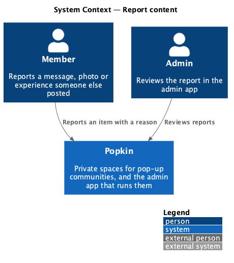
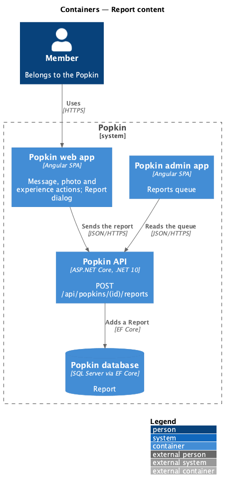
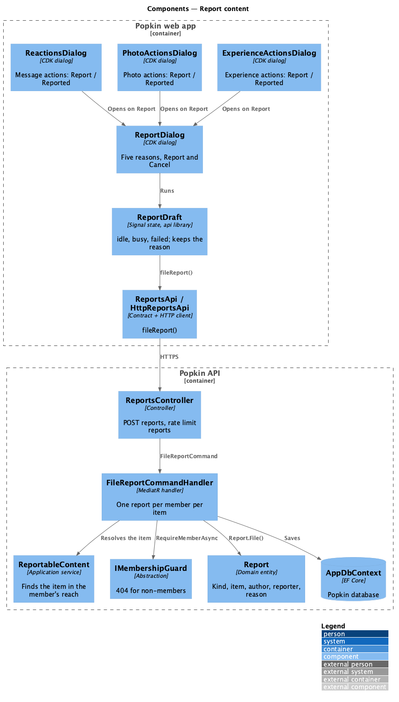
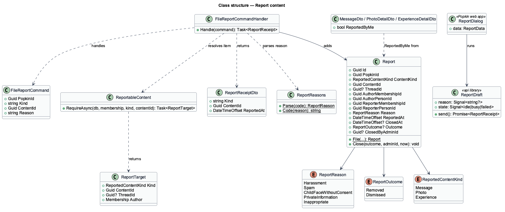
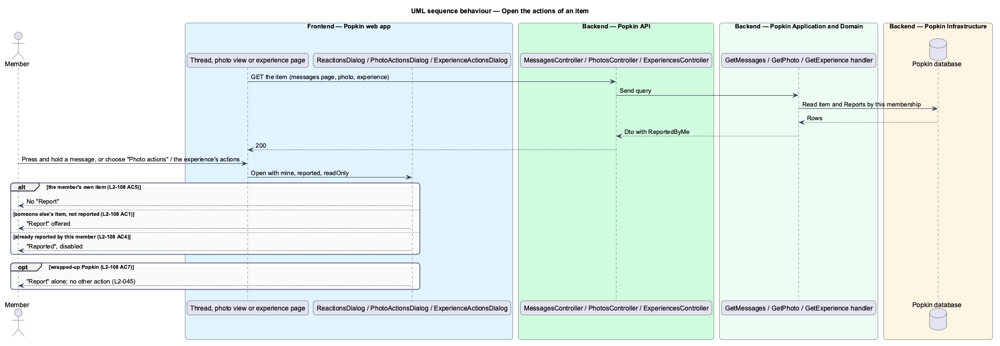
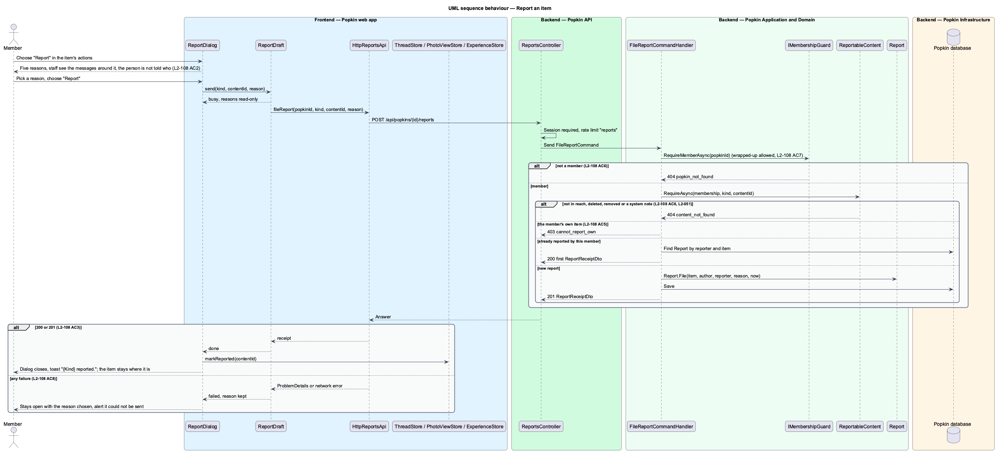

# Report content

## Overview

A Popkin is a private space, so nobody outside it sees what its members post. When something
posted breaks the rules, a member needs a way to tell Popkin's staff without leaving the app and
without the author learning who spoke up. *Report content* is that way. It sits in the Popkin web
app, not in the admin app: the member opens the actions of a message, a photo or an experience
someone else posted, chooses "Report", picks what is wrong and confirms.

- **report** — member's word that one message, photo or experience breaks the rules, with one of
  five reasons (`docs/specs/L1.md`, Terms)
- **reported item** — message, photo or experience that carries at least one open report
- **report reason** — one of "Harassment", "Spam or advertising", "Shows a child's face without
  consent", "Shares private information" and "Inappropriate"
- **open report** — report no admin has closed yet by removing the item or dismissing it

A report changes nothing a member sees. The item stays where it is until an admin acts on it
([Remove reported content or dismiss the report](../decide-report/README.md)). The report lands in
the queue of the admin app ([Reports](../review-reports/README.md)). The member who reported it
sees "Reported", disabled, where "Report" was, so the same item is not reported twice by the same
person.

A member reports only what is in reach: a message of a thread they belong to (Everyone, or a
direct message they are one of the two members of), a photo they can open, an experience of their
Popkin. Their own items are never reportable. A wrapped-up Popkin still takes reports, because
what was posted stays readable there (L2-108 AC7).

This feature is designed, not built. Nothing of it exists in the codebase yet.

## Description

### Screens and states

No mock draws any part of this feature (known gap). The design expects these mocks, written with
`writing-html-mocks` before implementation:

- `docs/mocks/dialogs/report/default.html` — the Report dialog: title `<TO SUPPLY>`, the question
  "what is wrong" as a radio group of the five report reasons, none chosen, the sentence that
  Popkin's staff will look at it with the messages around it and that the person is not told who
  reported it, "Report" (danger) and "Cancel".
- `docs/mocks/dialogs/report/invalid.html` — "Report" chosen with no reason picked; the group says
  so (copy `<TO SUPPLY>`).
- `docs/mocks/dialogs/report/busy.html` — "Report" busy and disabled, the reasons read-only.
- `docs/mocks/dialogs/report/failed.html` — the dialog open with the reason still chosen and a
  `pk-alert` that the report could not be sent (copy `<TO SUPPLY>`, L2-108 AC8).
- `docs/mocks/dialogs/reactions/report.html` — "Message actions" on someone else's message, with
  "Report" after "Copy".
- `docs/mocks/dialogs/reactions/reported.html` — the same with "Reported", disabled.
- `docs/mocks/dialogs/photo-actions/report.html` and `reported.html` — "Photo actions" for a photo
  someone else added: "Report" or "Reported", and, for the Host on an album photo, "Delete photo"
  too.
- `docs/mocks/dialogs/experience-actions/report.html` and `reported.html` — the same for an
  experience.
- `docs/mocks/pages/photo-view/read-only-report.html` — the photo view of a wrapped-up Popkin with
  "Photo actions" offering "Report" only.
- The success toast: "{Kind} reported." is the expected shape; its exact copy is `<TO SUPPLY>`.

### API

- `POST /api/popkins/{popkinId}/reports` — body `{ kind, contentId, reason }`, where `kind` is
  `message`, `photo` or `experience` and `reason` is `harassment`, `spam`, `child_face`,
  `private_information` or `inappropriate`. `201` `ReportReceiptDto { kind, contentId,
  reportedAt }`. A second report of the same item by the same member is answered `200` with the
  first report's receipt and changes nothing, so a retry after a lost answer is safe.
- Failures: `400` `kind_not_allowed`, `reason_not_allowed`; `403` `cannot_report_own` (the
  member's own item, L2-108 AC5); `404` `popkin_not_found` for a person who is not a member, and
  `404` `content_not_found` for an item that is not in reach: a message of a thread the member
  does not belong to, a photo of a direct message between two others, a deleted or removed item, a
  system note (L2-108 AC6, L2-051); `429` `rate_limited`. A wrapped-up Popkin is not refused
  (L2-108 AC7), so the handler uses `IMembershipGuard.RequireMemberAsync`, not
  `RequireActiveMemberAsync`.
- `ReportsController` (new, `Popkin.Api/Controllers/`) under the default fallback policy; a Popkin
  app session is required. It carries the new rate-limiter policy `RateLimitPolicyNames.Reports`
  (`"reports"`); its permit count and window are `<TO SUPPLY>` and are added to
  `docs/deployment.md` with it (ADR 0013).
- The reads that open the actions say whether the member already reported the item: `MessageDto`,
  `PhotoDetailDto` and `ExperienceDetailDto` each gain `bool ReportedByMe` (L2-108 AC4). The
  message read computes it for its page of messages in one query over `Reports` by the member's
  membership.
- No hub event is sent. A report is private to the member who made it; nobody else's screen
  changes.

### Backend (`backend/src/`)

- **`Report`** (Domain, new) — `Id`, `PopkinId`, `ContentKind` (`ReportedContentKind`: `Message`,
  `Photo`, `Experience`), `ContentId`, `ThreadId?` (the thread of a message, or of a photo sent in
  a direct message, so the admin side finds its context), `AuthorMembershipId`, `AuthorPersonId`,
  `ReporterMembershipId`, `ReporterPersonId`, `Reason` (`ReportReason`), `ReportedAt`,
  `ClosedAt?`, `Outcome?` (`ReportOutcome`: `Removed`, `Dismissed`), `ClosedByAdminId?`.
  `Report.File(...)` makes one; `Close(outcome, adminId, now)` belongs to
  [Remove reported content or dismiss the report](../decide-report/README.md). A unique index on
  (`ReporterMembershipId`, `ContentKind`, `ContentId`) keeps one report per member per item.
- **`ReportReason`** (Domain, new enum) — `Harassment`, `Spam`, `ChildFaceWithoutConsent`,
  `PrivateInformation`, `Inappropriate`. `ReportReasons` (Application) maps each to its wire code
  and back; an unknown code is `reason_not_allowed`.
- **`IAppDbContext.Reports`** (new `DbSet<Report>`) with its EF configuration and migration in
  `Popkin.Infrastructure`.
- **`FileReportCommand`** (Application, `Moderation/FileReport.cs`, new) — `PopkinId`, `Kind`,
  `ContentId`, `Reason`. Its handler calls `RequireMemberAsync`, resolves the item through
  `ReportableContent`, refuses the member's own, returns the existing report when there is one,
  and otherwise adds a `Report` and saves.
- **`ReportableContent`** (Application, new) — finds the item in the member's reach with the rules
  that already hold for reading it: `ChatThreads.RequireAsync` and `ChatThreads.RequireMessageAsync`
  for a message (which already answer `404` for another thread, a deleted message and a system
  note), `PhotoAccess.RequireAsync` for a photo, and `Experiences.RequireAsync` for an experience.
  Each `404` it raises is mapped to `content_not_found`, so the answer never says which rule
  refused. It returns the author's membership and person and the thread.
- **Telemetry** — the counter `popkin.reports.filed` on `PopkinMetrics`, with the dimension `kind`
  only. No log line, metric or span carries the reason's free text (there is none), the item's
  text, its id or the reporter's id (ADR 0012).

### Frontend (Popkin web app)

- **`ReactionsDialog`** ("Message actions", `dialogs/reactions/`) — `ReactionsData` gains
  `reported: boolean`. When `mine` is false, a `pk-menu-item` "Report" (icon `flag`) follows
  "Copy"; when `reported` is true it reads "Reported" and is disabled, its accessible description
  saying it was already reported. `MessageAction` gains `{ kind: 'report' }`. In a read-only
  thread (L2-045) the dialog opens with "Report" alone (L2-108 AC7).
- **`PhotoActionsDialog`** (`dialogs/photo-actions/`) — `PhotoActionsData` gains `canDelete`,
  `canReport` and `reported`; it closes with `'delete'` or `'report'`. The photo view renders
  "Photo actions" when either `canDelete` or `canReport` is true, and in a wrapped-up Popkin with
  `canReport` alone. `canReport` is `!photo.isMine`.
- **`ExperienceActionsDialog`** (`dialogs/experience-actions/`) — `ExperienceActionsData` gains
  `canReport` and `reported`; `ExperienceAction` gains `'report'`. The experience page renders its
  actions when any of `canEdit`, `canDelete`, `canReport` is true.
- **`ReportDialog`** (new, `dialogs/report/report.dialog.ts` + `.html`) — CDK dialog in
  `pk-dialog`, the five reasons as a radio group (`pk-choice-card`, `<TO SUPPLY>` until the mock
  names the component), the explanation of L2-108 AC2, "Report" (danger) and "Cancel". Data:
  `ReportData { accent, kind, popkinId, contentId }`. It runs `ReportDraft` and closes with the
  receipt on success.
- **`ReportDraft`** (new, `api` library, `moderation/report-draft.ts`) — signal state `idle` →
  `busy` → `failed`, the chosen reason kept across a failure (L2-108 AC8); unit-tested (ADR 0011).
- **`report-text.ts`** (new, `api` library) — the reason labels by wire code and the toast per
  kind, unit-tested.
- **`ReportsApi`** contract, `REPORTS_API` token and `HttpReportsApi` (new, `api` library,
  `moderation/reports-api.ts`), provided in `app.config.ts`.
- After a success the opener marks the item reported where it is held: `ThreadStore.markReported`
  (`messageId`), `PhotoViewStore.markReported()` and `ExperienceStore.markReported()`, so the next
  opening of the actions reads "Reported" without a reload. It shows the success toast through the
  existing toast service.

### Decisions

- A report is idempotent per member and item. A repeat is `200` with the first receipt, not `409`,
  so a retry after a network failure never shows an error for a report that was made.
- The item's reach is decided by the read rules that already exist, and every refusal is the one
  code `content_not_found`. A report never discloses that a thread or item exists outside the
  member's reach (L2-051).
- "Report" is offered on a message of a direct message, since its member may report it (L2-108
  AC1); the admin side then sees that direct message's context alone
  ([Reports](../review-reports/README.md)).
- L2-108 AC7 asks for "Report" in a wrapped-up Popkin, where L2-045 offers no action. This design
  follows L2-108 for "Report" alone; every other action stays off in a wrapped-up Popkin
  (conflict, reported to the index).

### Testing

- API: `Popkin.Api.Tests/Moderation/FileReportTests` — a message, a photo and an experience
  reported (`201`), the repeat (`200`, one row), the member's own (`403`), a non-member (`404`
  `popkin_not_found`), a direct message of two others and a deleted message (`404`
  `content_not_found`), a wrapped-up Popkin (`201`), an unknown reason (`400`). Reads:
  `ReportedByMe` true for the reporter, false for any other member.
- Application: `ReportReasonsTests`, one case per reason code.
- Frontend unit: `report-draft.spec.ts`, `report-text.spec.ts`.
- Playwright: `e2e/tests/report-content.spec.ts`, through the page objects
  `e2e/pages/report.dialog.ts` and the existing actions page objects, with the stub
  `POST …/reports` in `e2e/fixtures/stubs.ts` and a refreshed recording.

## Requirements

| L2 ID | Refines (L1) | Requirement |
|-------|--------------|-------------|
| `L2-108` | `L1-024` | Report a message, photo or experience: A member tells Popkin about something that breaks the rules. This is in the Popkin app. (AC1–AC8) |
| `L2-051` | `L1-012` | Popkins are private to their members: Membership decides everything a person sees. (a report reaches only what the member can read) |

## Diagrams

### System context

A member reports an item in Popkin; the report waits for an admin, who works from the admin app.

### Containers

The web app sends the report to the Popkin API, which stores it in the database. Nothing is
pushed to any other member.

### Components

Three action dialogs open one `ReportDialog`; `ReportsController` sends `FileReportCommand`,
whose handler finds the item through `ReportableContent` and adds a `Report`.

### Class structure

`Report` holds one member's report of one item, with its reason and, later, its outcome. The
reads that open the actions carry `ReportedByMe`.

### Behaviour — open the actions of an item

"Report" is offered on someone else's item, reads "Reported" once reported, and is absent on the
member's own (L2-108 AC1, AC4, AC5, AC7).

### Behaviour — report an item

The member picks a reason and confirms; a success leaves the item in place; a failure keeps the
dialog open with the reason chosen; an item out of reach is refused with `404` (L2-108 AC2, AC3,
AC6, AC8).

