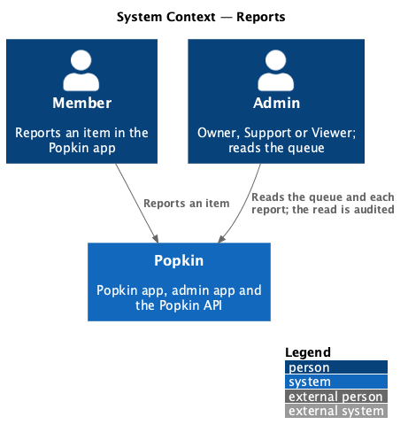
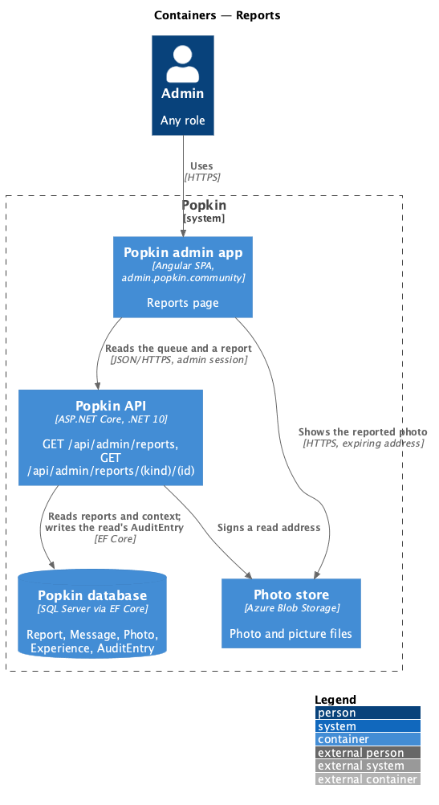
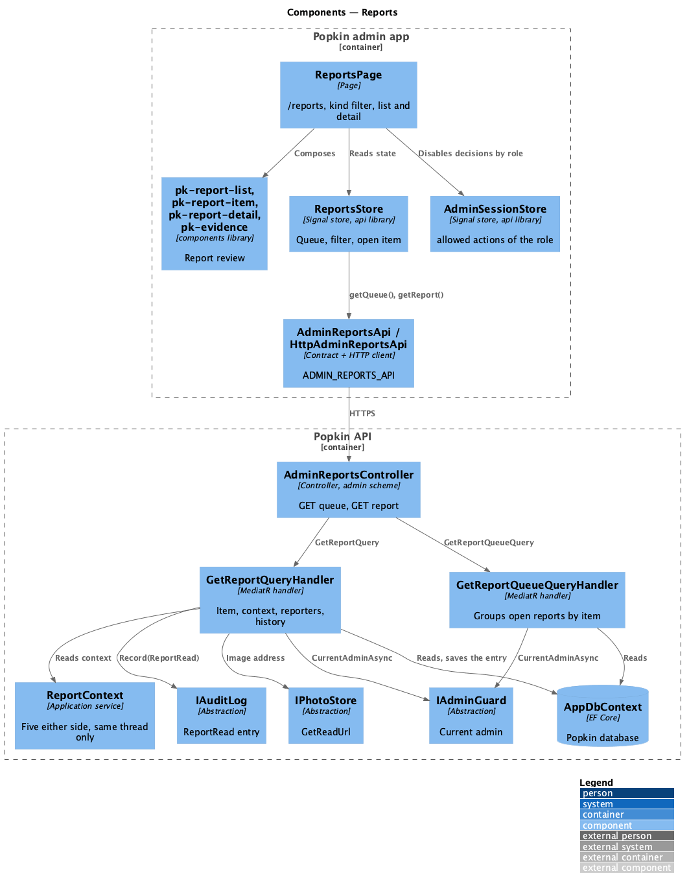
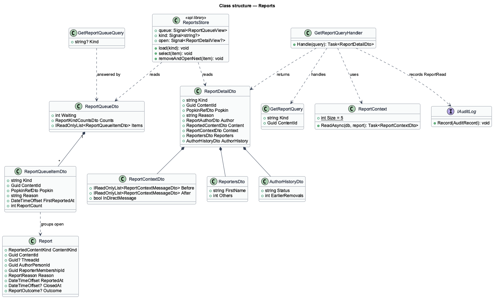
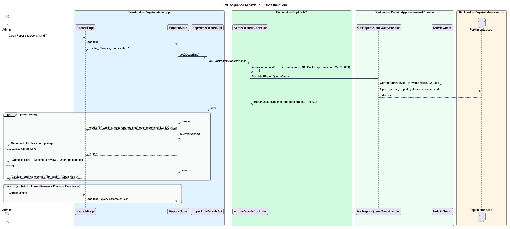
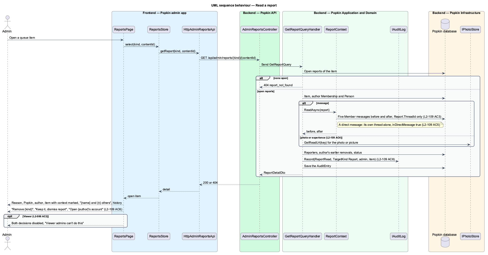

# Reports

## Overview

Members report what breaks the rules from inside the Popkin app
([Report content](../report-content/README.md)). *Reports* is the admin app's queue of those
reports, at `/reports`, where an admin reads each reported item with enough around it to judge it
fairly and then decides ([Remove reported content or dismiss the report](../decide-report/README.md)).

- **queue** — reported items with at least one open report, most-reported first
- **queue item** — one reported item, whatever the number of reports on it; its reports are read
  and decided together
- **context** — up to five messages before and five after a reported message, from the same
  thread, with the reported one marked
- **author's history** — the author's account status and the number of their items Popkin
  removed earlier

Reports is one of the two ways the admin app reaches a Popkin's content; the other is the
[Moderation view](../moderation-view/README.md). Every other admin screen shows a Popkin's facts
and counts, never what its members share (L2-078 AC4, ADR 0024). The rule for a direct message is
narrower still: a report on a direct message shows its context from that direct message alone,
and nothing else of it.

Reading a report is itself on the record. Each time an admin opens one, the audit log gains an
entry naming who read it and when (L2-109 AC8, L2-120 AC5). Any admin, Viewer included, may read
the queue; only an Owner or a Support admin may decide (L2-086).

This feature is designed, not built.

## Description

### Screens and states

From `docs/mocks/admin/manifest.json`, page `reports`, route `/reports`:

- `docs/mocks/admin/pages/reports/default.html` — "Reports", "5 waiting, most-reported first";
  the kind filter "All 5", "Messages 2", "Photos 2", "Experiences 1"; the list of queue items, each
  with its reason, "{Kind} in {Popkin}", how long ago, and "{n} reports" when more than one; the
  first item open: its kind, its Popkin as a link, the reason as the title, the author and the
  message, "Reported by" "Grace Adeyemi and 2 others", "Author's history" "Suspended · 2 earlier
  removals"; "Remove message", "Keep it, dismiss report" and "Open Tomás's account".
- `photo.html` — a reported photo: the photo in place of the message.
- `photos.html` — the filter on "Photos".
- `viewer.html` — a Viewer: both decisions disabled with "Viewer admins can't do this"; "Open
  {author}'s account" still offered.
- `removed.html`, `dismissed.html` — after a decision, the next item open, with a toast
  ([Remove reported content or dismiss the report](../decide-report/README.md)).
- `empty.html` — "Queue is clear", "Nothing to review", "New reports from members land here.
  Removals and dismissals are in the audit log.", "Open the audit log".
- `loading.html` — "Loading the queue", a status "Loading the reports…".
- `error.html` — "Couldn't load the reports", "The admin API didn't answer. Nothing has changed;
  try again, or check Health if it keeps happening.", "Try again" and "Open Health".

The mocks fall short of the requirement in three places (conflicts, reported to the index; the
requirement stands and the mocks change):

- No mock shows the context of L2-109 AC3: the five messages before and after, the reported one
  marked. `default.html` shows the reported message alone. The design expects
  `docs/mocks/admin/pages/reports/default.html` redrawn with the context.
- No mock shows a report on a direct message (L2-109 AC5). The design expects
  `docs/mocks/admin/pages/reports/direct-message.html`, saying the context comes from that direct
  message alone.
- `photo.html` shows no caption and `removed.html` shows an experience's text without its picture
  (L2-109 AC4).

The BEM blocks are those of the design system's
[Report review](../../../design-system/components/report-review.html): `report-list`,
`report-item` (`__icon`, `__text`, `__reason`, `__where`, `__meta`, `aria-current="true"` on the
open one), `report-detail` (`__where`, `__title`), `evidence` (`--stacked`, `__author`, `__text`,
`__image`), `kv`, `status` (`status--bad` for the count), with `page-head`, `segmented`, `panel`,
`panel-grid--list-detail` and `panel__foot`.

### API

All under `AdminReportsController` (new, `Popkin.Api/Controllers/Admin/`), route
`api/admin/reports`, `[Authorize(AuthenticationSchemes = AdminSessionCookie.Scheme)]`. No role is
needed to read (L2-086): the handlers call `IAdminGuard.CurrentAdminAsync()` only.

- `GET /api/admin/reports?kind=` — `kind` empty, `messages`, `photos` or `experiences`. `200`
  `ReportQueueDto { waiting, counts { all, messages, photos, experiences }, items }`, each item a
  `ReportQueueItemDto { kind, contentId, popkin { id, name, emoji }, reason, firstReportedAt,
  reportCount }`. Items are ordered by `reportCount` descending, then by `firstReportedAt`
  newest first, as the mock orders them. The counts ignore the filter, so every choice shows its
  own (L2-109 AC2). Paging: `<TO SUPPLY>` (the mocks show five items; no page size is given).
- `GET /api/admin/reports/{kind}/{contentId}` — `kind` `message`, `photo` or `experience`. `200`
  `ReportDetailDto { kind, contentId, popkin, reason, firstReportedAt, author { personId, name,
  avatar }, content, context { before[], after[], inDirectMessage }, reporters { firstName,
  others }, authorHistory { status, earlierRemovals } }`. `404` `report_not_found` when the item
  has no open report. The read writes an `AuditEntry` (below).
- `content` is a `ReportedContentDto`: for a message `{ text, imageUrl? }`; for a photo
  `{ imageUrl, caption }`; for an experience `{ title, when, place, pictureUrl? }`. Image
  addresses come from `IPhotoStore.GetReadUrl(key)` and expire as every photo address does
  (L2-051 AC2).
- `context.before` and `context.after` are `ReportContextMessageDto { messageId, author { name,
  avatar }, sentAt, text, removedByPopkin }`; the reported message is the one between them.
- `GET /api/admin/waiting` (shared, [the admin shell](../../README.md)) counts the queue items in
  its `reports`.

### Backend (`backend/src/`)

- **`GetReportQueueQuery`** (Application, `Admin/Moderation/GetReportQueue.cs`, new) — groups the
  open `Report` rows by (`ContentKind`, `ContentId`), counts each group, takes its first
  `ReportedAt`, and joins the Popkin's name and emoji. The item's `reason` is the reason most of
  its reports give, the earliest report breaking a tie (a design decision; the specs give one
  reason per item without saying which).
- **`GetReportQuery`** (Application, `Admin/Moderation/GetReport.cs`, new) — loads the open
  reports of the item, the item, its author's `Membership` and `Person`, the context, the
  reporters and the history, and records the read. Its handler calls `IAuditLog.Record` with
  `AuditAction.ReportRead`, `TargetKind.Report`, `TargetId` the item's earliest open report,
  `TargetName` "{Kind} in {Popkin}", `Details { kind, reportCount }`, then saves: the entry is the
  only write of the request (L2-109 AC8, L2-120 AC5). The entry holds no text of the item
  (L2-120 AC7).
- **`ReportContext`** (Application, new) — `Size = 5`. For a message it reads, from
  `Report.ThreadId` only, the five `Member`-kind messages before and the five after the reported
  one in `MessageOrder`, skipping those deleted by their author and showing those removed by
  Popkin as removed. For a direct message the thread is that direct message, so nothing of any
  other thread is read, and `inDirectMessage` is true (L2-109 AC5). A photo and an experience
  carry no context: the photo, its caption, or the experience's text and picture stand in place
  of the message (L2-109 AC4).
- **Reporters** — the display name in that Popkin (`Membership.DisplayName`) of the earliest
  reporter, and the number of others (L2-109 AC3). No other reporter is named.
- **Author's history** — `status` is `active`, `suspended` or `deleted`, read from `Person`:
  `DeletedAt`, and `SuspendedAt`, which the people subsystem's suspension design adds;
  `earlierRemovals` counts the author's other items whose reports closed `Removed`
  (`Report.AuthorPersonId`).
- **Privacy** — these two queries and the moderation view's are the only admin reads that return
  a message, a photo or an experience (L2-078 AC4, ADR 0024). Neither returns a reaction, a
  comment, a rating or any other thread.
- **Telemetry** — route templates only; no log line, metric or span carries the item's text, a
  name or a reason (ADR 0012).

### Frontend (Popkin admin app)

- **`ReportsPage`** (`frontend/projects/admin/src/app/pages/reports/reports.page.ts` + `.html`),
  route `/reports`, route data `page: 'reports'`, query parameter `kind`. It composes
  `pk-admin-shell`, `pk-page-head`, `pk-segmented-control` ("Kind of content"), `pk-panel`,
  `pk-report-list` of `pk-report-item`, `pk-report-detail` with `pk-evidence` and
  `pk-key-values`, `pk-status-pill`, `pk-empty-state`, `pk-skeleton` and the toast region. The
  decisions are `pk-button`s disabled from `AdminSessionStore.allowed` with the reason "Viewer
  admins can't do this" (L2-086 AC2). "Open {author}'s account" links to `/people/:personId`.
- **`pk-report-list`, `pk-report-item`, `pk-report-detail`, `pk-evidence`** (new, `components`
  library, one folder each, `name.ts` + `name.html` + `name.scss`, each with a parity spec, ADR
  0008). `pk-evidence` renders a message with its context (the reported one marked in words as
  well as by style), a photo with its caption, or an experience with its text and picture.
- **`ReportsStore`** (new, `api` library, `admin/moderation/reports-store.ts`) — the queue, the
  filter, the open item and its state (`loading`, `ready`, `empty`, `failed`). It opens the first
  item on load (L2-109 AC1), keeps the filter in the query parameter, and after a decision removes
  the item and opens the next ([decide-report](../decide-report/README.md)). Unit-tested (ADR
  0011).
- **`report-queue-text.ts`** (new, `api` library) — "{n} waiting, most-reported first", "Queue is
  clear", "{name} and {n} others" / "and 1 other", "{Kind} in {Popkin}", how long ago, and the
  history line ("Suspended · 2 earlier removals", "No earlier reports"). Unit-tested.
- **`AdminReportsApi`** contract, `ADMIN_REPORTS_API` token and `HttpAdminReportsApi` (new, `api`
  library, `admin/moderation/`), provided in the admin app's `app.config.ts`.
- The queue is read on open and when the filter changes; it is not polled. The shell's count
  follows `GET /api/admin/waiting` every 60 s.

### Decisions

- A queue item is the reported item, not the single report, so three reports on one message are
  read and decided once (L2-109 AC1, L2-110 AC2).
- Context is read from the reported message's own thread and from nowhere else, which is what
  keeps a direct message's other content out of view (L2-109 AC5, L2-078 AC4).
- Opening a report is audited each time it opens, not once per admin, so the log shows every
  read (L2-109 AC8).

### Testing

- API: `Popkin.Api.Tests/Admin/Moderation/ReportQueueTests` (the order, the counts with a filter,
  an empty queue), `ReportDetailTests` (a message with five either side, fewer at the start of a
  thread, a direct message's context from that thread alone, a photo, an experience, reporters,
  history, the audit entry written with the read, `404` for a closed item, `401` with no admin
  session and `403` with a Popkin app session).
- Application: `ReportContextTests`, one case per row: the middle of a thread, its first message,
  its last, deleted neighbours skipped, a removed neighbour marked.
- Frontend unit: `reports-store.spec.ts`, `report-queue-text.spec.ts`.
- Playwright (admin project): `e2e/tests/admin/reports.spec.ts` through
  `e2e/pages/admin/reports.page.ts`; parity specs for the four new components.

## Requirements

| L2 ID | Refines (L1) | Requirement |
|-------|--------------|-------------|
| `L2-109` | `L1-024` | Reports: The queue of what members reported, each with enough context to judge it. (AC1–AC8) |
| `L2-078` | `L1-012` | Admin access: Only admins reach the admin app, and the admin app reaches a Popkin's content only as moderation allows. (AC3, AC4) |
| `L2-086` | `L1-028` | Admin roles: Every admin has one role, and the API, not the screen, decides what it allows. (AC2, AC3) |
| `L2-120` | `L1-028` | Audit log: Every action in the console, with who did it and why. (AC5, AC7: a report read) |

## Diagrams

### System context

A member's report reaches an admin, who reads it in the admin app; the read is recorded.

### Containers

The admin app reads the queue and one report from the Popkin API under `/api/admin/reports`; the
API reads the reports, the item and its thread from the database and writes the audit entry
there. The photo store gives the address of a reported photo.

### Components

`ReportsPage` runs `ReportsStore` over `AdminReportsApi`; `AdminReportsController` sends two
queries, and `GetReportQueryHandler` uses `ReportContext` and `IAuditLog`.

### Class structure

The queue item groups the open `Report` rows of one item; the detail adds the content, its
context, the reporters and the author's history.

### Behaviour — open the queue

The queue loads most-reported first and opens its first item; the filter narrows it; an empty
queue says it is clear; a failure offers "Try again" (L2-109 AC1, AC2, AC7).

### Behaviour — read a report

The detail loads with its context, from a direct message alone when the item is in one, and the
read is recorded in the audit log in the same save (L2-109 AC3 to AC6, AC8).

