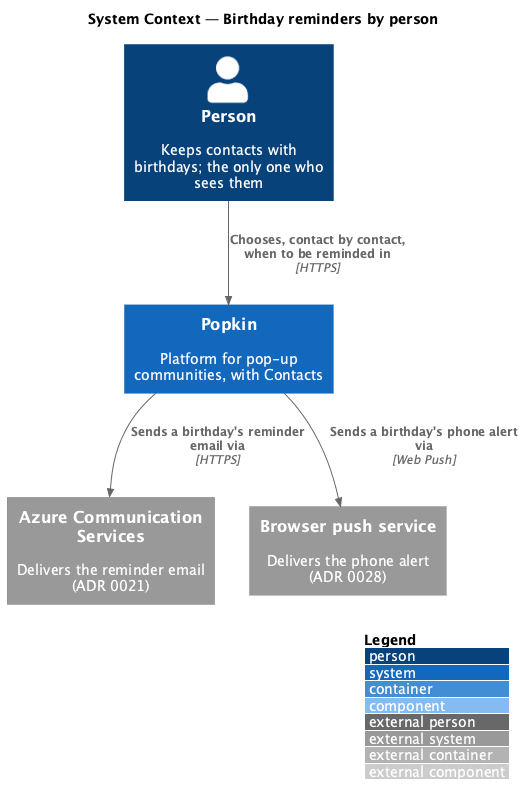
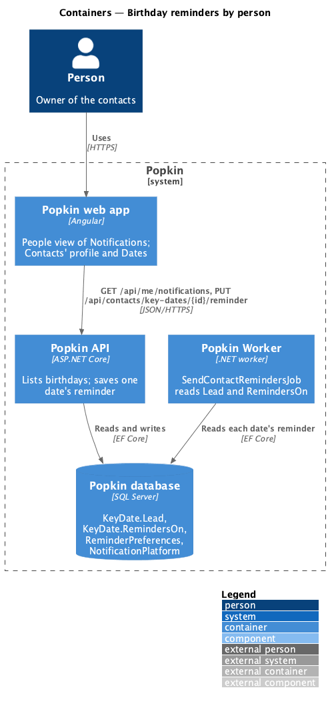
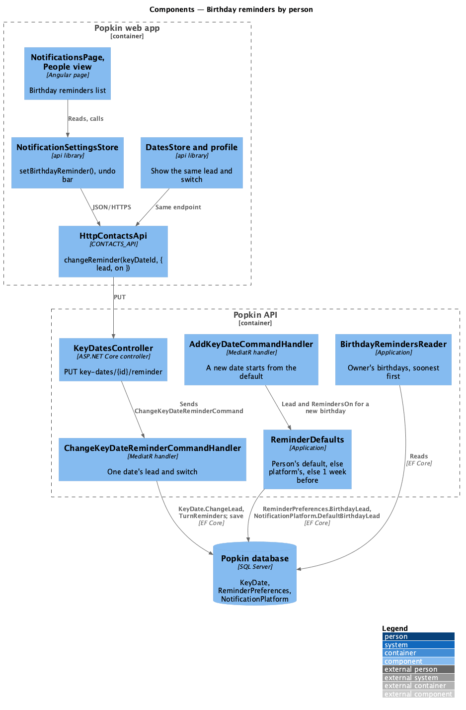
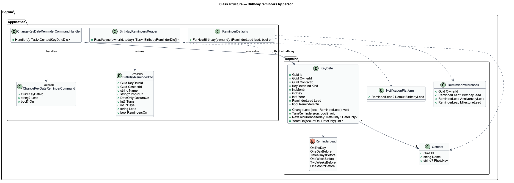
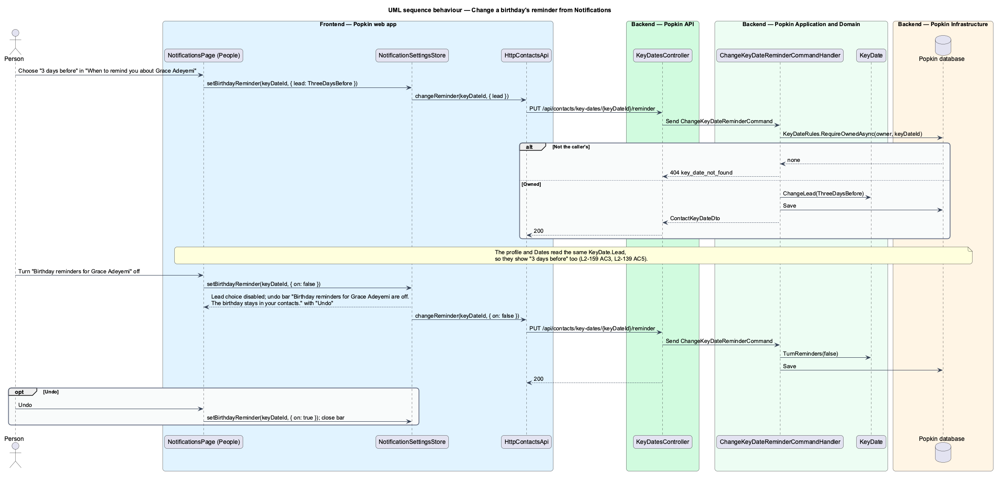
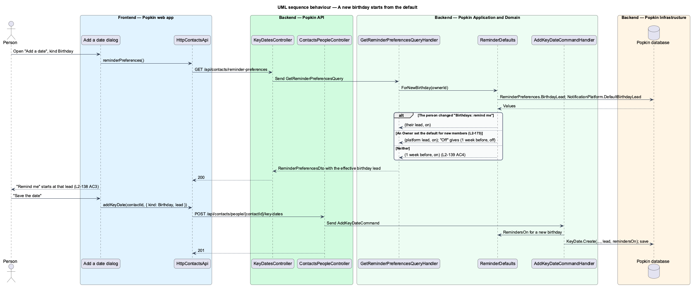

# Birthday reminders by person

## Overview

Contacts keeps the birthdays of a person's people, each with its own reminder
([Key dates](../../contacts/key-dates/README.md), L1-033). This feature shows those birthdays on
the "People" view of the Notifications screen (L1-040). There the person picks, contact by
contact, how early the reminder comes, or switches it off (L2-159). The lead time on this screen
and the lead time on the contact's date are one value, held by the `KeyDate`. A change in either
place shows in both (L2-139 AC5). The feature also sets where a new birthday's reminder starts:
from the person's own default, else the default for new members an Owner sets, else "1 week
before" (L2-139 AC4, L2-173).

The screen's frame belongs to [Notification settings](../notification-settings/README.md). Sending
the reminder on its day belongs to [Send reminders](../send-reminders/README.md), which reads the
same two fields.

- **birthday** — `KeyDate` whose `Kind` is `Birthday`, kept by its owner for one contact
- **lead time** — how long before the birthday its reminder comes: "On the day", "1 day before", "3 days before", "1 week before" or "2 weeks before" (`KeyDate.Lead`)
- **birthday's switch** — whether the birthday reminds at all (`KeyDate.RemindersOn`); off, the birthday stays in Contacts and nothing reminds of it
- **person's default** — "Birthdays: remind me" on Dates (`ReminderPreferences.BirthdayLead`), the lead time a new birthday starts at
- **default for new members** — the birthday lead an Owner sets in the admin app (`NotificationPlatform.DefaultBirthdayLead`), used until the person changes their own

Everything here is the owner's own Contacts data. Nothing is shown to another person or an admin,
and no contact is told (L2-122).

## Description

### Screens and states

- `docs/mocks/pages/notification-settings/people.html` — "Birthday reminders", "From the
  birthdays in your contacts. Pick how early, person by person.", then five rows, soonest first:
  photo or initials, the name, "Sat 19 Sep · turns 33 · in 7 days", a select of the five lead
  times, and a switch. Under them, "Show all 7 contacts with birthdays". "Muted people" follows
  ([Mute people](../mute-people/README.md)).
- `docs/mocks/pages/notification-settings/birthday-off.html` — Grace's switch off, her select
  disabled, and the undo bar "Birthday reminders for Grace Adeyemi are off. Her birthday stays in
  your contacts." with "Undo".

The specs stand where the mock differs, and the mock changes:

- The undo bar reads "Birthday reminders for {name} are off. The birthday stays in your
  contacts." (L2-159 AC5). A contact is named, never given a pronoun (L2-122 AC4).
- L2-159 AC1 lists five lead times. Dates and the profile offer six, with "1 month before"
  (L2-139 AC1). A birthday whose lead is "1 month before" shows that sixth option in its select,
  so the screen never shows a value it cannot hold. Whether the People view should offer it for
  every birthday is `<TO SUPPLY>`.
- The empty state "No birthdays yet. Add one to a contact and it shows here." (L2-159 AC6) is not
  drawn.
- L2-159 AC5 asks for the undo bar when a birthday's reminder is stopped from an email. The mock
  shows it on the screen too, and the design does the same when the switch is turned off here.

### API

The birthdays are read with the screen and changed through Contacts' own endpoint, so the lead
time has one writer.

- `GET /api/me/notifications` — its `birthdays` field: every birthday of the caller's contacts,
  soonest next occurrence first, as `BirthdayReminderDto` (`keyDateId`, `contactId`, `name`,
  `photoUrl`, `initials`, `occursOn`, `turns` when the year is known, `inDays`, `lead`,
  `remindersOn`). `birthdayCount` is their number. The list is empty when Contacts is switched off
  for the platform (`ContactsSwitch`), and the view then shows no "Birthday reminders" section.
- `PUT /api/contacts/key-dates/{keyDateId}/reminder` `{ lead?, on? }` — widened from `{ lead }`.
  `200` `ContactKeyDateDto`. `404` `key_date_not_found` for a date that is not the caller's.
  `400` `invalid_lead` for an unknown lead. A request with neither field is `400`
  `nothing_to_change`. Dates and the profile keep calling it with `lead` alone.
- `GET /api/contacts/reminder-preferences` — its `birthdayLead` is now the effective default
  (L2-139 AC4), and its `phoneNotifications` and `mondayEmail` are removed
  ([Send reminders](../send-reminders/README.md), L2-140 AC4).

### Backend

- **`KeyDate.RemindersOn`** — new column, true for every existing date. `TurnReminders(on)`. Turning
  it off keeps `Lead`, so turning it on brings back the lead time that was chosen.
- **`ChangeKeyDateReminderCommand(KeyDateId, Lead?, On?)`** — the existing handler gains `On`. It
  stays one load, one change and one save, guarded by `KeyDateRules.RequireOwnedAsync` and
  `ContactsSwitch.Require()`.
- **`ReminderPreferences.BirthdayLead`** — becomes nullable. Null means the person has never
  changed "Birthdays: remind me". Saving it on Dates sets it, as now.
- **`ReminderDefaults.ForNewBirthday(ownerId)`** (Application) — returns the lead and the switch
  a new birthday starts with:
  - the person's `BirthdayLead`, on, when it is set;
  - else `NotificationPlatform.DefaultBirthdayLead`, on, when it is set;
  - else, when an Owner set the default to "Off", "1 week before" and off;
  - else "1 week before", on (L2-139 AC4).

  `GetReminderPreferencesQueryHandler` and `AddKeyDateCommandHandler` use it. An anniversary and
  a milestone keep their own defaults, unchanged.
- **`BirthdayRemindersReader`** (Application) — the owner's birthdays with their contact, each
  next occurrence from `KeyDate.NextOccurrence` in the person's time zone
  (`NotificationPreferences.TimeZone`), `YearsOn` for "turns", and the days left. One query, no
  more than one row per key date.
- **Sending** — `SendContactRemindersCommandHandler` adds no reminder for a date whose
  `RemindersOn` is false, so nothing shows in Contacts and nothing is sent (L2-159 AC4). That
  change is designed in [Send reminders](../send-reminders/README.md).
- **Privacy** — no log, metric or span carries a contact's name, a date or the owner (L2-174 AC3).

### Frontend (Popkin web app)

- **People view** (`NotificationsPage`, `tab=people`) — `pk-undo-bar` when the banner is
  `birthdayOff`, then the section "Birthday reminders" with its sentence, a `pk-setting-list` of
  the first five birthdays, and "Show all {n} contacts with birthdays" (`pk-button` as a text
  button) when there are more than five. It shows the rest and moves focus to the sixth row
  (L2-159 AC2). With none, the section shows `pk-empty-state` with the words of AC6.
- **Each row** — `pk-avatar`, the name, the line "{weekday} {d} {month} · turns {n} · in {d} days"
  (or without "turns" when the year is unknown), a `pk-select-field` labelled "When to remind you
  about {name}", and a `pk-switch` labelled "Birthday reminders for {name}". The select is
  disabled while the switch is off (L2-159 AC4).
- **`NotificationSettingsStore.setBirthdayReminder(keyDateId, { lead?, on? })`** — calls
  `CONTACTS_API.changeReminder`, shows the change at once, raises the `birthdayOff` banner when
  `on` turns false, and puts the old values back with the toast "We couldn't save that. Try again."
  on failure. `undo()` for that banner turns the switch on again.
- **One value** — `DatesStore` and the profile read the date from the API when they open, so a
  change made here shows there, and the reverse (L2-159 AC3). No client cache spans the two.
- **Responsive** — below 576 px the select and the switch wrap onto a second line under the name.
  From 576 px they sit at the end of the row.

### Tests

- `ReminderDefaults.ForNewBirthday` direct test, one case per branch: the person's lead, the
  platform lead, the platform "Off", neither.
- API acceptance: `GET` lists the caller's birthdays soonest first and none of another person's;
  `PUT …/reminder` with `{ on: false }` then `GET` reads `remindersOn: false` with the lead kept;
  the same date read through `GET /api/contacts/dates` shows the same lead (L2-159 AC3); another
  person's date answers `404` `key_date_not_found`; a new birthday starts at the effective default
  (L2-139 AC4).
- Reminder acceptance through `SendContactRemindersCommand` with `FakeTimeProvider`: a date with
  `RemindersOn` false adds no reminder on its day (L2-159 AC4).
- `NotificationSettingsStore` unit spec: change, switch off with its banner, undo, revert.
- Playwright `tests/notification-settings.spec.ts` (`NotificationSettingsPage` page object): the
  People view, a lead changed, a switch off with "Undo", "Show all", and the empty state.

## Requirements

| L2 ID | Refines (L1) | Requirement |
|-------|--------------|-------------|
| `L2-159` | `L1-040` | Birthday reminders by person: A person sees and changes, contact by contact, when they are reminded of a birthday. (AC1–AC6) |
| `L2-139` | `L1-033` | Reminder defaults: Each date has its own reminder, starting from a default for its kind. (AC4, AC5) |

## Diagrams

### System context

A person sets each birthday's reminder in Popkin. Popkin later sends it by email and by phone
alert as their settings allow.

### Containers

The API reads and writes the lead time and the switch on the `KeyDate`. The Worker reads the
same two fields when the reminder day comes.

### Components

The Notifications screen and Contacts call one endpoint to change a date's reminder.
`ReminderDefaults` decides where a new birthday starts.

### Class structure

`KeyDate` holds the lead time and the switch. `ReminderDefaults` reads the person's default and
the platform's.

### Behaviour — change a birthday's reminder

A lead time chosen on the Notifications screen is saved on the `KeyDate`, so the profile and Dates
show it too. Switching it off keeps the lead time, disables the select and offers "Undo".

### Behaviour — a new birthday's default

Add a date reads the effective default and starts "Remind me" there. The new `KeyDate` keeps that
lead time and switch.

