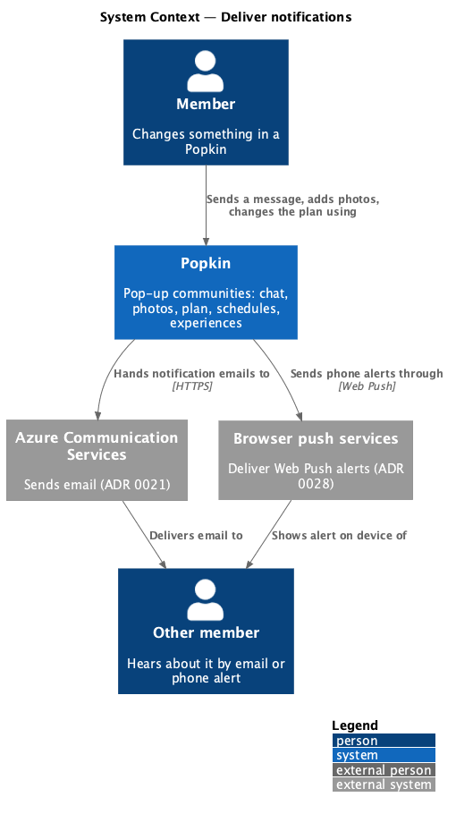
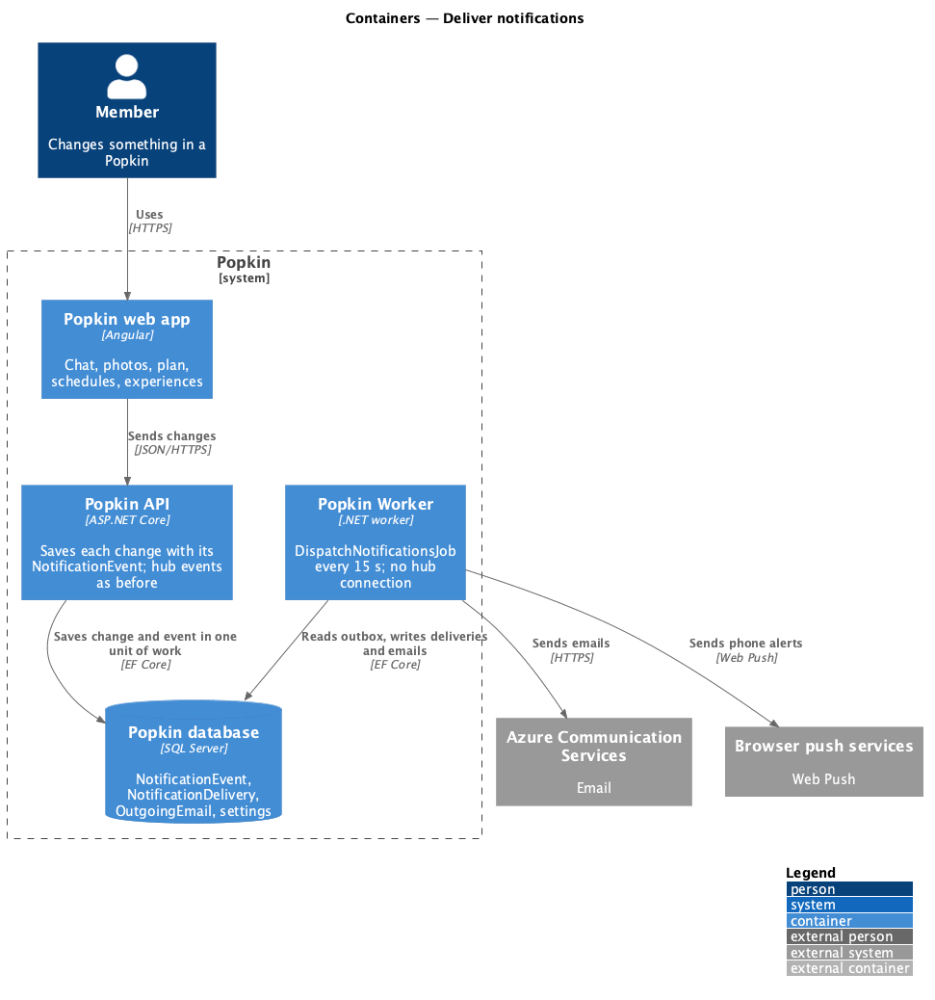
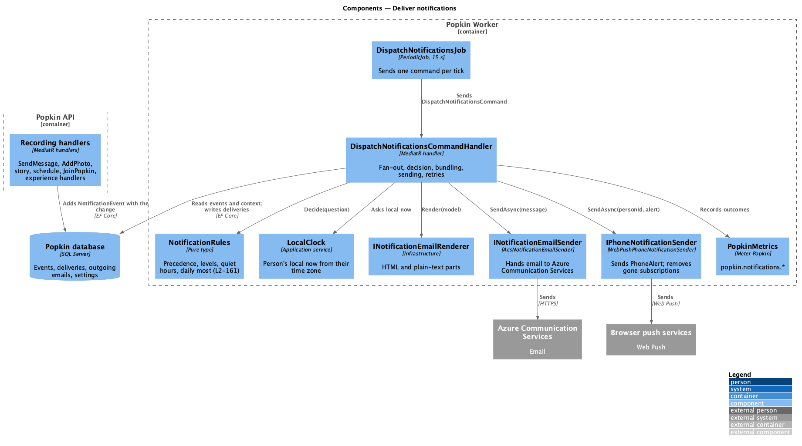
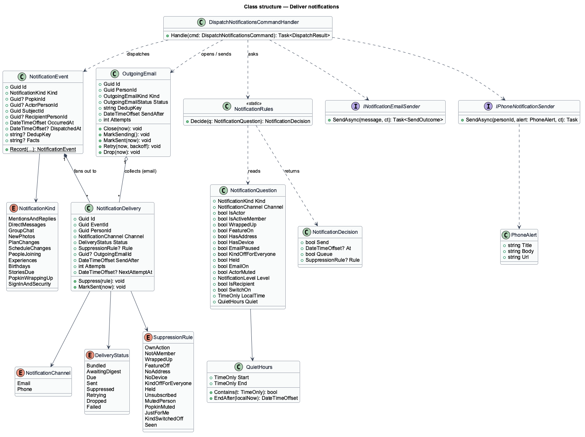
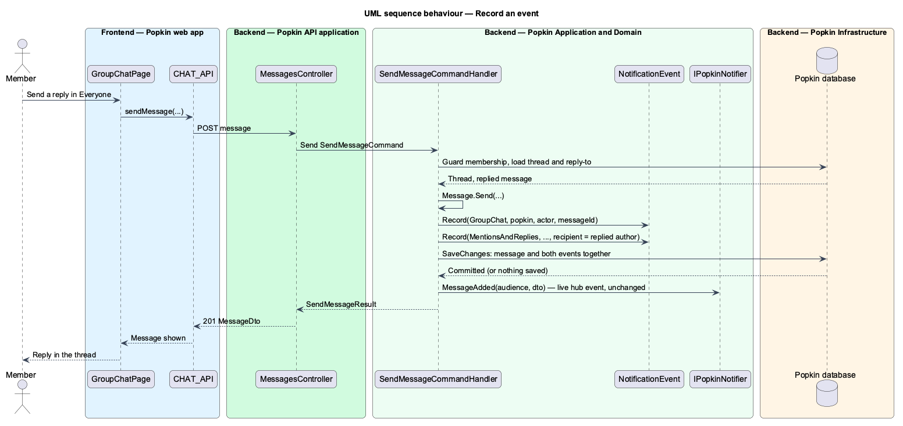
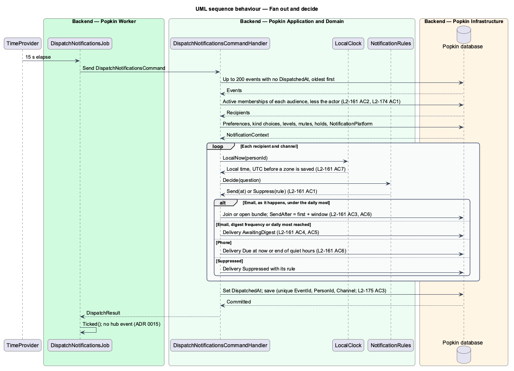
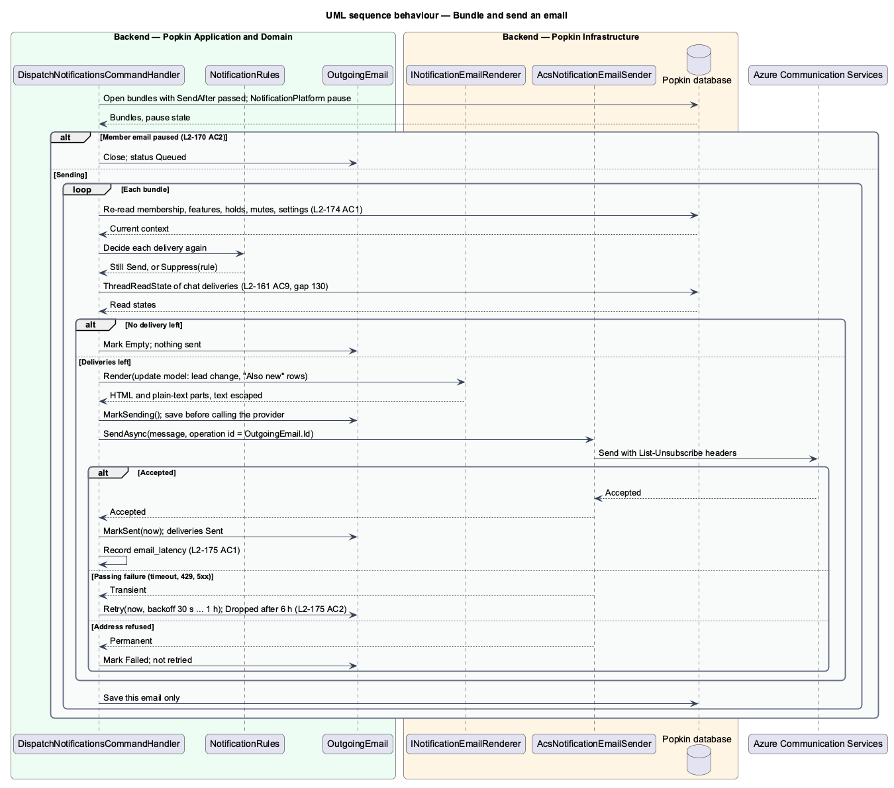
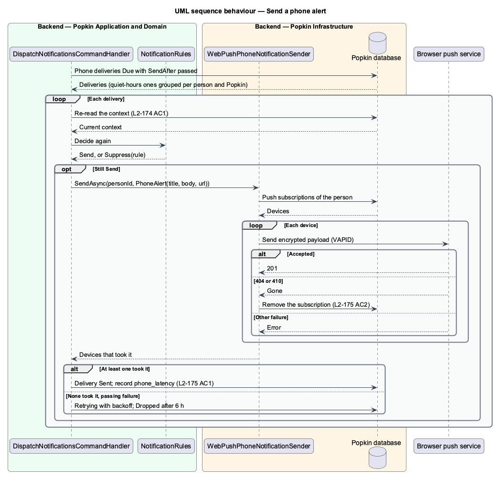

# Deliver notifications

## Overview

A person hears about what happens in their Popkins by email and by phone alert, only as their
settings allow (L1-040). This feature is the path between a change and its notification. It
records what happened, decides who hears of it, when and on which channel, and sends it once.
It owns the rules of L2-161, the privacy rules of L2-174 and the speed and reliability budgets
of L2-175. The settings screens ([Notification settings](../notification-settings/README.md),
[Each Popkin's level](../popkin-levels/README.md), [Mute people](../mute-people/README.md)) write
what this feature reads. The emails it sends are drawn by
[Popkin update email](../popkin-update-email/README.md), [Digest emails](../digest-emails/README.md)
and [Send reminders](../send-reminders/README.md).

The Popkin API records each change as an outbox row in the same unit of work as the change. The
Popkin Worker reads the outbox every 15 seconds, fans each change out to its recipients, applies
the rules and sends. The Worker holds no hub connection and sends no hub events
([ADR 0015](../../../adr/0015-the-worker-sends-no-hub-events.md)). The live hub events of
`IPopkinNotifier` are unchanged and independent of this path.

- **notification event** — `NotificationEvent` row recording one change that may notify, holding ids only
- **audience** — set of people an event may reach, decided by the handler that records it
- **delivery** — `NotificationDelivery` row for one event, one recipient and one channel, with its outcome
- **outgoing email** — `OutgoingEmail` row for one email to one person: an update, a digest or a reminder
- **bundle** — outgoing email of kind `Update` that collects every email delivery of one person within the bundling window
- **bundling window** — interval after a person's first pending change during which further changes join the same email (10 minutes by default, L2-173)
- **daily most** — largest number of activity emails sent to one person between midnight and midnight where they are (12 by default)
- **quiet hours** — interval in each person's own time zone during which no activity email or phone alert is sent (21:00 to 08:00 by default)
- **suppression** — decision not to send a delivery, recorded with the rule that made it
- **send-time recheck** — second evaluation of the rules immediately before a delivery is handed to a provider

Sign-in codes never pass through this feature. They keep their own path (`ICodeSender`), so no
setting, hold, pause or failure here can stop them (L2-154 AC2, L2-161 AC1).

## Description

### Screens and states

This feature has no screen of its own. The Notifications screen (`/account/notifications`,
`docs/mocks/pages/notification-settings/`) is designed in
[Notification settings](../notification-settings/README.md). The emails are drawn under
`docs/mocks/notifications/email-*/` and designed in their own features.

### What records an event

Each handler below adds one `NotificationEvent` beside its change and saves both with one
`SaveChangesAsync`. The handler decides the audience, as it already does for `Audience`; the
dispatcher only carries it out.

| Handler (`Popkin.Application`) | Kind | Audience | `RecipientPersonId` |
|---|---|---|---|
| `SendMessageCommandHandler`, Everyone thread | `GroupChat` | Active members but the author | — |
| `SendMessageCommandHandler`, reply to another member's message | `MentionsAndReplies` | That message's author | The author |
| `SendMessageCommandHandler`, direct message | `DirectMessages` | The other member of the thread only (L2-174 AC2) | The other member |
| `AddPhotoCommandHandler` | `NewPhotos` | Active members but the uploader | — |
| `AddStoryCommandHandler`, `SaveStoryCommandHandler`, `MoveStoryCommandHandler`, `DeleteStoryCommandHandler` | `PlanChanges` | Active members but the actor | The new owner, when the change gives the story to someone else |
| `SetTimeOffCommandHandler`, `SetWorkingHoursCommandHandler`, `SetEventCommandHandler`, `RemoveEventCommandHandler` | `ScheduleChanges` | Active members but the actor | — |
| `JoinPopkinCommandHandler` | `PeopleJoining` | Active members but the one who joined | — |
| `ShareExperienceCommandHandler`, `RateExperienceCommandHandler`, `CommentOnExperienceCommandHandler` | `Experiences` | Active members but the actor | — |

`SubjectId` is the message, the photo, the story, the experience or the new membership. Time
off and working hours have no row of their own to point at, so a schedule event's subject is the
member's membership, or the Popkin for its event; the email reads that member's week.

A reply in Everyone records two events: `GroupChat` for the Popkin and `MentionsAndReplies` for
the author of the message replied to. Fan-out gives the author the more specific event only, so
one message never reaches one person twice. Chat has no @mention: no requirement or mock defines
how a mention is written or recognised. `MentionsAndReplies` therefore comes from replies alone
until mentions are specified (`<TO SUPPLY>`).

Reactions, keen, photo comments and deletions record no event; L2-154 names no kind for them.
The reminder kinds (`Birthdays`, `StoriesDue`, `PopkinWrappingUp`) are recorded by
[Send reminders](../send-reminders/README.md), which reuses the deliveries, the rules and the
senders of this feature.

### Fan-out and decision

`DispatchNotificationsCommandHandler` (`Popkin.Application/Notifications/`) runs on every tick of
`DispatchNotificationsJob`.

1. It reads up to 200 `NotificationEvent` rows with no `DispatchedAt`, oldest first.
2. It resolves each audience to the active memberships of the Popkin at that moment, less the
   actor (L2-161 AC2). A person who left, was removed or deleted their account is not in it
   (L2-174 AC1).
3. It loads one `NotificationContext` for the people concerned: their `NotificationPreferences`,
   `NotificationKindChoice` rows, `Membership.NotificationLevel`, `PersonMute` rows, holds,
   suspensions and deletions, the `PlatformSnapshot` (kinds off for everyone, defaults, feature
   switches) and the `NotificationPlatform` row read from the database for the pause.
4. For each recipient and each channel (`Email`, `Phone`) it calls `NotificationRules.Decide`
   and writes one `NotificationDelivery` with the outcome. The unique key (`EventId`, `PersonId`,
   `Channel`) makes a second tick over the same event add nothing (L2-175 AC3).
5. It sets `DispatchedAt` on the event and saves.

An email delivery is placed according to the person's frequency:

- **As it happens** — it joins the person's open bundle, or opens one whose `SendAfter` is the
  first delivery's time plus the bundling window (L2-161 AC3). When the person has reached the
  daily most, the delivery is marked `AwaitingDigest` instead and rides in the 6 pm digest
  (L2-161 AC4).
- **Daily digest** or **Weekly digest** — it is marked `AwaitingDigest`; [Digest emails](../digest-emails/README.md)
  collects it (L2-161 AC5).

A phone delivery is marked `Due` with `SendAfter` set to now, or to the end of quiet hours when
now falls inside them (L2-161 AC6). It is never bundled.

### The rules

`NotificationRules` (`Popkin.Application/Notifications/`) is a pure, static type: given a
`NotificationQuestion` it returns a `NotificationDecision`, `Send(at)` or `Suppress(rule)`. It
reads no database and no clock; the handler passes the person's local time. It is tested one
case per row of the table below (ADR 0010: the clock is passed, never read).

The first rule that applies stops the delivery. Rows 1 to 6 come before the precedence of
L2-161 AC1, because they make a notification impossible or meaningless rather than unwanted.

| # | Rule | Channel | Outcome when it applies | Source |
|---|---|---|---|---|
| 1 | The recipient is the actor | Both | `Suppress(OwnAction)` | L2-161 AC2 |
| 2 | The recipient is no longer an active member, or the account is deleted | Both | `Suppress(NotAMember)` | L2-174 AC1 |
| 3 | The Popkin has wrapped up | Both | `Suppress(WrappedUp)` | L2-158 AC5 |
| 4 | The kind's feature (Plan, Schedules) is off for the Popkin | Both | `Suppress(FeatureOff)` | L2-154 AC4 |
| 5 | The account has no email address | Email | `Suppress(NoAddress)` | L2-161 AC8 |
| 6 | The person has no push subscription | Phone | `Suppress(NoDevice)` | L2-161 AC8 |
| 7 | All member email is paused | Email | `Queue` (held, not suppressed; see Pause) | L2-161 AC1, L2-170 |
| 8 | The kind is off for everyone | Both | `Suppress(KindOffForEveryone)` | L2-171 AC2 |
| 9 | The Popkin is held, the person is held, suspended or being deleted | Both | `Suppress(Held)` | L2-172 AC3, AC5 |
| 10 | The person turned "Email" off | Email | `Suppress(Unsubscribed)` | L2-156 AC3 |
| 11 | The actor is muted by the person | Both | `Suppress(MutedPerson)` | L2-160 AC3 |
| 12 | Level "Muted" and the kind is an activity kind | Both | `Suppress(PopkinMuted)` | L2-158 AC3 |
| 13 | Level "Just for me" and the kind is `GroupChat`, `NewPhotos`, `ScheduleChanges`, `PeopleJoining`, `Experiences`, or `PlanChanges` without the person as `RecipientPersonId` | Both | `Suppress(JustForMe)` | L2-158 AC2 |
| 14 | The person's switch for the kind and channel is off, after the default is applied | Both | `Suppress(KindSwitchedOff)` | L2-157 AC3 |
| 15 | Local time inside quiet hours | Phone | `Send(at end of quiet hours)` | L2-161 AC6 |
| 16 | Local time inside quiet hours | Email | `Send` into a bundle whose `SendAfter` is no earlier than the end of quiet hours | L2-161 AC6 |
| 17 | None of the above | Both | `Send(now)` | L2-161 |

A person's switch is their `NotificationKindChoice` value when one exists. Otherwise it is the
catalogue default of L2-154; the defaults for new members (L2-173) do not set a kind's switches. A required kind
never reaches the rules.

### Bundles and sending

On each tick, after fan-out, the handler sends what is due.

- **Email.** For each `OutgoingEmail` of kind `Update` whose `SendAfter` has passed and whose
  status is `Open`, it closes the bundle and runs the send-time recheck on each delivery. A
  delivery that no longer passes is marked `Suppressed` with its rule (L2-174 AC1). A chat
  delivery whose message the person has read since is suppressed with `Seen`: its
  `ThreadReadState.LastReadSentAt` is at or after the message's sent time (L2-161 AC9). Only
  chat has a read state; photos, stories and joining are always sent (known gap 130). When no
  delivery is left, the email is marked `Empty` and nothing is sent. Otherwise
  `INotificationEmailRenderer` builds the email from the deliveries
  ([Popkin update email](../popkin-update-email/README.md)), `INotificationEmailSender` hands it
  to Azure Communication Services, and the email is marked `Sent`.
- **Phone.** For each `NotificationDelivery` on `Phone` that is `Due` with `SendAfter` passed, it
  runs the recheck and calls `IPhoneNotificationSender.SendAsync(personId, PhoneAlert)`.
  Deliveries deferred by quiet hours for one person and one Popkin are sent as one alert at the
  end of quiet hours.

  An alert's title is the Popkin's name and its line says who did what, never what they wrote
  (it shows on a locked phone, L2-174 AC3): "Joel replied to you", "Joel sent you a message",
  "Joel wrote in Everyone", "Joel added photos", "Joel changed the plan", "Joel changed the
  schedule", "Joel joined", "Joel added to Experiences" (`PhoneAlerts`). It opens the
  conversation for a message (`/p/{popkinId}/chat/everyone`, or `/p/{popkinId}/chat/{memberId}`
  for a direct message) and the Popkin's home otherwise. The alerts deferred by quiet hours for
  one Popkin go as one, whose line is "{n} new things while you were away".

The `DedupKey` of an update email is `update:{OutgoingEmail.Id}`. The email is marked `Sending`
and saved before the provider is called. Its id is passed to Azure Communication Services as the
operation id, so a retry after a lost answer does not send it twice. Whether the .NET SDK
exposes the operation id on `EmailClient.SendAsync` is `<TO SUPPLY>`; without it, a crash
between the provider accepting and the save can send one email twice.

### Pause

When `NotificationPlatform.EmailPausedAt` is set, no outgoing email is handed to the provider.
Bundles keep their deliveries, close, and wait as `Queued` in the order they were due (L2-170
AC2). Phone alerts are not paused. On resume, the next tick sends the queued emails oldest first.
An email due more than 6 hours before the resume is marked `Dropped` and counted (L2-170 AC3).
The pause controls are designed in [Member email and notification kinds](../../admin-platform/notifications/README.md).

### Failures and retries

- **A passing failure** (a timeout, `429`, a `5xx`, a provider outage): the email or phone
  delivery is marked `Retrying`, its `Attempts` goes up, and `NextAttemptAt` follows the backoff
  30 s, 2 min, 10 min, 30 min, 1 h, then each hour. Six hours after it first fell due it is
  marked `Dropped` and counted with outcome `dropped` (L2-175 AC2).
- **A permanent failure** (the provider refuses the address): the email is marked `Failed` and is
  not retried.
- **A gone push subscription:** the push service answers `404` or `410`, and
  `WebPushPhoneNotificationSender` removes the subscription, as it does for reminders today
  (L2-175 AC2).
- **A hard bounce** is reported after acceptance, not at send time. Azure Communication Services
  keeps its own suppression list. How Popkin learns of a bounce for the bounce rate is known
  gap 129.
- **One failure stops one email.** Each outgoing email and each phone delivery is saved on its
  own, so a failure leaves the rest of the tick to run.

### API

This feature adds no endpoint of its own. It sets the rules every notification endpoint follows:

- Every settings endpoint reads and writes only the signed-in person's rows. A membership,
  Popkin or person that is not theirs answers `404` (`popkin_not_found` or `person_not_found`);
  with no session, `401` (L2-174 AC4). The one anonymous endpoint is the one-click unsubscribe
  ([Unsubscribe](../unsubscribe/README.md)).
- A value outside the catalogue (an unknown kind, level, frequency or lead time) answers `400`
  ProblemDetails with `code` `invalid_kind`, `invalid_level`, `invalid_frequency` or
  `invalid_lead`, and nothing changes (L2-174 AC5).
  Switching off a required kind answers `400` `notification_required` (L2-154 AC2).

### Backend

- **`NotificationKind`**, **`NotificationGroup`**, **`NotificationChannel`** (Domain, enums) and
  **`NotificationCatalogue`** (Domain) — as in the shared architecture
  ([Notifications](../../README.md#notifications)).
- **`NotificationEvent`** (Domain, new table) — `Id`, `Kind`, `PopkinId?`, `ActorPersonId?`,
  `SubjectId`, `RecipientPersonId?`, `OccurredAt`, `DispatchedAt?`, `DedupKey?` and `Facts?`;
  `Record(kind, popkinId, actor, subject, recipient, now, dedupKey, facts)`. Index on
  `DispatchedAt` where null; unique filtered index on `DedupKey` where not null, so a reminder
  job run twice records one event ([Send reminders](../send-reminders/README.md)). `Facts` is a
  small JSON object of ids, dates and enum values that the change alone knows, such as a story's
  old and new due date, column and owner ([Popkin update email](../popkin-update-email/README.md));
  it never holds text a member wrote.
- **`NotificationDelivery`** (Domain, new table) — `Id`, `EventId`, `PersonId`, `Channel`,
  `Status` (`Bundled`, `AwaitingDigest`, `Due`, `Sent`, `Suppressed`, `Retrying`, `Dropped`,
  `Failed`), `Rule?` (`SuppressionRule`), `OutgoingEmailId?`, `SendAfter`, `Attempts`,
  `NextAttemptAt?`, `SentAt?`. Unique (`EventId`, `PersonId`, `Channel`).
- **`OutgoingEmail`** (Domain, new table `OutgoingEmails`) — the one shape every email design
  uses: `Id`, `PersonId`, `Kind` (`NotificationEmailKind`: `Update`, `DailyDigest`,
  `WeeklyDigest`, `KeyDateReminder`, `StoryDue`, `WrapUp`), `PopkinId?`, `DedupKey` (unique),
  `Status` (`Open`, `Queued`, `Sending`, `Sent`, `Suppressed`, `Retrying`, `Dropped`, `Failed`),
  `SuppressedBy?` (`SuppressionRule`, set with `Suppressed`, e.g. `nothing_new` for an email left
  with nothing to say), `OpenedAt`, `SendAfter` (when it is due), `Attempts`, `NextAttemptAt?`,
  `SentAt?` and `ProviderMessageId?`; `Close(now)`, `Queue()`, `MarkSending()`,
  `MarkSent(now, providerMessageId)`, `Suppress(rule)`, `Retry(now, backoff)`, `Drop(now)`. An
  email that is due while member email is paused is `Queued`.
- **`NotificationRules`**, **`NotificationQuestion`**, **`NotificationDecision`**,
  **`SuppressionRule`** (Application) — the table above.
- **`QuietHours`** (Application, pure) — `Contains(localTime)`, `EndAfter(localNow)`; a window
  that crosses midnight is handled.
- **`LocalClock`** (Application) — the person's local now from `NotificationPreferences.TimeZone`,
  or UTC before one is saved (L2-161 AC7); an unknown zone falls back to UTC.
- **`DispatchNotificationsCommand`** / **`DispatchNotificationsCommandHandler`** — fan-out,
  decision and sending, as above.
- **`DispatchNotificationsJob`** (`Popkin.Worker/Jobs/`) — `PeriodicJob<DispatchResult>` every
  15 seconds whose command is `DispatchNotificationsCommand`, registered in `Program.cs` beside
  `SendContactRemindersJob`.
- **`INotificationEmailSender`** (Application) — `SendAsync(OutgoingEmailMessage, CancellationToken)`
  returns `Accepted`, `Transient` or `Permanent`. `AcsNotificationEmailSender` (Infrastructure)
  sends HTML and plain text with the `List-Unsubscribe` headers of [Unsubscribe](../unsubscribe/README.md),
  from `Notifications:EmailSender`, through the `EmailClient` the codes use. `NoNotificationEmailSender`
  sends nothing when `Communication:Endpoint` or `Notifications:EmailSender` is missing and answers
  `Permanent("not_configured")`, so the email is marked `Failed` and never retried. Without
  `Email:PostalAddress` the same sender is used: no notification email goes out without the
  footer's postal address (L2-163 AC5).
- **`IPhoneNotificationSender`** (Application) — widened from `PhoneReminder` to
  `PhoneAlert(Title, Body, Url)`; `WebPushPhoneNotificationSender` keeps its removal of gone
  subscriptions and returns how many devices took the alert.
- **`PurgeNotificationHistoryJob`** (Worker) — removes events, deliveries and outgoing emails
  older than `<TO SUPPLY>` days. No requirement sets the retention.
- **Telemetry** (`PopkinMetrics`, meter `Popkin`): `popkin.notifications.events` by `kind`;
  `popkin.notifications.deliveries` by `kind`, `channel` and `outcome`;
  `popkin.notifications.suppressed` by `rule`; `popkin.notifications.email_latency` (seconds from
  the window closing to the provider accepting) and `popkin.notifications.phone_latency` (seconds
  from the event to the push service accepting). Logs carry an `OutgoingEmail.Id` at most. No
  log, dimension or span carries a person, an address, a name, message text, a caption, a token
  or a link (L2-174 AC3, ADR 0012).

### Settings (for `docs/deployment.md`, ADR 0013)

| Setting | Container | When missing |
|---|---|---|
| `Notifications:EmailSender` | Worker | No notification email is sent; deliveries are marked sent. The address on `popkin.community`, `<TO SUPPLY>` (for example `notify@popkin.community`) |
| `Email:PostalAddress` | Worker | No notification email is sent, since the footer must carry a postal address (L2-163 AC5) |
| `Communication:Endpoint`, `Communication:ClientId` | Worker | As for codes: no email is sent |
| `Push:PublicKey`, `Push:PrivateKey`, `Push:Subject` | API, Worker | No phone alert is sent (ADR 0028) |
| `Addresses:BaseDomain` | Worker | Links in emails cannot be built; the Worker shall not start |
| `DataProtection:*` | API, Worker | See [Unsubscribe](../unsubscribe/README.md) |

### Performance

- **Email.** A bundle closes when its window ends and is sent on the next tick, at most 15 s
  later. The median from window close to the provider accepting is 60 s or less, and 95 in 100
  are within 5 minutes (L2-175 AC1). `popkin.notifications.email_latency` measures it.
- **Phone.** A phone alert waits for the next tick: 7.5 s at the median with a 15 s period, plus
  the push service's answer. L2-175 AC1 asks for 10 s at the median. That leaves about 2.5 s for
  the push call, which `popkin.notifications.phone_latency` measures. A shorter period for phone
  alerts may be needed (`<TO SUPPLY>`).
- **A tick** reads at most 200 events and sends what is due. The queries use the index on
  `NotificationEvent.DispatchedAt`, and on `OutgoingEmail` (`Status`, `SendAfter`).

### Tests

- `NotificationRules`: one test per row of the rules table and per row of L2-158's levels, with
  the person's switch from a choice, from the platform default and from the catalogue default.
  `QuietHours` across midnight. `LocalClock` with a zone, without one and with an unknown one.
- `DispatchNotificationsCommandHandler` on InMemory with `FakeTimeProvider`, one case per
  behaviour:
  - an event fans out to every active member but the actor;
  - a reply reaches its author once;
  - a direct message reaches the other member only;
  - a second tick adds no delivery;
  - a bundle collects three changes and sends one email when the window ends;
  - the thirteenth email of the day waits for the digest;
  - a change at 22:00 sends at 08:00;
  - a message read before the window ends is not emailed;
  - a member who left in the window is not emailed;
  - pause queues email and leaves phone alerts;
  - resume drops what is over 6 hours;
  - a transient failure retries on the backoff and drops at 6 hours;
  - a permanent failure is not retried;
  - a sender that throws stops one email only.

  No test sleeps; the clock is advanced (ADR 0010).
- Each recording handler: its acceptance test through the API asserts the `NotificationEvent` it
  adds (kind, audience, recipient), and asserts that a failed change adds none.
- `JobTests` (Worker): advancing the clock by 15 s sends one `DispatchNotificationsCommand`.
- API acceptance for L2-174 AC4 and AC5: another person's membership answers `404`, no session
  answers `401`, an unknown kind answers `400` with its code.
- Telemetry test: a sent and a suppressed delivery record their counters with no person or
  address among the tags.

## Requirements

| L2 ID | Refines (L1) | Requirement |
|-------|--------------|-------------|
| `L2-161` | `L1-040` | When notifications are sent: One set of rules decides whether a notification is sent and when. (AC1–AC9) |
| `L2-174` | `L1-040` | Notification privacy and security: A notification tells a person only what they are allowed to see, and nothing about it leaks. (AC1–AC6) |
| `L2-175` | `L1-040` | Notification speed and reliability: Notifications arrive promptly and only once. (AC1–AC6) |

## Diagrams

### System context

A member's change in Popkin reaches other members by email through Azure Communication Services
and by phone alert through the browsers' push services.

### Containers

The API writes the change and its notification event together; the Worker reads the outbox,
decides and sends. No hub event joins the two.

### Components

The recording handlers add events; `DispatchNotificationsCommandHandler` asks
`NotificationRules` about each recipient and channel, and sends through the two senders.

### Class structure

An event has many deliveries; an outgoing email collects the email deliveries of one person.

### Behaviour

A handler saves its change and its notification event in one unit of work, then sends the live
hub event as before.

On each tick the dispatcher fans new events out and records one decision per recipient and
channel.

When a bundle's window ends, the dispatcher checks each delivery again, builds one email and
sends it, retrying a passing failure.

A phone alert is checked again and sent to each device; a gone subscription is removed.

