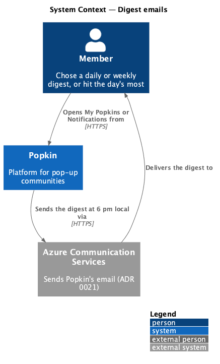
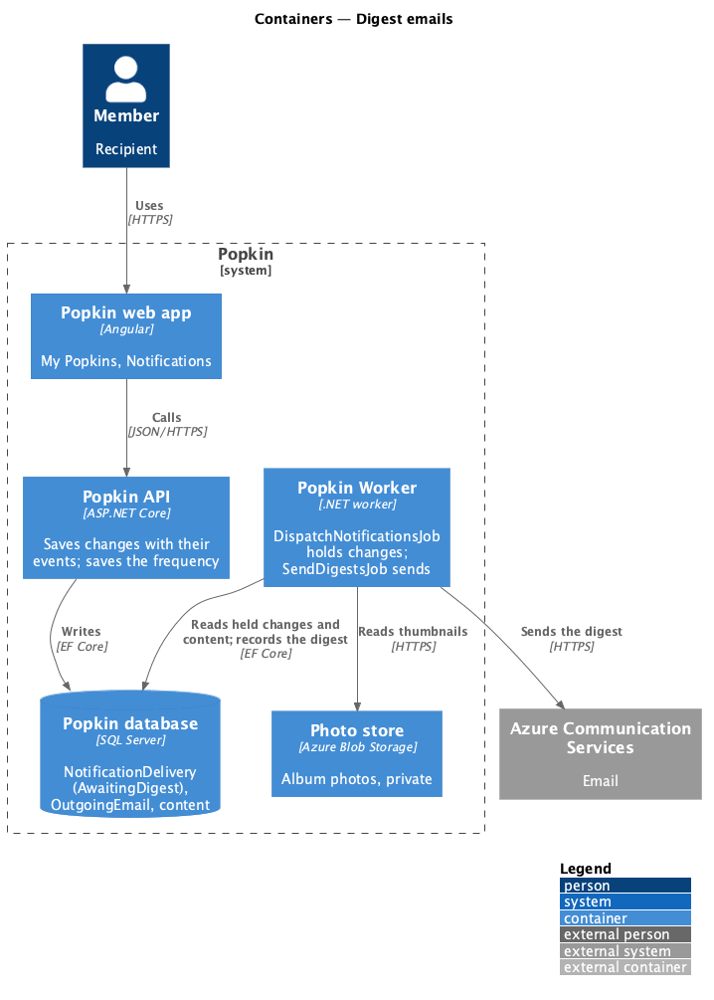
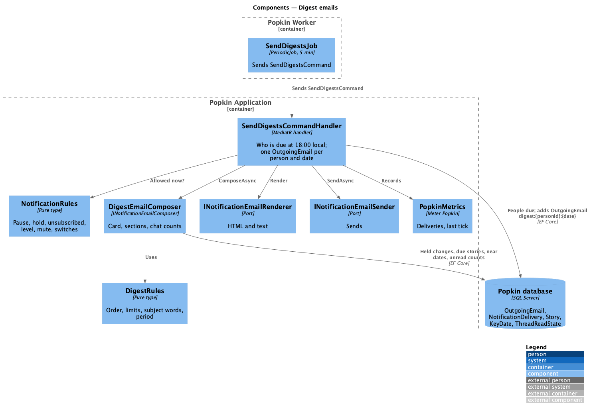
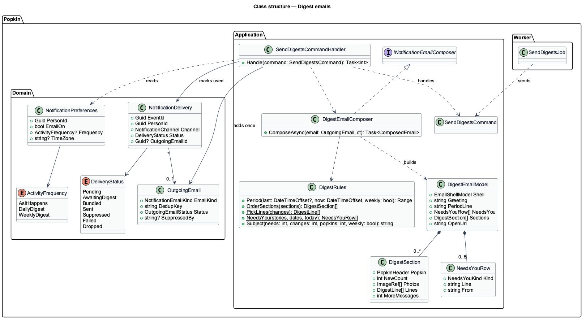
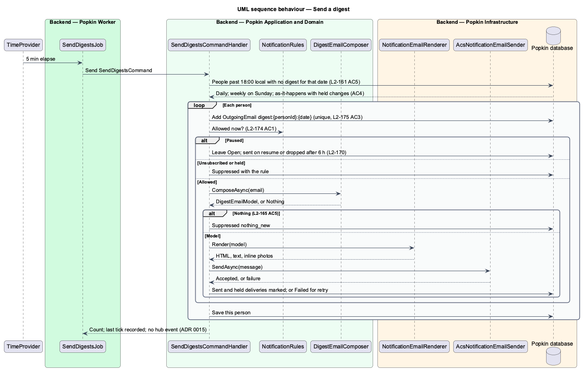
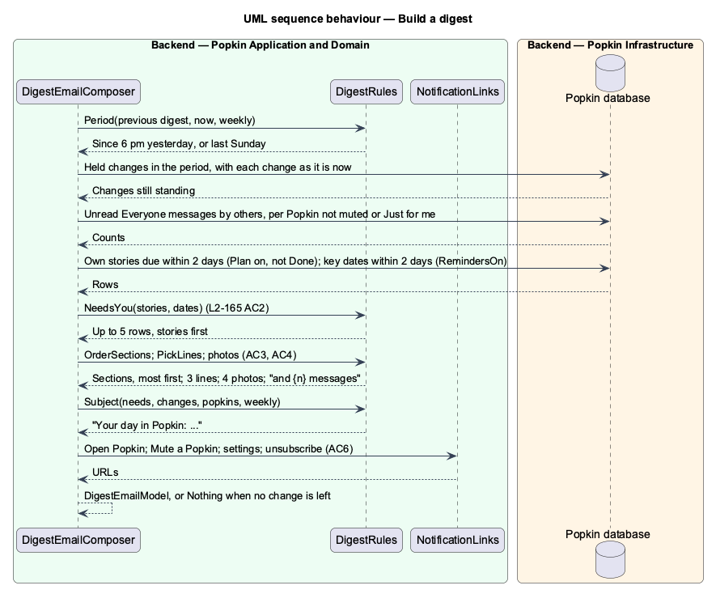

# Digest emails

## Overview

Not everyone wants an email per change. A person who chooses "Daily digest" or "Weekly digest"
for activity email (L2-156) gets one email that gathers what happened in all their Popkins: every
evening at 6 pm, or on Sunday at 6 pm (L2-161 AC5, L2-165). A person on "As it happens" who has
already had the day's most activity emails gets the rest in the same 6 pm digest (L2-161 AC4).
Reminders never wait for a digest; they go at their own time
([Send reminders](../send-reminders/README.md)).

The digest uses the email shell of [Popkin update email](../popkin-update-email/README.md):
envelope, header, one 600 px column, plain-text part and footer. [Deliver
notifications](../deliver-notifications/README.md) decides, change by change, what a person may
hear of. A change meant for a digest is held as a `NotificationDelivery` with the status
`AwaitingDigest`. This feature gathers those deliveries at the person's 6 pm, reads each change as
it is now, and sends one email, once.

- **digest** — activity email that gathers a person's held changes since the previous digest
- **daily digest** — digest sent every day at 6 pm where the person is
- **weekly digest** — digest sent on Sunday at 6 pm where the person is, gathering the week
- **digest period** — interval a digest covers: since the previous digest sent, or 24 hours (7 days for a weekly) when there is none
- **held change** — `NotificationDelivery` on the email channel whose status is `AwaitingDigest`
- **things that need the person** — stories the person owns that are due within two days, and the person's own reminders that fall within two days

## Description

### Emails and states

`docs/mocks/notifications/email-daily-digest/` (manifest id `email-daily-digest`):

- `needs-you.html` — subject "Your day in Popkin: 3 things need you", from "Popkin", sent at
  18:00. It opens "Evening, Mara" and "Everything since 6 pm yesterday", then the coral card "3
  things need you", one row each with an icon, a line and where it is from. Then one section per
  Popkin, most first: tile, name, "{n} new", up to four photos, up to three lines, and "and {n}
  messages in the chat". It ends with "Open Popkin" and the footer "You're getting one digest a
  day at 6 pm instead of an email per change. Reminders still arrive on time." with "Mute a
  Popkin" · "Notification settings" · "Unsubscribe from all email" (L2-165 AC1 to AC4, AC6).
- `quiet.html` — nothing needs the person: no card, and the subject reads "Your day in Popkin:
  23 new things across 3 Popkins" (L2-165 AC2).
- No mock draws the weekly digest. It is the daily digest with "Your week in Popkin", "Everything
  since last Sunday" and the weekly footer (L2-165 AC1, AC6).

### Where the mocks and the requirements differ

1. **Sender.** `notify@popk.in` in the mocks. The sender is on `popkin.community`, as in
   [Popkin update email](../popkin-update-email/README.md).
2. **"Are you in for the sunrise canoe?"** ("Sun 8:30 · 8 going, sign-up closes tonight") is an
   event with a sign-up. Popkin has none (gap 123), so the card holds stories and reminders only.
3. **"Grace's birthday is next Saturday"** falls more than two days ahead. The card lists
   reminders within two days (L2-165 AC2). A birthday further off reaches the person by its own
   reminder email on its reminder day.
4. **"Ellie moved the canoe from 7:00 to 8:30"** gives a story a time; a story has a due date
   only. The line names the story and its new column, owner or due date.
5. **"Sam is away Fri–Sun"** is a schedule change. It stays, as a line of "Schedule changes"
   when that kind is on for the person.

### What a digest holds (L2-165)

- **Who gets one.** At each tick the handler takes the people whose local time has passed 18:00
  today and who have no digest for that date yet:
  - every person whose activity email frequency is "Daily digest";
  - on a Sunday, every person on "Weekly digest";
  - any person on "As it happens" with held changes, which the daily most pushed into the digest
    (L2-161 AC4).

  The frequency is the person's own choice, or the default of
  [Notification defaults](../../admin-platform/notification-defaults/README.md) when they have
  made none.
- **Once only.** The digest's `OutgoingEmail` takes the `DedupKey` `digest:{personId}:{date}`,
  where the date is the person's local date (the Sunday for a weekly digest). A second tick, or a
  frequency changed on the same day, finds the row and sends nothing more (L2-175 AC3).
- **What it gathers.** The person's held changes whose `OccurredAt` falls in the digest period.
  Each change is read as it is now, and a change that no longer stands is dropped, as in a
  Popkin update. The rules are read again first (L2-174 AC1). A Popkin the person has left, one
  now muted, one held, or a kind now off for everyone loses its changes.
- **Nothing new, nothing sent** (L2-165 AC5). When no change is left, the row is marked
  `Suppressed` with `nothing_new`, so the next tick does not try again that day. The card alone
  does not make a digest: things that need the person are reminders' business.
- **The card** "{n} things need you" (AC2). It is gathered only for a digest that is being sent:
  - stories in an active Popkin with Plan on, not in "Done", owned by the person, due today,
    tomorrow or the day after: "{story}", "Yours in {Popkin} · due {weekday day month}";
  - key dates with their reminder on (`KeyDate.RemindersOn`) whose occurrence falls in the same
    two days, when "Birthdays" is on for email: "{what} {when}" in the words of `ReminderRules`,
    "from your contacts".

  The card lists stories first, soonest first, then dates, five rows at most. Without rows there
  is no card.
- **Subject** (AC2):
  - with the card: "Your day in Popkin: {n} things need you";
  - without it: "Your day in Popkin: {n} new things across {m} Popkins";
  - the weekly digest reads "Your week in Popkin: …";
  - "1 new thing" and "1 Popkin" are singular.

  The preheader joins the first three lines of the email with " · ".
- **Sections** (AC3, AC4). There is one section per Popkin with changes, in order of how many
  changes it has, most first; a tie goes to the Popkin with the newest change. Each section has:
  - the tile, the name and "{n} new", where `{n}` counts the section's changes;
  - up to four photos added to the album in the period, newest first, as inline images;
  - up to three lines, in this order: changes to the person (a reply, a direct message, a story
    given to them), then plan, people joining, photos, schedule and experiences, then group-chat
    messages, each newest first. A message line is "{first name}: “{text cut at 80}”";
  - "and {n} messages in the chat" (singular "1 message") when the chat holds messages in the
    period that no line shows.
- **The chat count.** It counts the messages of the Popkin's Everyone thread in the period, by
  others, that the person has not read (`ThreadReadState`). It counts whatever the "Group chat"
  switch says, since it gives a number and no words. A Popkin on "Just for me" shows no count. A
  muted Popkin shows no section (L2-158).
- **Opening and closing.** "Evening, {first name}" opens it, with the person's own first name.
  It is followed by "Everything since 6 pm yesterday", or "Everything since last Sunday" for the
  weekly. The digest ends with "Open Popkin", which opens My Popkins.
- **Footer** (AC6). The daily reason is "You're getting one digest a day at 6 pm instead of an
  email per change. Reminders still arrive on time."; the weekly reads "one digest a week, on
  Sunday at 6 pm". The narrowest mute is "Mute a Popkin", which opens Notifications on "Popkins"
  and changes nothing ([Unsubscribe](../unsubscribe/README.md)).
- **Time.** The digest goes at 18:00 in the person's time zone (`NotificationPreferences.TimeZone`,
  UTC before one is saved, L2-161 AC7). 18:00 lies outside quiet hours by default. When an Owner
  sets quiet hours that cover 18:00, the digest goes when they end (L2-161 AC6).

### Backend

All new.

- **`SendDigestsJob`** (`Popkin.Worker/Jobs/`) — a `PeriodicJob` every 5 minutes whose command is
  `SendDigestsCommand`, registered in `WorkerHost` beside the other jobs. A digest leaves
  within 5 minutes of 18:00, plus the dispatcher's 15-second tick.
- **`SendDigestsCommandHandler`** (`Popkin.Application/Notifications/Digests/`) gathers; it does
  not send:
  - It takes the people with held changes (`AwaitingDigest` on the email channel). A person on
    "Daily digest" with none has nothing to send, so no row is made for them.
  - For each one due (`DigestRules.IsDue`) with no row for the day's key, it adds the
    `OutgoingEmail` (`DailyDigest` or `WeeklyDigest`) as `Queued`, due now, and gathers the held
    changes of the period into it (`NotificationDelivery.Gather`). A held change older than the
    period (a frequency changed since) is dropped.
  - It saves after each person.
  - The dispatcher of [Deliver notifications](../deliver-notifications/README.md) sends it like
    any other email: the rules read again, quiet hours (a digest inside them waits for their
    end), a pause (queued, dropped after 6 hours, L2-170 AC3), retries and `nothing_new`.
- **`DigestEmailComposer`** (Application, chosen for `DailyDigest` and `WeeklyDigest` by
  `UpdateEmails`):
  - It reads each Popkin's changes as they are now through
    `PopkinUpdateEmailComposer.DigestChangesAsync`, the same reading as an update with a message
    cut at 80. The Everyone count takes only messages members wrote, not system lines. It reads
    the person's due stories and the near key dates.
  - It builds a `DigestEmailModel` (`Shell`, `Greeting`, `PeriodLine`, `NeedsYou[]`,
    `Sections[]` of `DigestSection` with `Popkin`, `NewCount`, `Photos[]`, `Lines[]` and
    `MoreMessages`, and `OpenUrl`).
  - It answers nothing when no change is left, and the email is suppressed as `nothing_new`.
- **`DigestRules`** (Application, pure) — section order, line order and limits, the card's
  window and order, the subject's words and plurals, and the digest period. It is tested one case
  per row.
- **`NotificationDelivery.Status`** has `AwaitingDigest`, set by the dispatcher; `Gather` moves a
  held change into its digest (`OutgoingEmailId`).
- **Shared parts** from [Popkin update email](../popkin-update-email/README.md): `EmailShellModel`,
  `EmailText`, `NotificationLinks`, `INotificationEmailRenderer`, `INotificationEmailSender`,
  `OutgoingEmail`.
- **Telemetry:**
  - `popkin.notifications.deliveries` by each change's `kind`, `channel=email` and `outcome`, and
    by the email's kind (`DailyDigest`, `WeeklyDigest`) when a digest is dropped;
  - `popkin.notifications.digests.last_tick`, the job's last tick, as `popkin.wrap_up.last_tick`
    is, so a stopped job is seen (ADR 0012).

  No dimension holds a person or a Popkin.

### Frontend

No screen. "Open Popkin" opens My Popkins. "Mute a Popkin" and "Notification settings" open
Notifications ([Unsubscribe](../unsubscribe/README.md)).

### Tests

- **Direct tests of `DigestRules`**, one case per row:
  - sections ordered by count, and a tie ordered by the newest change;
  - three lines at most, in the stated order;
  - four photos at most;
  - "and 1 message", and "and {n} messages";
  - the card's two-day window, an excluded story in "Done", and five rows at most;
  - each subject, daily and weekly, singular and plural;
  - the period since the previous digest, and 24 hours or 7 days without one.
- **Handler tests** on InMemory with `FakeTimeProvider`, one case per row:
  - before 18:00 local nothing is sent; at 18:00 one digest is sent;
  - a second tick sends none;
  - a weekly digest goes on Sunday only;
  - an "As it happens" person with held changes gets one, and one without them gets none;
  - nothing new sends none and marks `nothing_new`;
  - a change deleted since is left out;
  - a Popkin left since is left out;
  - a muted Popkin has no section;
  - a "Just for me" Popkin has no chat count;
  - unsubscribed, a hold or a pause each send nothing;
  - a time zone of `Pacific/Auckland` and of UTC;
  - one failing sender stops one person.

  No test sleeps (ADR 0010).
- **Composer and renderer tests:**
  - the greeting uses the recipient's first name;
  - members' text is encoded;
  - the footer shows the weekly words on the weekly digest.
- **Acceptance test through the API and Worker:** a person on "Daily digest" sees three changes
  made through the API arrive in one email at 18:00, and none before.

## Requirements

| L2 ID | Refines (L1) | Requirement |
|-------|--------------|-------------|
| `L2-165` | `L1-041` | The digest emails: "Daily digest" and "Weekly digest" put everything in one email. (AC1–AC6) |

## Diagrams

### System context

Popkin sends one digest a day or a week to each person who chose one, through Azure
Communication Services.

### Containers

The Worker gathers the held changes from the database at the person's 6 pm and sends the digest.
The API only records the changes and the settings.

### Components

`SendDigestsJob` sends one command per tick. Its handler finds who is due and drives the
composer, the renderer and the sender for each person.

### Class structure

### Behaviour

At 6 pm where the person is, the handler sends the digest once, or marks it `nothing_new`.

The composer builds the card and the sections from the held changes as they are now.

