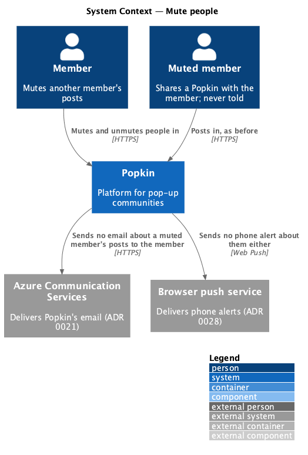
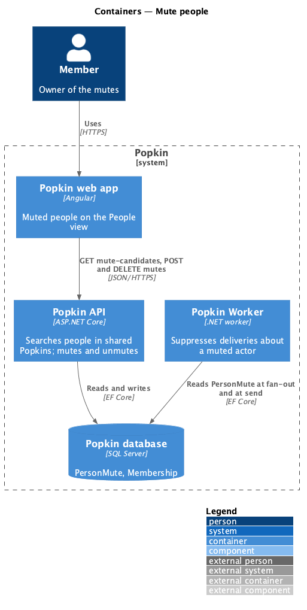
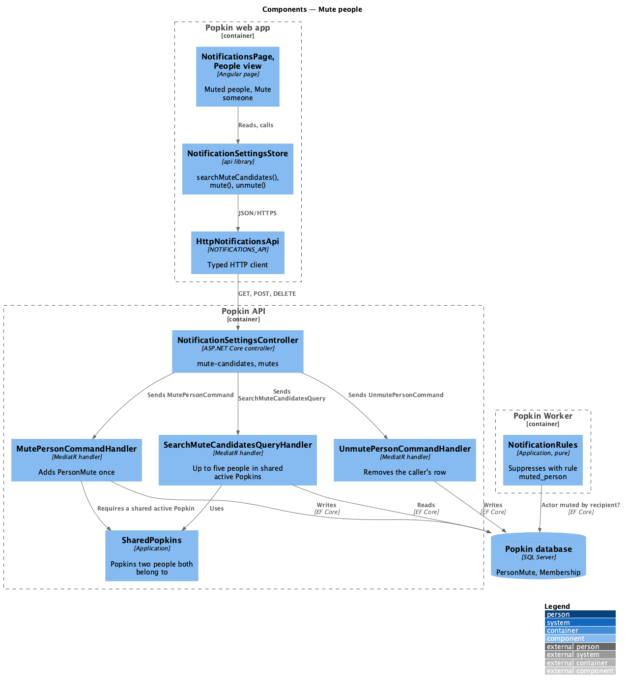
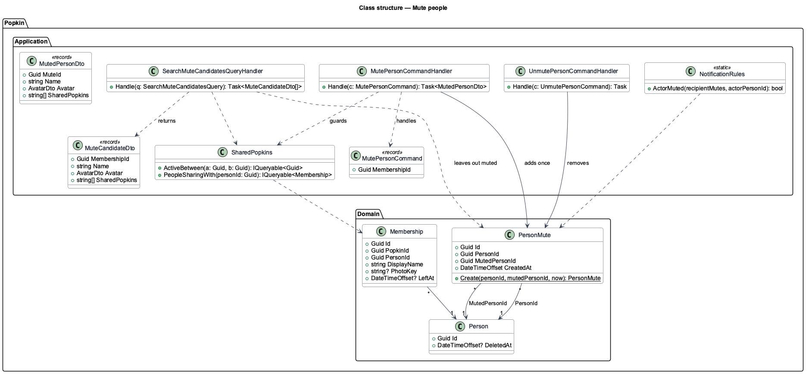
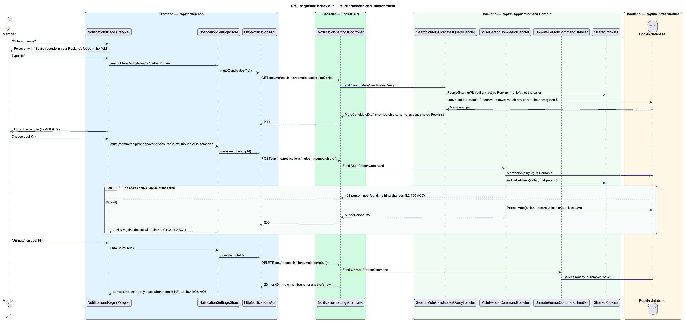
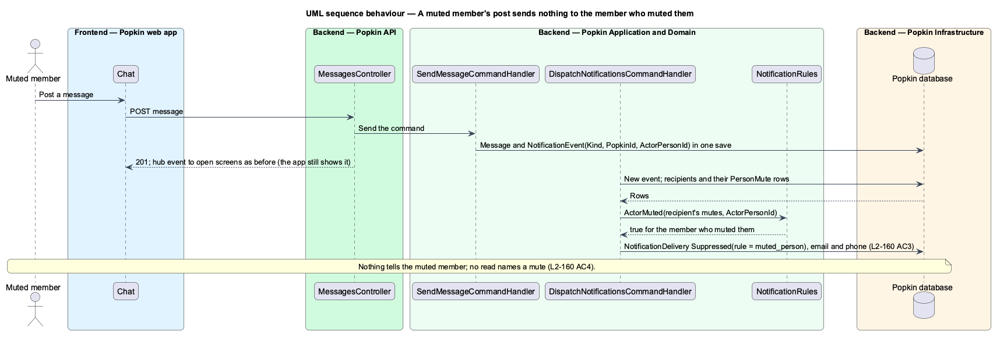

# Mute people

## Overview

In a busy Popkin one member's posts can be more than another member wants to hear about. A person
can mute that member: what the muted member posts, in any Popkin the two share, sends the person
no email and no phone alert (L2-160). Everything still shows in the app. The muted member is not
told, and nothing they can read says it (L1-040). This feature is the "Muted people" section of
the People view of the Notifications screen, its API, and the rule the Worker applies. The
screen's frame belongs to [Notification settings](../notification-settings/README.md), and the
order in which the rules apply belongs to [Deliver notifications](../deliver-notifications/README.md).

- **mute** — person's stop on email and phone alerts about one other person's posts, kept as a `PersonMute` row
- **muted member** — person named by a mute; told nothing
- **candidate** — person who shares at least one active Popkin with the person, is not the person, and is not muted yet
- **shared Popkin** — active Popkin in which both people have a membership that has not left
- **post** — message, photo, story change or experience a member adds; what the member does, not what is done to them

A mute is between accounts, not contacts. A contact need not have a Popkin account, so the picker
lists the people the person shares a Popkin with, not their contacts (the L1 assumption of
17 November 2026).

## Description

### Screens and states

- `docs/mocks/pages/notification-settings/people.html` — under "Birthday reminders", "Muted
  people", "No email or phone alerts about what they post, in any Popkin. They aren't told.", the
  dashed "Mute someone", and each muted person with photo or initials, name, a line and "Unmute".
- `docs/mocks/pages/notification-settings/mute-search.html` — "Mute someone" opens a popover with
  a search field and up to five people (`pick-list`). Escape or a tap outside closes it; choosing
  one adds them and closes it.
- `docs/mocks/pages/notification-settings/no-one-muted.html` — "No one's muted. You hear about
  everyone in your Popkins."

The specs stand where the mock differs, and the mock changes:

- The search field reads "Search people in your Popkins", not "Search your contacts", and it
  lists people who share an active Popkin with the person (L2-160 AC2).
- Each row's line names the Popkins the two share ("in Lakeside Weekend, Thursday Night Group").
  The mock's "Former manager", "Thursday group" and "Colleague" are contact relations, and a mute
  does not read Contacts (L2-160 AC1).
- A muted person who no longer shares any active Popkin stays muted. Their line then reads "No
  Popkins in common now". Those words are `<TO SUPPLY>`; no mock draws the case.
- The words for a search that finds nobody are `<TO SUPPLY>`.

### API

On `NotificationSettingsController` (`api/me/notifications`), default authenticated policy. Another
member is named by a `membershipId`, as every other read about members does (`MemberDto`). No
person id leaves the API.

- `GET /api/me/notifications` — its `muted` field: the caller's mutes, newest first, as
  `MutedPersonDto` (`muteId`, `name`, `avatar`, `sharedPopkins`).
- `GET /api/me/notifications/mute-candidates?q={text}` — `200` up to five `MuteCandidateDto`
  (`membershipId`, `name`, `avatar`, `sharedPopkins`). Each is a person who shares an active
  Popkin with the caller, is not the caller and is not muted. The name matches when `q` occurs
  anywhere in it, ignoring case and accents. With an empty `q` the first five are listed by name.
  A person in several shared Popkins appears once. `q` is at most 40 characters, else `400`
  `invalid_query`. No per-person read policy exists in `RateLimitPolicyNames`, so it is not rate
  limited; the answer is bounded by the caller's own Popkins.
- `POST /api/me/notifications/mutes` `{ membershipId }` — `200` `MutedPersonDto`. Muting someone
  already muted answers with the existing row. `404` `person_not_found` when the membership is the
  caller's own, belongs to someone who shares no active Popkin with the caller, or does not exist.
  Nothing changes (L2-160 AC7).
- `DELETE /api/me/notifications/mutes/{muteId}` — `204`. `404` `mute_not_found` for a row that is
  not the caller's. Deleting an already deleted mute answers `404`.

### Backend

- **`PersonMute`** (Domain, new table) — `Id`, `PersonId`, `MutedPersonId`, `CreatedAt`. Unique
  index on (`PersonId`, `MutedPersonId`). `Create` refuses the same id twice. Deleting an account
  (L2-049) removes the rows where it is either side.
- **`SharedPopkins`** (Application) — `ActiveBetween(a, b)` gives the active Popkins where both
  hold a membership that has not left. `PeopleSharingWith(personId)` gives the other members of
  the person's active Popkins.
- **`SearchMuteCandidatesQuery`** / **`…Handler`**, **`MutePersonCommand`** / **`…Validator`** /
  **`…Handler`**, **`UnmutePersonCommand`** / **`…Handler`**
  (`Popkin.Application/Notifications/Mutes/`). Each acts for `ICurrentPerson.PersonId` only. The
  name shown is the `DisplayName` of the muted person's most recent shared membership, and the
  photo is its `PhotoKey`.
- **The rule** — `NotificationRules.ActorMuted(recipientMutes, actorPersonId)` is true when the
  recipient has a `PersonMute` naming the event's `ActorPersonId`. `NotificationRules.Decide`
  calls it (rule 11 of [Deliver notifications](../deliver-notifications/README.md)), and the
  delivery is marked `Suppressed` with the `SuppressionRule` `MutedPerson` (`rule` `muted_person`), on both channels and for every kind with an
  actor: messages, direct messages included, photos, story changes and experiences (L2-160 AC3).
  It is read again at send (L2-174 AC1). A reminder has no actor, so a mute never stops one.
- **Never told** — no endpoint answers a question about who muted a person. No DTO of another
  feature carries a mute, and the hub sends no event about it (L2-160 AC4). The audit log does not
  record a member's mute, since it is not an admin's change.
- **Telemetry** — `popkin.notifications.mutes` by `action` (`mute`, `unmute`). No dimension
  carries either person (L2-174 AC3).

### Frontend (Popkin web app)

- **Muted people section** (People view of `NotificationsPage`) — `pk-settings-section` with its
  title and sentence, and "Mute someone" (`pk-button` dashed, `aria-haspopup="dialog"`,
  `aria-expanded`). Under it, a `pk-setting-list` of muted people (`pk-avatar`, name, the shared
  Popkins, and "Unmute", whose accessible name is "Unmute {name}"), or the empty line
  (`setting-list__empty`).
- **Picker** — `pk-popover`, the card anchored under "Mute someone" as the mock draws it
  (block `popover`, the dashed button its `popover__trigger`), holding a
  `pk-search-field` labelled "Search people in your Popkins" and a `pk-pick-list` of up to five
  people. Focus moves into the field when it opens. Arrow keys move through the list, Enter
  chooses, and Escape or a tap outside closes it and returns focus to "Mute someone". The list is
  announced as a list box. The card is a popover, not a page dialog, so no inline form is
  hand-rolled (AGENTS.md).
- **`NotificationSettingsStore`** — `searchMuteCandidates(q)` debounced 250 ms, cancelling an older
  request; `mute(membershipId)` adds the row on success; `unmute(muteId)` removes the row at once
  and puts it back with the toast "We couldn't save that. Try again." on failure.
- **Responsive** — below 576 px "Mute someone" sits under the section's sentence, and the popover
  takes the full width less the 16 px gutters (`min(300px, 100vw - 32px)` from 576 px).

### Tests

- `NotificationRules.ActorMuted` direct test: muted actor, not muted, no actor (a reminder),
  muted by someone else.
- API acceptance: candidates list only people in shared active Popkins, leave out the caller, the
  muted and people from a left or wrapped-up Popkin, and stop at five; muting answers the row and
  a second mute answers the same row; muting oneself or a stranger's membership answers `404`
  `person_not_found` (AC7); unmuting another's row answers `404` `mute_not_found`; the muted
  member's own reads show nothing of the mute (AC4).
- Dispatch acceptance: a message, a photo and a direct message from a muted member produce
  suppressed deliveries for the member who muted them and sent ones for others (AC3); after
  unmuting, the next one is sent (AC5).
- `NotificationSettingsStore` unit spec: debounce and cancel, mute, unmute and revert.
- Playwright `tests/notification-settings.spec.ts` (`NotificationSettingsPage` page object): the
  muted list, the picker by keyboard with Escape, muting someone, unmuting, and the empty line.

## Requirements

| L2 ID | Refines (L1) | Requirement |
|-------|--------------|-------------|
| `L2-160` | `L1-040` | Muted people: A person stops hearing about one other person's posts, without that person knowing. (AC1–AC7) |

## Diagrams

### System context

A member mutes another member in Popkin. The muted member keeps posting as before and is told
nothing. Popkin sends the member no email or phone alert about those posts.

### Containers

The API keeps the mutes. The Worker reads them when it fans out an event and when it sends.

### Components

Three handlers search, mute and unmute, each guarded by `SharedPopkins`. `NotificationRules`
applies the mute in the Worker.

### Class structure

A `PersonMute` joins two people. The API names the other person by a `membershipId` and a mute
by its `muteId`, never by a person id.

### Behaviour — mute and unmute

The picker searches people in shared active Popkins. Choosing one adds a mute once, and "Unmute"
removes it. A stranger or oneself is refused with `404`.

### Behaviour — the mute applied

A muted member's post still saves and shows in the app. At fan-out the dispatcher suppresses the
email and the phone alert to the member who muted them.

