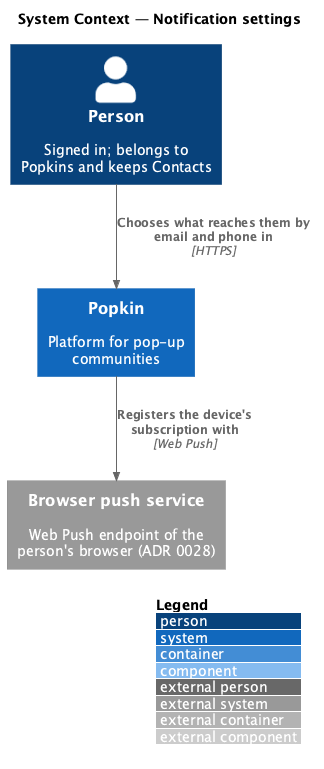
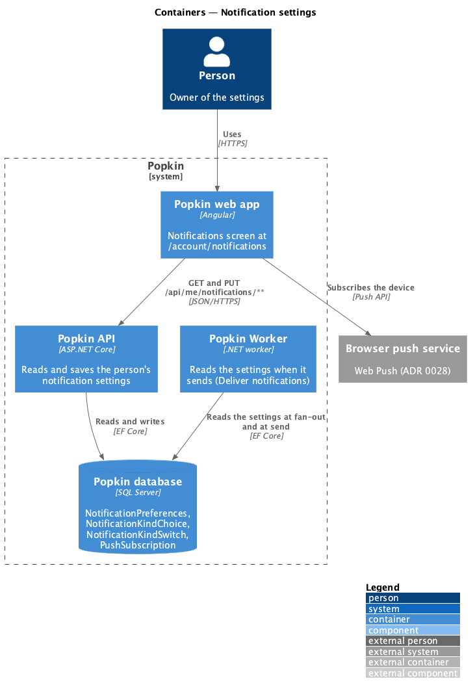
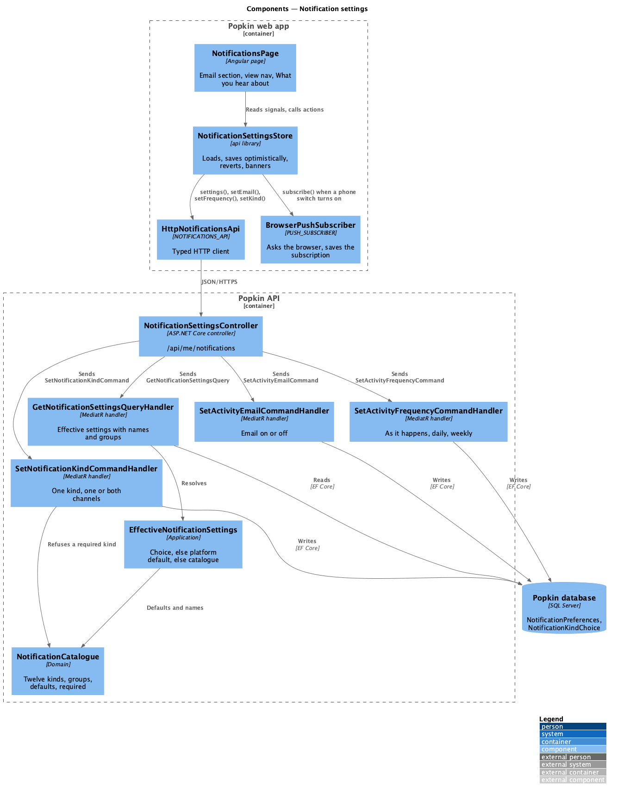
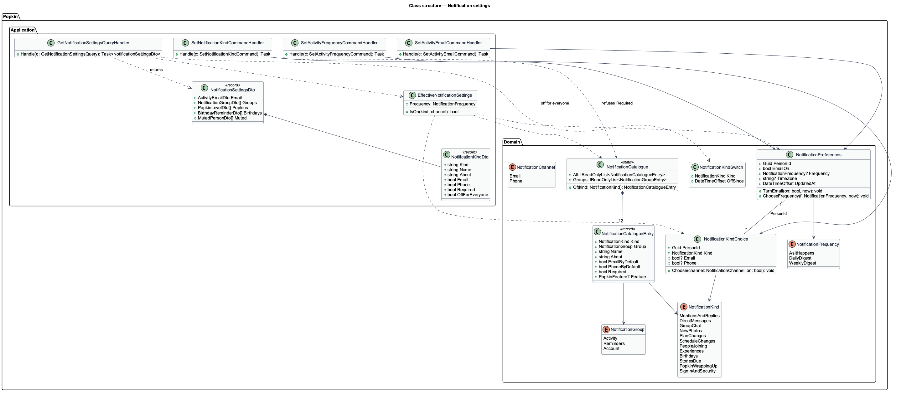
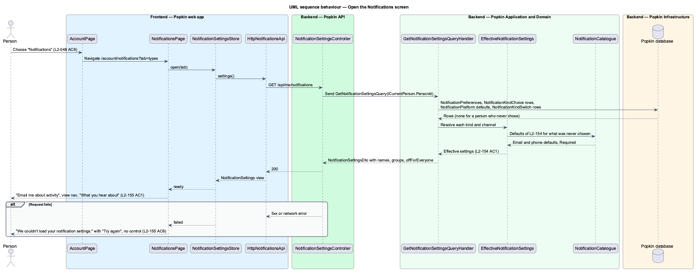
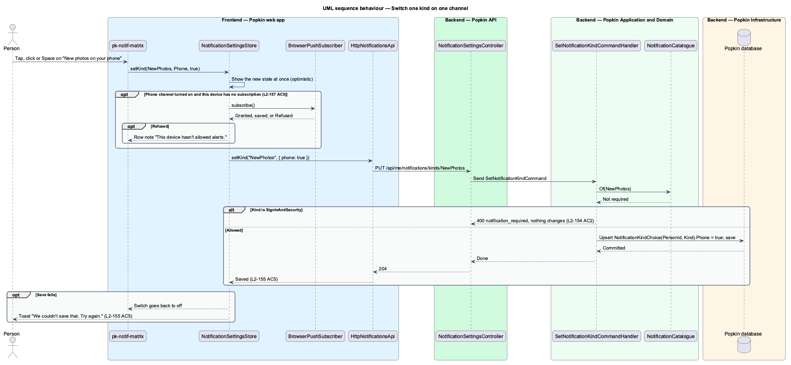
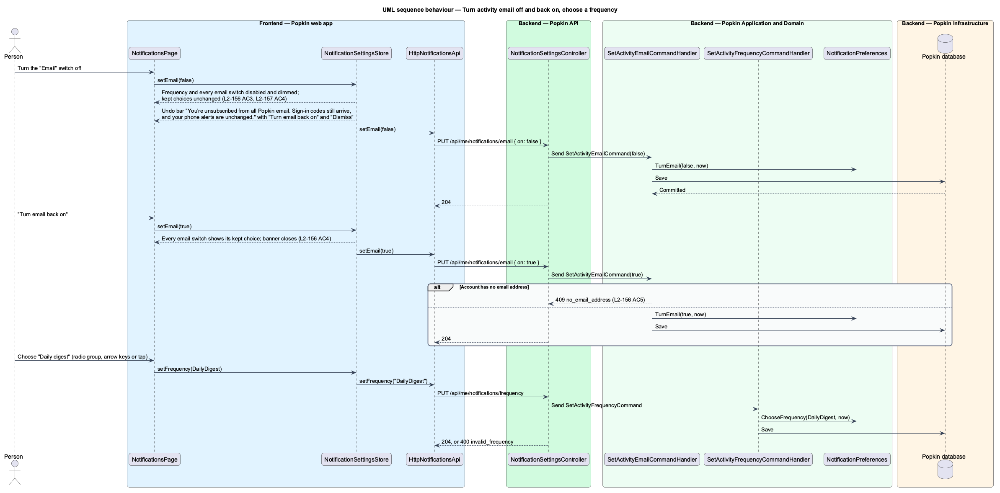

# Notification settings

## Overview

A person hears about their Popkins and their contacts' dates by email and by phone alert, and
chooses what reaches them (L1-040). This feature is the Notifications screen of the Popkin web app
and the API behind it. The screen opens from "Notifications" on the account screen
(L2-048 AC6). It holds three things. "Email me about activity" switches activity email on or off
and picks how often it comes (L2-156). The kinds of notification are listed with an email switch
and a phone switch each (L2-154, L2-157). Two further tabs, "Popkins" and "People", hold each
Popkin's level, birthday reminders and muted people. Their designs are
[Each Popkin's level](../popkin-levels/README.md),
[Birthday reminders by person](../birthday-reminders-by-person/README.md) and
[Mute people](../mute-people/README.md). This design owns the screen's frame, its load and its
failure.

Nothing on this screen sends anything. The settings are read by the Popkin Worker when it decides
and sends a notification ([Deliver notifications](../deliver-notifications/README.md)), as the
shared architecture in `docs/detailed-designs/README.md` (Notifications) records.

- **notification kind** — one of the twelve kinds of L2-154, such as "Mentions and replies", each in one group
- **notification group** — "When something changes" (activity), "Reminders" or "Your account"
- **activity email** — email about what changed in a person's Popkins, sent as it happens, as a daily digest or as a weekly digest
- **frequency** — how often activity email comes: "As it happens", "Daily digest" or "Weekly digest"
- **choice** — a person's own on or off for one kind on one channel, kept as a `NotificationKindChoice`
- **effective setting** — the person's choice where one exists, else the default for new members (L2-173), else the catalogue's default
- **required kind** — kind no person and no admin can switch off: "Sign-in codes and security"
- **off for everyone** — kind an Owner switched off for every member (L2-171); the member's own choice is kept and shown disabled

## Description

### Screens and states

The mock is `docs/mocks/pages/notification-settings/`. Its manifest entry gives the route
`/account/notifications`, the page id `notification-settings`, and opens it from `account`.

- `default.html` — "Notifications", "What reaches you by email and on your phone, Popkin by
  Popkin.", the "Email me about activity" section with its "Email" switch and three option cards,
  the view navigation "What you hear about", "Popkins" and "People", and the three groups as
  switch matrices. "Sign-in codes and security" reads "Always on" with a lock.
- `daily.html` — "Daily digest" chosen.
- `unsubscribed.html` — "Email" off; the option cards and every email switch dimmed and disabled;
  the undo bar "You're unsubscribed from all Popkin email. Sign-in codes still arrive, and your
  phone alerts are unchanged." with "Turn email back on".
- `loading.html` — skeletons and the hidden "Loading your notification settings…".
- `error.html` — "We couldn't load your notification settings", "Nothing has changed, and your
  email and phone alerts keep arriving as before.", "Try again" and "Your account".
- `popkins.html`, `muted.html`, `people.html`, `birthday-off.html`, `mute-search.html`,
  `no-one-muted.html` — the other tabs, in the designs named above.

Where the mock and the specs differ, the specs stand and the mock changes:

- The mock lists "Plans coming up" and calls the story kind "To-dos due" with "To-dos added,
  moved, or given to you". The screen lists the twelve kinds of L2-154 only, with "Stories due"
  and "Stories added, moved or given to you" (known gap 123).
- The mock draws the tabs as an ARIA tab list (`role="tab"`, `aria-selected`). L2-155 AC2 asks for
  navigation that carries `aria-current="page"`, so the screen uses `pk-view-nav` with links.
- The mock's note says turning any switch off shows an undo bar for 8 seconds. L2-156 to L2-159
  ask for an undo bar after three changes only: email off, a Popkin muted and a birthday's reminder
  off. Other switches show no bar. Whether the bar closes by itself after 8 seconds is
  `<TO SUPPLY>`; until settled it stays until dismissed or the screen is left.
- The "Email" switch's text for an account without an email address (L2-156 AC5) is not drawn.

### API

`NotificationSettingsController` (`Popkin.Api/Controllers/NotificationSettingsController.cs`),
route `api/me/notifications`, default authenticated policy. Every request acts on
`ICurrentPerson.PersonId` only; no route names another person, so no request can read or change
another person's settings (L2-174 AC4).

- `GET /api/me/notifications` — `200` `NotificationSettingsDto`, the whole screen in one read:
  - `email`: `{ on, available, frequency }`. `available` is false when `Person.Email` is null.
  - `groups`: for each `NotificationGroup`, its `name`, its `about`, and its `kinds`. Each kind
    has `kind`, `name`, `about`, `email`, `phone` (the effective setting), `required` and
    `offForEveryone`. The words come from `NotificationCatalogue`, so the web app keeps no copy of
    the list.
  - `popkins`, `birthdays`, `birthdayCount` and `muted`, as the three other designs describe.
- `PUT /api/me/notifications/email` `{ on }` — `204`. `409` `no_email_address` to turn email on
  for an account with no email address.
- `PUT /api/me/notifications/frequency` `{ frequency }` — `204`. `400` `invalid_frequency` for a
  value other than `AsItHappens`, `DailyDigest` or `WeeklyDigest`.
- `PUT /api/me/notifications/kinds/{kind}` `{ email?, phone? }` — `204`. `400` `invalid_kind` for
  an unknown kind. `400` `notification_required` for `SignInAndSecurity`, and nothing changes
  (L2-154 AC2). At least one of `email` and `phone` is given, or `400` `nothing_to_change`.
- Every refusal is a ProblemDetails with its `code` (L2-174 AC5).
- `PUT /api/me/time-zone` `{ zone }` — `204`, `400` `invalid_time_zone`. The web app sends it once
  when it starts, as the shared architecture records.
- The push subscription endpoints of [Reminders](../../contacts/reminders/README.md)
  move under `/api/me` with the time zone: `GET /api/me/push-key`, `POST` and
  `DELETE /api/me/push-subscriptions`, as phone alerts now serve every kind, not Contacts alone.

### Backend

- **`NotificationKind`**, **`NotificationGroup`**, **`NotificationChannel`**,
  **`NotificationFrequency`** (`Popkin.Domain/Notifications.cs`) — the enums of the shared
  architecture. They are serialised by name.
- **`NotificationCatalogue`** (Domain, static) — one `NotificationCatalogueEntry` per kind:
  `Kind`, `Group`, `Name`, `About`, `EmailByDefault`, `PhoneByDefault`, `Required` and `Feature`.
  The rows are the table of L2-154. `Groups` gives each group's name and sentence (L2-154 AC3).
  `Of(kind)` returns one entry.
- **`NotificationPreferences`** (Domain, new table, key `PersonId`) — `EmailOn` (true at first),
  `Frequency` (null follows the default for new members), `TimeZone` (moved from
  `ReminderPreferences`) and `UpdatedAt`. The row is added on a person's first change.
  `TurnEmail(on, now)` and `ChooseFrequency(frequency, now)`.
- **`NotificationKindChoice`** (Domain, new table, key (`PersonId`, `Kind`)) — `Email?` and
  `Phone?`. A row exists only for a kind the person changed. A null channel follows the default.
  `Choose(channel, on)`.
- **`EffectiveNotificationSettings`** (Application) — built from the person's rows, the
  `NotificationPlatform` defaults (read through `PlatformSnapshot`) and the catalogue. `Frequency`
  and `IsOn(kind, channel)` answer the same way for the screen and for the Worker, so the screen
  shows what will happen. A required kind is always on for email and off for phone.
- **`GetNotificationSettingsQuery`** / **`…Handler`** — builds `NotificationSettingsDto`. It reads
  the `NotificationKindSwitch` rows to set `offForEveryone` (L2-171 AC4). It adds the Popkins, the
  birthdays and the muted people through the readers of the three other designs.
- **`SetActivityEmailCommand`**, **`SetActivityFrequencyCommand`**, **`SetNotificationKindCommand`**
  with their validators and handlers (`Popkin.Application/Notifications/Settings/`). Each loads or
  adds the person's row and saves once. A write does not touch another kind or channel, so a choice
  kept while email is off returns when email is turned on (L2-157 AC4).
- **No email address** — `Person.Email` is null for an account that signs in by phone. Its `email`
  reads `available: false`, and the Worker sends it no email (L2-161 AC8).
- **Telemetry** — `popkin.notifications.settings_changed` (`PopkinMetrics`) by `setting` (`email`,
  `frequency`, `kind`) and `channel`. No dimension carries a person.

### Frontend (Popkin web app)

- **Route** — `/account/notifications`, `NotificationsPage`, `canActivate: [signedInGuard]`, data
  `{ shell: 'bare', page: 'notification-settings' }`, as the account screen uses `bare`. The query
  parameter `tab` (`types`, `popkins`, `people`) picks the view; a missing or unknown value reads
  `types` (L2-155 AC1, AC3). The email links that change a setting on arrival are designed in
  [Unsubscribe](../unsubscribe/README.md) (L2-168).
- **`NotificationsPage`** (`pages/notifications/notifications.page.ts` and `.html`, selector
  `pk-notifications-page`, OnPush) — a container. It composes `pk-top-bar` with "Back" to `/account`
  (accessible name "Your account", as in the mock), `pk-page-head`, the email section, `pk-view-nav`
  and the view of the chosen tab. While loading it shows `pk-skeleton` after 300 ms, as the account
  screen does. On failure it shows `pk-empty-state` with the mock's words, "Try again" and "Your
  account", and no control (L2-155 AC6).
- **`NotificationSettingsStore`** (`api` library, `lib/api/notifications/`, unit tested,
  ADR 0011) — signals `status` (`loading`, `ready`, `failed`), `settings` and `banner`. Its actions
  are `open(tab)`, `retry()`, `setEmail(on)`, `setFrequency(f)` and `setKind(kind, channel, on)`.
  Each action shows the new state at once, saves, and on failure puts the old state back and shows
  the toast "We couldn't save that. Try again." through `Toaster` (L2-155 AC5). Turning email off
  raises the `unsubscribed` banner, and "Turn email back on" calls `setEmail(true)` and closes it
  (L2-156 AC3, AC4). The store holds the rules of what is disabled: every email switch and the
  frequency while email is off, both switches of a kind off for everyone, and no switch for a
  required kind.
- **`NotificationsApi` / `NOTIFICATIONS_API` / `HttpNotificationsApi`** (`api` library) —
  `settings()`, `setEmail(on)`, `setFrequency(f)`, `setKind(kind, change)`, plus the calls of the
  three other designs. The page depends on the token; `app.config.ts` provides it.
- **`PUSH_SUBSCRIBER`** — moves from `lib/api/contacts/` to `lib/api/notifications/`, unchanged.
  When `setKind` turns a phone switch on and the device has no subscription, the store calls
  `subscribe()`. If the browser refuses, the switch stays on for the person's other devices and
  the row reads "This device hasn't allowed alerts." (L2-157 AC5).
- **Time zone** — `AppTimeZone` (`api` library) sends the device's IANA zone with
  `PUT /api/me/time-zone` once per start through `provideAppInitializer`. It replaces the save made
  when Contacts opens.
- **Components** (`components` library, `pk-*`, BEM blocks kept from the mock):
  - existing: `pk-top-bar`, `pk-page-head`, `pk-view-nav`, `pk-switch` (`role="switch"`, labelled
    "{kind} by email" and "{kind} on your phone", L2-157 AC1, L2-155 AC7), `pk-skeleton`,
    `pk-empty-state`, `pk-button`, `pk-toast`.
  - new `pk-settings-section` (block `settings-section`) — a titled section with a sentence and an
    end slot for the "Email" switch label (`switch-label`).
  - new `pk-option-grid` (block `option-grid`, `role="radiogroup"`) and `pk-option-card` (block
    `option-card`, `button`, `role="radio"`, `aria-checked`). Arrow keys move the choice; the
    chosen card is marked by its filled radio as well as its border. `pk-choice-card` differs in
    shape, and whether it can serve instead is `<TO SUPPLY>`.
  - new `pk-notif-group` (block `notif-group`) — a group's title, sentence and the column labels
    "Email" and "Phone" (`aria-hidden`, since each switch carries its own name).
  - new `pk-notif-matrix` (block `notif-matrix`) — the rows of one group. Each row has a name,
    what sends it and two switches, or "Always on" with the lock (`notif-matrix__lock`, L2-157
    AC2). A row may carry a note ("Switched off by Popkin for now", "This device hasn't allowed
    alerts.").
  - new `pk-undo-bar` (block `undo-bar`, `role="status"`) — a sentence, one action and "Dismiss".
    It is used by the three tabs.
- **Responsive (L2-155 AC4)** — the screen is `pk-screen layout="column"` with the `settings`
  width. Below 576 px the option cards stack, and each matrix row keeps its two switch columns at
  56 px. From 576 px the option cards sit in a row of three and the columns widen to 72 px. From
  768 px the content is centred at most 920 px wide. `pk-view-nav` scrolls sideways without a
  scrollbar, and nothing else scrolls sideways. Every control is at least 44 px tall.
- **State not by colour alone** — a switch shows its thumb's position; an option card shows its
  filled radio; a disabled control is dimmed and is `disabled`; the chosen view carries an
  underline as well as colour.

### Account entry (L2-048 AC6)

The account screen gains a `pk-menu-item` "Notifications" with the bell icon, above "Sign out",
as `docs/mocks/pages/account/default.html` draws it. It routes to `/account/notifications`.
"Back" on the Notifications screen returns to `/account`
([Manage the account](../../accounts/manage-account/README.md)).

### Tests

- `NotificationCatalogue` direct test, one case per row of L2-154's table: group, name, what sends
  it, email default, phone default, required.
- `EffectiveNotificationSettings` direct test, one case per source: no choice and no platform
  default; a platform default; a choice; a choice of one channel with the other following the
  default; a required kind.
- API acceptance (InMemory, `ApiFactory`, sequential): a new person's `GET` matches the defaults
  (L2-154 AC1); `PUT` on `SignInAndSecurity` answers `400` `notification_required` and changes
  nothing (AC2); email off then on keeps each choice (L2-156 AC3, AC4, L2-157 AC4); an unknown
  frequency answers `400` `invalid_frequency`; a phone-only account reads `available: false` and
  turning email on answers `409` `no_email_address` (L2-156 AC5); no session answers `401`.
- `NotificationSettingsStore` unit spec (`api`): optimistic change, failure reverting with the
  toast, the banner, disabled rules, the push refusal note.
- Playwright `tests/notification-settings.spec.ts` through `e2e/pages/notification-settings.page.ts`
  (page object owning the selectors), with `/api/me/notifications` answered from the recording:
  the account entry opens the screen; the groups and switches; a switch saved; a failed save
  reverting; email off with its banner and "Turn email back on"; "Daily digest" chosen; the
  loading and error states; the view nav by keyboard. Each state has its `routes.ts` entry for
  the sweeps, which are not run.

## Requirements

| L2 ID | Refines (L1) | Requirement |
|-------|--------------|-------------|
| `L2-154` | `L1-040` | Notification kinds: Popkin sends twelve kinds of notification, in three groups, named in the same words by the Popkin app, the emails and the admin app; a new person starts with the defaults of its table. (AC1–AC4) |
| `L2-155` | `L1-040` | The Notifications screen: A person sets what they hear about on one screen. (AC1–AC7) |
| `L2-156` | `L1-040` | Activity email: A person chooses whether activity email comes at all, and how often. (AC1–AC5) |
| `L2-157` | `L1-040` | What you hear about: Each kind has its own switch for email and for the phone. (AC1–AC5) |
| `L2-048` | `L1-002` | Account: A person manages how they appear and their session. (AC6: "Notifications" opens the Notifications screen) |

## Diagrams

### System context

A person sets their notifications in Popkin. The only external system involved is the browser's
push service, which registers a device when a phone switch is first turned on there.

### Containers

The web app reads and saves the settings through the API, which keeps them in the Popkin
database. The Worker reads the same rows when it sends; nothing on this screen calls the Worker.

### Components

`NotificationsPage` composes components and reads `NotificationSettingsStore`. In the API, one
controller sends one MediatR request per action, and `EffectiveNotificationSettings` resolves each
kind from the person's choice, the platform default and the catalogue.

### Class structure

`NotificationCatalogue` holds the twelve kinds. A person's `NotificationPreferences` and their
`NotificationKindChoice` rows exist only once they change something.

### Behaviour — open the screen

The account's "Notifications" opens the screen, which reads every setting in one request and
shows the effective settings, or the error state with "Try again".

### Behaviour — switch one kind

A switch changes at once and is saved. A required kind is refused. A phone switch turned on asks
the browser for alerts first, and a failed save puts the switch back with a toast.

### Behaviour — activity email and its frequency

Turning email off disables the email switches without losing them, and shows the undo bar. "Turn
email back on" restores each choice. A frequency is one choice of three.

