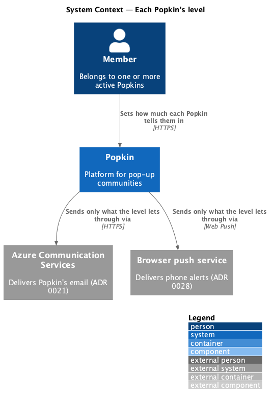
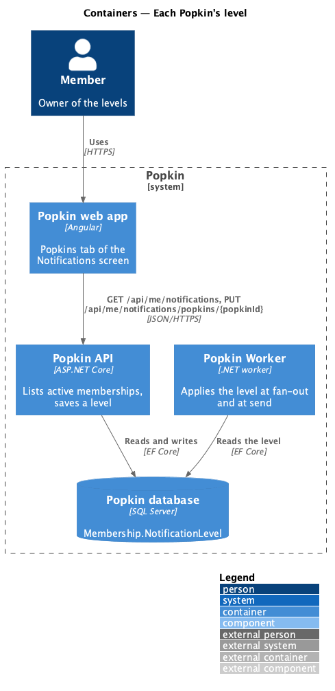
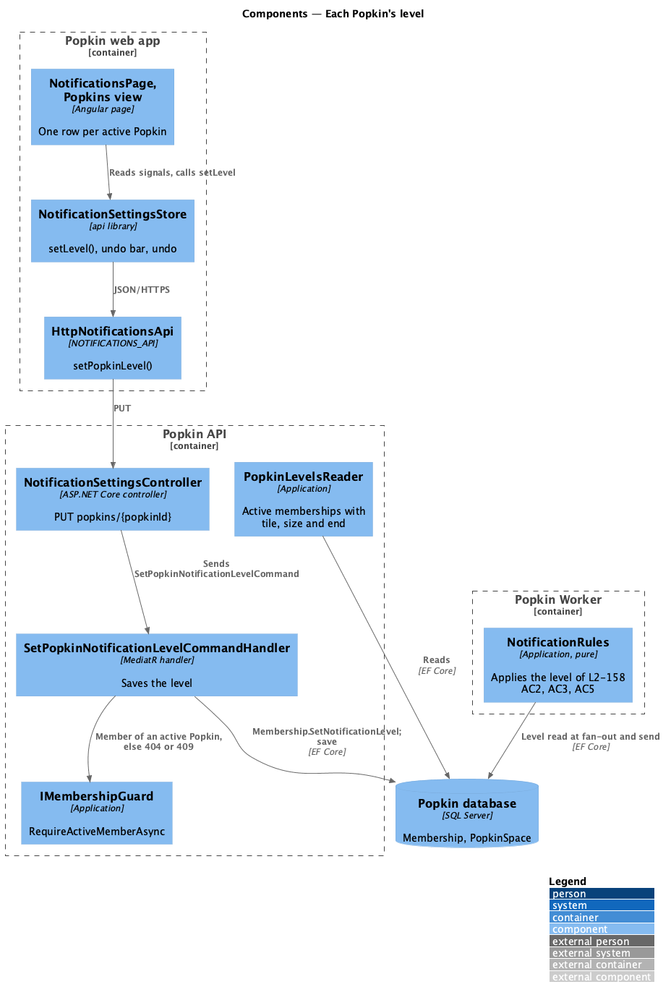
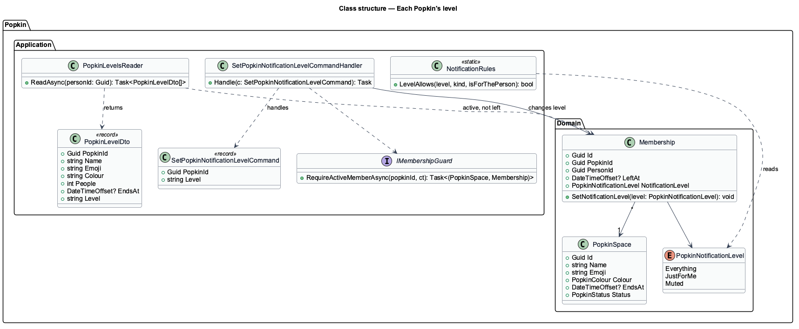
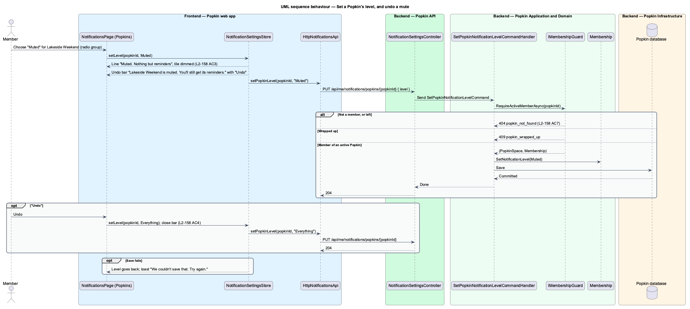
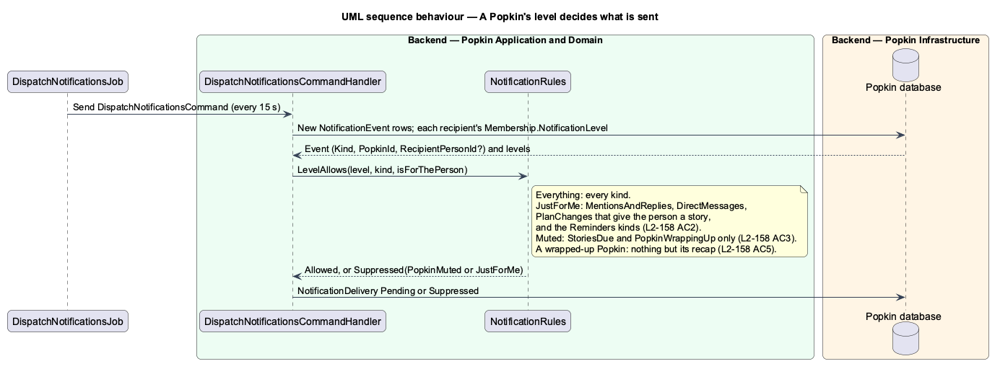

# Each Popkin's level

## Overview

A person can belong to several Popkins at once: a weekend away, a weekly group and a team of
parents. Each has its own pace, and the person decides how much each one tells them (L1-040). This
feature is the "Popkins" view of the Notifications screen and the level each membership keeps.
The screen's frame, its load and its failure belong to
[Notification settings](../notification-settings/README.md). The rules that apply the level when a
notification is sent belong to [Deliver notifications](../deliver-notifications/README.md). This
design defines what each level lets through.

- **level** — how much one Popkin tells one member: "Everything", "Just for me" or "Muted", kept as `Membership.NotificationLevel`
- **Everything** — level at which every kind the member has switched on is sent; the level of every new membership
- **Just for me** — level at which only what concerns the member is sent: mentions and replies, direct messages, a story given to them, and reminders
- **Muted** — level at which only the Popkin's reminders are sent: "Stories due" and "Popkin wrapping up"
- **active membership** — `Membership` with no `LeftAt`, in a `PopkinSpace` whose `Status` is not wrapped up

A level narrows; it never widens. A kind the member switched off (L2-157), a hold (L2-172) or a
kind off for everyone (L2-171) stops a notification whatever the level (L2-161 AC1).

## Description

### Screens and states

- `docs/mocks/pages/notification-settings/popkins.html` — the sentence "Just for me keeps
  mentions, direct messages, to-dos given to you and reminders. Muted stops everything but
  reminders for plans you're going to.", then one row per active Popkin: its tile, its name, its
  number of people and when it wraps up ("wraps up Sunday", "ongoing", "until Nov 30"), and a
  segmented radio group "Everything", "Just for me", "Muted". It ends "Wrapped-up Popkins never
  email you. New Popkins you join start on Everything."
- `docs/mocks/pages/notification-settings/muted.html` — Lakeside Weekend muted: its line reads
  "Muted. Nothing but plan reminders", its tile is dimmed, and the undo bar reads "Lakeside
  Weekend is muted. You'll still get a reminder before plans you're going to." with "Undo".

The specs stand where the mock differs, and the mock changes:

- The sentence reads as L2-158 AC1: "Just for me keeps mentions, direct messages, stories given
  to you and reminders. Muted stops everything but reminders."
- The muted line reads "Muted. Nothing but reminders" (AC3), and the undo bar "{Popkin} is muted.
  You'll still get its reminders." (AC4). "Plans you're going to" names the left-out "Plans coming
  up" (known gap 123).
- L2-158 AC4 asks for the undo bar when a Popkin is muted from an email. The mock also shows it
  when a Popkin is muted on the screen, and the design does the same. The undo bar is not shown
  for "Everything" or "Just for me".
- A member of no active Popkin sees the view's sentences and no rows. No mock draws it; the words
  for that case are `<TO SUPPLY>`.

### What each level lets through (L2-158 AC2, AC3)

| Kind | Everything | Just for me | Muted |
|---|---|---|---|
| Mentions and replies | Yes | Yes | No |
| Direct messages | Yes | Yes | No |
| Group chat | Yes | No | No |
| New photos | Yes | No | No |
| Plan changes that give the member a story | Yes | Yes | No |
| Other plan changes | Yes | No | No |
| Schedule changes | Yes | No | No |
| People joining | Yes | No | No |
| Experiences | Yes | No | No |
| Stories due | Yes | Yes | Yes |
| Popkin wrapping up | Yes | Yes | Yes |

"Birthdays" belongs to no Popkin, and "Sign-in codes and security" to none either, so no level
touches them. A wrapped-up Popkin sends nothing but its recap, whatever the level (AC5). A plan
change "gives the member a story" when its `NotificationEvent.RecipientPersonId` is the member's,
which the plan's handler sets when a story's owner becomes that member.

### API

On `NotificationSettingsController` (`api/me/notifications`), default authenticated policy:

- `GET /api/me/notifications` — its `popkins` field: one `PopkinLevelDto` per active membership of
  the caller (`popkinId`, `name`, `emoji`, `colour`, `people`, `endsAt`, `level`), most recently
  active first (`PopkinSpace.LastActivityAt`), as My Popkins orders them. A wrapped-up Popkin is not listed.
- `PUT /api/me/notifications/popkins/{popkinId}` `{ level }` — `204`. `400` `invalid_level` for a
  value other than `Everything`, `JustForMe` or `Muted`. `404` `popkin_not_found` for a Popkin the
  caller does not belong to or has left (L2-158 AC7, L2-051). `409` `popkin_wrapped_up` for a
  wrapped-up one. Setting the level it already has is a `204` that changes nothing.

### Backend

- **`PopkinNotificationLevel`** (Domain enum, stored by name) — `Everything` (value 0, the column's default),
  `JustForMe`, `Muted`.
- **`Membership.NotificationLevel`** — new column, `Everything` for every membership, existing and
  new (L2-158 AC6). `SetNotificationLevel(level)`. `Membership.Join` leaves it at `Everything`.
- **`SetPopkinNotificationLevelCommand`** / **`…Validator`** / **`…Handler`**
  (`Popkin.Application/Notifications/Settings/`) — `IMembershipGuard.RequireActiveMemberAsync`,
  then `SetNotificationLevel`, then one save.
- **`PopkinLevelsReader`** (Application) — the caller's active memberships with their Popkin's
  name, emoji, colour, count of members who have not left, and `EndsAt`. Used by
  `GetNotificationSettingsQueryHandler`.
- **`NotificationRules.LevelAllows(level, kind, isForThePerson)`** — the table above, as a pure
  function. `NotificationRules.Decide` calls it at fan-out and again at send
  ([Deliver notifications](../deliver-notifications/README.md), rules 12 and 13). A delivery it
  stops is marked `Suppressed` with the `SuppressionRule` `PopkinMuted` (level "Muted") or
  `JustForMe`, counted by `popkin.notifications.suppressed` with `rule` `popkin_muted` or
  `just_for_me`.
- **Leaving and rejoining** — leaving keeps the row with its `LeftAt`. Joining again by a new
  invite makes a new `Membership`, which starts on `Everything`.

### Frontend (Popkin web app)

- **Popkins view** (`NotificationsPage`, `tab=popkins`) — `pk-undo-bar` when the store's banner is
  `popkinMuted`, the sentence, then a `pk-setting-list` of rows. Each row composes
  `pk-popkin-tile` (with its `muted` input on `Muted`), the name, the line ("{n} people · wraps up
  {when}", "ongoing", or "Muted. Nothing but reminders"), and `pk-segmented-control kind="radio"`
  (its `levels` form) with the three options, labelled "How much you hear from {Popkin}", as the
  mock names it. The view is chosen with `pk-view-nav` ("What you hear about", "Popkins"). The closing sentence follows.
- **`NotificationSettingsStore.setLevel(popkinId, level)`** — shows the change at once, raises the
  `popkinMuted` banner for `Muted`, saves, and on failure puts the old level back with the toast
  "We couldn't save that. Try again.". `undo()` for this banner sets `Everything` and closes it.
- **New component** `pk-setting-list` (block `setting-list`, `ul`) — rows of `setting-list__item`
  with a main part (`setting-list__main`, `__name`, `__sub`) and an end slot. It is distinct from
  the existing `pk-settings-list` (`dl`, key and value). `pk-popkin-tile` gains a `muted` input if
  it has none: the tile dimmed and the emoji desaturated, with the line saying "Muted" so colour
  is not the only signal.
- **Responsive** — below 576 px the radio group sits under the Popkin's name, starting at its
  left. From 576 px it sits at the end of the row (L2-155 AC4).
- **Keyboard** — the radio group takes one tab stop; arrow keys move and choose.

### Tests

- `NotificationRules.LevelAllows` direct test, one case per cell of the table above (33 cases),
  plus a wrapped-up Popkin.
- API acceptance: a new member's level reads `Everything` (AC6); `PUT` `Muted` then `GET` reads
  `Muted`; another Popkin's id answers `404` `popkin_not_found` (AC7); a left membership answers
  `404`; an unknown level answers `400` `invalid_level`.
- Dispatch acceptance on InMemory, through `DispatchNotificationsCommand`: a Group chat message to
  a member on `JustForMe` is suppressed, a reply is sent; on `Muted` only "Stories due" goes;
  after wrap-up nothing goes (AC2, AC3, AC5).
- `NotificationSettingsStore` unit spec: level change, undo bar on `Muted`, undo, revert on failure.
- Playwright `tests/notification-settings.spec.ts` through the `NotificationSettingsPage` page
  object: the Popkins view, muting with its undo bar, "Undo", and the radio group by keyboard.

## Requirements

| L2 ID | Refines (L1) | Requirement |
|-------|--------------|-------------|
| `L2-158` | `L1-040` | Each Popkin's level: A person chooses how much each Popkin they belong to tells them. (AC1–AC7) |

## Diagrams

### System context

A member sets each Popkin's level in Popkin. The level decides what Popkin then sends by email
and by phone alert about that Popkin.

### Containers

The API saves the level on the membership. The Worker reads it when it fans out an event and
again when it sends.

### Components

The Popkins view calls the store, the store calls the API, and one handler guards the membership
and saves the level. `NotificationRules` in the Worker applies it.

### Class structure

The level is one column of `Membership`. A reader lists the active memberships with what each
row shows.

### Behaviour — set a level

Choosing "Muted" shows at once with an undo bar. The handler refuses a Popkin the member is not in
or that has wrapped up, and "Undo" puts the Popkin back on "Everything".

### Behaviour — the level is applied

At fan-out the dispatcher asks `NotificationRules` whether the level lets each kind through. What
it stops is recorded as suppressed, not sent.

