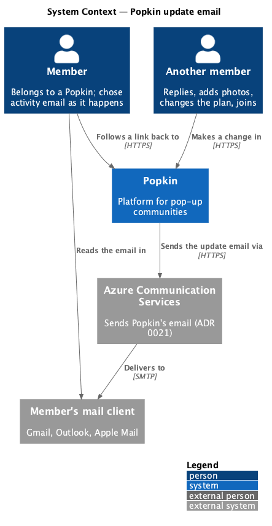
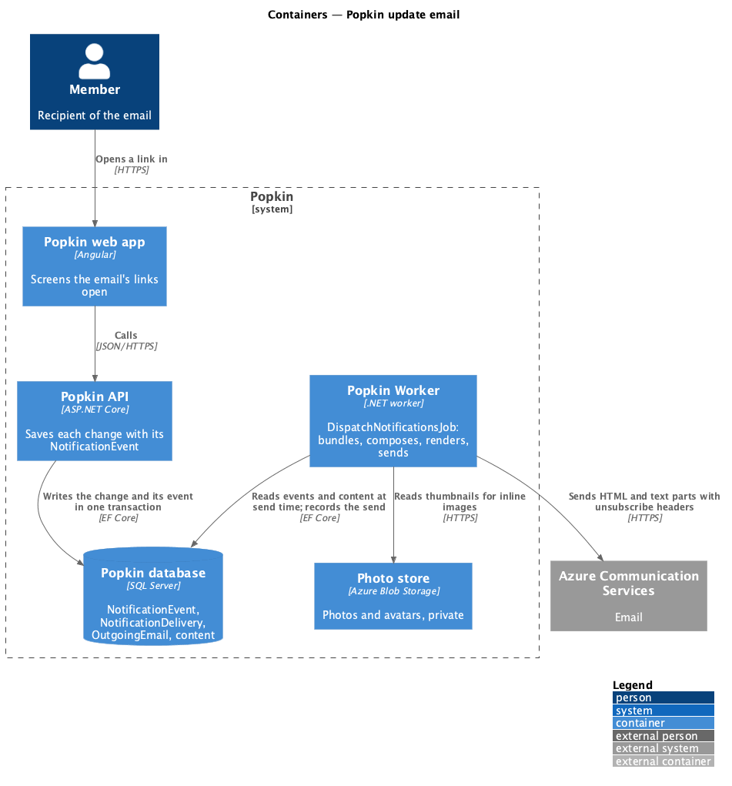
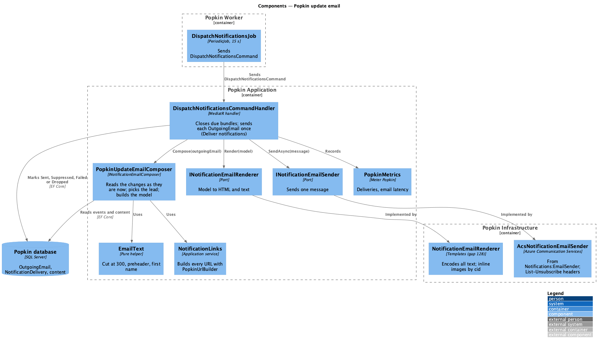
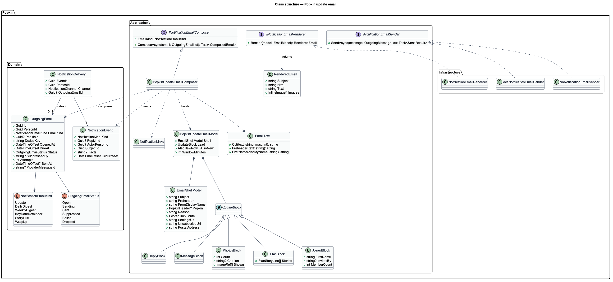
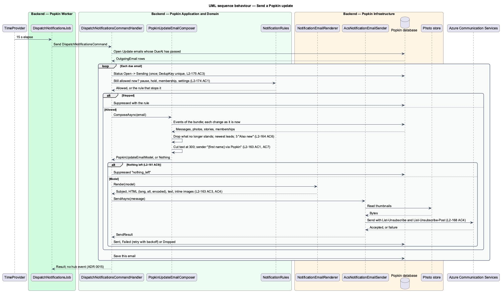
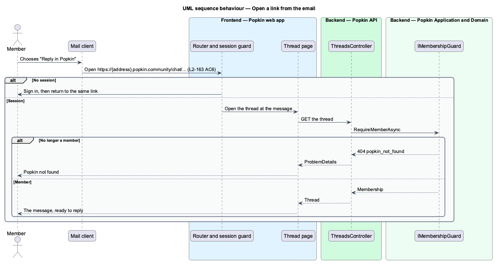

# Popkin update email

## Overview

A person who chose "As it happens" for activity email (L2-156) hears of each change in their
Popkins by an email sent shortly after it (L1-041). This feature covers two things: the shape
every activity and reminder email shares (L2-163), and the Popkin update email itself (L2-164).
The digests ([Digest emails](../digest-emails/README.md)) and the reminder emails
([Send reminders](../send-reminders/README.md)) use the same shape and the same parts.

[Deliver notifications](../deliver-notifications/README.md) decides who hears of a change, on
which channel and when, and gathers the changes that land within the bundling window into one
`OutgoingEmail`. When that window closes, this feature reads what the changes are now, builds the
email, renders it and hands it to the mail provider. No content travels in the outbox; every
word is read at send time, so a message deleted before the window closes is left out.

- **Popkin update email** — activity email of one change, or of a bundle of changes, in one Popkin, to one person
- **bundle** — changes for one person in one Popkin that land within the bundling window, sent as one email
- **bundling window** — interval from the first change of a bundle to its sending, 10 minutes unless an Owner changed it (L2-161 AC3, L2-173)
- **lead change** — first change of a bundle, which takes the email's subject, headline and button
- **email shell** — envelope, header, body column and footer that every notification email shares
- **envelope** — subject, sender display name and preview line a mail client shows before the email opens
- **preheader** — hidden first line of the body that a mail client shows as the preview
- **narrowest mute** — the footer link that stops the least: this Popkin, this person's birthday, or one Popkin chosen on the settings screen

Every email goes to one person and names only what that person may see (L2-174). A direct
message's email goes only to the other member of it (L2-164 AC5).

## Description

### Emails and states

The mocks draw each email inside a mock mail client, with its envelope above the body. They are
`docs/mocks/notifications/email-popkin-update/` (manifest id `email-popkin-update`, opened from
`notification-settings`):

- `message.html` — the lead change is a reply: "Walt replied to you", the person's own message
  faded above ("You · 10:31"), the reply with its sender and time, "Reply in Popkin", and "Also
  new in the last 10 minutes" with three rows (L2-164 AC1, AC6).
- `single.html` — the same reply with no bundle: no "Also new" section (L2-164 AC1).
- `photos.html` — "Dev added 6 photos to the album", the caption, a grid of five photos with a
  "+1" tile in the Popkin's colour, and "See the album" (L2-164 AC2).
- `plan.html` — "Ellie changed the plan", one story marked "Yours now" with "Given to you by
  Ellie · due Fri 18 Sep", another with its due date changed ("Due 21 Sep" struck through, "Due
  25 Sep"), and "Open the plan" (L2-164 AC3).
- `member.html` — "Joel joined Lakeside Weekend" with the newcomer's photo, whose invite they came
  in on, "That makes 15 people", and "Say hi to Joel" (L2-164 AC4).
- Every state ends with the footer: "You're getting this because you're in {Popkin} and asked
  for {kind} by email, as it happens.", then "Mute {Popkin}" · "Notification settings" ·
  "Unsubscribe from all email", then the postal address (L2-163 AC5, L2-164 AC7).

No mock draws the direct-message variant (L2-164 AC5) or the mention variant (L2-164 AC1). Both
follow `message.html`.

### Where the mocks and the requirements differ

The requirements stand and the mocks change (L1, "Source and assumptions"):

1. **Sender.** The mocks send from `notify@popk.in`. The sender is on `popkin.community`
   (ADR 0021, L2-163 AC1), read from `Notifications:EmailSender`.
2. **"or just reply to this email"** (`message.html`, `single.html`). Nobody can reply by email
   (owner's ruling of 2026-11-17, gap 124). The line is removed. The email carries no
   `Reply-To`, and replies to the sender address are not read.
3. **Times in the plan.** "Ellie moved the sunrise canoe to 8:30" in the "Also new" lists, and
   `member.html`'s "so he'll show up on the canoe sign-up", draw an event with a time and a
   sign-up. Popkin has neither (gap 123). A plan change names a story and its column, owner or
   due date only. A join says whose invite they came in on and the member count, nothing about
   their schedule.
4. **The plan mock's preview** "Due Friday · and the van moved to the 25th" is free text. The
   preheader is built from the lead change's facts (AC1 below), as the subject is.

### Rules of the shell (L2-163)

- **Envelope.** The display name is "{first name} via Popkin" when one member made the lead
  change, and "Popkin" otherwise. The first name is the member's display name in that Popkin up
  to its first space (`PersonName.FirstName`). The subject names what happened and the Popkin
  ("Walt replied to you in Lakeside Weekend"). The preheader is the first 90 characters of the
  lead change's text, or its facts when it has no text (AC1).
- **Header.** It shows the Popkin wordmark. An email about one Popkin adds the Popkin's tile
  (emoji on its colour) and name; a digest or a contact's reminder shows the wordmark alone
  (AC2).
- **Layout.** There is one column, at most 600 px wide, centred. It is built from tables with
  inline styles, so Gmail, Outlook and Apple Mail draw it the same way. Nothing sits side by side
  below 600 px, and every button is at least 44 px tall (AC3). The photo grid is the one
  multi-cell row. It keeps three columns at every width, since its cells are pictures, not text.
- **Two parts.** Each email has an HTML part and a plain-text part with the same words and the
  same links. The HTML sets `lang="en"`, every image has `alt` text (empty for a decorative
  avatar beside a name already written), no word is only in an image, and text colours meet
  WCAG 2.2 AA on their backgrounds (AC4). The colours are the light theme's tokens. Emails take
  no dark theme of their own, since mail clients recolour them unpredictably (`<TO SUPPLY>`:
  whether to add `color-scheme` meta tags once the mocks' dark toggle is ruled on).
- **Footer.** The reason, then the narrowest mute, "Notification settings" and "Unsubscribe from
  all email", then Popkin's postal address from `Email:PostalAddress` (AC5). The links are built
  by [Unsubscribe](../unsubscribe/README.md).
- **Links.** Every link is absolute, built by `PopkinUrlBuilder` on the Popkin's own address
  (L2-062), and opens a screen behind the normal session check (AC6). Only the unsubscribe link
  acts without a session. Links carry no tracking parameters.
- **Members' words.** Text a member wrote (a message, a caption, a display name, a story's title)
  is HTML-encoded by the renderer and never inserted as markup. A message or a caption is cut at
  300 characters, ending "…" (`EmailText.Cut`). The cut keeps whole grapheme clusters, so an
  emoji is never split (AC7).
- **Pictures.** Photos and avatars sit in a private Blob container (ADR 0022), so an email
  cannot link to them publicly. Each picture travels inside the email as an inline attachment
  with a `Content-ID`, a 320 px thumbnail at most, and the HTML refers to it as `cid:`. Inline
  attachments keep every picture private to its recipient. Azure Communication Services email
  supports them. Their total size per email is kept under 1 MB, and photos past the fifth are
  counted in the "+{n}" tile, not attached ([ADR 0031](../../../adr/0031-notification-emails-by-razor-components.md)).

### The four changes (L2-164)

The changes come from the `NotificationEvent` rows a bundle holds
([Deliver notifications](../deliver-notifications/README.md)). Each is read again at send time:

| Change | Event `Kind`, `SubjectId` | What the email reads | Headline | Button |
|---|---|---|---|---|
| Reply | `MentionsAndReplies`, the reply | the reply, the message it answers (the recipient's own) | "{first name} replied to you" | "Reply in Popkin" → the message in its thread |
| Mention | `MentionsAndReplies`, the message | the message | "{first name} mentioned you" | "Reply in Popkin" |
| Direct message | `DirectMessages`, the message | the message | "{first name} sent you a message" | "Reply in Popkin" → the direct message |
| Group chat | `GroupChat`, the message | the message | "{first name} in {Popkin}" | "Open the chat" |
| Photos | `NewPhotos`, the first photo of the upload | photos the same member added to the album in the window, newest first, and the first caption | "{first name} added {n} photos to the album" | "See the album" |
| Plan changes | `PlanChanges`, the story | the story now, and the event's facts (column, owner and due date before and after) | "{first name} changed the plan" | "Open the plan" |
| People joining | `PeopleJoining`, the membership | the membership, who invited them, the member count | "{first name} joined {Popkin}" | "Say hi to {first name}" → Everyone |
| Schedule changes | `ScheduleChanges`, the time-off entry | the entry | "{first name} booked time off" | "Open Schedules" |
| Experiences | `Experiences`, the experience | the experience, its new rating or comment | "{first name} added {experience}" | "Open Experiences" |

Popkin chat has no mention yet: `Message` has `ReplyToMessageId` but no mentioned members.
"Mentioned you" is drawn only for when a message can name members (`<TO SUPPLY>`: the
requirement for @mentions, named in L2-154 but specified nowhere else).

A change read at send time that no longer stands is left out: a deleted message, a removed
photo, a story deleted, a member who left before the window closed. A bundle that has nothing
left is suppressed and nothing is sent (L2-161 AC9). A plan change keeps only the stories still
on the board. "Yours now" marks a story whose owner became the recipient in the window.

**Bundle order.** The lead change is the newest one, as `message.html`'s note says ("the newest
leads, the rest are listed under it"). The others follow under "Also new in the last {n}
minutes", newest first, three at most. Each row has the member's avatar, one line ("Dev added 6
photos", "Priya: “{text cut at 60}”", "Ellie moved “{story}” to Doing") and the time
(L2-161 AC3, L2-164 AC6). `{n}` is the bundling window in minutes. The subject, the sender name
and the footer's kind follow the lead change.

**Plan facts.** A plan change needs its before and after (a due date struck through), which the
board does not keep: `PlanChange` holds only burn-down deltas. The event therefore carries
`Facts`, a small JSON of ids and dates with no text: `columnFrom`, `columnTo`, `ownerFrom`,
`ownerTo`, `dueFrom`, `dueTo`. [Deliver notifications](../deliver-notifications/README.md) adds
the column to `NotificationEvent`. The story's title is read from `Story` at send time.

### Backend

All new. Only `IPhoneNotificationSender`, `CommunicationText`, `EmailClient` and `PersonName`
exist today.

- **`NotificationEmailKind`** (Domain enum) — `Update`, `DailyDigest`, `WeeklyDigest`,
  `KeyDateReminder`, `StoryDue`, `WrapUp`.
- **`OutgoingEmail`** (Domain, table `OutgoingEmails`) — one email to one person:
  - Fields: as in [Deliver notifications](../deliver-notifications/README.md), the one shape
    every email design uses (`Kind` is the `NotificationEmailKind`; `SendAfter` is when it is
    due; the window opened at `OpenedAt`).
  - A Popkin update's `DedupKey` is `update:{bundleId}`, where the bundle id is the
    `OutgoingEmail.Id` chosen when the window opens.
  - `NotificationDelivery.OutgoingEmailId` ties each change to its email.
  - The deliver-notifications design owns opening, holding and closing the row. This design owns
    turning it into a message.
- **`EmailShellModel`** (Application) — `Subject`, `Preheader`, `FromDisplayName`,
  `PopkinHeader?` (`Name`, `Emoji`, `ColourToken`), `Reason`, `MuteLink?` (`Label`, `Url`),
  `SettingsUrl`, `UnsubscribeUrl`, `PostalAddress`.
- **`PopkinUpdateEmailModel`** (Application) — `Shell`, `Lead` (one of `ReplyBlock`,
  `MessageBlock`, `PhotosBlock`, `PlanBlock`, `JoinedBlock`, `ScheduleBlock`, `ExperienceBlock`),
  `AlsoNew` (at most three `AlsoNewRow`: `AvatarRef`, `Line`, `At`) and `WindowMinutes`.
- **`PopkinUpdateEmailComposer`** (Application, `Notifications/Emails/`) — implements
  `INotificationEmailComposer` for `EmailKind.Update`. It takes the `OutgoingEmail` and its
  deliveries, reads each change as it is now through `IAppDbContext`, drops what no longer
  stands, picks the lead change, and builds the model.
  - It answers `ComposedEmail.Nothing` when no change is left.
  - It reads the recipient's local time zone for the times shown.
  - It is the only reader of message text, captions and names for this email, and logs none of
    them.
- **`EmailText`** (Application) — `Cut(text, max)` by grapheme, `Preheader(text)` (90
  characters, one line, no line breaks), `FirstName(displayName)`.
- **`NotificationLinks`** (Application) — builds every URL with `PopkinUrlBuilder`:
  - `Message(popkinId, threadId, messageId)`, `DirectMessage(popkinId, memberId)`,
    `Album(popkinId)`, `Plan(popkinId)`, `Everyone(popkinId)`, `Schedules(popkinId)` and
    `Experiences(popkinId)`;
  - and, from [Unsubscribe](../unsubscribe/README.md), `Settings(tab, action?)` and
    `Unsubscribe(personId)`.
- **`INotificationEmailRenderer`** (Application port) — `Render(EmailModel) → RenderedEmail`
  (`Subject`, `Html`, `Text`, `InlineImages[]` of `ContentId`, `BlobKey` and `MediaType`).
  `NotificationEmailRenderer` (Infrastructure) renders HTML and text from templates and encodes
  all text. The templates are Razor components rendered with `HtmlRenderer`
  ([ADR 0031](../../../adr/0031-notification-emails-by-razor-components.md)).
- **`INotificationEmailSender`** (Application port) — `SendAsync(OutgoingMessage,
  CancellationToken) → SendResult` (`Accepted(providerMessageId)`, `Transient(reason)` or
  `Permanent(reason)`). `OutgoingMessage` holds `To`, `FromDisplayName`, `RenderedEmail`,
  `UnsubscribeUrl` and `UnsubscribePostUrl`.
  - `AcsNotificationEmailSender` (Infrastructure) sends through `EmailClient` from
    `Notifications:EmailSender`, with the inline images read from the photo store.
  - It sets the headers `List-Unsubscribe: <https://…>` and `List-Unsubscribe-Post:
    List-Unsubscribe=One-Click` (L2-168 AC4).
  - It sets no `Reply-To`.
  - `NoNotificationEmailSender` sends nothing when `Communication:Endpoint` or
    `Notifications:EmailSender` is missing, and answers `Permanent("not_configured")`.
- **Sending.** The dispatcher of [Deliver notifications](../deliver-notifications/README.md)
  marks a due `OutgoingEmail` `Sending`. It calls the composer, the renderer and the sender, then
  marks the row `Sent`, `Suppressed`, `Failed` (to retry with backoff) or `Dropped`, and saves
  per email. Because the `DedupKey` is unique and a row moves to `Sending` once, a second tick
  never sends it again (L2-175 AC3).
- **Telemetry.** `popkin.notifications.deliveries` (`kind`, `channel=email`, `outcome`) and
  `popkin.notifications.email_latency`, from `SendAfter` to the provider accepting, in seconds. No
  dimension, log or span holds an address, a name, text or a link (L2-174 AC3).
- **Settings** (ADR 0013, `docs/deployment.md`):
  - `Notifications:EmailSender` (API and Worker): the sender address on `popkin.community`
    (`<TO SUPPLY>`: its local part, `notify` in the designs).
  - `Email:PostalAddress` (Worker): the footer's address. Without it no notification email is
    sent, since a commercial email without a postal address breaks anti-spam law (`<TO SUPPLY>`:
    the address, gap 127).

### Frontend

This feature has no screen. Its links open screens that exist: the thread at its message, the
direct message, Photos, Plan, Everyone, Schedules and Experiences, each behind the session check
(L2-163 AC6). The links that open Notifications belong to
[Unsubscribe](../unsubscribe/README.md).

### Tests

- **Direct tests of `EmailText`**, one case per row: a cut at 300 characters with "…"; no cut at
  300 exactly; an emoji across the cut kept whole; a preheader of one line; a first name from
  "Walt Brennan" and from "Cher".
- **Direct tests of `PopkinUpdateEmailComposer`** on InMemory, one case per row:
  - each change of the table gives its headline, button and link;
  - a reply shows the recipient's own message;
  - the newest change leads and the next three follow, newest first;
  - a fifth change is not listed;
  - a deleted message is left out, and a bundle of only deleted changes answers `Nothing`;
  - a photo removed in the window is not counted;
  - a story deleted is left out;
  - a story given to the recipient is "Yours now";
  - a due date's before and after are both shown;
  - the sender is "{first name} via Popkin", and "Popkin" for a join.
- **Renderer tests** (Infrastructure):
  - a message holding `<script>` and `&` is encoded in the HTML and kept as written in the text
    part;
  - the HTML has `lang`, and every `img` has `alt`;
  - the text part holds every link of the HTML part;
  - the footer has its three links in order and the postal address;
  - the inline images match the `cid:` references.
- **Sender tests**, with a fake `EmailClient`:
  - both unsubscribe headers are set and no `Reply-To` is;
  - a provider failure answers `Transient`, and a refused address answers `Permanent`;
  - no log line holds the address.
- **Acceptance tests through the API and Worker**, on InMemory with `FakeTimeProvider` and the
  `ApiFactory`, the fake sender standing in for Azure Communication Services:
  - a reply posted through the API reaches the recipient's fake inbox once, 10 minutes after it,
    and none reaches the author;
  - two more changes in the window ride in the same email.

  No test sleeps; the clock is advanced (ADR 0010).
- No Playwright test: an email is not a screen of the web app. The mocks stay the reference for
  the markup, and a renderer snapshot test compares the HTML's structure (not its pixels) with
  each state of the mocks.

## Requirements

| L2 ID | Refines (L1) | Requirement |
|-------|--------------|-------------|
| `L2-163` | `L1-041` | How every email is built: Every activity and reminder email has one shape. (AC1–AC7) |
| `L2-164` | `L1-041` | The Popkin update email: "As it happens" sends one email per change, or one per bundle of changes. (AC1–AC7) |

## Diagrams

### System context

Popkin sends the email through Azure Communication Services, which delivers it to the person's
mail client. The links in the email bring the person back to Popkin.

### Containers

The API writes the change and its outbox event in one transaction. The Worker reads both, builds
the email and sends it. The photo store supplies the inline pictures.

### Components

The dispatcher hands a due email to the composer. The composer reads the changes as they are
now, the renderer turns the model into HTML and text, and the sender adds the unsubscribe
headers.

### Class structure

`OutgoingEmail` is the unit of sending. The composer builds a `PopkinUpdateEmailModel` that wraps
the shared `EmailShellModel`.

### Behaviour

When a bundle's window closes, the Worker composes, renders and sends it once. A bundle whose
changes are all gone is suppressed.

A link in the email opens Popkin behind the normal session check. Without a session, the person
signs in first and lands where the link pointed.

