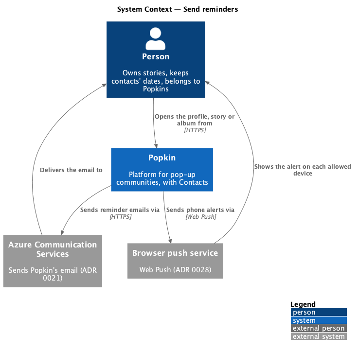
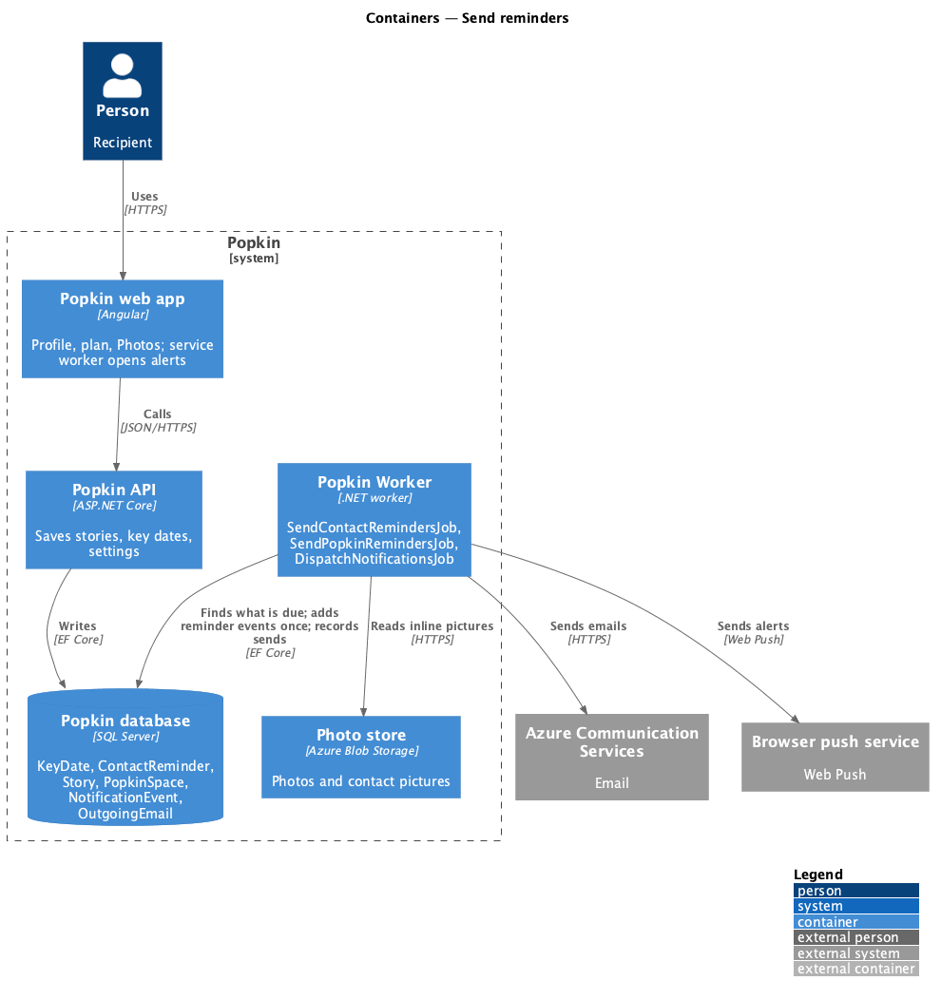
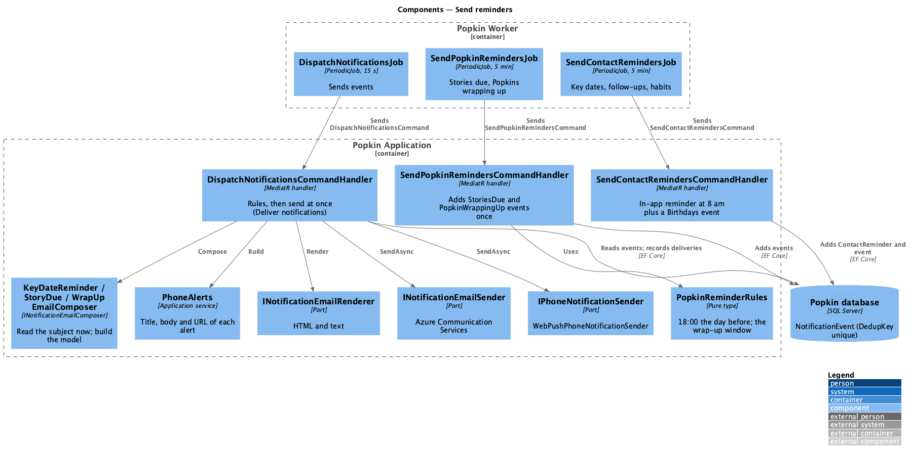
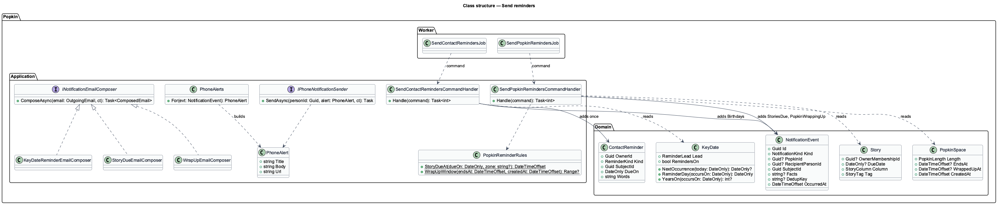
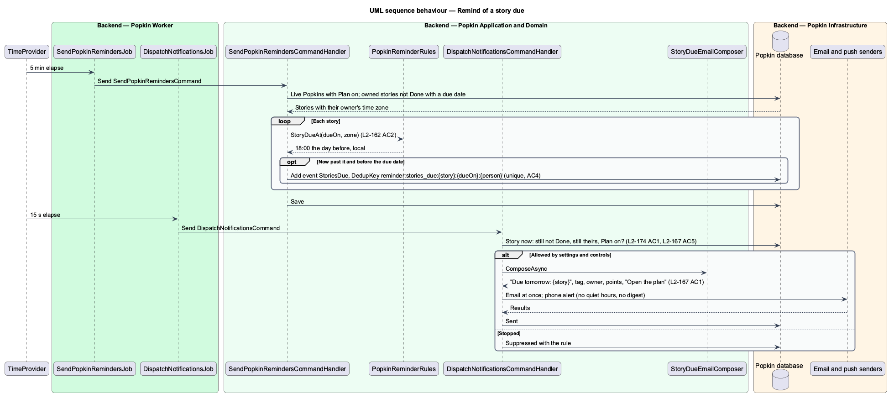
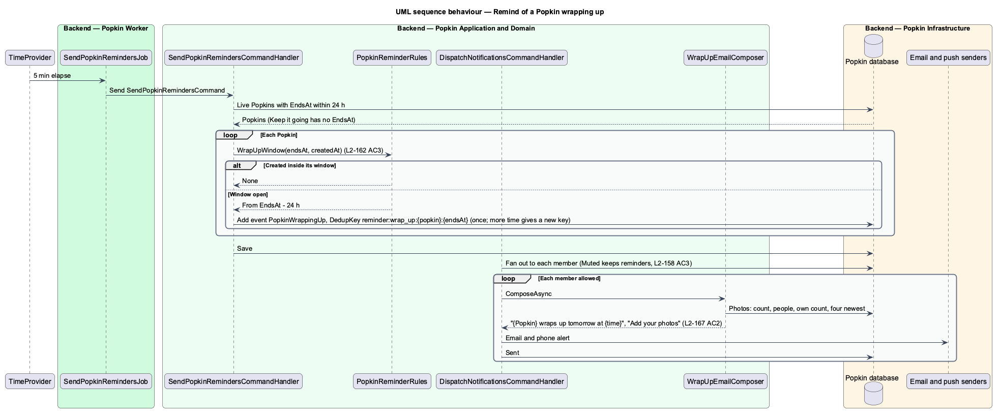
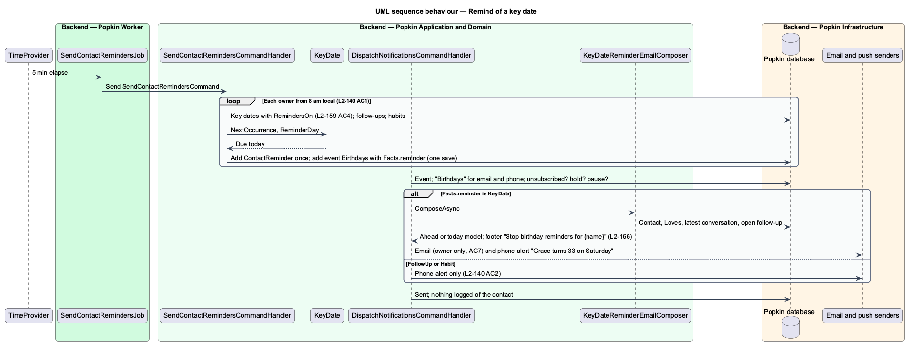

# Send reminders

## Overview

A reminder tells a person ahead of a day that matters, at a set time, whatever their activity
email's frequency (L1-040, L2-162). There are three kinds of reminder in the "Reminders" group of
L2-154:

- **"Birthdays"** — a contact's key date on its reminder day, at 8 am where the person is, by
  email and phone (L2-140, L2-166). A follow-up's due day and a habit's reminder days also send
  a phone alert under this kind, and no email (L2-140 AC2).
- **"Stories due"** — a story the person owns, due tomorrow, at 6 pm the day before (L2-167).
- **"Popkin wrapping up"** — every member, once, 24 hours before their Popkin wraps up (L2-167).

This feature finds what is due and records it once as a `NotificationEvent` with a recipient.
[Deliver notifications](../deliver-notifications/README.md) checks it against the person's
settings and the platform's controls and sends it at once: a reminder is not bundled, not held
for a digest, not counted towards the daily most, and not delayed by quiet hours (L2-161 AC4,
AC6). This feature also builds the three reminder emails on the email shell of
[Popkin update email](../popkin-update-email/README.md).

The in-app reminder in Contacts stays with [Reminders](../../contacts/reminders/README.md). On
17 November 2026, L2-140 replaced the Monday email of the week ahead with this path.

- **reminder** — notification of a key date, a story due or a Popkin's end, sent at its own time
- **reminder day** — occurrence of a key date minus its lead time ([Key dates](../../contacts/key-dates/README.md))
- **reminder event** — `NotificationEvent` of a reminder kind, with its recipient and a `DedupKey` that makes it once only
- **due tomorrow** — a story whose due date is the day after the owner's local today
- **wrap-up window** — the 24 hours before a Popkin's `EndsAt`

## Description

### Emails and states

The emails are in `docs/mocks/notifications/email-birthday/` (manifest id `email-birthday`) and
`docs/mocks/notifications/email-plan-reminder/` (manifest id `email-plan-reminder`):

- `email-birthday/ahead.html`:
  - Subject "Grace's birthday is Saturday, Sep 19", from "Popkin", at 08:00. There is no Popkin
    tile in the header.
  - The body has the contact's photo with the badge "33", "Grace turns 33 on Saturday", and "Sat
    19 Sep · Best friend from uni · London".
  - Then "Things Grace loves, from your notes" as chips, "Last time you talked · Fri 11 Sep" with
    the conversation's title and text, and "Open Grace's page".
  - The footer reads "You asked to be reminded 1 week before Grace Adeyemi's birthday, from your
    contacts." with "Stop birthday reminders for Grace" (L2-166 AC1, AC4, AC6).
- `email-birthday/today.html` — subject "Today: Grace's birthday", "It's Grace's birthday
  today", "Say happy birthday" and "Grace's page" (L2-166 AC2).
- `email-plan-reminder/task.html` — subject "Due tomorrow: Book the cabin at Pine Hollow", the
  story's title, "Due tomorrow, Friday.", "Yours", the tag "Stay", "9 comments", "Latest from
  Ellie · 2 hr ago" with the comment, and the footer "…a to-do of yours in Cabin Week ’27 is due
  tomorrow." with "Mute Cabin Week ’27" (L2-167 AC1, AC3).
- `email-plan-reminder/wrap-up.html`:
  - Subject "Lakeside Weekend wraps up in 24 hours", then "Lakeside Weekend wraps up tomorrow at
    6 pm" and "After that the chat closes and the album becomes a keepsake. Photos you add now
    make the recap."
  - Then "48 photos so far from 11 people. You've added 14." and "Add your photos".
  - The footer reads "Everyone in a Popkin gets this once, a day before it wraps up." (L2-167 AC2,
    AC4).
- `email-plan-reminder/event.html` — "Plans coming up". This feature does not build it (gap
  123).

### Where the mocks and the requirements differ

1. **Sender.** `notify@popk.in` in the mocks. The sender is on `popkin.community`.
2. **"to-do"** (`task.html` body and footer). The word is "story": "a story of yours in
   {Popkin} is due tomorrow" (L2-167 AC3). The body's extra sentence "It's the last open Stay
   to-do on the plan." is not in L2-167 and is not built.
3. **"Mark it done"** (`task.html`). No email acts on Popkin (gap 124). The one button is "Open
   the story", which opens the story on the plan board (L2-167 AC1).
4. **Comments on a story.** "9 comments" and "Latest from Ellie" need comments on stories, which
   Popkin does not have. L2-167 AC1 was changed on 2026-11-17 to leave them out, and the button
   reads "Open the plan"; the mock changes.
5. **A pronoun.** `ahead.html`'s preview "Here's what you know she likes" gives a contact a
   pronoun, which Contacts never does (L2-122 AC4). The preheader is "Turns {age}. Here's what
   you keep about {name}." or, with no age, "On {weekday}. Here's what you keep about {name}."
6. **The event** (`event.html`) is gap 123 and is not built.

### What is due and when (L2-162)

- **Key dates** ("Birthdays").
  - Owner: `SendContactRemindersJob` and its handler ([Reminders](../../contacts/reminders/README.md)).
  - When: from 8 am on the reminder day, where the person is (`ReminderRules.Hour` becomes 8).
  - What: a key date whose `RemindersOn` is true (L2-159 AC4).
  - Event: one per new `ContactReminder`, `Kind = Birthdays`, `RecipientPersonId = owner`,
    `SubjectId` = the `ContactReminder`, `Facts` `{"reminder":"KeyDate"}`.
  - Channels: email and phone, as "Birthdays" allows.
  - `DedupKey`: `reminder:birthdays:{contactReminderId}`.
- **Follow-ups and habits** ("Birthdays").
  - Owner and timing: the same handler, on their day.
  - Event: one per new `ContactReminder`, `Facts` `{"reminder":"FollowUp"}` or
    `{"reminder":"Habit"}`.
  - Channel: the phone only. The catalogue gives these a phone alert and no email.
  - `DedupKey`: as above.
- **Stories due** ("Stories due").
  - Owner: `SendPopkinRemindersJob`.
  - When: from 18:00 the day before the due date, where the story's owner is.
  - What: a story with an owner and a `DueDate`, not in `Done`, in a live Popkin with Plan on.
  - Event: `Kind = StoriesDue`, `RecipientPersonId` = the owner's person, `SubjectId` = the
    story, `Facts` `{"dueOn":"2026-09-18"}`.
  - Channels: email and phone.
  - `DedupKey`: `reminder:stories_due:{storyId}:{dueOn}:{personId}`.
- **Popkin wrapping up** ("Popkin wrapping up").
  - Owner: `SendPopkinRemindersJob`.
  - When: from `EndsAt − 24 h`.
  - What: a live Popkin with an `EndsAt` (not "Keep it going") that existed at `EndsAt − 24 h`.
  - Event: `Kind = PopkinWrappingUp`, `PopkinId`, no recipient (every member),
    `SubjectId` = the Popkin, `Facts` `{"endsAt":"…"}`.
  - Channels: email and phone, to each member.
  - `DedupKey`: `reminder:wrap_up:{popkinId}:{endsAt:O}`.

Rules that apply to all three:

- **Once only** (L2-162 AC4). `NotificationEvent.DedupKey` is unique (nullable for activity
  events). The handler adds an event whose key is not there yet, so a second tick adds nothing.
  The emails it leads to take the `OutgoingEmail` key `reminder:{kind}:{subjectId}:{dueOn}:{personId}`
  of the shared architecture, and a retry sends nothing twice (L2-175 AC3).
- **A story moved.** A story whose due date changes gets a new key, so it reminds again for the
  new day. A story moved to "Done", or given to someone else, before the event is sent is
  suppressed at send time, since the rules read the story again (L2-162 AC2, L2-174 AC1).
- **More time.** A Popkin given more time has a new `EndsAt`, so a new key. It reminds again 24
  hours before its new end (L2-162 AC3). A Popkin that ends early ("Wrap up now") never reaches
  its window, and the one already sent stands.
- **A short Popkin.** A Popkin created less than 24 hours before its end ("Just today", a weekend
  started on Saturday) sends no wrap-up reminder. Its members have only just joined, and the
  email would arrive as they start (`<TO SUPPLY>`: confirmation of this reading of "24 hours
  before").
- **Late start.** The jobs tick every 5 minutes. A reminder due while the Worker was down is
  sent at the next tick, as long as its moment has not passed: the key date's day, the story's
  due date, the Popkin's end.
- **What the dispatcher applies.**
  - It applies: pause, kind off for everyone, hold, unsubscribed (email only), the person's
    switch for the kind and channel, and the Popkin's level. "Muted" and "Just for me" keep
    reminders (L2-158 AC2, AC3).
  - It does not apply: muted people (a reminder has no actor), the daily most, digests and quiet
    hours.
  - A reminder emailed to a person on a digest goes on its own.
  - A paused reminder email queues like any other and is dropped after 6 hours (L2-170).
- **Phone alerts** go through `IPhoneNotificationSender` as `PhoneAlert` (`Title`, `Body`,
  `Url`):
  - a key date: "Grace turns 33 on Saturday", which opens the contact's profile;
  - a follow-up: "{text} is due today", which opens Follow-ups;
  - a habit: the words of `ReminderRules`, which open the contact's profile;
  - a story: "Due tomorrow: {story}", which opens the story;
  - a wrap-up: "{Popkin} wraps up tomorrow at {time}", which opens Photos.

### What each email says

- **Key date** (L2-166).
  - What the composer reads: the `ContactReminder`, its `KeyDate` and `Contact`
    (`Name`, `KnownAs`, `City`, `Loves`, photo), the latest `TimelineEntry` of kind
    `Conversation` with its title, text and day, and the contact's open follow-ups.
  - Subjects: "{name}'s birthday is {weekday}, {date}" ahead, and "Today: {name}'s birthday" on
    the day. A key date that is not a birthday takes the words of Dates (L2-137): "{name}'s
    anniversary is {weekday}, {date}", or the date's title.
  - The name is the contact's first name (`PersonName.FirstName(Contact.Name)`).
  - The badge shows the age from `KeyDate.YearsOn` when the year is known, and nothing without
    it.
  - "On your list" appears only ahead of the day. It shows the contact's earliest open follow-up
    due on or before the occurrence, with "You planned it for {day}" (AC3). `<TO SUPPLY>`: whether
    only a follow-up whose text names the birthday counts.
  - "Things {name} loves, from your notes" lists the `Loves`, and "Last time you talked · {date}"
    shows the latest conversation's title and text cut at 300. Each is left out when empty (AC4).
  - Buttons: "Open {name}'s page" ahead; on the day, "Say happy birthday" and "{name}'s page".
    All of them open the contact's profile (AC1, AC2).
  - Footer: "You asked to be reminded {lead} of {full name}'s {kind}, from your contacts." where
    `{lead}` reads "on the day" for the day itself. The mute is "Stop birthday reminders for
    {name}", which opens Notifications on "People" and switches that date's reminders off with
    Undo ([Unsubscribe](../unsubscribe/README.md), L2-159 AC5).
  - Privacy: the email goes to the owner only and names nobody but their own contact. Nothing
    from it is logged (AC7, L2-122).
- **Story due** (L2-167 AC1, AC3, AC5).
  - Header: the Popkin's tile.
  - Subject: "Due tomorrow: {story}".
  - Body: the title, "Due tomorrow, {weekday}.", the owner's avatar with "Yours", its points,
    and the tag in its colour, with the tag's name as text so colour is not the only carrier.
  - Button: "Open the plan", which opens the plan board (L2-167 AC1, as changed 2026-11-17).
  - Footer: "You're getting this because a story of yours in {Popkin} is due tomorrow." with
    "Mute {Popkin}".
  - It is not sent when Plan is off for the Popkin.
- **Popkin wrapping up** (L2-167 AC2, AC4).
  - Subject: "{Popkin} wraps up in 24 hours".
  - Headline: "{Popkin} wraps up tomorrow at {time}", in the recipient's time zone, written "6
    pm".
  - Body: four album photos, newest first, as inline images; "{n} photos so far from {m}
    people." and "You've added {k}." (left out at zero).
  - Button: "Add your photos", which opens Photos.
  - Footer: "Everyone in a Popkin gets this once, a day before it wraps up." with "Mute
    {Popkin}".

### Backend

- **`SendContactRemindersCommandHandler`** (changed, `Popkin.Application/Contacts/Reminders/`):
  - It remains the only writer of `ContactReminder`.
  - For each fresh reminder it adds the reminder event in the same save. It no longer calls
    `IPhoneNotificationSender` itself.
  - It skips a key date whose `RemindersOn` is false.
  - The Monday branch, `IContactsEmailSender`, `ContactWeeklyEmail` and the reads of
    `ReminderPreferences.PhoneNotifications` and `MondayEmail` are removed
    ([Reminders](../../contacts/reminders/README.md)).
  - `ContactReminder.NotifiedAt` is kept for the in-app message only.
- **`SendPopkinRemindersJob`** (new, `Popkin.Worker/Jobs/`) — a `PeriodicJob` every 5 minutes,
  command `SendPopkinRemindersCommand`.
- **`SendPopkinRemindersCommandHandler`** (new, `Popkin.Application/Notifications/Reminders/`):
  - **Stories:** it reads the live Popkins with Plan on (`IFeatureSwitches` and the Host's
    choice, [Choose a Popkin's features](../../popkins/choose-features/README.md)), then their
    owned stories not in `Done` with a `DueDate`. For each story it checks the owner's local time
    and adds the event when due.
  - **Popkins:** it reads the live Popkins whose `EndsAt` falls within 24 hours and that were
    created at least 24 hours before it, and adds the event.
  - It saves in batches of 100 events.
  - It sends nothing itself.
- **`PopkinReminderRules`** (Application, pure) — `StoryDueAt(dueOn, zone)` gives 18:00 the day
  before, local. `WrapUpWindow(endsAt, createdAt)` gives the window, or none. Both are tested one
  case per row.
- **`NotificationEvent.DedupKey`** (nullable, unique where set) and **`Facts`** — added by
  [Deliver notifications](../deliver-notifications/README.md). The catalogue
  (`NotificationCatalogue`) gives "Birthdays" with `Facts.reminder` of `FollowUp` or `Habit` the
  phone channel alone.
- **Composers** (Application, `INotificationEmailComposer`):
  - `KeyDateReminderEmailComposer` (`KeyDateReminder`);
  - `StoryDueEmailComposer` (`StoryDue`);
  - `WrapUpEmailComposer` (`WrapUp`).

  Each reads its subject as it is now and answers `Nothing` when it no longer stands: a contact,
  date, story or Popkin deleted; a story done or given away; a Popkin wrapped up. They share
  `EmailShellModel`, `EmailText` and `NotificationLinks` with
  [Popkin update email](../popkin-update-email/README.md).
- **`PhoneAlerts`** (Application) — builds the `PhoneAlert` of each reminder for the dispatcher.
- **`IPhoneNotificationSender`** (changed) — `SendAsync(personId, PhoneAlert, ct)` replaces
  `PhoneReminder`, and `WebPushPhoneNotificationSender` sends the alert's URL in its payload. A
  subscription answered `404` or `410` is still removed (ADR 0028).
- **Telemetry:**
  - `popkin.notifications.events` by `kind` (`birthdays`, `stories_due`, `popkin_wrapping_up`);
  - `popkin.notifications.deliveries` by `kind`, `channel` and `outcome`;
  - `popkin.notifications.reminders.last_tick` per job.

  `popkin.contacts.reminders.sent` keeps the `in_app` channel only.
- **Settings.** No new setting. `App:Origin` (Worker), used only by the Monday email's link, is
  removed in favour of `PopkinUrlBuilder` (`docs/deployment.md`).

### Frontend

No new screen. The links open screens that exist:

- the contact's profile;
- Follow-ups;
- the plan board, at `/p/:popkinId/plan` (L2-167 AC1);
- Photos.

The service worker of ADR 0028 opens the alert's `Url` when the alert is chosen.

### Tests

- **Direct tests of `PopkinReminderRules`**, one case per row:
  - due at 18:00 the day before, in UTC, `Europe/London` across the clock change, and
    `Pacific/Auckland`;
  - the wrap-up window for each of "Just today", "The weekend" and "Until a date";
  - none for "Keep it going";
  - none for a Popkin created inside its window;
  - a new window after more time.
- **Handler tests** (`SendPopkinRemindersCommandHandler`) on InMemory with `FakeTimeProvider`:
  - before 18:00 nothing, at 18:00 one event, and a second tick adds none;
  - none for a story in `Done`, with no owner, with no due date, in a Popkin with Plan off, or in
    a wrapped-up Popkin;
  - a changed due date reminds again;
  - one wrap-up event per `EndsAt`, and a second one after more time.
- **Handler tests** (`SendContactRemindersCommandHandler`):
  - at 8 am one in-app reminder and one event;
  - `RemindersOn` false gives neither;
  - a follow-up and a habit give events with their `Facts`;
  - no Monday email is sent on any day.
- **Composer tests**, one case per row:
  - the subjects ahead and today;
  - the age badge with and without a year;
  - "On your list" shown ahead and left out on the day;
  - "Loves" and "Last time you talked" left out when empty;
  - a non-birthday's words;
  - the story email without comments;
  - the wrap-up time in the recipient's zone, and "You've added" left out at zero;
  - `Nothing` for each subject gone.
- **Dispatcher tests** in [Deliver notifications](../deliver-notifications/README.md) cover
  that:
  - a reminder ignores quiet hours, digests and the daily most;
  - "Birthdays" off for email sends the phone alert only;
  - a muted Popkin still sends reminders.
- **Acceptance test through the API and Worker:** a story given a due date through the API
  reaches its owner's fake inbox once at 18:00 the day before. A Popkin's members are each sent
  one wrap-up email 24 hours before its end. No test sleeps (ADR 0010).

## Requirements

| L2 ID | Refines (L1) | Requirement |
|-------|--------------|-------------|
| `L2-140` | `L1-033` | Reminders reach the person: A reminder arrives in Contacts, and by email and phone alert as the person's notification settings say. (AC2, AC3; AC1 and AC4 in [Reminders](../../contacts/reminders/README.md)) |
| `L2-162` | `L1-040` | When reminders are sent: Each reminder has its own time, whatever the activity email's frequency. (AC1–AC4) |
| `L2-166` | `L1-041` | The key date reminder email: A reminder of a contact's birthday or key date comes with what the person keeps about them. (AC1–AC7) |
| `L2-167` | `L1-041` | The story-due and wrap-up emails: Two reminders come from a Popkin: a story due tomorrow, and the Popkin wrapping up tomorrow. (AC1–AC5) |

## Diagrams

### System context

Popkin reminds a person by email through Azure Communication Services and by phone through the
browser's push service.

### Containers

The Worker finds what is due, records each reminder once and sends it. The API supplies nothing
to this path beyond the data the Worker reads.

### Components

Two jobs find what is due. The dispatcher of Deliver notifications sends each reminder event at
once through the composers, the renderer and the two senders.

### Class structure

### Behaviour

From 6 pm the day before, a story due tomorrow is recorded once and sent to its owner.

From 24 hours before its end, a Popkin's wrap-up reminder is recorded once and goes to every
member.

At 8 am on a reminder day, a key date's reminder becomes an in-app message and an event. The
event is sent by email and phone as "Birthdays" allows.

