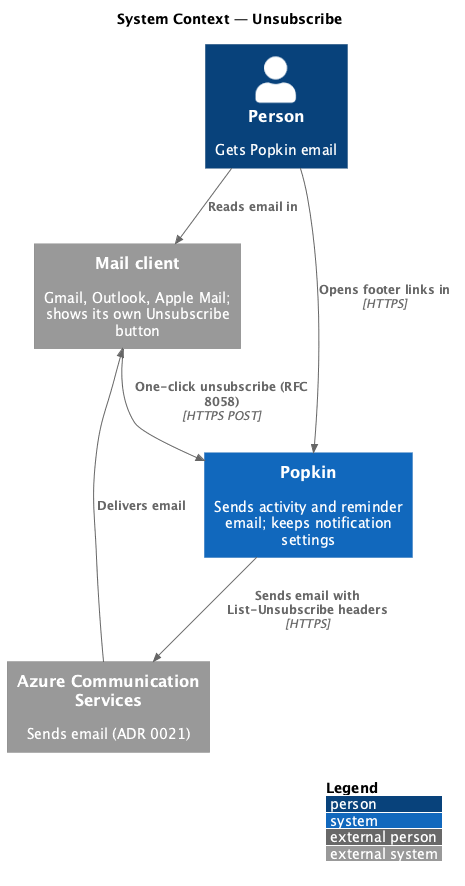
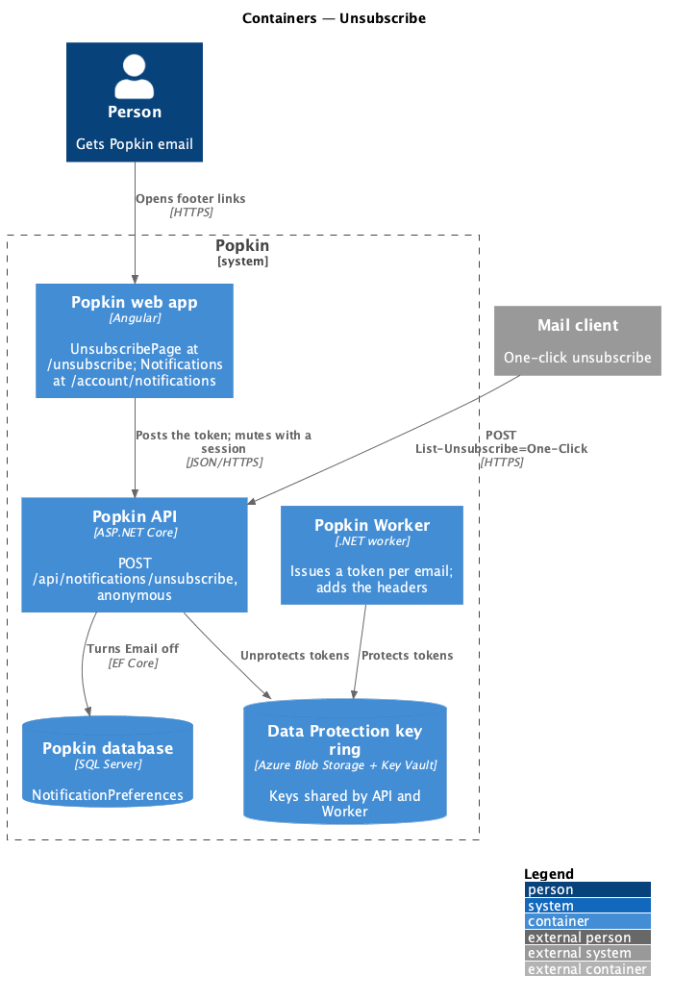
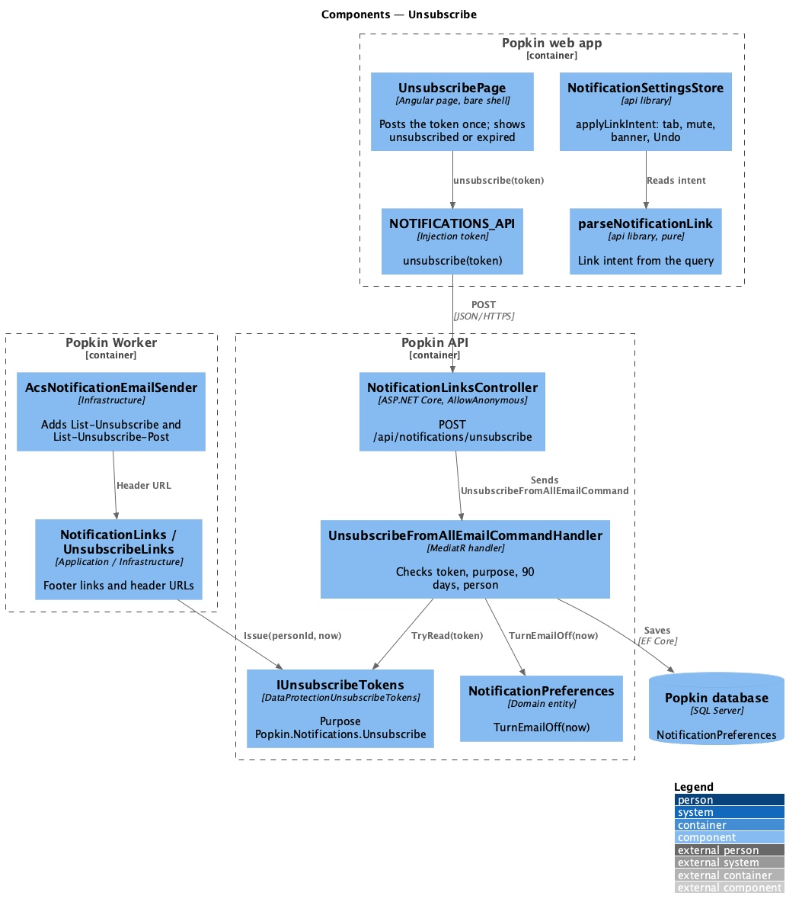
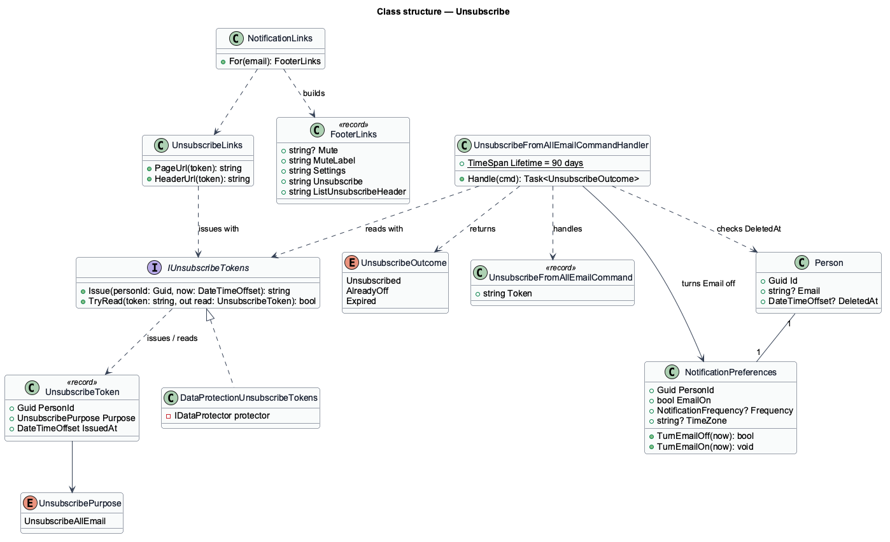
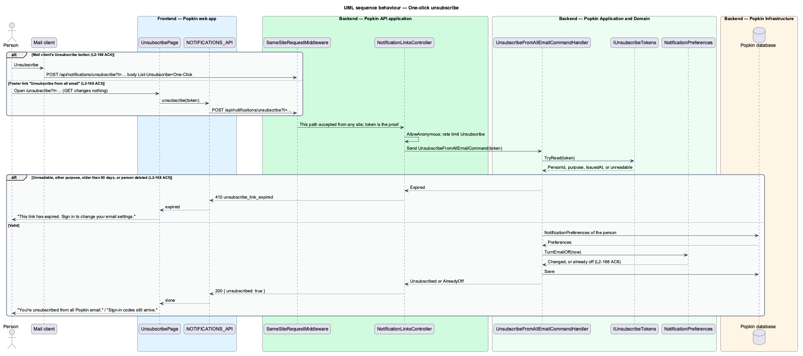
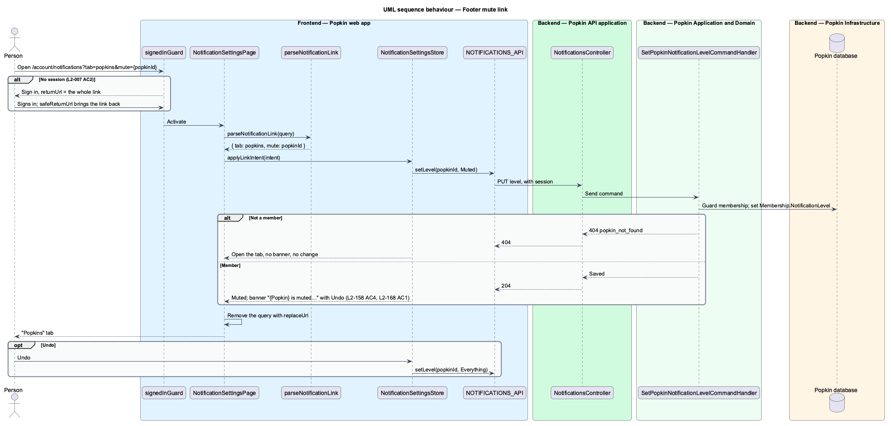

# Unsubscribe

## Overview

Every activity and reminder email ends with a footer that says why it arrived and offers three
ways to hear less: the narrowest mute first, then the notification settings, then "Unsubscribe
from all email" (L1-041, L2-163 AC5). This feature makes those links work (L2-168).

The mute links and "Notification settings" open the Notifications screen in the Popkin web app.
They sign the person in first when there is no session, open the right tab, apply the mute and
offer "Undo". "Unsubscribe from all email" is the one link in Popkin that changes something
without a session. Mail providers and the law expect one click to stop marketing and bulk
email. Every email therefore also carries the `List-Unsubscribe` and `List-Unsubscribe-Post`
headers of RFC 8058, so a mail client's own "Unsubscribe" button works without opening Popkin.

- **footer link** — link at the foot of an email: a mute link, "Notification settings" or "Unsubscribe from all email"
- **mute link** — footer link that stops the narrowest thing the email came from: "Mute {Popkin}", "Mute a Popkin" or "Stop birthday reminders for {name}"
- **link intent** — what a footer link asks the Notifications screen to do: the tab to open, and the mute to apply, if any
- **unsubscribe token** — signed value in an unsubscribe link that names one recipient and the one thing it may do
- **one-click unsubscribe** — RFC 8058 request: a `POST` to the `List-Unsubscribe` URL with the body `List-Unsubscribe=One-Click`, sent by a mail client with no session

Unsubscribing turns the person's "Email" off, exactly as the switch on the Notifications screen
does (L2-156 AC3). Sign-in codes still arrive and phone alerts are unchanged.

## Description

### Screens and states

- `docs/mocks/pages/notification-settings/` — the landing screen of every footer link but
  unsubscribe, at `/account/notifications`. The state `muted` shows a mute link's banner
  ("{Popkin} is muted…" with "Undo"), `birthday-off` the birthday banner, `unsubscribed` the
  banner "You're unsubscribed from all Popkin email…" with "Turn email back on", and `default`
  the screen opened from "Notification settings". The screen itself is designed in
  [Notification settings](../notification-settings/README.md).
- `docs/mocks/notifications/email-*/` — each email's footer with its links (L2-163 AC5).
- `docs/mocks/pages/unsubscribe/` — the page a one-click link opens without a session: `default`
  ("You're unsubscribed from all Popkin email.", "Sign-in codes still arrive.", "Turn email back
  on"), `working` while its one request is out, `expired` ("This link has expired." "Sign in to
  change your email settings.", "Sign in") and `error` ("We couldn't unsubscribe you." "Nothing
  has changed. Check your connection and try again.", "Try again") (L2-168 AC3, AC5).

### Footer links

`NotificationLinks` (Application) builds each footer link with `PopkinUrlBuilder` on the app's
origin (`App:Origin`, `https://app.popkin.community`). Each opens `/account/notifications` with a query that states the link intent:

| Footer link | URL | Lands on |
|---|---|---|
| "Mute {Popkin}" | `/account/notifications?tab=popkins&mute={popkinId}` | "Popkins", that Popkin set to "Muted", banner with "Undo" (L2-158 AC4) |
| "Mute a Popkin" | `/account/notifications?tab=popkins` | "Popkins", no change (L2-168 AC1) |
| "Stop birthday reminders for {name}" | `/account/notifications?tab=people&stop-birthday={keyDateId}` | "People", that birthday's switch off, banner with "Undo" (L2-159 AC5) |
| "Notification settings" | `/account/notifications?tab=types` | "What you hear about" (L2-168 AC2) |
| "Unsubscribe from all email" | `/unsubscribe?t={token}` | The unsubscribe page, no session needed (L2-168 AC3) |

- **Sign-in first.** `/account/notifications` sits behind `signedInGuard`. Without a session the
  guard opens sign-in with `returnUrl` set to the whole link, and `safeReturnUrl` brings the
  person back to it once signed in (L2-007 AC2, AC3).
- **The intent is parsed in one place.** `parseNotificationLink(queryParamMap)` (`api` library,
  pure, unit tested) returns `{ tab, mute? }`. An unknown tab falls back to "types", and a
  malformed id is ignored. `NotificationSettingsStore` applies the mute through the ordinary
  settings API, as a tap on the screen would. A Popkin the person is not in, or a key date that
  is not theirs, answers `404`; the screen then opens the tab with no banner and no change. The
  query is then removed from the address with `replaceUrl`, so a reload does not mute twice.
- **No token in mute links.** A mute link changes the signed-in person's own setting, is undone
  with one tap, and the banner shows what changed. It carries no secret.

### One-click unsubscribe

- **The link and the headers.** `NotificationLinks` issues a token for each email and builds two
  URLs from it on the app's origin:
  - `https://app.popkin.community/unsubscribe?t={token}` — the footer link; a page in the web app.
  - `https://app.popkin.community/api/notifications/unsubscribe?t={token}` — the `List-Unsubscribe`
    URL. `AcsNotificationEmailSender` adds the headers
    `List-Unsubscribe: <{that URL}>` and `List-Unsubscribe-Post: List-Unsubscribe=One-Click` to
    every activity and reminder email (L2-168 AC4). Azure Communication Services shall sign both
    headers with DKIM, as mailbox providers require. Whether its DKIM signature covers custom
    headers is `<TO SUPPLY>`.
- **The page.** `UnsubscribePage` (`frontend/projects/popkin/src/app/pages/unsubscribe/`) is
  served at `/unsubscribe`, with route data `{ shell: 'bare', page: 'unsubscribe' }` and no
  guard. It reads `t` and posts it once with `NOTIFICATIONS_API.unsubscribe(token)`. It then
  shows "You're unsubscribed from all Popkin email." with "Sign-in codes still arrive." and the
  link "Turn email back on" to `/account/notifications?tab=types`, which signs the person in
  first (L2-168 AC3). An expired or refused token shows "This link has expired." "Sign in to
  change your email settings." with "Sign in" to `/account/notifications`. A request that fails
  for another reason shows "We couldn't unsubscribe you." "Nothing has changed. Check your
  connection and try again." with "Try again", which posts again. The page acts on
  a person's click, not on a link scanner's `GET`: the `GET` of the page changes nothing, and the
  change is a `POST` the page sends once it runs.
- **The endpoint.** `POST /api/notifications/unsubscribe?t={token}`, `[AllowAnonymous]`:
  - With the form body `List-Unsubscribe=One-Click` (a mail client) or an empty body (the page),
    it answers `200`. The body is `{ "unsubscribed": true }` for the page; a mail client reads
    the status only.
  - A token that fails any check of the next section answers `410` `unsubscribe_link_expired`.
    The answer is the same whatever failed, so nothing is learned about the recipient
    (L2-168 AC5).
  - `GET` answers `405` with `Allow: POST`; a `GET` never unsubscribes.
  - It runs under the rate-limiter policy `RateLimitPolicyNames.Unsubscribe`: 30 requests per
    client address per 10 minutes, the shape of the other per-address limits.
  - `SameSiteRequestMiddleware` accepts this one path from any site, because a mail provider
    posts from its own servers and the token, not the cookie, is the proof. Every other change
    keeps its same-site check (L2-050 AC2).
- **Replay.** Turning "Email" off when it is already off changes nothing and answers `200`, so a
  second click, a mail client's retry, or the page and the header both firing all end the same
  way (L2-168 AC6).

### Token rules

- **Shape.** The token holds the person's id and its expiry, 90 days after it was issued. It is
  protected with ASP.NET Core Data Protection's time-limited protector under the purpose
  `Popkin.Notifications.Unsubscribe` and written base64url. It is opaque and authenticated
  encryption, so a changed token cannot be read (L2-168 AC5).
- **One purpose.** The protector's purpose string isolates it: a token from any other protector,
  or this token presented anywhere else, fails to unprotect. The only endpoint that reads it is
  the unsubscribe endpoint, and the only change it makes is "Email" off.
- **90 days.** `UnsubscribeTokens` compares the expiry with `TimeProvider`, not with the system
  clock, so tests advance a `FakeTimeProvider`. A token issued more than 90 days ago is refused.
- **Deleted account.** A token whose person has `DeletedAt` set, or does not exist, is refused.
- **Keys.** The Worker issues tokens and the API reads them, so both shall share one Data
  Protection key ring with the application name `Popkin`
  ([ADR 0031](../../../adr/0031-one-data-protection-key-ring-in-blob-storage.md)): the blob
  `dataprotection/keys.xml` in `stpopkin{suffix}`, its keys wrapped by the key `dataprotection`
  in `kvpopkin{suffix}`. Keys roll every 90 days by default; a retired key still unprotects until
  it is removed, so a token outlives a key roll.
- **Nothing logged.** No log, metric or span carries the token, the URL with its query string,
  or the person (L2-174 AC3). A refusal is counted by reason in `popkin.notifications.unsubscribes`
  with `outcome` (`unsubscribed`, `already`, `expired`).

### API

`NotificationLinksController` (`Popkin.Api/Controllers/`).

- `POST /api/notifications/unsubscribe?t={token}` — `[AllowAnonymous]`, as above.
  `200` `{ unsubscribed: true }`; `410` `unsubscribe_link_expired`; `429` `rate_limited`.

The mute links use the settings endpoints of [Notification settings](../notification-settings/README.md),
[Each Popkin's level](../popkin-levels/README.md) and
[Birthday reminders by person](../birthday-reminders-by-person/README.md), with a session.

### Backend

- **`IUnsubscribeTokens`** (Application) — `Issue(personId): string`, and `Read(token): Guid?`,
  null for anything forged, altered or past its 90 days. `UnsubscribeTokens` (Infrastructure)
  implements it with `IDataProtectionProvider.CreateProtector("Popkin.Notifications.Unsubscribe")`
  made time-limited.
- **`UnsubscribeFromAllEmailCommand(token)`** / **`UnsubscribeFromAllEmailCommandHandler`**
  (`Popkin.Application/Notifications/`) — reads the token, checks purpose, age (90 days by
  `TimeProvider`) and the person. It then calls `NotificationPreferences.TurnEmail(false, now)`,
  which the "Email" switch also calls (L2-156 AC3), and saves. It returns `Unsubscribed`,
  `AlreadyOff` or `Expired`. Queued and bundled emails for the person are stopped by the
  send-time recheck ([Deliver notifications](../deliver-notifications/README.md)).
- **`NotificationLinks`** (Application) — builds the footer links of one email from the email's
  model: the mute link that fits it, settings, and the unsubscribe link.
- **Settings** (ADR 0013), for `docs/deployment.md`: `DataProtection:BlobUri` and
  `DataProtection:KeyId` (Key Vault key), API and Worker. Without them, outside Development, the
  Worker shall not send notification email, because the links it would put in the emails could
  not be read by the API.

### Frontend (Popkin web app)

- **`UnsubscribePage`** — as above; route `/unsubscribe` added to `app.routes.ts` beside the
  other public routes, title "Unsubscribe · Popkin".
- **`NOTIFICATIONS_API`** — `unsubscribe(token): Observable<void>`, which maps `410` to an
  `expired` result.
- **`parseNotificationLink`** (`api`) — the link intent, with its unit specs: each row of the
  footer links table, an unknown tab, a malformed id and no query.
- **`NotificationSettingsStore`** — `applyLinkIntent(intent)` mutes, shows the banner, and
  clears the query.

### Tests

- `UnsubscribeFromAllEmailCommandHandler` on InMemory with `FakeTimeProvider`, one case per row:
  a valid token turns "Email" off; already off answers `AlreadyOff`; 90 days less a minute is
  valid; 90 days and a minute is expired; a deleted person is expired; a token of another
  purpose is expired; a changed character is expired. Phone choices and kind choices are
  unchanged.
- API acceptance (`ApiFactory`, no session): `POST` with `List-Unsubscribe=One-Click` answers
  `200` and the settings read shows "Email" off; a second `POST` answers `200`; a `GET` answers
  `405`; a bad token answers `410` `unsubscribe_link_expired`; a cross-site `POST` is accepted on
  this path and refused on another (`403` `cross_site_request`).
- `AcsNotificationEmailSender` test with a fake `EmailClient`: every email carries both headers,
  with the header URL on `/api/notifications/unsubscribe`.
- `parseNotificationLink` and `NotificationSettingsStore.applyLinkIntent` unit specs (`api`).
- Playwright (`e2e/tests/notifications-links.spec.ts`, page objects `UnsubscribePage` and
  `NotificationSettingsPage`):
  - `/unsubscribe?t=…` shows the unsubscribed state;
  - an expired token shows the expired state;
  - "Turn email back on" opens sign-in, then Notifications;
  - `/account/notifications?tab=popkins&mute=…` shows the muted banner, and "Undo" restores
    "Everything".

  Answers come from `responses.json`, with stubs for the expired state. Each new screen state
  gets its `routes.ts` entry.

## Requirements

| L2 ID | Refines (L1) | Requirement |
|-------|--------------|-------------|
| `L2-168` | `L1-041` | Footer links and unsubscribing: Each email's footer links stop what the person asks, and nothing else. (AC1–AC6) |

## Diagrams

### System context

A person unsubscribes from an email's footer link or from their mail client's own button; Popkin
stops every email but sign-in codes.

### Containers

The Worker puts the token in each email; the API reads it with the shared key ring; the web app
shows the page and the landing screen.

### Components

`UnsubscribeFromAllEmailCommandHandler` reads the token and turns "Email" off through the same
`NotificationPreferences` method as the switch.

### Class structure

### Behaviour

A mail client's button, or the page a footer link opens, posts the token once; a replay answers
the same.

A mute link signs the person in if needed, opens the right tab, applies the mute and offers
"Undo".

