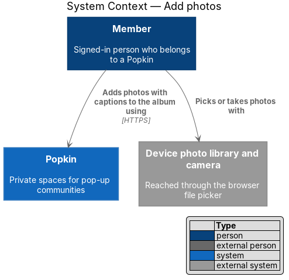
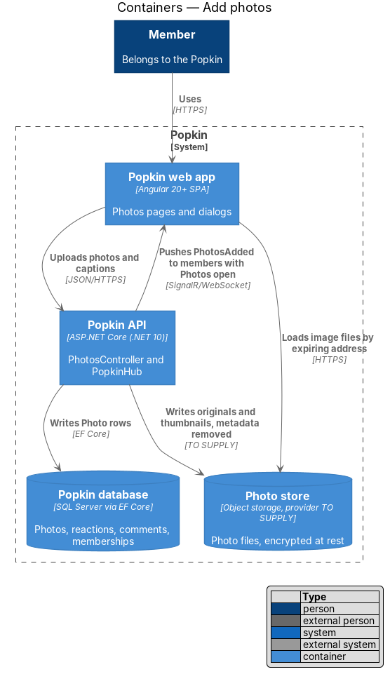
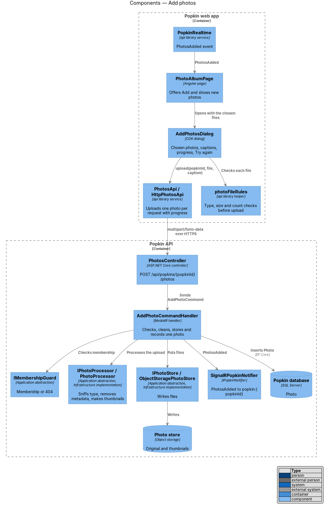
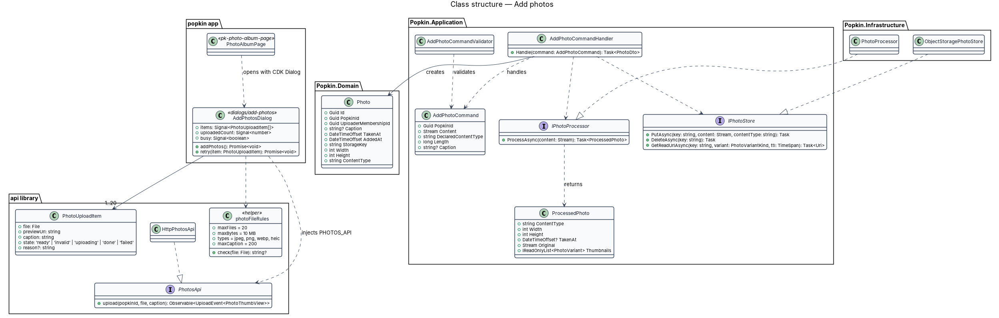
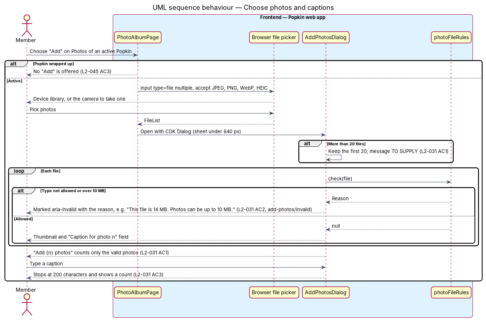
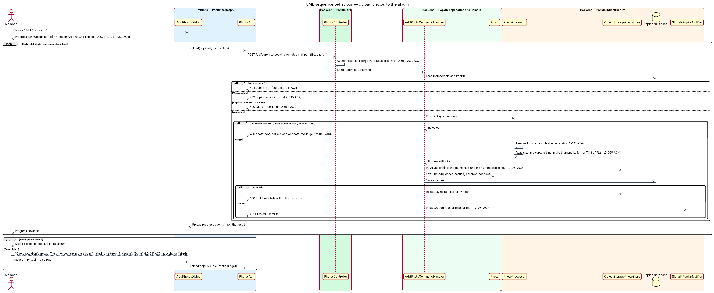
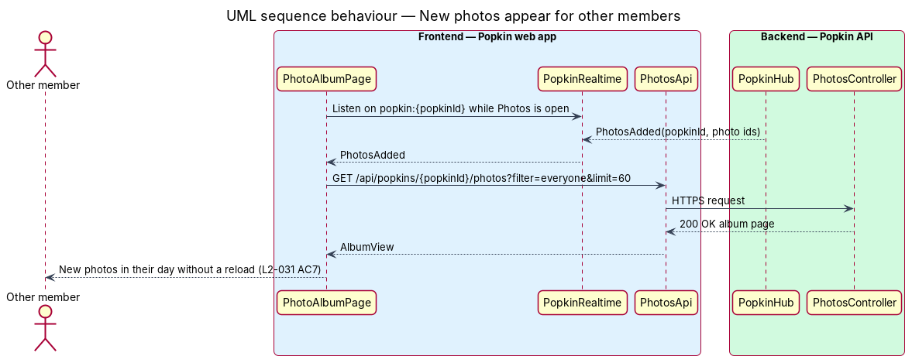

# Add photos

## Overview

Popkin is a free platform for pop-up communities. Each Popkin has one shared photo album, called
Photos (L1 Terms), that every member can add to and browse. This feature covers adding photos to
that album. A member chooses up to 20 photos from their device, or takes one with the camera,
gives each an optional caption, and uploads them. The other members see the new photos without
reloading.

- **album** — the Popkin's shared set of photos, shown on the Photos tab
- **upload item** — one chosen file in the add-photos dialog, with its preview, caption and
  upload state
- **original** — the stored file at the size it was added, with location and device metadata
  removed. It is what "Save photo" downloads (L2-036 AC1).
- **thumbnail** — smaller copy of a photo in a modern format, made at upload, served in lists
  (L2-055 AC4)
- **Photo store** — object storage that holds the files; the Popkin database holds only their
  keys and facts

Each photo travels in its own request. One failure therefore never loses the others (L2-031 AC5),
and the dialog can count progress as "Uploading 2 of 3". The browser checks type, size and caption
length before upload so the member sees problems at once. The API checks again from the file's
content, whatever its name says (L2-052 AC3).

## Description

### Screens and states

- `docs/mocks/dialogs/add-photos/default.html` — "Add photos", the line "JPEG, PNG, WebP or HEIC,
  up to 10 MB each. Location data is removed.", three photos with "Caption for photo n" and
  "Add 3 photos".
- `docs/mocks/dialogs/add-photos/invalid.html` — one photo marked "This file is 14 MB. Photos can
  be up to 10 MB."; the action reads "Add 2 photos" (L2-031 AC2).
- `docs/mocks/dialogs/add-photos/busy.html` — rows "Uploading", the bar "Uploading 2 of 3" and a
  disabled "Adding…" (L2-031 AC4).
- `docs/mocks/dialogs/add-photos/failed.html` — the alert "One photo didn't upload. The other two
  are in the album.", the failed row with "Didn't upload. Try again", and "Done" (L2-031 AC5).
- `docs/mocks/pages/photo-album/default.html` — the "Add photos" button that opens the picker;
  `docs/mocks/pages/photo-album/empty.html` and `no-results.html` offer "Add photos" too.

No mock shows the message when more than 20 files are chosen, nor the caption counter near
200 characters; their wording is `<TO SUPPLY>`.

### API

- `POST /api/popkins/{popkinId}/photos` — `multipart/form-data` with `file` and an optional
  `caption`. `201 Created` with `PhotoDto` and a `Location` of the photo. Errors:
  `400 photo_type_not_allowed`, `400 photo_too_large`, `400 caption_too_long` (each naming the
  field, L2-052 AC1), `404 popkin_not_found` (L2-051 AC1), `409 popkin_wrapped_up`
  (L2-045 AC2). The request size limit is 10 MB plus form overhead; the overhead allowance is
  `<TO SUPPLY>`.
- `PopkinHub` event `PhotosAdded(popkinId, photoIds)` on `popkin:{popkinId}`.

### Frontend

- **`AddPhotosDialog`** — introduced, `dialogs/add-photos/add-photos.dialog.ts`, opened with the
  CDK `Dialog` from `PhotoAlbumPage` with the chosen `File` list. It holds one `PhotoUploadItem`
  per file. Each row composes a thumbnail and `pk-text-field` (pill, `maxlength` 200, with a
  count). Above the rows sits `pk-alert` for the failed state. The footer holds `pk-progress` and
  `pk-button`. The frame is `pk-dialog`: a bottom sheet under 640 px, focus held inside, and
  Escape closes it (L2-057 AC2, L2-058 AC4). Uploads run one at a time. The action is disabled
  and reads "Adding…" while they run (L2-056 AC3). The upload row (`upload-item` in the mock) has
  no design-system page; its component name is `<TO SUPPLY>`.
- **`photoFileRules`** — pure helper in the `api` library: at most 20 files; types `image/jpeg`,
  `image/png`, `image/webp`, `image/heic`; at most 10 MB; captions at most 200 characters. It
  returns the reason shown on an invalid row.
- **`PhotosApi` / `PHOTOS_API` / `HttpPhotosApi`** — introduced. `upload(popkinId, file,
  caption)` posts with `reportProgress` and emits progress and the `PhotoThumbView` result.
- **`PhotoAlbumPage`** — the "Add" action is a `pk-button` (floating variant). It triggers a
  hidden `<input type="file" multiple accept="image/jpeg,image/png,image/webp,image/heic">`. On a
  phone the device's picker also offers the camera. The page refreshes on `PhotosAdded`
  (L2-031 AC7).

### Backend

- **`PhotosController`** — introduced, `/api/popkins/{popkinId}/photos`. It binds the form,
  checks the request size, and sends `AddPhotoCommand`.
- **`AddPhotoCommand` / `AddPhotoCommandValidator` / `AddPhotoCommandHandler`** — introduced. The
  validator limits the caption to 200 characters. The handler takes these steps:
  1. Loads the caller's membership through `IMembershipGuard`.
  2. Refuses a wrapped-up Popkin.
  3. Passes the stream to `IPhotoProcessor`.
  4. Writes the original and thumbnails to `IPhotoStore` under a random key
     (`popkins/{popkinId}/{guid}`) that cannot be guessed (L2-051 AC2).
  5. Inserts the `Photo` and saves.

  When the save fails, the handler deletes the files it wrote. On success it pushes
  `PhotosAdded` through `IPopkinNotifier`.
- **`IPhotoProcessor`** — introduced in `Popkin.Application.Abstractions` and implemented in
  Infrastructure by `PhotoProcessor`. It identifies the type from the file's leading bytes and
  refuses anything but JPEG, PNG, WebP or HEIC. It removes location and device metadata
  (L2-031 AC6), reads width, height and capture time, and makes thumbnails. The imaging library,
  the HEIC decoder, the thumbnail sizes and format, and whether the original is re-encoded are
  `<TO SUPPLY>`.
- **`IPhotoStore` / `ObjectStoragePhotoStore`** — `PutAsync`, `DeleteAsync` and
  `GetReadUrlAsync`. The store encrypts files at rest (L2-054 AC5). The provider is
  `<TO SUPPLY>`.
- **Domain** — `Photo` (`Id`, `PopkinId`, `UploaderMembershipId`, `Caption?`, `TakenAt`,
  `AddedAt`, `StorageKey`, `Width`, `Height`, `ContentType`). `TakenAt` is the capture time read
  before the metadata is removed, or `AddedAt` when the file has none. `IAppDbContext` gains
  `DbSet<Photo>`; `PhotoConfiguration` maps it.
- **Logging** — no photo content or caption is logged (L2-054 AC3).

### Open questions

- Rate limit on uploads: `<TO SUPPLY>`. L2-053 names none.
- Message when more than 20 files are chosen: `<TO SUPPLY>`.
- Imaging library, HEIC support, thumbnail sizes and format: `<TO SUPPLY>`.
- Photo store provider: `<TO SUPPLY>`.

## Requirements

| L2 ID | Refines (L1) | Requirement |
|-------|--------------|-------------|
| `L2-031` | `L1-009` | Add photos: Any member adds photos to the album. |
| `L2-045` | `L1-011` | A wrapped-up Popkin is read-only: Nothing new is added to a Popkin that has ended. |
| `L2-051` | `L1-012` | Popkins are private to their members: Membership decides everything a person sees. |
| `L2-052` | `L1-012` | Input is validated and output is encoded: Nothing a person types can harm another person or the system. |
| `L2-054` | `L1-012` | Personal data is protected: Phone numbers, emails, messages and photos are handled as private data. |

From `L2-045` this feature enforces AC2 and AC3 for photos. From `L2-052` it enforces AC1 and AC3,
and from `L2-054` AC3 and AC5.

## Diagrams

### System context

A member picks or takes photos on their device and adds them to the Popkin's album.

### Containers

The web app uploads each photo to the Popkin API. The API writes the files to the Photo store and
the record to the Popkin database, then tells other members over SignalR.

### Components

`AddPhotosDialog` checks files with `photoFileRules` and uploads through `PhotosApi`.
`AddPhotoCommandHandler` uses `IPhotoProcessor` and `IPhotoStore`, inserts the `Photo` and
notifies.

### Class structure

The dialog holds up to 20 `PhotoUploadItem` rows and depends on the `PhotosApi` contract. On the
server the handler creates a `Photo` from a `ProcessedPhoto`.

### Behaviour — choose photos and captions

The dialog marks each file that breaks a rule with its reason. Only the valid photos are counted
in the action (L2-031 AC1, AC2, AC3).

### Behaviour — upload photos to the album

Photos upload one at a time with progress. The server checks the real file type, removes
metadata and stores the files. A failed photo stays in the dialog with "Try again" while the
others reach the album (L2-031 AC4, AC5, AC6).

### Behaviour — new photos appear for other members

A member with Photos open receives `PhotosAdded` and reloads the latest page, so new photos
appear without a reload of the screen (L2-031 AC7).

