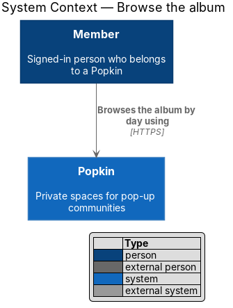
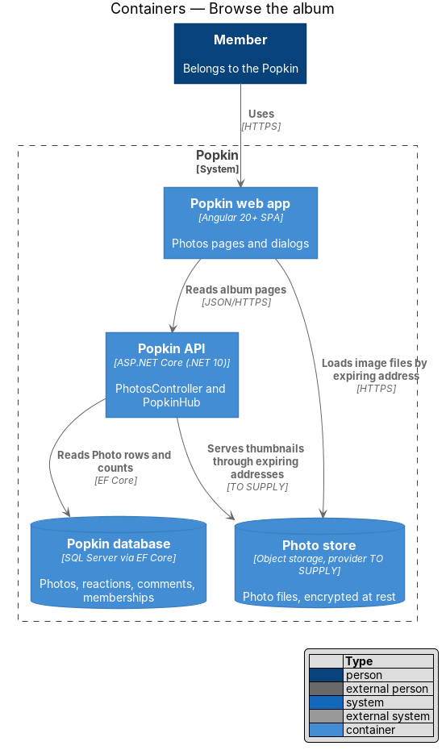
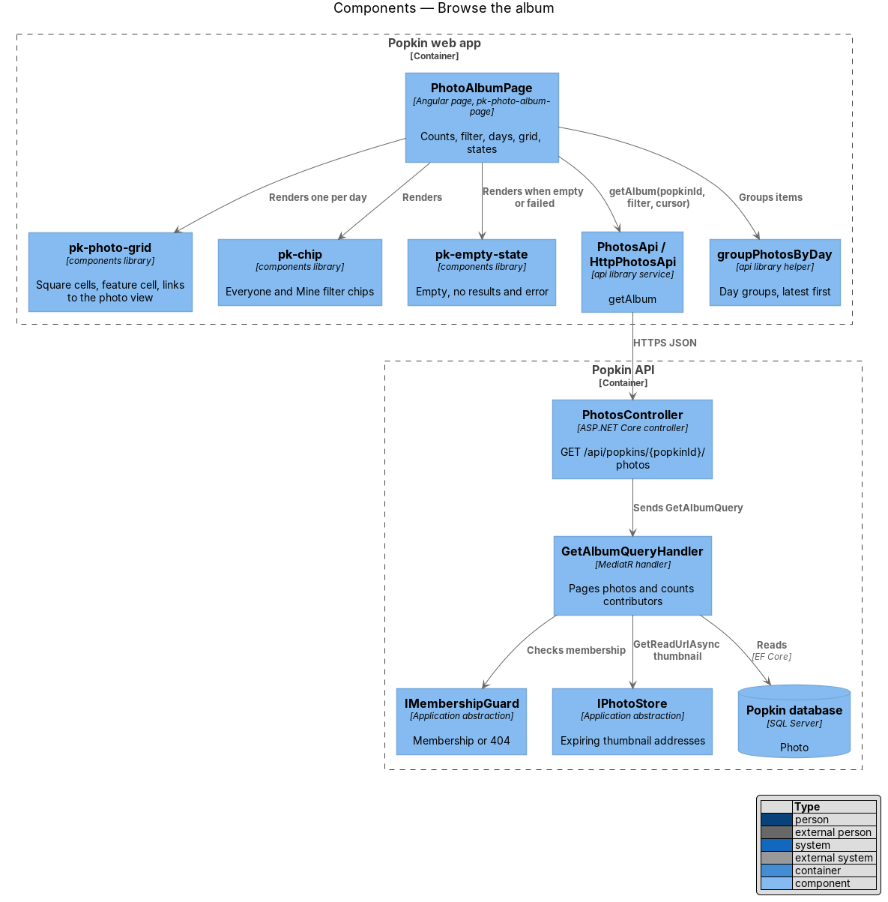
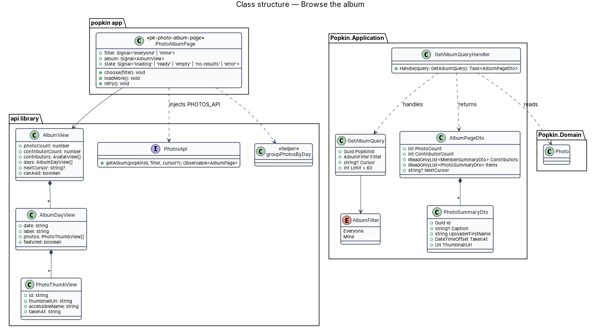
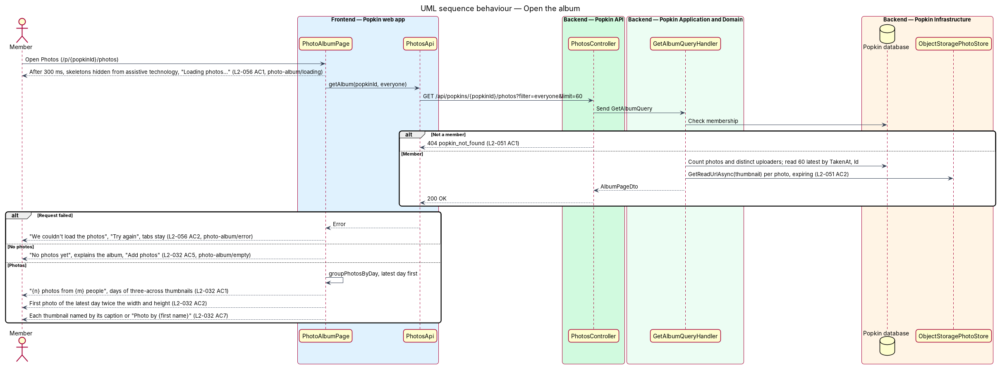
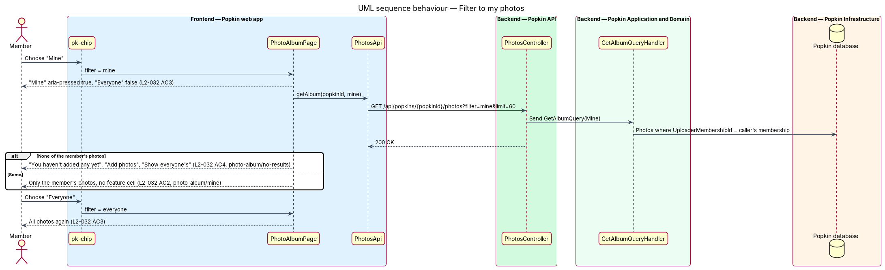
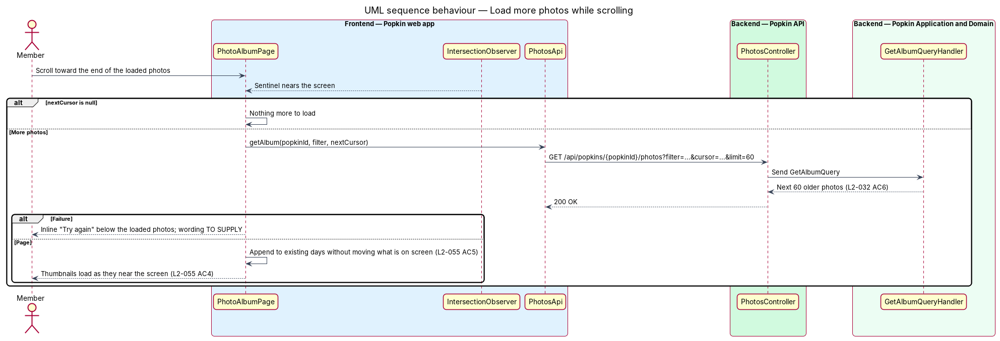

# Browse the album

## Overview

Popkin is a free platform for pop-up communities. Each Popkin has one shared photo album, called
Photos, on its own tab. This feature covers browsing that album. The tab shows how many photos
there are and from how many people. It groups the photos by day, latest day first, and lets a
member narrow the view to their own photos. A large album loads in pages as the member scrolls.

- **album** — the Popkin's shared set of photos
- **day group** — the photos taken on one calendar day, as the member's device counts days,
  under a label such as "Saturday"
- **feature cell** — the first photo of the latest day, shown twice the width and height of the
  others when the filter is "Everyone"
- **filter** — the pair of chips "Everyone" and "Mine" that choose whose photos show
- **cursor** — opaque position in the album from which the next page of older photos starts

The album is read-only here. Adding photos belongs to [add photos](../add-photos/README.md) and
opening one belongs to [view a photo](../view-photo/README.md). Thumbnails come from the Photo
store through addresses that expire (L2-051 AC2), sized for the grid (L2-055 AC4).

## Description

### Screens and states

- `docs/mocks/pages/photo-album/default.html` — "Photos", the contributor avatars, "48 photos from
  11 people", the "Everyone" and "Mine" chips, the days "Saturday" and "Friday", the feature cell,
  "Add photos" and the tabs.
- `docs/mocks/pages/photo-album/loading.html` — skeleton cells and "Loading photos…".
- `docs/mocks/pages/photo-album/empty.html` — "No photos yet", "This is the album everyone shares.
  Add the first one and the rest will follow." and "Add photos" (L2-032 AC5).
- `docs/mocks/pages/photo-album/mine.html` — "Mine" pressed, only Mara's photos, no feature cell
  (L2-032 AC3).
- `docs/mocks/pages/photo-album/no-results.html` — "You haven't added any yet", "Add photos" and
  "Show everyone's" (L2-032 AC4).
- `docs/mocks/pages/photo-album/error.html` — "We couldn't load the photos", "They're safe. Check
  your connection and try again." and "Try again" (L2-056 AC2).

The thumbnails in the mocks have empty `alt` text. L2-032 AC7 requires the caption, or
"Photo by {first name}", as each thumbnail's name; the implementation follows the requirement.
The mocks also do not show the failed load of a later page: the album keeps what it has and
says "More photos didn’t load." with "Try again".

### API

- `GET /api/popkins/{popkinId}/photos?filter=everyone|mine&cursor={cursor}&limit=60` —
  `200 OK` with `AlbumPageDto`: `PhotoCount`, `ContributorCount`, `Contributors` (at most four,
  the latest to add first; first names and avatars only, L2-054 AC2), `Items`
  (`PhotoSummaryDto`: id, caption, uploader with membership id, first name and avatar,
  `TakenAt`, `AddedAt`, thumbnail address, `Width`, `Height`, `IsMine`), `NextCursor`, `CanAdd`.
  Errors: `404 popkin_not_found` (L2-051 AC1), `400 invalid_filter` or `400 invalid_cursor`
  (L2-052 AC1). A page holds 60 photos, and `limit` is at most 60.

### Frontend

- **`PhotoAlbumPage`** — introduced, `pages/photo-album/photo-album.page.ts`, selector
  `pk-photo-album-page`, route `/p/:popkinId/photos`, route data `{ shell: 'app', page:
  'photo-album' }`. It reads `AlbumStore`, whose state is `loading`, `ready`, `empty`,
  `no-results` or `error`. It composes the following:
  - `pk-tab-header` with the `pk-avatar` stack and the count
  - `pk-chip` filter chips in a group labelled "Filter", using `aria-pressed`
  - `pk-album`, which holds one `pk-group-label` and one `pk-photo-grid` per day
  - `pk-skeleton`, `pk-empty-state`, `pk-fab` ("Add photos", in the `[slot=fab]` of
    `pk-app-screen`)
  - `pk-popkin-nav`

  A sentinel after the last cell requests the next page (L2-032 AC6). New pages append, so
  nothing already on screen moves (L2-055 AC5). "Add photos" is hidden when `CanAdd` is false,
  for a wrapped-up Popkin (L2-045 AC3).
- **`AlbumStore`** — introduced in the `api` library, with unit tests. It holds the filter, the
  pages and the state, loads the next page, and on `PhotosAdded` or a reconnect reads the album
  again quietly and merges the answer in album order. The album route and the photo view route
  sit under one parent route that provides it, so the album is kept while a photo is open.
- **`PopkinFrame`** — introduced in the `api` library, provided by the same parent route: the
  Popkin's colour, name, members and time left around a screen.
- **`pk-photo-grid`** — introduced in the `components` library, block `photo-grid`
  (`docs/design-system/components/photo-grid.html`). It renders square cells as links to
  `/p/:popkinId/photos/:photoId`, three across below 768 px (L2-032 AC1). The modifier element
  `photo-grid__feature` spans two by two (L2-032 AC2). Each `` has the accessible name and
  `loading="lazy"` (L2-032 AC7, L2-055 AC4).
- **`groupPhotosByDay`** — pure helper in the `api` library (`album-days`). It turns
  `PhotoSummaryDto` items into day groups, latest first, by `TakenAt` in the device's time zone.
  A day within the last week is labelled with its weekday, an older one with its date. It
  features the first photo of the latest day only for "Everyone".
- **`PhotosApi`** — gains `getAlbum(popkinId, filter, cursor?)`.
- **View models** — `AlbumView`, `AlbumDayView`, `PhotoThumbView` with `accessibleName` computed
  as the caption or "Photo by {first name}".

### Backend

- **`PhotosController`** — gains `GET /api/popkins/{popkinId}/photos`.
- **`GetAlbumQuery` / `GetAlbumQueryHandler`** — introduced; the handler checks the filter and
  the cursor itself, with no validator class. It checks membership through `IMembershipGuard`.
  It counts photos and distinct uploaders and reads up to 60 photos ordered by `TakenAt` then
  `Id`, descending, after the cursor. It asks `IPhotoStore.GetReadUrlAsync` for each thumbnail
  address: signed, good for one hour and not tied to a session
  ([Join a Popkin](../../invitations/join-popkin/README.md)). The query uses parameters only
  (L2-052 AC4). An index on `Photo (PopkinId, TakenAt, Id)` serves the read within the 300 ms
  budget for 95 % of requests (L2-055 AC3).
- **`AlbumFilter`** — enumeration `Everyone`, `Mine`.

### Open questions

None. Settled while building: a day group follows the capture day (`TakenAt`), and a day starts
where the member's device says it does; a thumbnail address lasts one hour.

## Requirements

| L2 ID | Refines (L1) | Requirement |
|-------|--------------|-------------|
| `L2-032` | `L1-009` | Browse the album: Photos is the Popkin's shared album. |
| `L2-051` | `L1-012` | Popkins are private to their members: Membership decides everything a person sees. |
| `L2-055` | `L1-013` | Screens are fast: Popkin feels immediate on a phone. |
| `L2-056` | `L1-013` | Loading, failure and offline are always explained: A person is never left guessing. |

## Diagrams

### System context

A member browses the album of a Popkin they belong to.

### Containers

The web app reads album pages from the Popkin API and loads thumbnails straight from the Photo
store through addresses that expire.

### Components

`PhotoAlbumPage` composes the chips, one `pk-photo-grid` per day and the empty states, and reads
pages through `AlbumStore` and `PhotosApi`. `GetAlbumQueryHandler` pages the photos and asks `IPhotoStore` for
thumbnail addresses.

### Class structure

An `AlbumView` holds day groups of thumbnails. The server's `AlbumPageDto` carries one page of
`PhotoSummaryDto` items and the cursor for the next.

### Behaviour — open the album

The page shows skeletons while it waits. It then shows the error, the empty album, or the day
groups with the feature cell (L2-032 AC1, AC2, AC5, AC7).

### Behaviour — filter to my photos

"Mine" asks for the member's own photos and marks the chip as pressed. With none, the page says
so and offers "Add photos" (L2-032 AC3, AC4).

### Behaviour — load more photos while scrolling

When the sentinel nears the screen and a cursor remains, the page loads the next 60 photos and
appends them (L2-032 AC6). When that load fails, the photos already shown stay, under "More
photos didn’t load." and "Try again".

