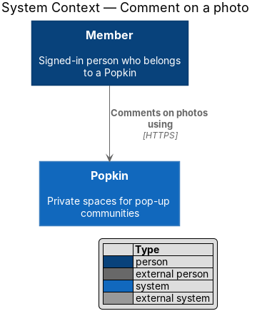
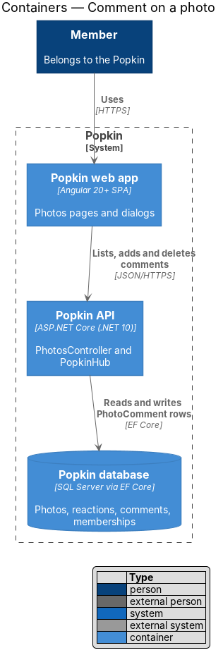
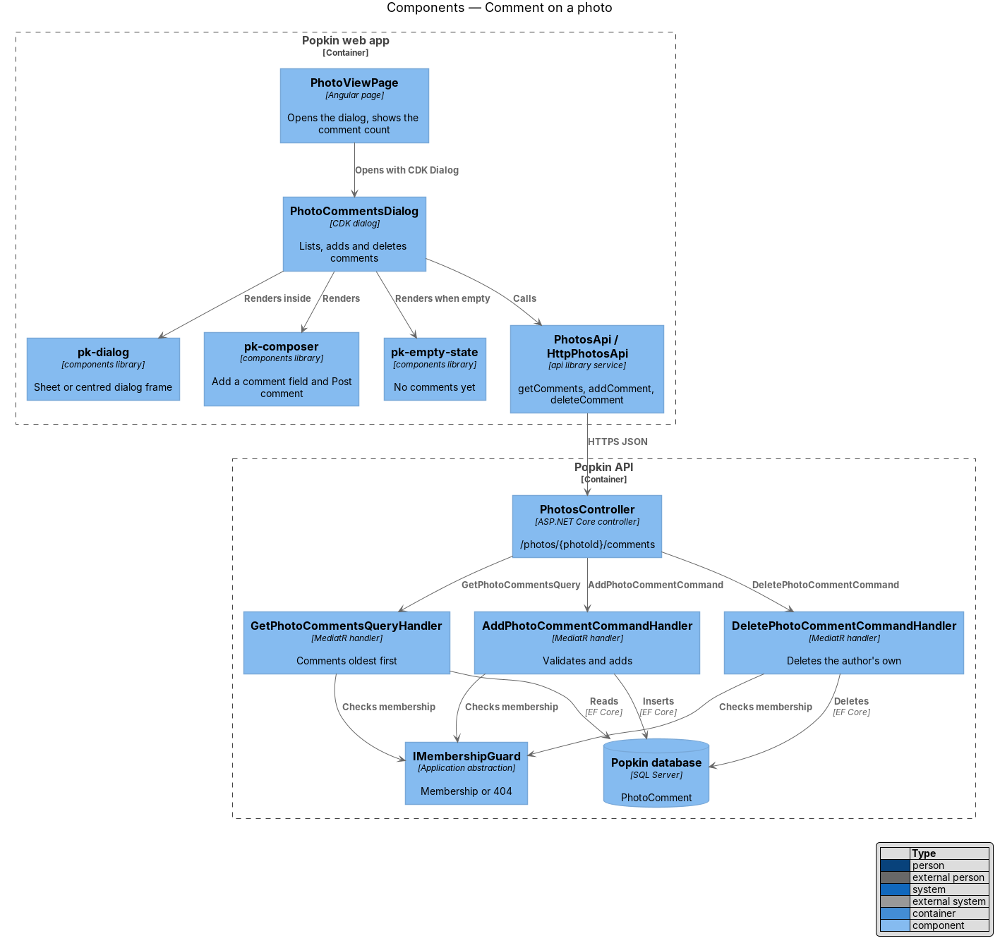
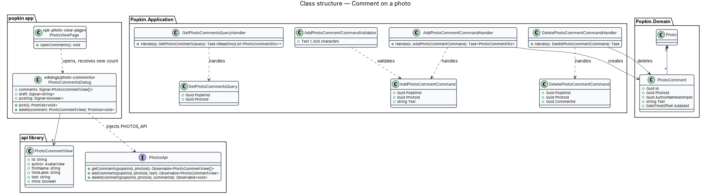
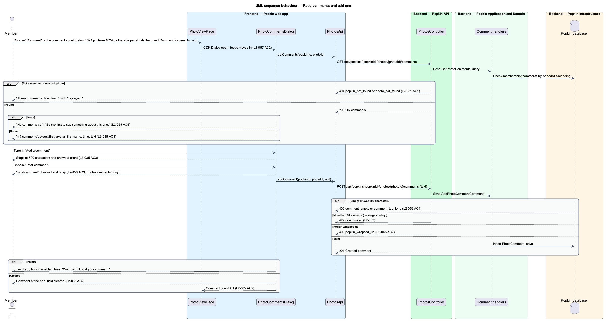
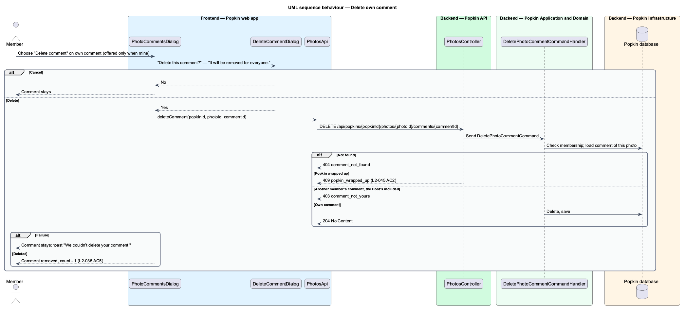

# Comment on a photo

## Overview

Popkin is a free platform for pop-up communities. Members of a Popkin share photos in an album
and open each one in the [photo view](../view-photo/README.md). This feature lets members talk
about a photo under it. The photo's comments are listed oldest first with a field to add one.
A member may delete their own comment after confirming.

- **comment** — short text a member writes about one photo, stored as a `PhotoComment`
- **comment count** — number of comments on a photo, shown on the photo view as "{n} comments"
- **photo comments dialog** — CDK dialog that lists and adds comments below 1024 px, a bottom
  sheet under 640 px (L2-058 AC4)
- **side panel** — the photo view's `photo-info` from 1024 px: author, caption, reactions, the
  comments themselves and the comment field, beside the photo (L2-058 AC11)

Where the comments appear depends on the width. Below 1024 px, "Comment" or the comment count
opens the photo comments dialog; the photo stays visible but inert behind it. From 1024 px the
side panel lists the same comments and has the same field, and "Comment" moves focus to that
field instead of opening a dialog. Both read and write the same comments. When a comment is
added or deleted, the count on the photo view follows (L2-035 AC2). A photo of a direct message
takes comments as an album photo does, for its two members only (known gap 73, closed by
journey 14).

## Description

### Screens and states

- `docs/mocks/dialogs/photo-comments/default.html` — "3 comments", the comments of Walt
  ("Sat 7:40"), Ellie and Dev with avatar, first name, time and text, the field "Add a comment"
  (`maxlength` 500) and "Post comment".
- `docs/mocks/dialogs/photo-comments/busy.html` — the field holds "Up at 6 again tomorrow?" and
  "Post comment" is disabled with `aria-busy="true"` (L2-056 AC3).
- `docs/mocks/dialogs/photo-comments/empty.html` — title "Comments", "No comments yet" and "Be the
  first to say something about this one." (L2-035 AC4).
- `docs/mocks/dialogs/photo-comments/own-comment.html` — "4 comments"; the member's own comment
  is last and has the icon button "Delete comment" (L2-035 AC5).
- `docs/mocks/dialogs/photo-comments/near-limit.html` — a long comment with the count
  "490 / 500" under the field (L2-035 AC3).
- `docs/mocks/dialogs/photo-comments/error.html` — the comments did not load: the alert "These
  comments didn’t load." with "Try again", and no field until they do (L2-056).
- `docs/mocks/dialogs/photo-comments/read-only.html` — a photo of a wrapped-up Popkin: the
  comments to read, no field and no "Delete comment" (L2-045).
- `docs/mocks/dialogs/delete-comment/default.html` — "Delete this comment?", "It will be removed
  for everyone.", "Delete" (danger) and "Cancel"; focus starts on "Cancel".
- `docs/mocks/pages/photo-view/default.html` — "Comment" and "3 comments", the entry points; from
  1024 px the side panel lists the comments and ends with the field "Add a comment" and "Post
  comment".
- `docs/mocks/pages/photo-view/own-comment.html` — the side panel with the member's own comment
  and "Delete comment".
- `docs/mocks/pages/photo-view/wrapped.html` — the side panel of a wrapped-up Popkin: comments,
  no field.

### API

- `GET /api/popkins/{popkinId}/photos/{photoId}/comments` — `200 OK` with comments oldest first
  (`PhotoCommentDto`: `id`, `author` with first name and avatar as in other DTOs, `addedAt`,
  `text`, `mine`).
- `POST /api/popkins/{popkinId}/photos/{photoId}/comments` with `{ text }` — `201 Created` with
  the comment. Errors: `400 comment_empty`, `400 comment_too_long` (over 500 characters after
  trimming, L2-052 AC1), `409 popkin_wrapped_up` (L2-045 AC2), `429 rate_limited` (L2-053).
- `DELETE /api/popkins/{popkinId}/photos/{photoId}/comments/{commentId}` — `204 No Content`.
  Errors: `404 comment_not_found`, `403 comment_not_yours`, `409 popkin_wrapped_up`.
- All three: `404 popkin_not_found` for a non-member (L2-051 AC1), `404 photo_not_found` for a
  photo outside the Popkin or a photo of a direct message the caller is not in.
- `GET /api/popkins/{popkinId}/photos/{photoId}` gains `commentCount`.

### Frontend

- **`PhotoCommentsDialog`** — introduced, `dialogs/photo-comments/photo-comments.dialog.ts`,
  opened by `PhotoViewPage` with the CDK `Dialog` below 1024 px. It composes these components:
  - `pk-dialog` for the frame, with the title "{n} comments", or "Comments" when there are none
  - `pk-comments`, the list of `pk-comment` (block `comment`), with `pk-avatar`
  - `pk-empty-state`
  - `pk-alert` for a failed load, with "Try again"
  - `pk-composer` for the field, labelled "Add a comment", with "Post comment", `maxlength` 500
    and a count from 450 characters, "{n} / 500" (L2-035 AC3)

  "Post comment" is disabled while empty or posting, with `aria-busy="true"` while posting.
  Text is rendered as text, never as HTML (L2-052 AC2). Focus moves into the dialog, stays there,
  and returns to the opener on close (L2-057 AC2). On close the dialog returns the current count.
  In a wrapped-up Popkin the dialog has no field and no "Delete comment".
- **`PhotoViewPage`** — gains `openComments()` and applies the returned count. From 1024 px the
  page loads the comments into the side panel of `pk-photo-viewer`, which lists them with
  `pk-comments` and ends with the same `pk-composer`; "Comment" focuses that field. The page
  reads no viewport width: both the panel and the "Comment" button are rendered, the panel's
  comments and field are hidden with `display: none` below 1024 px, and "Comment" focuses the
  field when it is shown, else opens the dialog (L2-058). One comments store in the `api` library
  serves the dialog and the panel, so both show the same list.
- **`pk-comment`** — each comment: avatar, first name, time and text; the member's own comment has
  an icon button "Delete comment" (`comment__delete`). It asks "Delete this comment?" in a CDK
  dialog, `DeleteCommentDialog`, before the delete is sent.
- **`DeleteCommentDialog`** — introduced, `dialogs/delete-comment/`. Title "Delete this
  comment?", text "It will be removed for everyone.", buttons "Delete" (danger) and "Cancel";
  focus starts on "Cancel". It closes on "Delete"; the comment leaves the list when the server
  answers, and the count goes down by one.
- **Failures** — a failed post keeps the text in the field and enables "Post comment" again, and
  shows the danger toast "We couldn’t post your comment."; a failed delete leaves the comment in
  the list and shows the danger toast "We couldn’t delete your comment."; both stay until
  dismissed (L2-056 AC7).
- **`PhotosApi`** — gains `getComments`, `addComment` and `deleteComment`; view model
  `PhotoCommentView` with `mine` to offer "Delete comment".

### Backend

- **`PhotosController`** — gains the three comment actions. `POST` carries the `messages` rate
  limit policy (60 a minute), which experience comments share.
- **`GetPhotoCommentsQuery` / `GetPhotoCommentsQueryHandler`** — introduced. It checks membership
  through `IMembershipGuard`, loads the photo with the read guard of `GET …/photos/{photoId}`, and
  reads its comments ordered by `AddedAt`.
- **`AddPhotoCommentCommand` / `AddPhotoCommentCommandHandler`** — introduced. The handler
  requires 1 to 500 characters after trimming, refuses a wrapped-up Popkin, inserts a
  `PhotoComment` with `AddedAt` from `TimeProvider`, and saves.
- **`DeletePhotoCommentCommand` / `DeletePhotoCommentCommandHandler`** — introduced. It refuses a
  wrapped-up Popkin and deletes the comment only when `AuthorMembershipId` is the caller's
  membership; the Host is refused too. Owned data stays scoped to its owner.
- **Domain** — `PhotoComment` (`Id`, `PhotoId`, `AuthorMembershipId`, `Text`, `AddedAt`).
  `IAppDbContext` gains `DbSet<PhotoComment>`; `PhotoCommentConfiguration` maps it with cascade
  delete from `Photo` (L2-036 AC3) and an index on `(PhotoId, AddedAt)`.
- **Logging** — comment text is never logged (L2-054 AC3).
- **Real time** — none. A comment reaches others on their next read; L2-035 asks for no live
  update.

### Open questions

Settled by journey 14:

- "Delete comment" is an icon button on one's own comment; it asks "Delete this comment?" ("It
  will be removed for everyone.", "Delete", "Cancel"), as "Delete this message?" does.
- Only the author may delete a comment, not the Host.
- A wrapped-up Popkin refuses both posting and deleting with `409 popkin_wrapped_up`; its photo
  view and dialog show the comments with no field and no "Delete comment".
- Comments are not live for others.
- Rate limit: the `messages` policy, 60 a minute, shared with experience comments.
- Choices the contract left open, taken as the simplest: the count shows from 450 characters,
  "{n} / 500", as chat's composer shows its count from 1,800 of 2,000; a failed load shows an
  alert with "Try again" in the dialog or the panel; a failed post or delete is a danger toast,
  "We couldn’t post your comment." or "We couldn’t delete your comment."; the confirmation
  closes on "Delete" and has no busy or failed state of its own.

## Requirements

| L2 ID | Refines (L1) | Requirement |
|-------|--------------|-------------|
| `L2-035` | `L1-009` | Comment on a photo: Members talk about a photo under it. |
| `L2-045` | `L1-011` | A wrapped-up Popkin is read-only: Nothing new is added to a Popkin that has ended. |
| `L2-051` | `L1-012` | Popkins are private to their members: Membership decides everything a person sees. |
| `L2-052` | `L1-012` | Input is validated and output is encoded: Nothing a person types can harm another person or the system. |
| `L2-056` | `L1-013` | Loading, failure and offline are always explained: A person is never left guessing. |
| `L2-057` | `L1-014` | Accessible to WCAG 2.2 AA: Everyone can use every screen. |
| `L2-058` | `L1-014` | Responsive from 360 px: One layout serves every screen size. |

## Diagrams

### System context

A member reads and writes comments on a photo of a Popkin they belong to.

### Containers

The web app reads, adds and deletes comments through the Popkin API, which keeps them in the
Popkin database.

### Components

`PhotoCommentsDialog` composes `pk-dialog`, `pk-composer` and `pk-empty-state` and calls
`PhotosApi`; from 1024 px the side panel of `pk-photo-viewer` does the same. One query handler
and two command handlers serve the three endpoints.

### Class structure

A `Photo` owns its `PhotoComment` rows. The dialog holds `PhotoCommentView` items and hands the
count back to `PhotoViewPage`.

### Behaviour — read comments and add one

The dialog, or the side panel from 1024 px, loads the comments, or shows the empty invitation.
Posting disables the button while in flight, and on success appends the comment and raises the
count (L2-035 AC1 to AC4).

### Behaviour — delete own comment

"Delete comment" is offered only on the member's own comment and asks "Delete this comment?"
first. The server refuses another member's comment with `403 comment_not_yours` (L2-035 AC5).

