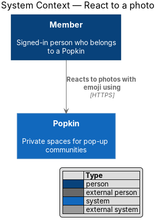
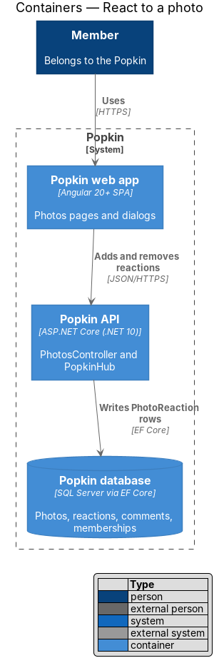
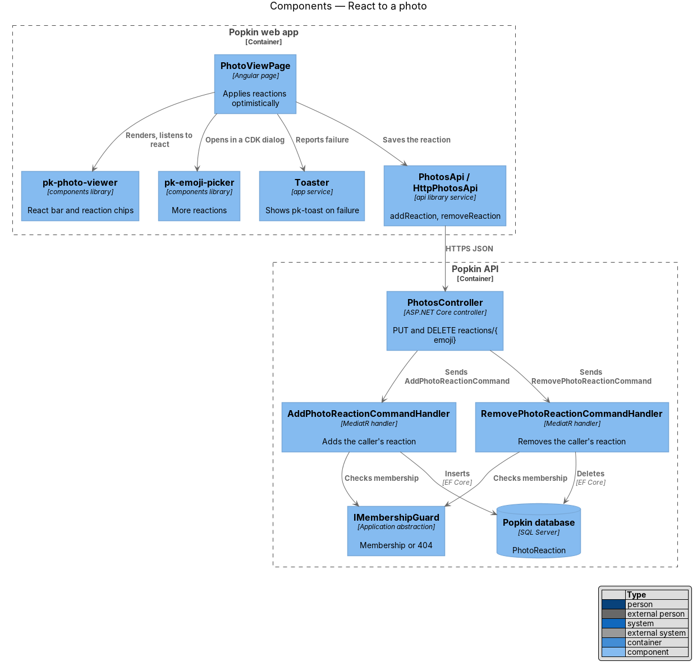
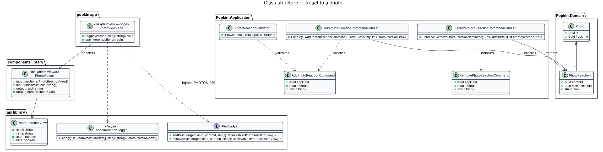
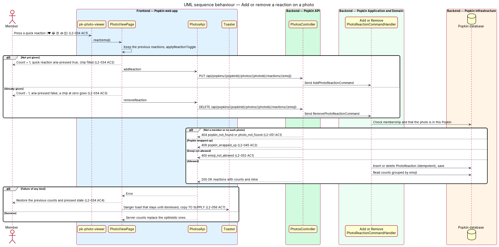
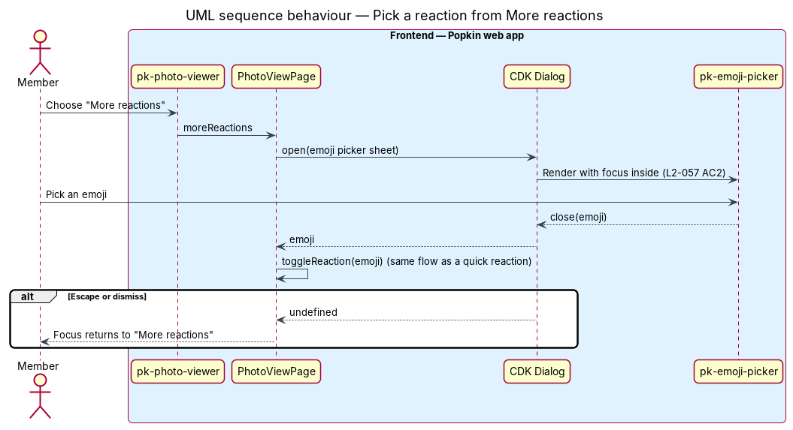

# React to a photo

## Overview

Popkin is a free platform for pop-up communities. Members of a Popkin share photos in an album
and open each one in the [photo view](../view-photo/README.md). This feature lets a member react
to a photo with an emoji. A row under the photo offers five quick reactions, ❤️ 😂 😍 🔥 and 👏,
and "More reactions" for any other emoji. Picking a reaction the member already gave removes it.

- **reaction** — one emoji a member gives a photo, stored as a `PhotoReaction`
- **quick reaction** — one of the five toggle buttons in the react bar
- **reaction chip** — label above the react bar that shows one emoji and its count. It is filled
  when the member gave that reaction.
- **optimistic update** — change shown on screen before the server confirms it, undone when the
  server refuses

The screen updates at once on a press and confirms with the server afterwards. When the save
fails, the count returns to what it was and a message says so (L2-034 AC4). The behaviour mirrors
reactions on chat messages (L2-024).

## Description

### Screens and states

- `docs/mocks/pages/photo-view/default.html` — the chips "❤️ 10" (named "Heart, 10, you reacted",
  `aria-pressed="true"`) and "😍 4"; the react bar with ❤️ pressed; "More reactions".
- `docs/mocks/pages/photo-view/not-reacted.html` — "❤️ 9" and no quick reaction pressed: the state
  before the member's reaction, the state a removal or a rollback returns to (L2-034 AC3, AC4).
- `docs/mocks/dialogs/reactions/default.html` — the target of "More reactions" in the photo-view
  mock. That dialog is the chat message actions dialog. The photo view uses its emoji picker part,
  `pk-emoji-picker`; the photo-specific sheet has no mock of its own.
- `docs/mocks/notifications/toast/danger.html` — the danger toast pattern ("Your rating didn't
  save / Your stars are back to how they were."). The copy for a photo reaction is `<TO SUPPLY>`.

### API

- `PUT /api/popkins/{popkinId}/photos/{photoId}/reactions/{emoji}` — adds the caller's reaction.
  It is idempotent and returns `200 OK` with the photo's reactions (emoji, count, mine).
- `DELETE /api/popkins/{popkinId}/photos/{photoId}/reactions/{emoji}` — removes it. It is
  idempotent and returns `200 OK` with the photo's reactions.
- Errors for both: `404 popkin_not_found` (L2-051 AC1), `404 photo_not_found`,
  `409 popkin_wrapped_up` (L2-045 AC2), `400 emoji_not_allowed` (L2-052 AC1). The emoji is
  URL-encoded in the path.

### Frontend

- **`PhotoViewPage`** — from [view a photo](../view-photo/README.md). This feature adds
  `toggleReaction(emoji)`, which takes these steps:
  1. Keeps the current list.
  2. Applies `applyReactionToggle` and calls `addReaction` or `removeReaction`.
  3. Replaces the list with the server's answer on success.
  4. On failure, restores the kept list and shows a danger `pk-toast` through `Toaster`. The toast
     stays until dismissed (L2-056 AC7).

  A second press while a request for the same emoji is in flight waits for that request, so the
  two cannot cross. `openMoreReactions()` opens `pk-emoji-picker` in a CDK dialog and toggles the
  emoji picked.
- **`pk-photo-viewer`** — its `react-bar` is a group labelled "React" of five
  `<button aria-pressed>` named "React heart", "React laughing", "React heart eyes", "React fire"
  and "React clapping", plus "More reactions" (L2-034 AC1). Each `stage-chip` is named "{emoji
  name}, {count}" with ", you reacted" when the member reacted. A pressed chip is filled white, so
  the state is shape and text as well as colour (L2-057 AC5, AC6).
- **`applyReactionToggle`** — pure helper in the `api` library. It adds one to the count and marks
  the reaction as the member's, or takes one away and drops a chip that reaches zero.
- **`PhotosApi`** — gains `addReaction` and `removeReaction`; view model `PhotoReactionView`
  (`emoji`, `name`, `count`, `mine`).

### Backend

- **`PhotosController`** — gains the `PUT` and `DELETE` reaction actions.
- **`AddPhotoReactionCommand` / `AddPhotoReactionCommandHandler`** and
  **`RemovePhotoReactionCommand` / `RemovePhotoReactionCommandHandler`** — introduced. Each handler
  checks membership through `IMembershipGuard` and loads the `Photo` scoped to the Popkin. Each
  refuses a wrapped-up Popkin, inserts or deletes the caller's `PhotoReaction`, saves, and
  returns the counts grouped by emoji.
- **`PhotoReactionValidator`** — accepts an emoji only from the catalogue that `pk-emoji-picker`
  offers. The catalogue is `<TO SUPPLY>` and is shared with chat reactions.
- **Domain** — `PhotoReaction` (`PhotoId`, `MembershipId`, `Emoji`) with the key `(PhotoId,
  MembershipId, Emoji)`. `IAppDbContext` gains `DbSet<PhotoReaction>`;
  `PhotoReactionConfiguration` maps it with cascade delete from `Photo` (L2-036 AC3).

### Open questions

- Whether a member may give one photo more than one different emoji, as chat allows
  (L2-024 AC4): `<TO SUPPLY>`. The key above allows it.
- Whether other members with the photo open see counts change live: `<TO SUPPLY>`. L2-034 does
  not ask for it, and the design does not push reaction events.
- Toast copy for a failed photo reaction: `<TO SUPPLY>`.

## Requirements

| L2 ID | Refines (L1) | Requirement |
|-------|--------------|-------------|
| `L2-034` | `L1-009` | React to a photo: Members react to photos with emoji. |
| `L2-045` | `L1-011` | A wrapped-up Popkin is read-only: Nothing new is added to a Popkin that has ended. |
| `L2-051` | `L1-012` | Popkins are private to their members: Membership decides everything a person sees. |
| `L2-056` | `L1-013` | Loading, failure and offline are always explained: A person is never left guessing. |

## Diagrams

### System context

A member reacts to a photo of a Popkin they belong to.

### Containers

The web app saves each reaction through the Popkin API, which writes it to the Popkin database.
No file is touched.

### Components

`PhotoViewPage` drives the react bar in `pk-photo-viewer`, the emoji picker and the toaster. Two
handlers add and remove reactions.

### Class structure

`PhotoReaction` belongs to one `Photo` and one membership. The page applies the toggle with a
pure helper before the server answers.

### Behaviour — add or remove a reaction on a photo

The press changes the count and the pressed state at once. The server's answer replaces it, or a
failure restores it and shows a toast (L2-034 AC2, AC3, AC4).

### Behaviour — pick a reaction from More reactions

"More reactions" opens the emoji picker in a dialog. The emoji picked follows the same toggle;
dismissing the dialog returns focus to the control.

