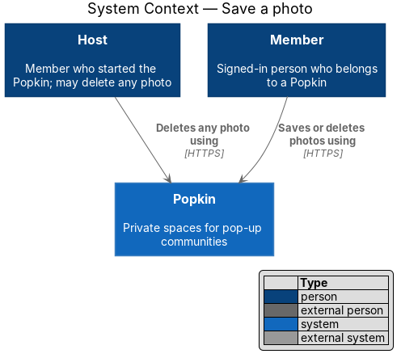
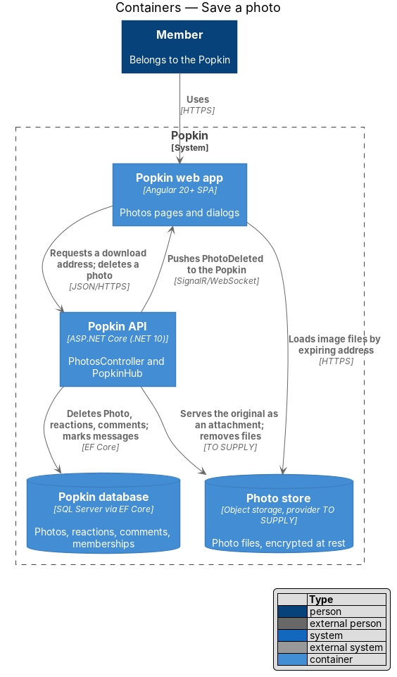
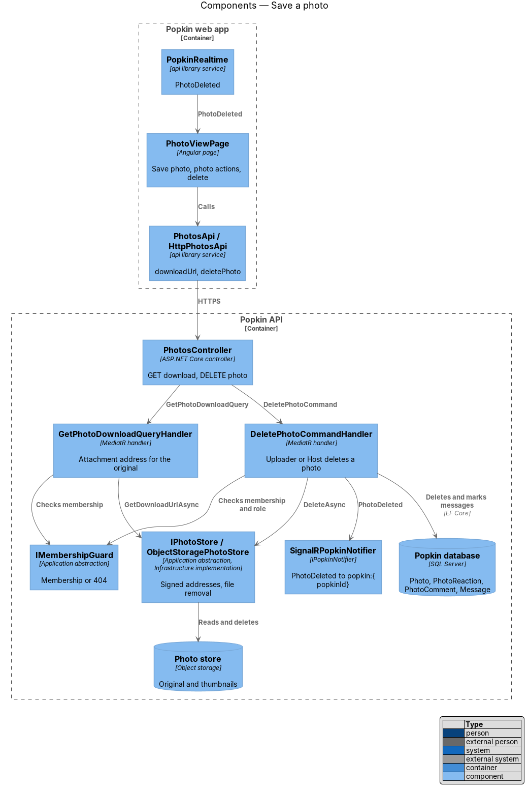
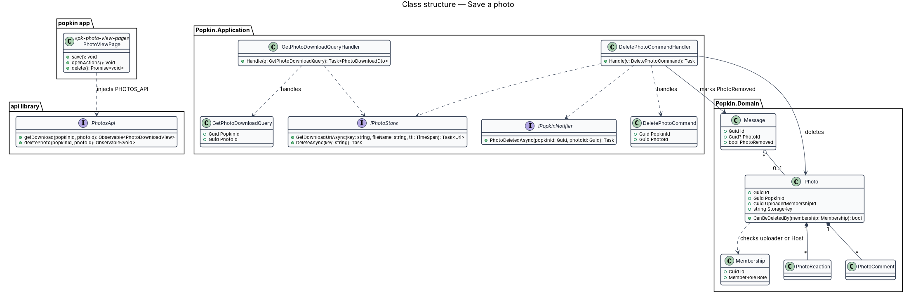
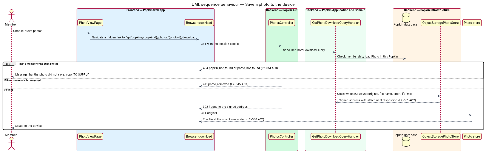
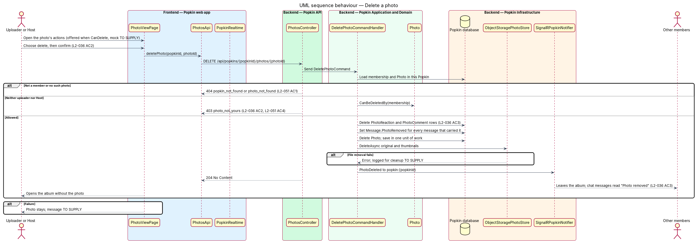

# Save a photo

## Overview

Popkin is a free platform for pop-up communities. Members of a Popkin share photos in an album
and open each one in the [photo view](../view-photo/README.md). This feature covers keeping and
removing photos. "Save photo" downloads the photo at the size Popkin keeps it. The member who
added a photo may delete it after confirming, and the Host may delete any photo of the album.
Deleting a photo removes it from the album and deletes its reactions and comments. Every chat
message that carried it then reads "Photo removed".

- **stored image** — the largest file Popkin keeps of a photo, the display image
  (`Photo.StorageKey`): JPEG, turned upright, location and device data removed, longest edge at
  most 2048 px and never enlarged ([add photos](../add-photos/README.md))
- **download address** — signed address of the stored image that expires after one hour and
  makes the browser save the file as an attachment
- **uploader** — member who added the photo (`Photo.UploaderMembershipId`), or sent it in a
  direct message
- **Host** — member who started the Popkin (`MemberRole.Host`)
- **photo actions** — menu on the photo view, "Photo actions", that offers "Delete photo" to
  whoever may delete the photo
- **"Photo removed"** — what a chat message reads in place of a photo that was deleted

The API checks membership and hands back a short-lived address, signed by `PhotoUrlSigner` as
every photo address is (known gap 9 settles the scheme; the provider of the photo store stays
open). The browser then fetches the file from that address (L2-051 AC2). In a wrapped-up Popkin
whose album is kept, saving still works (L2-045 AC3); deleting does not, as a wrapped-up Popkin
is read-only.

## Description

### Screens and states

- `docs/mocks/pages/photo-view/default.html` — "Save photo" as an icon button in the top bar and,
  because the member added this photo, "Photo actions" (⋯) beside it. From 1024 px the top bar
  stays over the photo and the side panel holds the rest (L2-058 AC11).
- `docs/mocks/pages/photo-view/member.html` — a member on a photo someone else added, who is not
  the Host: "Save photo" and no "Photo actions".
- `docs/mocks/pages/photo-view/direct.html` — a photo of a direct message sent by the other
  member: no "Photo actions", as only its sender may delete it.
- `docs/mocks/pages/photo-view/save-failed.html` — the danger toast "We couldn’t save this
  photo." / "Try again in a moment.", which stays until dismissed (L2-056 AC7).
- `docs/mocks/pages/photo-view/wrapped.html` — a photo of a wrapped-up Popkin: "Save photo" and
  no "Photo actions".
- `docs/mocks/pages/photo-view/removed.html` — the photo was deleted while it was open: "This
  photo was removed", "It’s no longer in Photos." and "Back to Photos".
- `docs/mocks/dialogs/photo-actions/default.html` — the menu "Photo actions" with "Delete photo".
- `docs/mocks/dialogs/delete-photo/default.html` — "Delete this photo?", "It will be removed from
  Photos and from chat for everyone.", "Delete photo" (danger) and "Cancel"; focus starts on
  "Cancel".
- `docs/mocks/dialogs/delete-photo/busy.html` — "Deleting…" disabled with `aria-busy="true"`
  (L2-056 AC3).
- `docs/mocks/dialogs/delete-photo/failed.html` — the alert "We couldn’t delete this photo." /
  "It’s still here. Try again." with the dialog kept open.
- `docs/mocks/pages/photo-album/photo-deleted.html` — the album without the photo and the success
  toast "Photo deleted.".
- `docs/mocks/pages/group-chat/photo-removed.html` — a message whose photo was deleted: a muted
  "Photo removed" with the image-off icon in place of the photo and its text under it; a message
  with no text that reads "Photo removed" alone; and a reply whose quote of it reads "Photo
  removed".

### API

- `GET /api/popkins/{popkinId}/photos/{photoId}/download` — `200 OK` with `PhotoDownloadDto`
  (`url`, `expiresAt`). The address is signed by `PhotoUrlSigner` for one hour and served as an
  attachment, `Content-Disposition: attachment; filename="popkin-photo-{yyyyMMdd-HHmm}.jpg"`,
  from the photo's `TakenAt` (its capture time, or when it was added). Errors:
  `404 popkin_not_found` (L2-051 AC1), `404 photo_not_found`, for a photo of a direct message
  too when the caller is not one of its two members. It answers in a wrapped-up Popkin.
- `DELETE /api/popkins/{popkinId}/photos/{photoId}` — `204 No Content`. Errors:
  `404 popkin_not_found`, `404 photo_not_found`, `403 photo_not_yours` when the caller may not
  delete it (L2-036 AC2, L2-051 AC4), `409 popkin_wrapped_up` (L2-045).
- `GET /api/popkins/{popkinId}/photos/{photoId}` gains `canDelete`: true for the uploader; for an
  album photo, for the Host too; for a photo of a direct message, for its sender only (journey
  13's rule).
- `MessageDto` gains `photoRemoved` (bool).
- `PopkinHub` event `PhotoDeleted { popkinId, photoId }`, sent to the photo's audience: the
  Popkin's members for an album photo, the two members for a photo of a direct message.

### Frontend

- **`PhotoViewPage`** — from [view a photo](../view-photo/README.md). This feature adds four
  actions:
  - `save()` — calls `PhotosApi.getDownload`, then activates a temporary link to the address.
    "Save photo" is disabled while the request runs (L2-056 AC3). A failure shows the danger
    `pk-toast` "We couldn’t save this photo." / "Try again in a moment.", which stays until
    dismissed (L2-056 AC7).
  - `openActions()` — "Photo actions" is rendered only when `canDelete` is true and the Popkin is
    not wrapped up. It opens `PhotoActionsDialog`.
  - `delete()` — opens `DeletePhotoDialog`. After the delete, the page goes to the album,
    `/p/{popkinId}/photos`, with the success toast "Photo deleted."; for a photo of a direct
    message it goes back to its direct message with the same toast.
  - On `PhotoDeleted` for the photo it shows, the page shows the state of `removed.html`: "This
    photo was removed", with "Back to Photos" (or back to the direct message).
- **`PhotoActionsDialog`** — introduced, `dialogs/photo-actions/`: `pk-dialog` titled "Photo
  actions" with a `pk-menu-list` of one danger row, "Delete photo".
- **`DeletePhotoDialog`** — introduced, `dialogs/delete-photo/`: "Delete this photo?", "It will be
  removed from Photos and from chat for everyone.", "Delete photo" (danger) and "Cancel". While
  the request runs, "Delete photo" reads "Deleting…", disabled and busy. A failure keeps the
  dialog open with the `pk-alert` "We couldn’t delete this photo." / "It’s still here. Try
  again."
- **`PhotosApi`** — gains `getDownload(popkinId, photoId)` and `deletePhoto(popkinId, photoId)`.
- **Real-time** — `PhotoAlbumPage` (the album, [browse the album](../browse-album/README.md)) drops a
  photo on `PhotoDeleted`. The chat's stores mark every message that carried the photo as
  removed, so an open thread shows "Photo removed" without a reload.
- **`pk-message`** — a message with `photoRemoved` renders `bubble__removed`, the image-off icon
  and "Photo removed" in muted italics, in place of the photo, and its text under it; it is not a
  link. `pk-quote` and the previews of the Chat tab and the home read "Photo removed" for such a
  message with no text.

### Backend

- **`PhotosController`** — gains `GET …/download` and `DELETE …/{photoId}`.
- **`GetPhotoDownloadQuery` / `GetPhotoDownloadQueryHandler`** — introduced. It checks membership
  through `IMembershipGuard`, loads the `Photo` scoped to the Popkin, and asks
  `IPhotoStore.GetDownloadUrl` for an attachment address of the original.

  The original is a third stored file of each upload, album and chat alike: a JPEG at the size it
  was added, turned upright and re-encoded without location or device data (L2-031 AC6), under
  the photo's key ending `-original.jpg` (`Photo.OriginalKey`). A photo stored before journey 14
  has none and is saved as its display image. The file is named
  `popkin-photo-{yyyyMMdd-HHmm}.jpg` from `TakenAt` in UTC, and the address lives as long as any
  signed address, one hour (`PhotoUrlSigner.Lifetime`). Deleting a photo and removing an album
  that was not kept delete the original with the other files.
- **`DeletePhotoCommand` / `DeletePhotoCommandHandler`** — introduced. It checks membership and
  calls `Photo.CanBeDeletedBy(membership)`, which allows the uploader and the Host. In one unit of
  work it takes these steps:
  1. Deletes the photo's `PhotoReaction` and `PhotoComment` rows.
  2. Sets `PhotoRemoved = true` and `PhotoId = null` on every `Message` that carried it.
  3. Deletes the `Photo`.

  After the commit it deletes the stored image and the thumbnail through
  `IPhotoStore.DeleteAsync`; a file that fails to delete is logged without content and stays an
  orphan. Then it sends `PhotoDeleted` to the photo's audience through `IPopkinNotifier`. How an
  open thread learns which messages lost their photo is decided when it is built: by an existing
  message event if one fits, or by `PhotoDeleted` alone, with the client marking every message
  that carried the photo id. The choice is recorded here when made.
- **Album removal** — `RemoveWrappedUpAlbumsCommandHandler` (journey 9) sets `PhotoRemoved` on
  the messages whose photos it removes, so a photo message with no text reads "Photo removed"
  rather than an empty bubble (known gap 74).
- **Domain** — this design adds `Message.PhotoRemoved` (bool), which tells "Photo removed" apart
  from a message that never had a photo (L2-036 AC3). `Photo` gains `CanBeDeletedBy(Membership)`:
  the uploader always; the Host for a photo in the album (`InAlbum`); for a
  photo of a direct message, its sender only.

### Open questions

- Mocks for the photo actions, the delete confirmation, failures and "Photo removed":
  `<TO SUPPLY>`.
- Whether photos may be deleted after the Popkin wraps up: `<TO SUPPLY>`. L2-045 lists no delete.
- Cleanup of files whose deletion failed, for example by a `Popkin.Worker` job: `<TO SUPPLY>`.
- How an open thread learns its message lost its photo: decided (journey 14) — no message event is reused; `PhotoDeleted(popkinId, photoId)` goes to the photo's audience (the Popkin, or a direct message's two members) and the client marks the message whose `photo.id` it names `photoRemoved`, as the next read of the thread gives.

## Requirements

| L2 ID | Refines (L1) | Requirement |
|-------|--------------|-------------|
| `L2-036` | `L1-009` | Save a photo: Members keep the photos they want. |
| `L2-045` | `L1-011` | A wrapped-up Popkin is read-only: Nothing new is added to a Popkin that has ended. |
| `L2-051` | `L1-012` | Popkins are private to their members: Membership decides everything a person sees. |
| `L2-056` | `L1-013` | Loading, failure and offline are always explained: A person is never left guessing. |
| `L2-058` | `L1-014` | Responsive from 360 px: One layout serves every screen size. |

## Diagrams

### System context

A member saves photos of a Popkin they belong to. The uploader or the Host deletes them.

### Containers

The web app asks the Popkin API for a download address and fetches the file from it. Deletion
goes through the API, which updates the database, removes the files and tells the photo's
audience.

### Components

`PhotosController` dispatches to `GetPhotoDownloadQueryHandler` and `DeletePhotoCommandHandler`.
Both use `IPhotoStore`; the delete handler also notifies through `SignalRPopkinNotifier`.

### Class structure

A `Photo` owns its reactions and comments and decides who may delete it. A `Message` references
a photo and records when it was removed.

### Behaviour — save a photo to the device

The page asks for a download address and hands it to the browser. The browser saves the stored
image (L2-036 AC1); a failure is a toast.

### Behaviour — delete a photo

Only the uploader or, for an album photo, the Host may delete. The handler removes the
reactions, comments and photo, marks the chat messages, deletes the files and tells the photo's
audience (L2-036 AC2, AC3).

