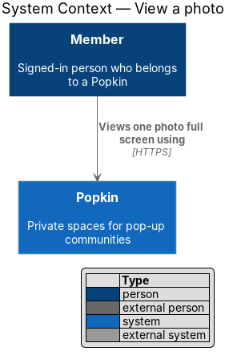
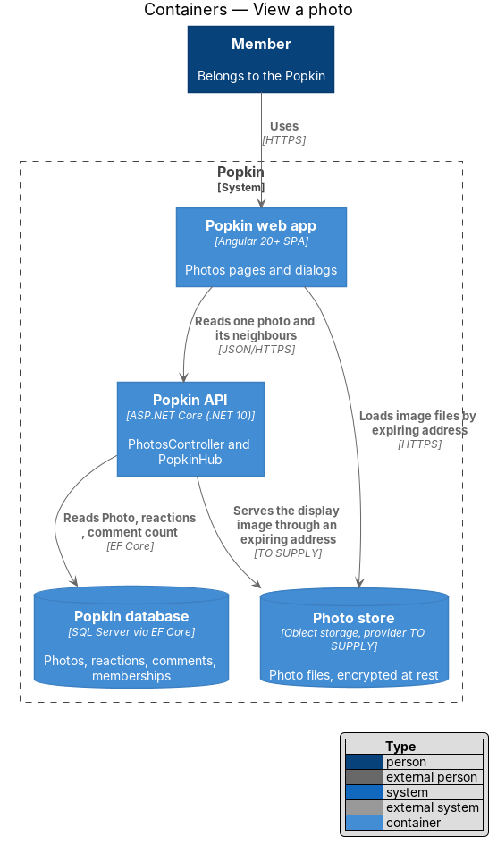
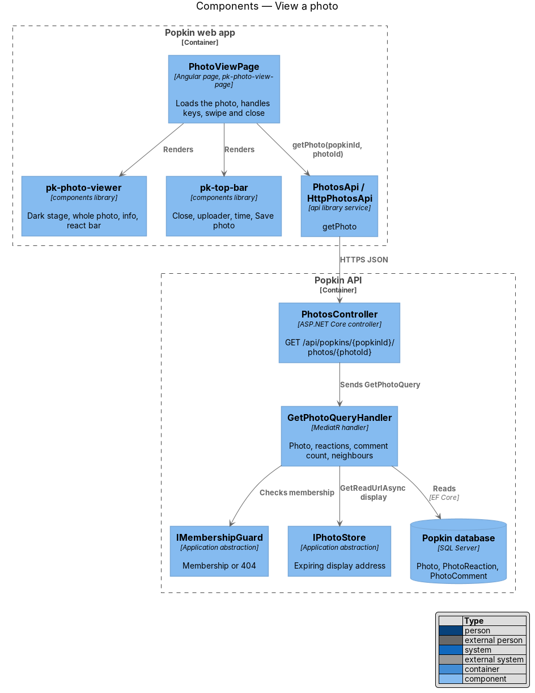
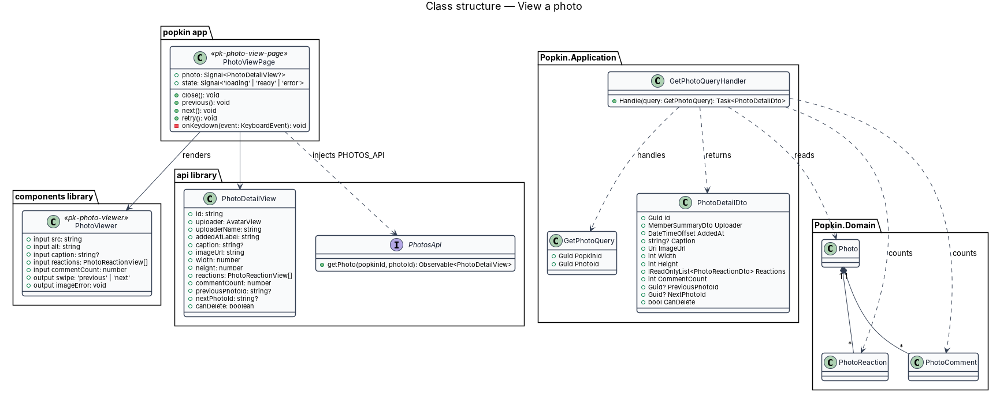
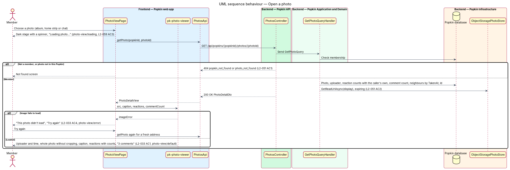
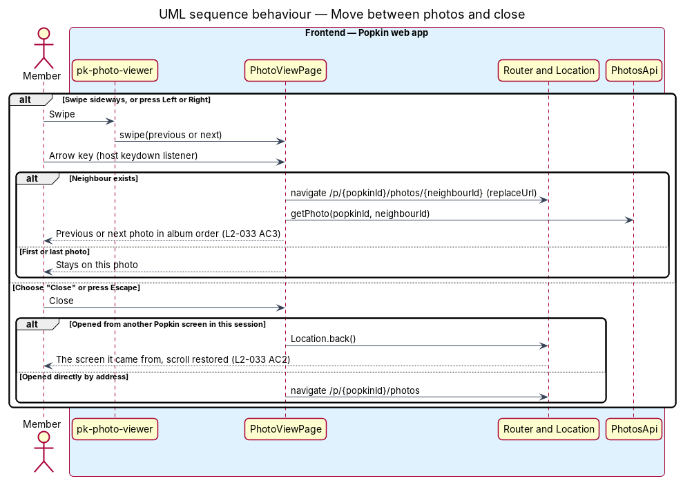

# View a photo

## Overview

Popkin is a free platform for pop-up communities. Each Popkin has a shared photo album, called
Photos. This feature covers opening one photo from the album, the Popkin home strip or a chat
message. The photo opens full screen on a dark stage, the same in both themes, so every photo
reads the same way (L2-059 AC3). The member sees who added it and when, the whole photo without
cropping, its caption, its reactions with counts and its number of comments. The member moves to
the previous or next photo by swiping or with the arrow keys, and closes the view with "Close" or
Escape.

- **photo view** — full-screen screen for one photo (`photo-view` in the mocks)
- **stage** — the dark background of the photo view, from the token `--color-bg-stage`
- **album order** — order of the album, latest `TakenAt` first, that "previous" and "next"
  follow
- **display image** — copy of the photo sized for the screen, served through an address that
  expires

Reacting, commenting and saving happen on this screen, but each has its own design:
[react to a photo](../react-to-photo/README.md),
[comment on a photo](../comment-on-photo/README.md) and [save a photo](../save-photo/README.md).
This feature owns the screen, its loading and failure states, and the navigation.

## Description

### Screens and states

- `docs/mocks/pages/photo-view/default.html` — "Close", "Mara Okafor", "Saturday, 7:02 am",
  "Save photo", the photo, the caption "First light on the dock. Worth the 6 am alarm.", the chips
  "❤️ 10" and "😍 4", "3 comments", and the react bar.
- `docs/mocks/pages/photo-view/loading.html` — "Loading…" in the top bar and "Loading photo…" on
  the stage.
- `docs/mocks/pages/photo-view/error.html` — "This photo didn't load", "Check your connection and
  try again." and "Try again" (L2-033 AC4).
- `docs/mocks/pages/photo-view/not-reacted.html` — the same photo before the member reacted.

### API

- `GET /api/popkins/{popkinId}/photos/{photoId}` — `200 OK` with `PhotoDetailDto`: uploader
  (first name, full name and avatar only, L2-054 AC2), `AddedAt`, `Caption`, display image
  address, `Width`, `Height`, `Reactions` (emoji, count, mine), `CommentCount`,
  `PreviousPhotoId`, `NextPhotoId` and `CanDelete`. Errors: `404 popkin_not_found` for a
  non-member (L2-051 AC1), `404 photo_not_found` for a photo that is not in this Popkin.

### Frontend

- **`PhotoViewPage`** — introduced, `pages/photo-view/photo-view.page.ts`, selector
  `pk-photo-view-page`, route `/p/:popkinId/photos/:photoId`, route data `{ shell: 'bare', page:
  'photo-view' }`. It loads the photo through `PhotosApi.getPhoto`. Its `state` is `loading`,
  `ready` or `error`. It handles these inputs:
  - **Left and Right** — a host `keydown` listener opens the neighbour. Navigation uses
    `replaceUrl`, so "Close" returns past every photo seen (L2-033 AC3).
  - **Escape and "Close"** — `Location.back()` when the view opened from another screen in this
    session. Scroll position restoration (`withInMemoryScrolling`) returns the member to the
    place they left (L2-033 AC2). Opened directly by address, the view goes to the album
    instead.
  - **image error** — "Try again" fetches the photo again for a fresh address, because an
    address may have expired (L2-033 AC4).
- **`pk-photo-viewer`** — introduced in the `components` library
  (`docs/design-system/components/photo-viewer.html`), blocks `photo-stage`, `photo-info`,
  `stage-chip` and `react-bar`. The image uses `object-fit: contain` and reserves its aspect
  ratio from `width` and `height`. It therefore shows the whole photo without cropping, and
  nothing moves when it arrives (L2-033 AC1, L2-055 AC5). It emits `swipe` from pointer events
  and `imageError`. The caption is the page's heading. The focus ring is cream so it reads on the
  dark stage.
- **`pk-top-bar`** — "Close", the uploader's avatar and name, the time label, and "Save photo".
- **`PhotosApi`** — gains `getPhoto(popkinId, photoId)`; view model `PhotoDetailView`.

### Backend

- **`PhotosController`** — gains `GET /api/popkins/{popkinId}/photos/{photoId}`.
- **`GetPhotoQuery` / `GetPhotoQueryHandler`** — introduced. The handler checks membership through
  `IMembershipGuard`, loads the `Photo` scoped to `PopkinId`, and groups `PhotoReaction` rows by
  emoji with the caller's own marked. It counts `PhotoComment` rows and finds the neighbours in
  album order with two indexed reads on `(PopkinId, TakenAt, Id)`. It asks
  `IPhotoStore.GetReadUrlAsync` for the display image. `CanDelete` is true for the uploader and
  for the Host (L2-036 AC2).

### Open questions

- Whether "previous" and "next" follow the filter the member came from ("Mine") or always the
  whole album: `<TO SUPPLY>`. The design follows the whole album.
- Whether the time shown is when the photo was added (`AddedAt`, the wording of L2-033 AC1) or
  when it was taken: `<TO SUPPLY>`. The design shows `AddedAt`.
- Size of the display image and lifetime of its address: `<TO SUPPLY>`.

## Requirements

| L2 ID | Refines (L1) | Requirement |
|-------|--------------|-------------|
| `L2-033` | `L1-009` | View a photo: A photo opens full screen on a dark background in both themes. |
| `L2-051` | `L1-012` | Popkins are private to their members: Membership decides everything a person sees. |
| `L2-057` | `L1-014` | Accessible to WCAG 2.2 AA: Everyone can use every screen. |
| `L2-059` | `L1-014` | Light and dark themes: Popkin follows the device and the person. |

From `L2-057` this feature realises AC1 (keyboard) and AC6 (named icon-only controls) for the
photo view, and from `L2-059` AC3.

## Diagrams

### System context

A member opens a photo of a Popkin they belong to.

### Containers

The web app reads the photo's details from the Popkin API. It loads the display image from the
Photo store through an address that expires.

### Components

`PhotoViewPage` composes `pk-top-bar` and `pk-photo-viewer` and reads through `PhotosApi`.
`GetPhotoQueryHandler` reads the photo, its reaction counts, its comment count and its
neighbours.

### Class structure

`PhotoDetailView` carries everything the view shows and the ids of the neighbours. A `Photo` owns
its reactions and comments.

### Behaviour — open a photo

The page shows the dark loading stage, then the photo. When the image itself fails to load, it
shows the failure with "Try again" (L2-033 AC1, AC4).

### Behaviour — move between photos and close

A swipe or an arrow key opens the neighbour in album order. "Close" and Escape go back to the
screen the member came from (L2-033 AC2, AC3).

