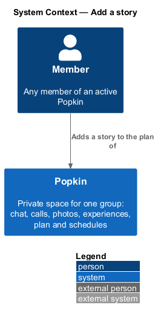
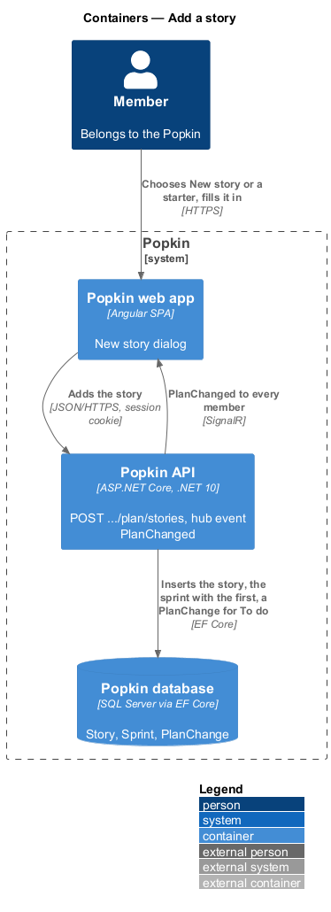
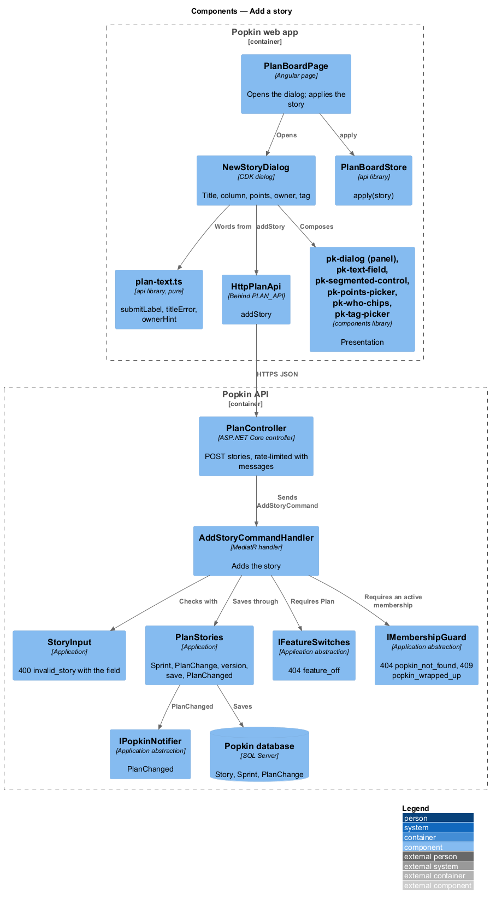
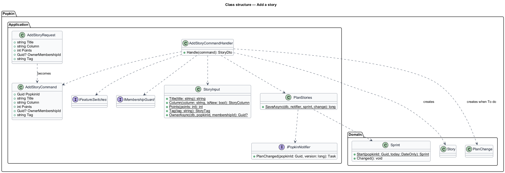
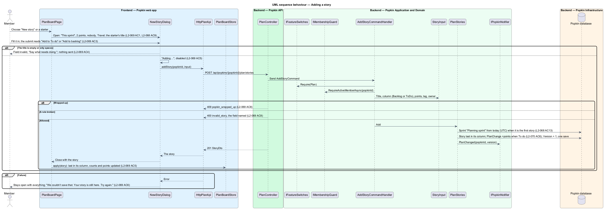

# Add a story

## Overview

Popkin is a platform for pop-up communities. On the [Plan board](../plan-board/README.md) of a
*Popkin*, a private space for one group, any member adds a **story**: one job someone can own. The
"New story" dialog asks what needs doing, where it goes, how big it is, who is on it and what it
is about, and puts the story last in its column.

- **story**, **column**, **points**, **owner**, **tag**, **sprint** — as defined in the
  [Plan board](../plan-board/README.md)
- **This sprint** — the dialog's word for To do: a new story goes to Backlog or to To do, never
  straight to Doing or Done
- **starter** — one of the four titles the empty board offers ("Pick the dates", "Find somewhere
  to stay", "Sort out getting there", "Set a budget"), which opens the dialog with that title

The first story of a Popkin starts its sprint that day (L2-068 AC13). Adding exists only while
the Plan switch is on ([Plan switch](../plan-switch/README.md)) and only in an active Popkin.
Journey 21 builds it.

## Description

### Screens and states

- `docs/mocks/dialogs/new-story/default.html` — "New story"; "What needs doing?" with a title
  field (`maxlength="80"`); "Where does it go?" with "Backlog" and "This sprint" as a segmented
  radio group, "This sprint" chosen; "How big is it?" with "1 is a quick text. 8 is a weekend of
  phone calls." and the points 1, 2, 3, 5, 8 as a radio group, 2 chosen; "Who’s on it?" with
  every member as a toggle (`aria-pressed`) with their avatar and first name; "Tag" with the five
  tags as a radio group, "Travel" chosen; the submit "Add to To do" (L2-069 AC1, AC3).
- `invalid.html` — the title field marked invalid and "Say what needs doing." under it
  (L2-069 AC4).
- `busy.html` — "Adding…", disabled (L2-069 AC5).
- `failed.html` — the alert "We couldn’t save that. Your story is still here. Try again." and
  everything entered kept (L2-069 AC6).
- With no member chosen, "Who’s on it?" reads "No one yet. Anyone can pick it up."; choosing a
  member presses them, choosing them again clears the choice (L2-069 AC2). With "Backlog" chosen
  the submit reads "Add to backlog".
- After a save the dialog closes, the story is last in its column and the column's counts and
  points change (L2-069 AC5).

### Form factors

Below 768 px the dialog is a sheet at the bottom of the screen; from 768 px it is a panel on the
right side of the board (`.dialog--panel`, L2-069 AC7). The board stays visible beside the panel.
Nothing reads the viewport width.

### API

- `POST /api/popkins/{popkinId}/plan/stories` with `{ title, column, points, ownerMembershipId,
  tag }` → `201` `StoryDto` ([Plan board](../plan-board/README.md)), with `Location` of the board.
- The rules (`StoryInput`), each a `400` `invalid_story` naming its field in `errors`:
  - `title` — trimmed, 1 to 80 characters.
  - `column` — `Backlog` or `ToDo`; `Doing` and `Done` are refused for a new story.
  - `points` — 1, 2, 3, 5 or 8.
  - `tag` — one of the five.
  - `ownerMembershipId` — null, or a member of this Popkin who has not left.
- A new story has no due date (L2-070 AC8). It is added by the caller (`addedByMembershipId`)
  at the server's time, which is also when it entered its column.
- With the first story of the Popkin, the `Sprint` is created: "Planning sprint", its first day
  today (UTC), version 1 (L2-068 AC13).
- A story added to To do appends a `PlanChange` of `+points`; one added to Backlog appends none.
- Refusals before the rules: `401`; `404` `feature_off` (L2-077 AC3); `404` `popkin_not_found`
  (L2-051); `409` `popkin_wrapped_up` (L2-069 AC8, L2-045). Counted with messages
  (`RateLimitPolicyNames.Messages`, 60 a minute per person, L2-053): `429` beyond.
- `PlanChanged(popkinId, version)` follows the save.

### Frontend (`frontend/projects/`)

- **`NewStoryDialog`** (`dialogs/new-story`) — opened by `PlanBoardPage` with the Popkin, its
  members (from `PopkinFrame`) and, from a starter, the title. A `form[pk-dialog]` with `panel`
  set. The title is a `pk-text-field` (`maxlength="80"`); the column a `pk-segmented-control`
  (`kind="radio"`, "Backlog", "This sprint"); the points `pk-points-picker`; the owner
  `pk-who-chips`, with "No one yet. Anyone can pick it up." when nobody is pressed; the tag
  `pk-tag-picker`. Submitting with a title that is empty or only spaces marks the field
  `aria-invalid` with "Say what needs doing." and moves focus to it; the field's `maxlength`
  keeps a title within 80 characters, and a `400` `invalid_story` from the API marks the field it
  names. While it saves the submit reads "Adding…" and every control is disabled; on success it
  closes with the `StoryDto`, which the page hands to `PlanBoardStore.apply`; on failure the
  alert shows and everything stays.
- **`plan-text.ts`** — `submitLabel(column)` ("Add to backlog", "Add to To do"),
  `titleError(title)` ("Say what needs doing."), `ownerHint` ("No one yet. Anyone can pick it
  up."), `POINTS` ([1, 2, 3, 5, 8]), `TAGS`, `STARTERS`, `STORY_TITLE_MAX` (80).
- **`PlanApi.addStory(popkinId, input)`**.
- **Components**: `pk-points-picker` (`.pts-group`, `role="radiogroup"` named "How big is it?",
  options `role="radio"` with `aria-checked`, arrow keys move the choice), `pk-tag-picker`
  (`.chips` radio group named "Tag", each chip with its `.story-tag__dot`), `pk-who-chips`
  (`.who-chip` toggles with `aria-pressed`, one at most pressed), and `pk-dialog` gains the input
  `panel`, which adds `dialog--panel`.

### Backend (`backend/src/`)

- **`AddStoryCommand`** / handler — `Require(Feature.Plan)`, `RequireActiveMemberAsync`,
  `StoryInput.ForNew(...)`, then `PlanStories`: create the sprint when there is none, add the
  story, append the `PlanChange` when it goes to To do, raise `Version`, save, send
  `PlanChanged`, answer `StoryDto`.
- **`StoryInput`** (Application) — `Title(string)`, `Column(string, isNew)`, `Points(int)`,
  `Tag(string)`, `OwnerAsync(db, popkinId, membershipId?)`, `DueDate(DateOnly?)`; each throws
  `ProblemException(400, "invalid_story")` with the field named.
- **`PlanController.AddStory`** — `[HttpPost("stories")]`,
  `[EnableRateLimiting(RateLimitPolicyNames.Messages)]`, `CreatedAtAction` of the board.

### Decisions

- Nothing about a title is changed but its ends: it is stored as typed and always shown as text
  ([Input validation and encoding](../../security/input-validation-and-encoding/README.md)).
- Two first stories added at once create one sprint: the sprint's key is the Popkin, and the save
  that loses is made again from a fresh read ([Plan board](../plan-board/README.md), `PlanStories`).
- Nobody is chosen in "Who’s on it?" when the dialog opens. The mock draws Ellie pressed; the
  requirement and the app start with nobody, so the hint shows.
- The dialog's column choice names To do "This sprint", as the mock and L2-069 AC1 do; the
  submit names the column ("Add to To do").

## Requirements

| L2 ID | Refines (L1) | Requirement |
|-------|--------------|-------------|
| `L2-069` | `L1-017` | Add a story: Any member adds a story. |
| `L2-068` | `L1-017` | The plan board: The Plan tab opens on the board: four columns of stories and the sprint's state (AC9, AC13). |
| `L2-070` | `L1-017` | Change a story: A story moves across the board as the work gets done (AC6, AC8). |
| `L2-045` | `L1-011` | A wrapped-up Popkin is read-only: Nothing new is added to a Popkin that has ended. |
| `L2-052` | `L1-012` | Input is validated and output is encoded: Nothing a person types can harm another person or the system. |
| `L2-053` | `L1-012` | Abuse is limited: One person cannot flood the system or another person. |
| `L2-077` | `L1-019` | A feature that is off: A feature that is off is not there. |

## Diagrams

The system context: any member adds a story to the Popkin's plan.

The web app sends the story to the API, which keeps it, starts the sprint with the first one and
tells the other members.

The dialog, its pickers and the API's handler with `StoryInput` and `PlanStories`.

The command, its rules and what it writes.

Adding a story.

