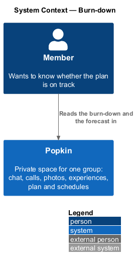
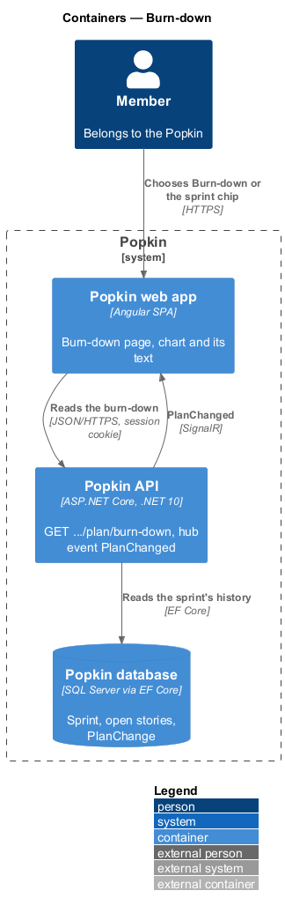
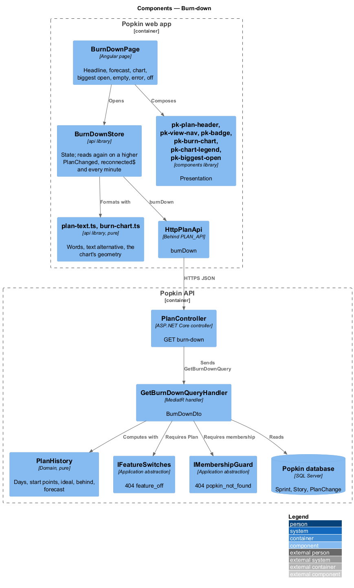
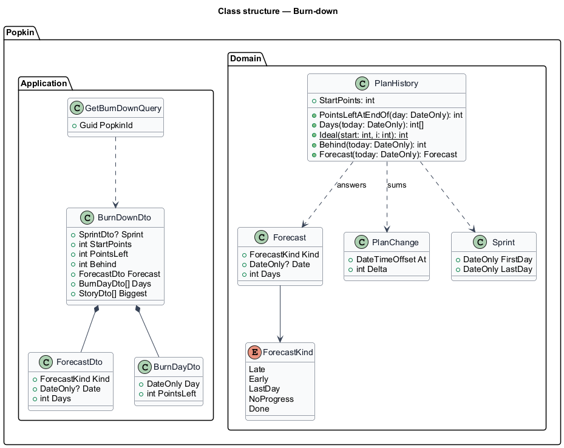
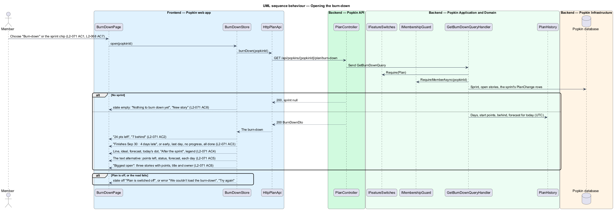

# Burn-down

## Overview

Popkin is a platform for pop-up communities. The Plan tab of a *Popkin* has a second view beside
the [Plan board](../plan-board/README.md): the **burn-down**. It draws the points left at the end
of each day of the sprint, says whether the plan is on track, forecasts when it will be done, and
lists the biggest stories still open.

- **sprint**, **points left**, **day** — as defined in the [Plan board](../plan-board/README.md)
- **start points** — the points left at the end of the sprint's first day
- **ideal** — the points left the plan would have if it burned evenly: for day *i* of the sprint,
  0 to 27, `round(start × (27 − i) / 27)`; 0 after the last day
- **behind** — the points left now minus the ideal for today: "{d} behind" when positive,
  "{d} ahead" when negative, "On track" when 0
- **pace** — the points burned per day on average over the last five days
- **forecast** — when the plan finishes at that pace: late, early, on the last day, no progress,
  or done
- **biggest open** — the three stories with the most points in To do and Doing; of two with the
  same points, the one added first comes first (the mock's Grocery list before Everyone confirms)

It exists only while the Plan switch is on ([Plan switch](../plan-switch/README.md)). Journey 21
builds it.

## Description

### Screens and states

- `docs/mocks/pages/burn-down/default.html` — the view switch ("Burn-down" current), "Burn-down",
  "Aug 30 – Sep 26" (L2-071 AC1); the headline "24 pts left" with the badge "7 behind"; "Finishes
  Sep 30 · 4 days late" (AC2, AC3); the chart (`figure.burn-chart`): the y axis 30, 20, 10, 0; the
  points left by day as a line in the Popkin's colour; the ideal line dashed from 32 to 0 on
  Sep 26; the forecast dotted from today to Sep 30; a dot and "24 left" on today; "+3" over the
  day the line rose; the shaded "After the sprint"; the x axis "Aug 30", "Sep 6", "Today",
  "Sep 19", "Sep 26"; the legend "Points left", "Ideal line", "At this week’s pace" (AC4);
  "Biggest open": "8 Book the cabin at Pine Hollow" with Mara, "5 Rent a 7-seat van" with Walt,
  "3 Grocery list for three dinners" with Ellie (AC6). From 1024 px "Biggest open" sits beside the
  chart; narrower, under it (AC7).
- `done.html` — no points left: "All done", "Finished Sep 17 · 9 days early", no forecast line
  and no "At this week’s pace", and "Nothing left open. Nice work, all six of you." in "Biggest
  open" (AC3).
- `empty.html` — no stories: "Nothing to burn down yet", "Add a story or two and the chart draws
  itself as they get done." and "New story", which opens [Add a story](../add-a-story/README.md)
  (AC8).
- `loading.html` — skeletons of the chart and the list, and "Loading the burn-down…" for
  assistive technology. `error.html` — "We couldn’t load the burn-down", "It’s safe. Check your
  connection and try again." and "Try again".
- `off.html` — Plan off, as the board ([Plan switch](../plan-switch/README.md)): "Burn-down"
  with no dates, "Plan is switched off", and no points, chart or story. A wrapped-up Popkin's
  burn-down reads as any other; its empty state offers no "New story".

### The forecast

With `today` the server's UTC date and `n` = `min(5, today − firstDay)` days in the window:

| Case | Kind | Text |
|---|---|---|
| No points left | `Done`; `date` the first day whose end had 0 points left and every day after it too; `days` = `lastDay − date` | "All done" and "Finished {date}", with " · {n} days early" when `days` > 0 and " · {n} days late" when below 0 |
| `n` is 0, or the points left at the end of day `today − n` minus the points left now is 0 or less | `NoProgress` | "No progress in the last few days" |
| Otherwise, `pace` = that difference / `n`; `date` = `today` + `ceil(pointsLeft / pace)` | `Late` when `date` is after `lastDay`, `days` = `date − lastDay`; `Early` when before, `days` = `lastDay − date`; `LastDay` when equal, `days` 0 | "Finishes {date} · {n} days late", "Finishes {date} · {n} days early", "Finishes {date}, on the last day" |

In the default mock, today is Sep 12, the fourteenth day: the points left were 31 at the end of
Sep 7 and are 24 now, so the pace is 7 / 5 = 1.4, and 24 points take 18 days: Sep 30, four days
after Sep 26. The ideal for the fourteenth day (`i` = 13) is `round(32 × 14 / 27)` = 17, so the
plan is 7 behind.

### The chart

- The x axis runs from the first day to the later of three days after the last day and one day
  after the forecast's `date`, so "After the sprint" and the forecast always fit (Sep 29 in the
  done mock, Oct 1 in the default). Its labels are the first day, each seventh day after it,
  "Today", and the last day; a label that would overlap "Today" is left out.
- The y axis runs from 0 to the largest of the start points and every day's points left, rounded
  up to a multiple of 10, with a tick every 10.
- The line joins the points left at the end of each day so far, today's being the points left
  now. Each day the line rose is marked "+{n}" over it.
- The ideal line runs from the start points on the first day to 0 on the last day. The forecast
  line runs from today's points left to 0 on the forecast's date, only for `Late`, `Early` and
  `LastDay`.
- **Text alternative** (L2-071 AC5, [WCAG 2.2 AA](../../accessibility/wcag-2-2-aa/README.md)):
  the figure is named "Points left by day"; the drawing is hidden from assistive technology, and
  a visually hidden paragraph says "24 points left, 7 behind. Finishes Sep 30, 4 days late.
  Points left at the end of each day: Aug 30: 32, Aug 31: 32, …, Sep 12: 24." The mock's
  paragraph gives the days only, as "day 1: 32"; the app adds the status and the forecast, which
  the requirement asks for, and names each day by its date.

### Form factors

From 1024 px the chart and "Biggest open" sit side by side (`.burn`, a row); narrower, the list is
under the chart (L2-071 AC7). The chart's plot fills its width at every size; its marks are drawn
in a 100 × 100 box stretched to the plot, and the labels are placed by percentage, so nothing
reads the viewport width ([Responsive layout](../../accessibility/responsive-layout/README.md)).

### API

- `GET /api/popkins/{popkinId}/plan/burn-down` → `200` `BurnDownDto`: `sprint` (`SprintDto`, null
  before the first story), `startPoints`, `pointsLeft`, `behind`, `forecast` (`ForecastDto`:
  `kind` — `Late`, `Early`, `LastDay`, `NoProgress` or `Done`; `date` or null for `NoProgress`;
  `days`), `days` (`BurnDayDto`: `day`, `pointsLeft`, one per day from the first day to today or
  the last day, whichever is earlier) and `biggest` (at most three `StoryDto`s, the most points
  first in To do and Doing, then the earliest added).
- Refusals: `401`; `404` `feature_off`; `404` `popkin_not_found`. A read: no rate limit beyond
  the API's.

### Frontend (`frontend/projects/`)

- **`BurnDownPage`** (`/p/:popkinId/plan/burn-down`, `data-page="burn-down"`, providing
  `PopkinFrame` and `BurnDownStore`) — composes `pk-app-screen`, `pk-plan-header` ("Burn-down",
  the sprint's days) with `pk-view-nav`, the headline and its `pk-badge`, the forecast,
  `pk-burn-chart`, `pk-biggest-open`, `pk-empty-state` (empty, error, off) and `pk-popkin-nav`
  with `current="plan"`. "New story" opens `NewStoryDialog`.
- **`BurnDownStore`** (`api`) — `open(popkinId)`, `state` (`loading`, `ready`, `empty`, `error`,
  `off`, `not-found`), the `view`; reads again on a higher `PlanChanged`, on `reconnected$` and
  every 60 seconds while open, as `PlanBoardStore` does.
- **`plan-text.ts`** — `headline` ("24 pts left", "All done"), `badge` ("7 behind", "3 ahead",
  "On track"), `forecastText` (the table above), `chartText` (the text alternative), `biggestEmpty`
  ("Nothing left open. Nice work, all six of you.", the members as a word from two to twelve, as
  [This week](../../schedules/this-week/README.md) does).
- **`burn-chart.ts`** (`api`, pure, unit-tested) — from a `BurnDownDto` and today: the x and y
  domains, the ticks and their labels, the line's points, the ideal and forecast lines, today's
  dot and label, the rises, and where "After the sprint" begins.
- **Components**: `pk-burn-chart` (`figure.burn-chart` with the paragraph, the plot in an `svg`
  hidden from assistive technology, and its legend as a `figcaption[pk-chart-legend]`) and
  `pk-biggest-open` (`aside.biggest`, `h2` "Biggest open", an `ol` of points named "{n} points",
  title and owner's avatar, or its empty line). `pk-chart-legend`'s swatch gains `line`,
  `ideal` and `forecast`, whose dashes and dots tell them apart without their colour.

### Backend (`backend/src/`)

- **`GetBurnDownQuery`** / handler — `Require(Feature.Plan)`, `RequireMemberAsync`; reads the
  sprint, the open stories and the sprint's `PlanChange` rows; `PlanHistory` gives the days, the
  start points, behind and the forecast.
- **`PlanHistory.Forecast(today)`** (Domain, unit-tested one case per row of the table above)
  answers `Forecast(Kind, Date?, Days)`.
- **`PlanController.GetBurnDown`** — `[HttpGet("burn-down")]`.

### Decisions

- The window of the pace is the five days before today, ending now, not the sprint's last five
  days: L2-071 AC3 calls them "the sprint's last five days", meaning the five days just gone.
- A sprint younger than a day has no pace and reads "No progress in the last few days".
- After the last day, the ideal is 0, so "behind" is the points left; the days stop at the last
  day, and the forecast still says when the plan will finish.
- The x axis grows to hold the forecast, as both mocks do.

### Open points

- A sprint whose stories are all in Backlog has nothing in the sprint: its start points are 0, and
  the burn-down reads as empty ("Nothing to burn down yet"), not "All done". Decided while
  building journey 21: "All done" means work was finished, and none was.

## Requirements

| L2 ID | Refines (L1) | Requirement |
|-------|--------------|-------------|
| `L2-071` | `L1-017` | Burn-down: The burn-down says whether the plan is on track and when it will be done. |
| `L2-070` | `L1-017` | Change a story: A story moves across the board as the work gets done (AC5, AC6). |
| `L2-077` | `L1-019` | A feature that is off: A feature that is off is not there. |
| `L2-051` | `L1-012` | Popkins are private to their members: Membership decides everything a person sees. |
| `L2-056` | `L1-013` | Loading, failure and offline are always explained: A person is never left guessing. |
| `L2-057` | `L1-014` | Accessible to WCAG 2.2 AA: Everyone can use every screen. |
| `L2-058` | `L1-014` | Responsive from 360 px: One layout serves every screen size. |
| `L2-059` | `L1-014` | Light and dark themes: Popkin follows the device and the person. |

## Diagrams

The system context: members read whether the plan is on track.

The web app reads the burn-down from the API, which computes it from the sprint's history.

The page, its store and the chart's helpers; the query and `PlanHistory`.

The burn-down's answer and the history it is computed from.

Opening the burn-down.

