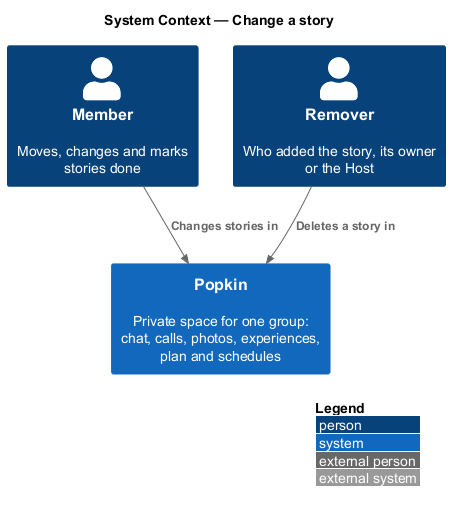
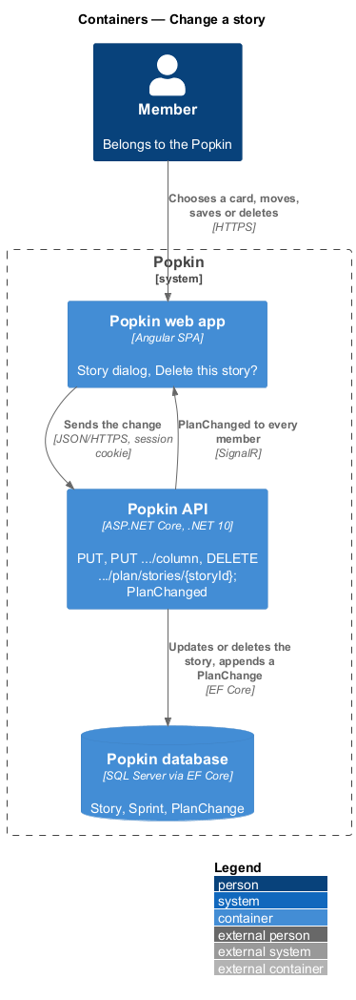
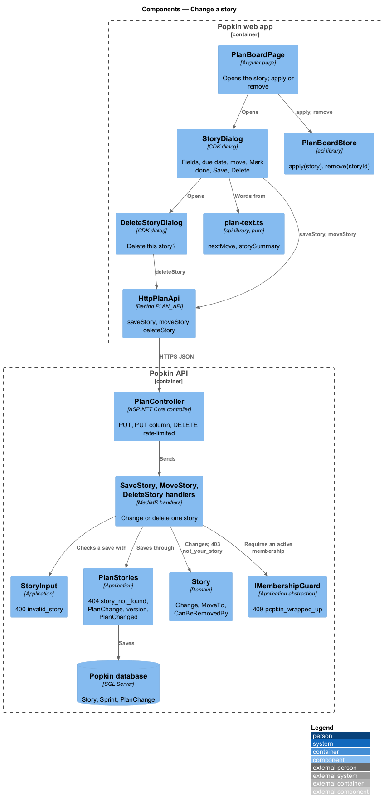
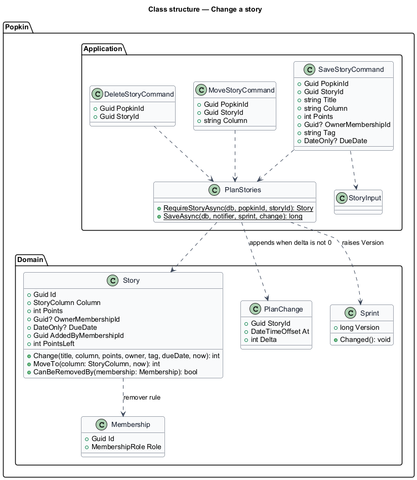
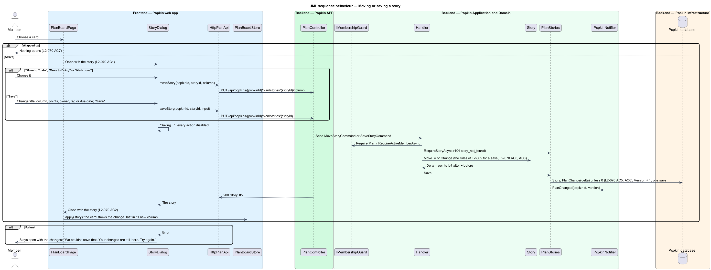
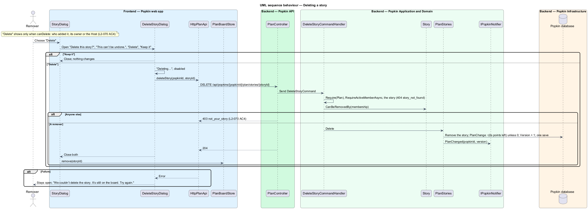

# Change a story

## Overview

Popkin is a platform for pop-up communities. A story on the [Plan board](../plan-board/README.md)
of a *Popkin* moves across the board as the work gets done. Choosing a card opens the **story
dialog**, titled with the story, where any member moves it on, marks it done, changes its title,
column, points, owner, tag or due date, or, if it is theirs to remove, deletes it.

- **story**, **column**, **points**, **owner**, **tag**, **sprint**, **points left** — as defined
  in the [Plan board](../plan-board/README.md)
- **due date** — the day a story should be done by; any calendar date, or none
- **next column** — Backlog moves to To do and To do to Doing; a story in Doing is finished with
  "Mark done"
- **remover** — the member who added the story, its owner or the Host: the members who may delete
  it

Every change to a story that changes the points left is written to the sprint's history, so the
[Burn-down](../burn-down/README.md) can say where the plan stood at the end of each day. Changing
exists only while the Plan switch is on ([Plan switch](../plan-switch/README.md)) and only in an
active Popkin. Journey 21 builds it.

## Description

### Screens and states

- `docs/mocks/dialogs/story/default.html` — "Book the cabin at Pine Hollow"; the line "Doing ·
  8 points · Mara · Stay" (with " · Due Sep 21" when it has a due date); the fields of "New story" ([Add a story](../add-a-story/README.md)) set
  to the story, the column choice with "Backlog", "This sprint", "Doing" and "Done"; "Due
  (optional)", a date field; the actions "Mark done", "Save" and "Delete" (L2-070 AC1).
- `done.html` — a story in Done: no move and no "Mark done", only "Save" and "Delete".
- `busy.html` — "Saving…" with every action disabled.
- `failed.html` — the alert "We couldn’t save that. Your changes are still here. Try again." and
  the changes kept.
- `no-delete.html` — "Rent a 7-seat van" in To do, seen by Sam, who did not add it, does not own
  it and is not the Host: "Move to Doing", "Mark done" and "Save", and no "Delete". A story in
  Backlog offers "Move to To do"; one in Doing "Mark done" alone (L2-070 AC1, AC2, AC4).
- `docs/mocks/dialogs/delete-story/` — `default`: **Delete this story?**, "This can’t be undone.",
  "Delete" and "Keep it"; `busy`: "Deleting…", disabled; `failed`: "We couldn’t delete the story.
  It’s still on the board. Try again." (L2-070 AC4).
- A wrapped-up Popkin's cards open nothing (L2-070 AC7, [Plan board](../plan-board/README.md)).

### Form factors

As "New story": a sheet below 768 px, a panel on the right of the board from 768 px. "Delete this
story?" opens over it as every confirmation does: a sheet below 640 px, centred above
(`pk-dialog`).

### API

- `PUT /api/popkins/{popkinId}/plan/stories/{storyId}` with `{ title, column, points,
  ownerMembershipId, tag, dueDate }` → `200` `StoryDto`. The rules of [Add a story](../add-a-story/README.md)
  apply, with any of the four columns allowed, and `dueDate` any calendar date or null to clear
  it (L2-070 AC3, AC8). A story whose column changes is last in its new column.
- `PUT /api/popkins/{popkinId}/plan/stories/{storyId}/column` with `{ column }` → `200`
  `StoryDto`: "Move to To do", "Move to Doing" and "Mark done" (`Done`). It changes the column
  alone (L2-070 AC2).
- `DELETE /api/popkins/{popkinId}/plan/stories/{storyId}` → `204` (L2-070 AC4). The story goes
  with its comments once comments exist.
- **The history.** A change appends one `PlanChange` with `Delta` = (its points left after) −
  (its points left before), where a story's points left are its points in To do and Doing and 0
  in Backlog and Done; a delete appends −(its points left before). A delta of 0 writes nothing.
  So a story moving into Done takes its points off the day's points left, one moving out of Done
  adds them back, and a change of points in To do or Doing moves the line up or down
  (L2-070 AC5, AC6).
- Refusals: `401`; `404` `feature_off`; `404` `popkin_not_found`; `404` `story_not_found` for a
  story that is not in this Popkin or no longer exists; `409` `popkin_wrapped_up` (L2-070 AC7);
  `403` `not_your_story` for a delete by anyone but a remover (L2-070 AC4); `400`
  `invalid_story` with the field. Every write is counted with messages.
- `PlanChanged(popkinId, version)` follows each write.

### Frontend (`frontend/projects/`)

- **`StoryDialog`** (`dialogs/story`) — opened by `PlanBoardPage` with the `StoryDto`, the
  members and the Popkin's colour. The title is the story's; the line under it is
  `storySummary` ("Doing · 8 points · Mara · Stay", "To do · 5 points · Walt · Travel · Due
  Sep 21", or "No one yet" for no owner). The fields are
  those of `NewStoryDialog` with four columns, and `pk-text-field` `type="date"` "Due
  (optional)". The actions: `nextMove(column)` ("Move to To do", "Move to Doing", or none), "Mark
  done" when not Done, "Save", and "Delete" when `canDelete`. A move or "Mark done" sends
  `moveStory` and closes with the story when it answers; "Save" sends `saveStory`. While either
  runs the action reads "Saving…" and every action is disabled; on failure the alert shows and
  the changes stay. A `404` `story_not_found` closes the dialog and the board reads again.
- **`DeleteStoryDialog`** (`dialogs/delete-story`) — opened over the story dialog with its own
  title and description ids; "Delete" sends `deleteStory`, reads "Deleting…" and is disabled
  while it runs; on success both dialogs close and the page calls `PlanBoardStore.remove`.
- **`plan-text.ts`** — `nextMove`, `storySummary`, `columnChoiceLabel` ("This sprint" for To do).
- **`PlanApi.saveStory`, `.moveStory`, `.deleteStory`**.
- **Components**: as [Add a story](../add-a-story/README.md); the actions are `pk-button`s in
  the dialog's footer.

### Backend (`backend/src/`)

- **`SaveStoryCommand`**, **`MoveStoryCommand`**, **`DeleteStoryCommand`** / handlers —
  `Require(Feature.Plan)`, `RequireActiveMemberAsync`, the story of this Popkin or `404`
  `story_not_found`; for a delete, `Story.CanBeRemovedBy(membership)` or `403` `not_your_story`;
  `StoryInput` for a save; then `PlanStories`: the change, its `PlanChange`, `Version` raised, one
  save, `PlanChanged`.
- **`Story.Change(...)`**, **`Story.MoveTo(column, now)`** — set the fields; a new column sets
  `ColumnEnteredAt`. Each answers the change to the points left, `PointsLeft` after minus before.
- **`Story.CanBeRemovedBy(membership)`** — the member who added it, its owner or the Host. The
  same rule sets `StoryDto.canDelete`.
- **`PlanController`** — `SaveStory` (`[HttpPut("stories/{storyId:guid}")]`), `MoveStory`
  (`[HttpPut("stories/{storyId:guid}/column")]`), `DeleteStory`
  (`[HttpDelete("stories/{storyId:guid}")]`), each rate-limited with messages.

### Decisions

- "Move to {next column}" is offered from Backlog and To do only. From Doing the next column is
  Done, and "Mark done" is that move, so the dialog shows it once.
- A move answers when it is saved, and the dialog closes then; it does not move the card before
  the answer. A move is one small request, and a card that moved back on a failure would be
  harder to follow than a short "Saving…".
- A delete is checked against the remover rule in the handler, never in the page alone; the page
  hides "Delete" from anyone else (L2-070 AC4).
- `PlanChange` rows are kept when their story is deleted: the days before the delete still count
  its points.
- A save that changes nothing still raises the version and sends `PlanChanged`; it writes no
  `PlanChange`.

## Requirements

| L2 ID | Refines (L1) | Requirement |
|-------|--------------|-------------|
| `L2-070` | `L1-017` | Change a story: A story moves across the board as the work gets done. |
| `L2-069` | `L1-017` | Add a story: Any member adds a story (the rules of a story, AC4, AC8). |
| `L2-045` | `L1-011` | A wrapped-up Popkin is read-only: Nothing new is added to a Popkin that has ended. |
| `L2-051` | `L1-012` | Popkins are private to their members: Membership decides everything a person sees. |
| `L2-052` | `L1-012` | Input is validated and output is encoded: Nothing a person types can harm another person or the system. |
| `L2-053` | `L1-012` | Abuse is limited: One person cannot flood the system or another person. |
| `L2-077` | `L1-019` | A feature that is off: A feature that is off is not there. |

## Diagrams

The system context: members move and change stories; removers delete them.

The web app sends each change to the API, which writes the story and its history and tells the
other members.

The two dialogs and the three handlers with `PlanStories`.

A story's changes, the remover rule and the history row.

Moving a story on, marking it done, or saving it.

Deleting a story.

