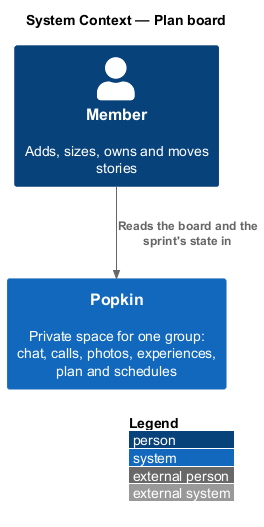
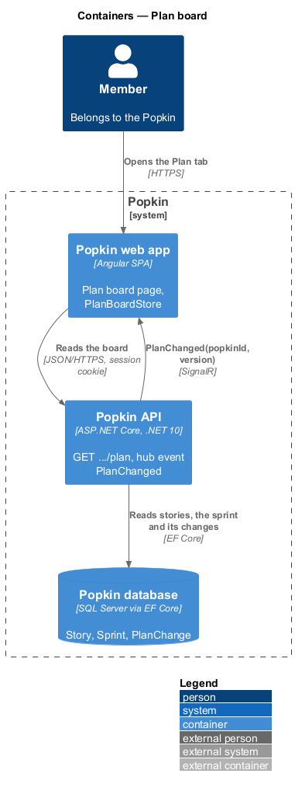
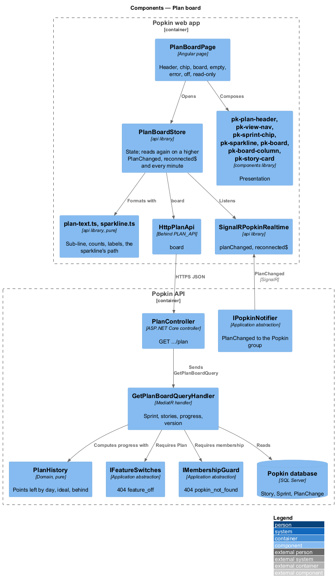
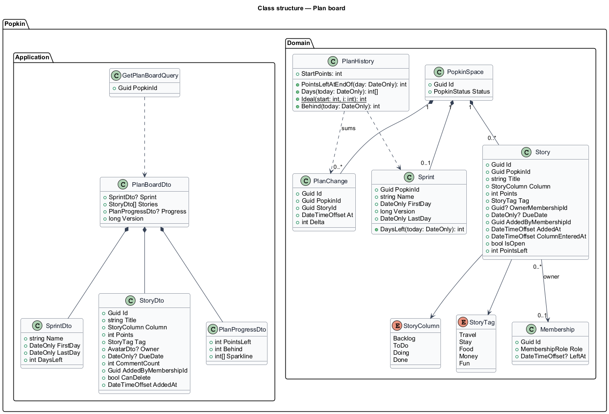
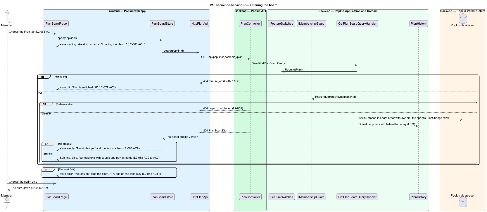
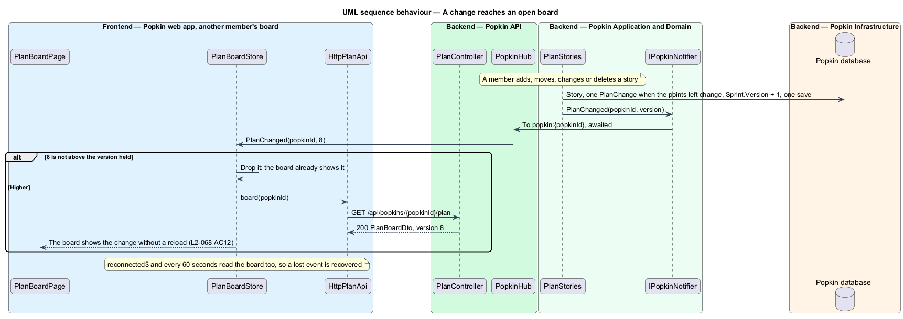

# Plan board

## Overview

Popkin is a platform for pop-up communities. When Plan is on, a *Popkin*, a private space for one
group, has a **Plan** tab where its members plan what they are getting together for, whatever kind
of event it is. The tab opens on the **plan board**: four columns of stories and the state of the
sprint. Any member adds a story, sizes it, owns it and moves it on as the work gets done.

- **story** — one job someone can own ("Book the cabin at Pine Hollow"): a title, a column, its
  points, an owner or none, a tag and, when set, a due date
- **column** — where a story is: **Backlog** (ideas, not this sprint), **To do**, **Doing** or
  **Done**, in that order
- **points** — how big a story is: 1, 2, 3, 5 or 8
- **owner** — the member on it; a story may have none ("No one yet")
- **tag** — what a story is about: Travel, Stay, Food, Money or Fun, each with its colour dot
- **sprint** — the stretch of 28 days the Popkin plans in. A Popkin has one, "Planning sprint".
  It starts on the day the first story is added and its last day is 27 days later
  ("Aug 30 – Sep 26"). It holds the stories in To do, Doing and Done; Backlog is not in it
- **points left** — the points of the stories in To do and Doing
- **day** — a calendar day in UTC, the same for every member (L2-068)

The board sits beside the [Burn-down](../burn-down/README.md), the other view of the tab. A story
is added with [Add a story](../add-a-story/README.md) and changed, moved and deleted with
[Change a story](../change-a-story/README.md). All of it exists only while the Plan switch is on
([Plan switch](../plan-switch/README.md)). Journey 21 builds it. This design holds the model the
other Plan designs share: the story, the sprint and the history of points left.

## Description

### Screens and states

- `docs/mocks/pages/plan-board/default.html` — Cabin Week ’27: the header (`pk-plan-header`)
  with the view switch ("Board" current, "Burn-down"), "Our plan", "Planning sprint ·
  Aug 30 – Sep 26 · 14 days left" with the days left in bold, the sprint chip (a sparkline,
  "24 pts left · 7 behind", a link to the burn-down) and "New story"; the four columns, each with
  its name, its number of stories ("stories: 3" for assistive technology) and its points
  ("6 pts"); Backlog with "Ideas, not this sprint" and a dashed edge; the cards with their title,
  tag, "Due Sep 21", points ("5", named "5 points") and owner's avatar or the dashed "No one
  yet"; the Done cards muted with a tick in the Popkin's colour (L2-068 AC2 to AC5, AC7).
- `empty.html` — no stories: the sub-line "Break it into small jobs. Anyone can add one.", no
  chip; "No stories yet", "A story is one job someone can own. Start with the big four and split
  them up as you go." and the starters "Pick the dates", "Find somewhere to stay", "Sort out
  getting there" and "Set a budget", each opening "New story" with its title (L2-068 AC9).
- `loading.html` — four skeleton columns of three skeleton cards each, and "Loading the plan…"
  for assistive technology (L2-068 AC10).
- `error.html` — the tabs stay; "We couldn’t load the plan", "It’s safe. Check your connection
  and try again." and "Try again" (L2-068 AC11).
- `read-only.html` — a wrapped-up Popkin: "Wrapped up" in place of the days left, the banner
  "This Popkin has wrapped up. The plan stays, but nobody can change it.", cards that open
  nothing, and no "New story" (L2-070 AC7).
- `off.html` — Plan is switched off ([Plan switch](../plan-switch/README.md)).
- A column with no stories reads "Nothing here yet" (L2-068 AC6).

### Form factors

Below 640 px each column is 84% of the width and the board scrolls sideways with snapping; "New
story" is the floating action above the tabs (`pk-fab`). From 640 px each column is 300 px wide;
from 768 px "New story" sits in the header, and from 1024 px the four columns share the width (L2-068 AC8,
[Responsive layout](../../accessibility/responsive-layout/README.md)). The page does not scroll
sideways at any width; only the board does. The tabs follow `pk-popkin-nav`. Nothing reads the
viewport width: the styles of `pk-board` and `pk-plan-header` place everything.

### API

- `GET /api/popkins/{popkinId}/plan` → `200` `PlanBoardDto`:
  - `sprint` (`SprintDto` or null before the first story): `name` ("Planning sprint"),
    `firstDay`, `lastDay` (`firstDay` + 27) and `daysLeft` (`max(0, lastDay − today)`).
  - `stories` — every story of the Popkin, as `StoryDto`: `id`, `title`, `column` (`Backlog`,
    `ToDo`, `Doing`, `Done`), `points`, `tag` (`Travel`, `Stay`, `Food`, `Money`, `Fun`), `owner`
    (`AvatarDto` with the owner's `membershipId` and first name, or null), `dueDate` or null,
    `commentCount` (always 0 until comments exist), `addedByMembershipId`, `canDelete` (the viewer
    added it, owns it or is the Host) and `addedAt`. They come in board order: by column, then by
    the time each entered its column, so a story added or moved is last in its column.
  - `progress` (`PlanProgressDto`, null when there are no stories): `pointsLeft`, `behind` (points
    left minus the ideal for today, positive behind, negative ahead, 0 on track) and `sparkline`
    (the points left at the end of each day of the sprint so far, today's being the points left
    now).
  - `version` — the sprint's version, 0 before the first story.
- Refusals: `401` without a session; `404` `feature_off` while Plan is off (L2-077 AC3); `404`
  `popkin_not_found` for a non-member (L2-051).
- Hub: `PlanChanged(popkinId, version)`, sent to the Popkin's group after every write of
  [Add a story](../add-a-story/README.md) and [Change a story](../change-a-story/README.md).
  It is a state hint: the version rises with every change, and a screen reads the board (or the
  burn-down) again when the version is above the one it holds (L2-068 AC12). Its recovery read is
  `GET …/plan`.

### Frontend (`frontend/projects/`)

- **`PlanBoardPage`** (`/p/:popkinId/plan`, `data-page="plan-board"`, behind `signedInGuard`,
  providing `PopkinFrame` and `PlanBoardStore`) — composes `pk-app-screen`, `pk-plan-header`
  with `pk-view-nav` ("Board" current), `pk-sprint-chip`, `pk-button` "New story", `pk-board`
  with four `pk-board-column`s of `pk-story-card`s, `pk-empty-state` (empty, error, off),
  `pk-banner` (wrapped up), `pk-fab` and `pk-popkin-nav` with `current="plan"`. "New story" and a
  starter open `NewStoryDialog`; a card opens `StoryDialog`, except in a wrapped-up Popkin.
- **`PlanBoardStore`** (`api`) — `open(popkinId)`, `state` (`loading`, `ready`, `empty`,
  `error`, `off`, `not-found`), the `view` (the header's sub-line, the chip, the four columns
  with their counts, points and cards), and `apply(story)` and `remove(storyId)`, which put a
  story the member saved on the board at once, before `PlanChanged` comes back. It keeps the
  highest `version` it has read and reads the board again on `PlanChanged` with a higher one, on
  `reconnected$`, and every 60 seconds while open (L2-077 AC4).
- **`plan-text.ts`** (`api`, pure, unit-tested) — the sprint's days ("Aug 30 – Sep 26", across
  years "Dec 30 2026 – Jan 26 2027"), the sub-line ("Planning sprint · Aug 30 – Sep 26 · 14 days
  left", "1 day left", "0 days left", "Wrapped up"), a column's points ("11 pts", "1 pt"), the
  points' name ("{n} points", "1 point"), "Due Sep 21", the chip's status ("7 behind", "3 ahead",
  "on track") and the badge's ("7 behind", "3 ahead", "On track"), the column names, the submit
  and move labels of the dialogs, the title's error, the starters, the burn-down's headline,
  forecast and text alternative, and the home's and the recap's lines.
- **`sparkline.ts`** (`api`, pure, unit-tested) — the sparkline's path and ideal line in a
  44 × 22 box: the days so far over the sprint's 28, the ideal from the start points to zero,
  up to the largest points left rounded up to a multiple of 5, as the burn-down's chart.
- **`PLAN_API`** / **`PlanApi`** / **`HttpPlanApi`** (`api/src/lib/api/plan/plan-api.ts`) —
  `board`, `addStory`, `saveStory`, `moveStory`, `deleteStory`, `burnDown` and `summary`.
- **`hub-events.ts`** gains `planChanged: 'PlanChanged'`.
- **Components** (`components`, each with its parity spec): `pk-board` (`.board`, the columns'
  row and its snapping), `pk-board-column` (`section.board__col` named by its column, the head
  with `h2`, count and points, the hint and dashed edge of Backlog, the list, "Nothing here yet"),
  `pk-story-card` (`.story-card`: a `button` that opens the story, or a `div` when read-only; the
  title, the tick of `--done`, the tag's dot and name, "Due {date}", the points named "{n}
  points", the owner's `pk-avatar` named by first name or the dashed circle named "No one yet"),
  `pk-sprint-chip` (`a.sprint-chip`, the link to the burn-down) and `pk-sparkline`
  (`svg.sparkline`, hidden from assistive technology: the chip's words carry its meaning). It
  reuses `pk-plan-header`, `pk-view-nav`, `pk-empty-state`, `pk-chip` (the starters),
  `pk-banner`, `pk-fab` and `pk-skeleton`.

### Backend (`backend/src/`)

- **`Story`** (Domain) — `Id`, `PopkinId`, `Title`, `Column` (`StoryColumn`), `Points`, `Tag`
  (`StoryTag`), `OwnerMembershipId?`, `DueDate?` (`DateOnly`), `AddedByMembershipId`, `AddedAt`
  and `ColumnEnteredAt`, which orders a column. `IsOpen` is true in To do and Doing;
  `PointsLeft` is its points when open and 0 otherwise.
- **`StoryColumn`** — `Backlog`, `ToDo`, `Doing`, `Done`. **`StoryTag`** — `Travel`, `Stay`,
  `Food`, `Money`, `Fun`.
- **`Sprint`** (Domain) — key `PopkinId`, `Name` ("Planning sprint"), `FirstDay` (`DateOnly`),
  `Version` (a concurrency token that rises with every change to the board). `LastDay` is
  `FirstDay` + 27 and `DaysLeft(today)` is `max(0, LastDay − today)`. It is created with the first
  story and never moved: deleting every story leaves it as it is (L2-068 AC13).
- **`PlanChange`** (Domain) — `Id`, `PopkinId`, `StoryId`, `At` (`DateTimeOffset`), `Delta`: one
  change to the points left. `StoryId` is not a foreign key, so the row outlives a deleted story.
- **`PlanHistory`** (Domain, pure, unit-tested one case per row) — from a sprint's changes:
  `PointsLeftAtEndOf(day)` (the sum of the deltas with `At` before the next day's midnight UTC),
  `Days(today)` (the points left at the end of each day from the first day to today or the last
  day), `StartPoints` (the points left at the end of the first day), `Ideal(start, i)`
  (`round(start × (27 − i) / 27)`, half away from zero, for `i` from 0 to 27, then 0),
  `Behind(today)`, and the forecast of the [Burn-down](../burn-down/README.md).
- **`StoryInput`** (Application) — the rules of a story's fields
  ([Add a story](../add-a-story/README.md)): `400` `invalid_story` with the field named.
- **`PlanStories`** (Application) — what every write shares: `Feature.Plan`, then the guard,
  the story of this Popkin or `404` `story_not_found`, the sprint created with the first story,
  one `PlanChange` for a change to the points left, `Version` raised, one save, and
  `PlanChanged(popkinId, version)` once it is committed. A save that loses to another write
  (`DbUpdateConcurrencyException` on `Version`) is made again from a fresh read, up to three
  times in all.
- **`GetPlanBoardQuery`** / handler — `IFeatureSwitches.Require(Feature.Plan)`, then
  `IMembershipGuard.RequireMemberAsync`; reads the sprint, the stories with their owners, and the
  sprint's `PlanChange` rows for the progress; `today` is the UTC date of `TimeProvider`.
- **`PlanController`** (`api/popkins/{popkinId:guid}/plan`) — one action per endpoint, each
  sending one MediatR request; the writes carry
  `[EnableRateLimiting(RateLimitPolicyNames.Messages)]`.
- **`IPopkinNotifier.PlanChanged(Guid popkinId, long version)`** and
  **`IPopkinClient.PlanChanged`** — to `popkin:{popkinId}`, awaited.
- EF: `StoryConfiguration` (index on `PopkinId, Column, ColumnEnteredAt`, the title at most 80),
  `SprintConfiguration` (`Version` `IsConcurrencyToken`), `PlanChangeConfiguration` (index on
  `PopkinId, At`); one migration.
- A member who leaves (L2-047) or whose account is erased (L2-049) stops owning their stories in
  the same save: their stories read "No one yet". The points do not change, so no `PlanChange` is
  written.

### Decisions

- **Points left are kept as a log of changes, `PlanChange`.** Every add, move, change of points
  and delete that changes the points left appends one row with the difference, in the same unit
  of work as the story. The points left at the end of day D are the sum of the deltas before
  midnight UTC after D. This is simple (one insert per write, nothing updated), exact (any day's
  value is a sum, never a sample taken at the wrong moment), needs no job (no Worker takes a
  snapshot at midnight, and none can miss one), and survives the switch: while Plan is off nothing
  writes, and the sum carries the last value across the days in between. A change that leaves the
  points left as they were, such as a story added to Backlog or moved from To do to Doing, writes
  no row.
- The board's `today` is the server's UTC date; the web app sends none, because a day of Plan is
  a calendar day in UTC (L2-068), unlike the Schedule tab's.
- The sprint starts with the first story wherever it goes, Backlog included.
- One sprint per Popkin; editing it and further sprints are deferred (known gap 80).
- `commentCount` is always 0, and no card or dialog shows a count, until comments exist (known gap
  79).
- `PlanChanged` carries the version only: the board is read again whole, which is a single read
  of at most a few hundred rows, rather than patched from the event.

### Open points

- Whether a story's history should say who made each change. `PlanChange` records none; nothing
  asks for it yet.

### Cross-cutting

[Membership authorisation](../../security/membership-authorisation/README.md) (the guard after
the switch), [Input validation and encoding](../../security/input-validation-and-encoding/README.md)
(a title is shown as text), [Loading, failure and offline](../../reliability/loading-failure-offline/README.md)
(the skeleton, the failure and "Try again"), [WCAG 2.2 AA](../../accessibility/wcag-2-2-aa/README.md)
(each column a named section, the counts and points named, the owner named, the tick not the only
sign of done: the column says it), [Light and dark themes](../../accessibility/light-and-dark-themes/README.md)
(tokens by role; the tag dots from the palette) and [Optional motion](../../accessibility/optional-motion/README.md)
(the card's press and the snapping scroll honour reduced motion).

## Requirements

| L2 ID | Refines (L1) | Requirement |
|-------|--------------|-------------|
| `L2-068` | `L1-017` | The plan board: The Plan tab opens on the board: four columns of stories and the sprint's state. |
| `L2-070` | `L1-017` | Change a story: A story moves across the board as the work gets done (AC5, AC6, AC7, the history of points left and the read-only board). |
| `L2-077` | `L1-019` | A feature that is off: A feature that is off is not there. |
| `L2-045` | `L1-011` | A wrapped-up Popkin is read-only: Nothing new is added to a Popkin that has ended. |
| `L2-051` | `L1-012` | Popkins are private to their members: Membership decides everything a person sees. |
| `L2-056` | `L1-013` | Loading, failure and offline are always explained: A person is never left guessing. |
| `L2-057` | `L1-014` | Accessible to WCAG 2.2 AA: Everyone can use every screen. |
| `L2-058` | `L1-014` | Responsive from 360 px: One layout serves every screen size. |

## Diagrams

The system context: members plan together on one board.

The web app reads the board from the API, which reads the database and tells the other members
through the hub.

The page, its store and the pure helpers on the web side; the controller, the query, the switch,
the guard and `PlanHistory` on the API side.

A Popkin has one sprint once it has a story; every change to the points left is a `PlanChange`.

Opening the board.

Another member's change reaching an open board without a reload.

