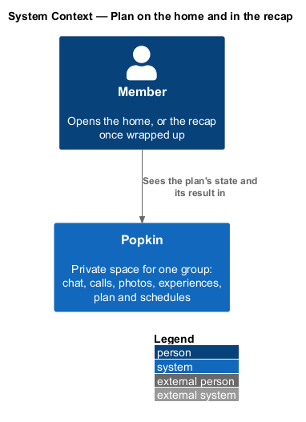
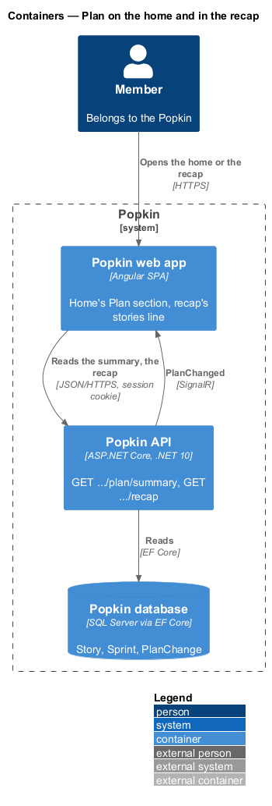
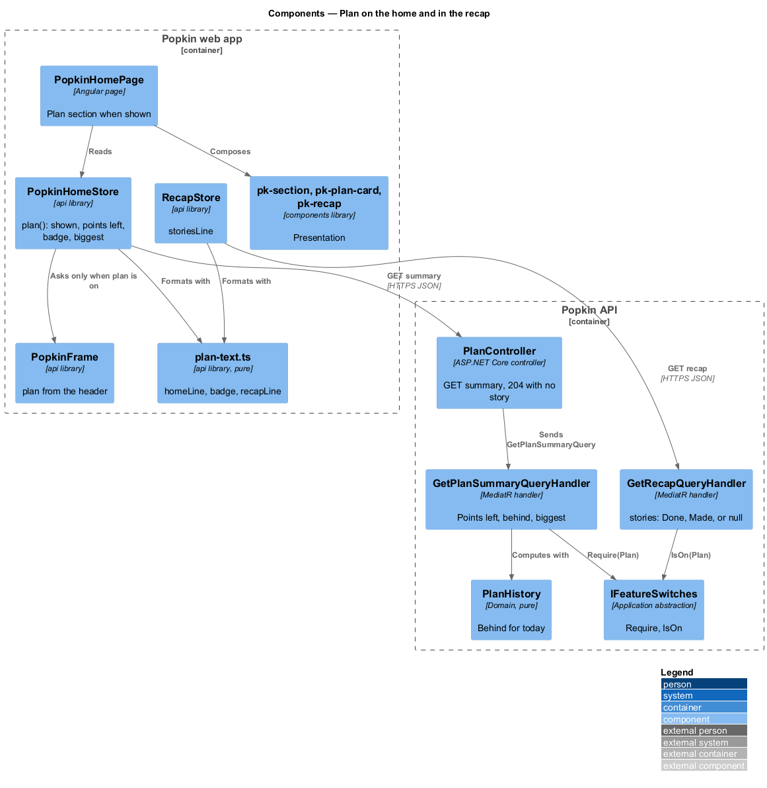
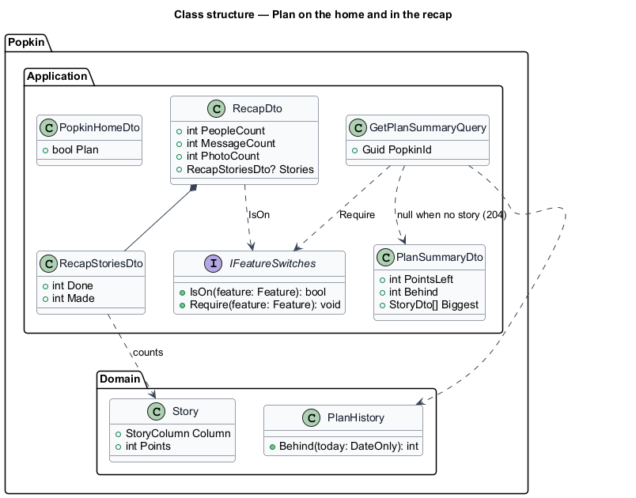
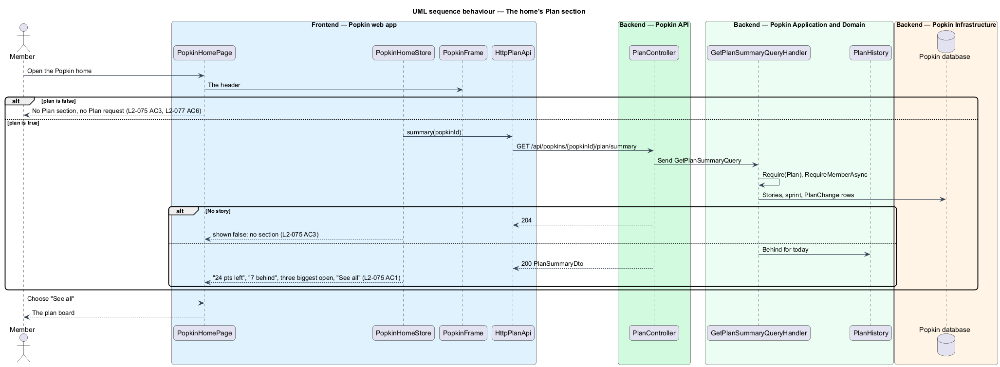

# Plan on the home and in the recap

## Overview

Popkin is a platform for pop-up communities. The *Popkin home* summarises a Popkin and leads to
everything in it; the *recap* is the send-off once it has wrapped up. When Plan is on, the home
gains a **Plan** section that says where the plan stands, and the recap counts the stories done
out of the stories made.

- **points left**, **behind**, **biggest open** — as defined in the [Plan board](../plan-board/README.md)
  and the [Burn-down](../burn-down/README.md)
- **stories made** — every story of the Popkin that still exists, whatever its column
- **stories done** — the stories in Done

Both are left out when Plan is off or the Popkin has no story (L2-075 AC3, L2-077 AC6). This
design adds to the [Popkin home](../../popkins/popkin-home/README.md) and the
[Recap](../../wrap-up/recap/README.md). Journey 21 builds it.

## Description

### Screens and states

- `docs/mocks/pages/popkin-home/plan.html` — Cabin Week ’27 with Plan and Schedules on: the
  section "Plan" with "See all" ("of the plan" for assistive technology), which opens the plan
  board (`/p/:popkinId/plan`); a card with "24 pts left" and "7 behind" in the Popkin's colour
  ("3 ahead", "On track"); and the list "Biggest open" of the three largest open stories, each
  with its points named "{n} points", its title and its owner's avatar (L2-075 AC1). The section
  sits before Schedule, in the side column from 1024 px and in the single column below.
- `docs/mocks/pages/wrapped-up/plan.html` — the recap with Plan on: a card "The plan" with
  "12 of 14 stories done", after the stats, counting every story made, Backlog included
  (L2-075 AC4).
- When the summary fails to load, the section shows the home's per-section failure with "Try
  again", as the other sections do ([Loading, failure and offline](../../reliability/loading-failure-offline/README.md)).

### API

- `GET /api/popkins/{popkinId}/plan/summary` → `200` `PlanSummaryDto`: `pointsLeft`, `behind`
  and `biggest` (at most three `StoryDto`s, as the burn-down's); `204` when the Popkin has no
  story. Refusals: `401`; `404` `feature_off`; `404` `popkin_not_found`.
- `GET /api/popkins/{popkinId}` — `PopkinHomeDto.plan` says whether to ask for the summary
  ([Plan switch](../plan-switch/README.md)).
- `GET /api/popkins/{popkinId}/recap` — `RecapDto` gains `stories`: `RecapStoriesDto(Done, Made)`,
  or null when Plan is off or the Popkin has no story.
- `PlanChanged` reaches the home through the Popkin's group like any other event; the home reads
  the summary again when it arrives with a version above the one it holds, and on
  `reconnected$`.

### Frontend (`frontend/projects/`)

- **`PopkinHomeStore`** — `plan()`: `{ shown, pointsLeft, badge, biggest }`, read with the other
  summaries when `PopkinFrame.plan` is true; `shown` is false on `204`, on `404` `feature_off` and
  while Plan is off.
- **`PopkinHomePage`** — the section (`pk-section`, heading "Plan", `linkSuffix="of the plan"`,
  the link to the board) with `pk-plan-card` inside.
- **`RecapStore`** — `storiesLine` from `stories`, or nothing.
- **`plan-text.ts`** — `homeLine` ("24 pts left"), `badge`, `recapLine` ("12 of 14 stories done",
  "1 of 1 story done").
- **`PLAN_API.summary`**; **`RECAP_API`**'s `RecapDto` gains `stories`.
- **Components**: `pk-plan-card` (a `.card`: the points left and the status, then the rows of
  `pk-biggest-open` as an `ol` named "Biggest open", without its heading) and `pk-recap`'s card
  "The plan" with the stories line.

### Backend (`backend/src/`)

- **`GetPlanSummaryQuery`** / handler — `Require(Feature.Plan)`, `RequireMemberAsync`; no story
  answers null, which the controller turns into `204`; otherwise `PlanHistory` gives the points
  left and behind, and the open stories the biggest.
- **`GetRecapQueryHandler`** — takes `IFeatureSwitches`; when `IsOn(Feature.Plan)` and the Popkin
  has stories, counts them and those in Done.
- **`PlanController.GetSummary`** — `[HttpGet("summary")]`.

### Decisions

- The recap counts the stories that exist when it is read; a deleted story is not counted as
  made.
- The home asks for the summary only while the header says Plan is on, so a home with Plan off
  makes no Plan request.

## Requirements

| L2 ID | Refines (L1) | Requirement |
|-------|--------------|-------------|
| `L2-075` | `L1-017` | Plan and Schedules on the home and in the recap: The home and the recap show the plan when the features are on (AC1, AC3, AC4). |
| `L2-077` | `L1-019` | A feature that is off: A feature that is off is not there (AC6). |
| `L2-019` | `L1-006` | Popkin home: The home of a Popkin summarises it and leads to everything in it. |
| `L2-046` | `L1-011` | Recap: The recap is the send-off. |
| `L2-056` | `L1-013` | Loading, failure and offline are always explained: A person is never left guessing. |

## Diagrams

The system context: members see the plan's state on the home and its result in the recap.

The web app reads the summary and the recap from the API.

The home's and the recap's stores and the two handlers.

The summary and the recap's count.

Opening the home with Plan on.

