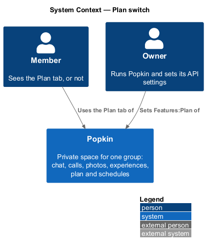
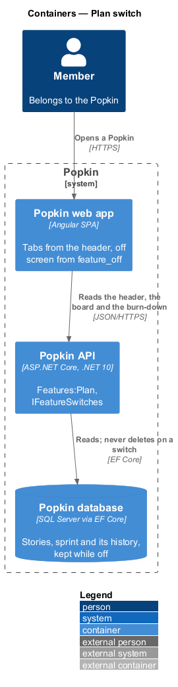
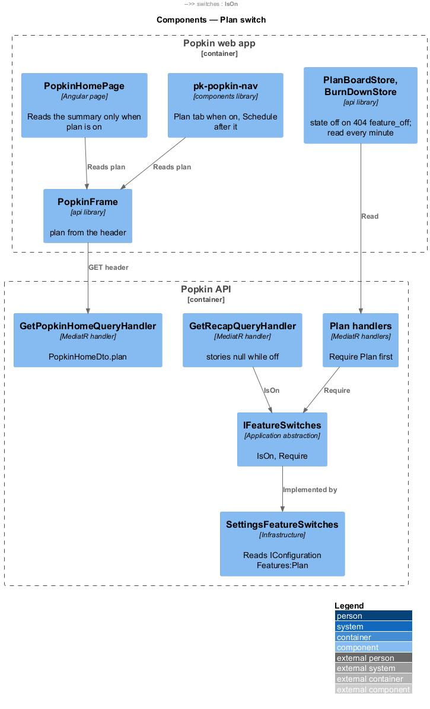
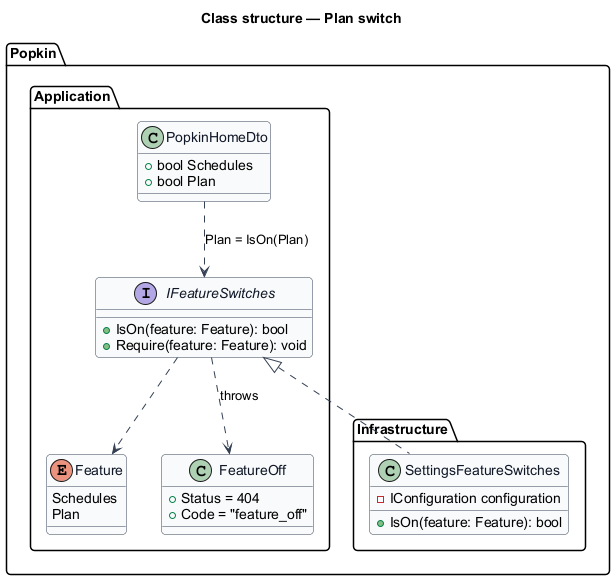
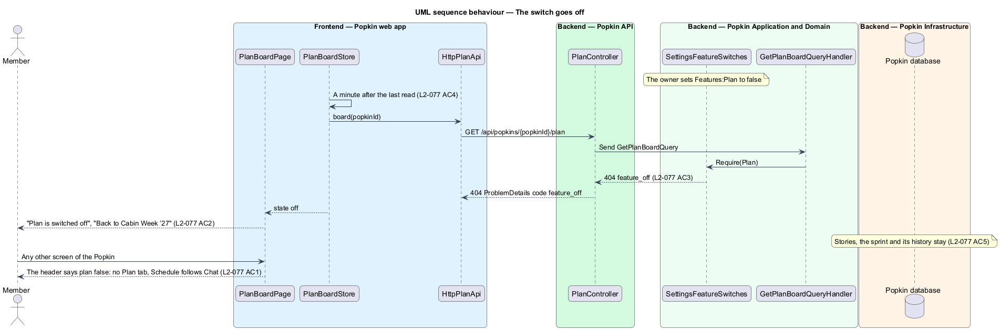

# Plan switch

## Overview

Popkin is a platform for pop-up communities. Plan, the tab where a *Popkin*'s members break what
they are getting together for into stories and follow them to done, is a feature that can be
switched on and off for every Popkin at once. When it is off, the Plan tab is not there, its
screens say so, the home and the recap leave its section out, and the API refuses its requests,
keeping every story for when it returns.

- **feature switch** — an on/off setting for one feature across every Popkin (L1-019)
- **Plan** — the feature of the [Plan board](../plan-board/README.md),
  [Add a story](../add-a-story/README.md), [Change a story](../change-a-story/README.md), the
  [Burn-down](../burn-down/README.md) and [Plan on the home and in the recap](../plan-on-the-home-and-recap/README.md)

L1-019 puts the switch in a separate admin app, which journey 23 builds. Until then the switch is
an API setting, `Features:Plan`, as [ADR 0023](../../../adr/0023-features-switched-on-by-a-setting.md)
decides, built the same way as the [Schedules switch](../../schedules/schedules-switch/README.md).
Journey 21 builds it.

## Description

### Screens and states

- Every screen of a Popkin shows the tabs Home, Chat, Plan, Schedule, Photos and Experiences when
  both features are on; Home, Chat, Plan, Photos and Experiences when only Plan is on; and Home,
  Chat, Photos and Experiences when both are off (L2-068 AC1, L2-077 AC1). Schedule follows Plan
  when Plan is on, and Chat when it is off (L2-072 AC1).
- `docs/mocks/pages/plan-board/off.html` — the header "Our plan" with the view switch, then
  "Plan is switched off", "Popkin has turned this feature off for now. Nothing is lost: it comes
  back as it was when the feature is on again. Your host can ask Popkin to find out more." and
  "Back to Cabin Week ’27"; no story, no sprint (L2-077 AC2). `pages/burn-down/off.html` shows
  the same under "Burn-down".
- The home leaves its Plan section out and the recap its count of stories (L2-077 AC6,
  [Plan on the home and in the recap](../plan-on-the-home-and-recap/README.md)).

### API

- **`Features:Plan`** — an API setting, off unless `true`, listed in `docs/deployment.md`, set by
  the parameter `plan` in `infra/main.bicep`. `ApiFactory` and `eng/Start-E2eApi.ps1` set it to
  `true`; the tests of the off state turn it off.
- **`Feature.Plan`** — the second value of `Feature` (Application), beside `Schedules`.
  `IFeatureSwitches.Require(Feature.Plan)` throws `404` `feature_off` ("Plan is switched off.").
  `SettingsFeatureSwitches` reads `Features:{feature}` from `IConfiguration` at each call, so a
  changed setting needs no new release.
- Every Plan endpoint (`GET …/plan`, `POST …/plan/stories`, `PUT …/plan/stories/{storyId}`,
  `PUT …/plan/stories/{storyId}/column`, `DELETE …/plan/stories/{storyId}`,
  `GET …/plan/burn-down`, `GET …/plan/summary`) calls `Require(Feature.Plan)` first, before
  membership, so nothing of the feature answers while it is off (L2-077 AC3). A non-member of a
  Popkin learns only that the feature is off, which says nothing about the Popkin.
- `GET /api/popkins/{popkinId}` (the home header, `PopkinHomeDto`) gains `plan` (bool,
  `IsOn(Feature.Plan)`), the web app's only source for the tab and the home's section.
- `GET …/recap` sets `stories` to null while Plan is off (`IsOn`, never `Require`: the recap
  itself is not part of Plan).
- No hub event is sent when the switch changes: nothing in the API knows when a setting changed.

### Frontend (`frontend/projects/`)

- **`PopkinFrame.plan`** — `computed` from the header's `plan`; false until it is read and when
  it fails, as `PopkinFrame.schedules` is.
- **`pk-popkin-nav`** — input `plan` (bool) adds the Plan tab between Chat and Schedule (or Photos
  when `schedule` is false), with the board icon of the mock; `current` (`PopkinNavTab`) gains
  `'plan'`.
- **Every page with tabs** passes `[plan]="frame.plan()"` beside `[schedule]="frame.schedules()"`.
- **`PlanBoardStore`, `BurnDownStore`** — a `404` `feature_off` is the state `off`; the page shows
  `pk-empty-state` with "Plan is switched off", the line above and "Back to {Popkin name}",
  which opens the home. The stores read every 60 seconds while open, so an open screen turns to
  it within a minute without a reload (L2-077 AC4).
- **`PopkinHomePage`** — reads `…/plan/summary` only when `frame.plan()` is true.
- **`plan-text.ts`** — `offTitle` ("Plan is switched off").

### Decisions

- The switch is read on every request (`IConfiguration`), not cached, so turning it off is
  honoured at once by the API and within a minute by an open screen.
- Data is never deleted by the switch (L2-077 AC5). While Plan is off nothing writes a story or
  its history ([Plan board](../plan-board/README.md), `PlanChange`), so the burn-down after the
  switch is turned on again carries the last points left across the days it was off.
- The admin app of journey 23 replaces `SettingsFeatureSwitches` behind the same interface; no
  Plan endpoint changes.

## Requirements

| L2 ID | Refines (L1) | Requirement |
|-------|--------------|-------------|
| `L2-077` | `L1-019` | A feature that is off: A feature that is off is not there. |
| `L2-068` | `L1-017` | The plan board: The Plan tab opens on the board: four columns of stories and the sprint's state (AC1). |
| `L2-072` | `L1-018` | Time off: The Schedule tab opens on time off: a week of the group's days off at a time (AC1, Schedule after Plan). |
| `L2-075` | `L1-017` | Plan and Schedules on the home and in the recap: The home and the recap show the plan when the features are on (AC3). |

## Diagrams

The owner switches Plan in the API's settings; members see the tab or not.

The API reads the setting; the web app reads the header.

The switch's interface, its implementation, and its readers on both sides.

`IFeatureSwitches` and the feature enum, now with `Plan`.

A board that is open when the switch goes off.

