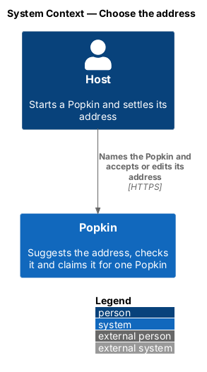
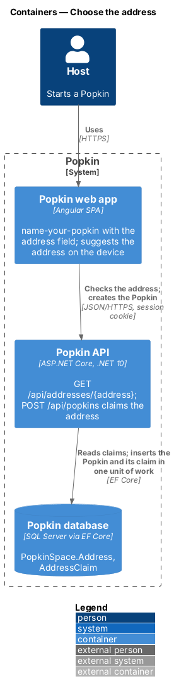
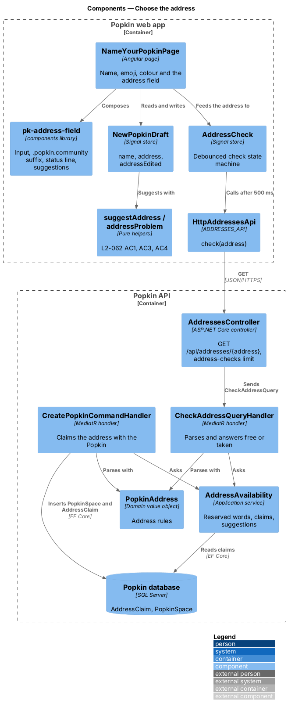
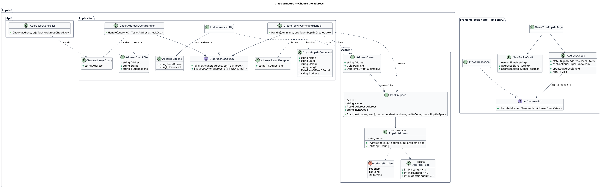
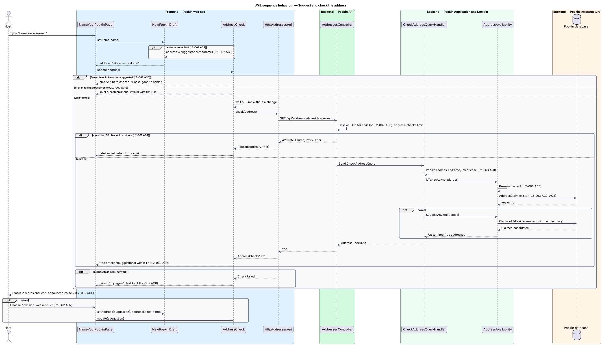
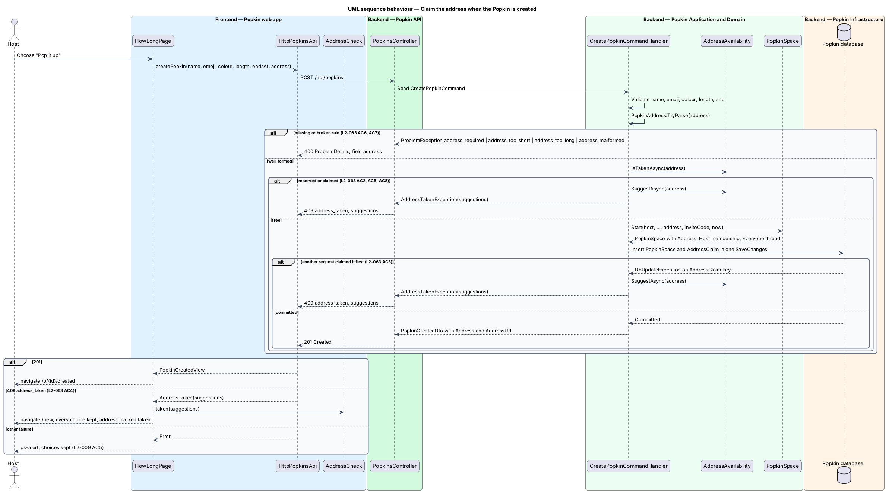

# Choose the address

## Overview

Popkin is a platform for pop-up communities. Every Popkin has its own web address,
`https://{address}.popkin.community` (L1-016). This feature covers how that address is settled
and how the system keeps it to one Popkin.

- **address** — short word under `popkin.community` that belongs to one Popkin, such as `lakeside-weekend`
- **suggestion** — address the web app derives from the name as the person types it
- **availability check** — question to the Popkin API whether a well-formed address is free or taken
- **reserved word** — word that is never an address, such as `www`, `api` or `admin`
- **address claim** — record that an address has been given to a Popkin; it is never deleted

The address is settled on the first step of starting a Popkin, "Name your Popkin"
([Start a Popkin](../start-popkin/README.md)). Below the name field, an "Address" field shows the
suggestion as the name is typed, followed by ".popkin.community". Most Hosts never type in it.
A Host who does type in it keeps what they typed. Half a second after typing stops, the web app
asks the Popkin API whether the address is free. A taken or reserved address disables "Looks
good" and offers up to three free addresses with a number after them.

The Popkin API decides in the end. `POST /api/popkins` carries the address. The API validates it
again, whatever the screen allowed, and claims it in the same unit of work that creates the
Popkin. A claim is never released: an address stays taken after its Popkin wraps up, is removed,
or loses its Host to account deletion (L2-063 AC8). Opening a Popkin by its address belongs to
[Open a Popkin by its address](../open-by-address/README.md). That the address never changes is
in [Popkin settings](../popkin-settings/README.md) (L2-066).

## Description

### Screens and states

No mock draws the address yet. The requirements name these states of `name-your-popkin`; each
needs a mock before implementation, under `docs/mocks/pages/name-your-popkin/`:

| State | What shows | Requirement | Mock |
|---|---|---|---|
| Suggested | Address field filled from the name, ".popkin.community" after it | L2-062 AC1 | `<TO SUPPLY>` |
| Checking | Status line while the check runs | L2-062 AC6 | `<TO SUPPLY>` |
| Free | Icon and text that the address is free | L2-062 AC6 | `<TO SUPPLY>` |
| Taken | Icon and text that it is taken, up to three suggestions, "Looks good" disabled | L2-062 AC7, L2-063 AC4 | `<TO SUPPLY>` |
| Invalid | Field `aria-invalid` with the rule broken, "Looks good" disabled | L2-062 AC4 | `<TO SUPPLY>` |
| Choose an address | Empty field, hint to choose one, "Looks good" disabled | L2-062 AC5 | `<TO SUPPLY>` |
| Check failed | "Could not be checked" with "Try again", text kept | L2-062 AC8 | `<TO SUPPLY>` |
| Too many checks | When the person can check again | L2-067 AC7 | `<TO SUPPLY>` |
| 360 px | Whole address fits or wraps, no sideways scroll | L2-062 AC10 | `<TO SUPPLY>` |
| 768 px and wider | `pk-preview-card` shows the address under the name | L2-062 AC10 | `<TO SUPPLY>` |

The copy of every message above is `<TO SUPPLY>` until the mocks write it.

### API

- `GET /api/addresses/{address}` — introduced. Authenticated by the fallback policy, so a
  visitor receives `401` (L2-067 AC8). Rate-limited by the `address-checks` policy. `200`
  `AddressCheckDto { address, status, suggestions }`, where `status` is `free` or `taken` and
  `suggestions` holds up to three free addresses when it is `taken`. Failures: `400` ProblemDetails
  with `code` `address_too_short`, `address_too_long` or `address_malformed`; `429`
  `rate_limited` with `Retry-After` (L2-067 AC7).
- `POST /api/popkins` — changed. The body gains `address`. New failures: `400` with `code`
  `address_required`, `address_too_short`, `address_too_long` or `address_malformed`, the field
  named `address` (L2-063 AC7); `409` with `code` `address_taken` and the extension
  `suggestions` (L2-063 AC3, AC4). `PopkinCreatedDto` gains `Address` and `AddressUrl`.

A reserved word answers exactly as a taken address does, `taken` or `409` `address_taken`
(L2-063 AC5). An address that begins with `xn--` answers `address_malformed` (L2-063 AC6).

### Frontend — Popkin web app and `api` library

- **`suggestAddress(name)`** (pure helper, `api` library, introduced) — applies L2-062 AC1 in
  order: lower case; accents removed by Unicode NFD and removal of combining marks; each run of
  spaces and punctuation turned into one hyphen; every other character outside `a-z` and `0-9`
  dropped, emoji included; hyphens trimmed from both ends; cut to 40 characters; hyphens trimmed
  again. It returns `""` when fewer than 3 characters remain (L2-062 AC5). "Lakeside Weekend"
  gives `lakeside-weekend`. Unit tests (ADR 0011) take one case per rule.
- **`addressProblem(address)`** (pure helper, `api` library, introduced) — returns `tooShort`,
  `tooLong`, `edgeHyphen`, `doubleHyphen`, `punycode` or `null` (L2-062 AC4, L2-063 AC6). It is
  the client copy of `PopkinAddress.TryParse`; the two share one table of cases.
- **`normaliseAddressInput(text)`** (pure helper, `api` library, introduced) — lower-cases the
  text and drops every character outside `a-z`, `0-9` and `-` as it is typed (L2-062 AC3).
- **`AddressCheck`** (signal store, `api` library, introduced) — the field's state machine. Its
  states are `empty`, `invalid(problem)`, `waiting`, `checking`, `free`, `taken(suggestions)`,
  `failed` and `rateLimited(retryAt)`. A change of text cancels the check in flight. After 500 ms
  without a change, a well-formed address moves to `checking` and calls
  `AddressesApi.check(address)` (L2-062 AC6). `canContinue` is true only in `free`
  (L2-062 AC4, AC5, AC7). Unit tests drive it with a fake clock.
- **`NewPopkinDraft`** (changed) — gains `address` and `addressEdited`. While `addressEdited` is
  false, each change of name writes `suggestAddress(name)` to `address`. The first keystroke in
  the address field sets `addressEdited`, and the name no longer moves the address
  (L2-062 AC2). Going back from the next step keeps the address (L2-062 AC9).
- **`pk-address-field`** (`components` library, introduced) — `pk-text-field` with the suffix
  ".popkin.community" drawn after the input as text, a status line with an icon and words, and a
  row of `pk-chip` suggestions. The status line is a polite live region, so free, taken and
  failed are announced (L2-062 AC6, L2-057). The icon is decoration; the words carry the state
  (L2-057 AC5). At 360 px the suffix wraps under the input rather than scrolling sideways
  (L2-062 AC10). It has a parity spec (ADR 0008) once its mock exists.
- **`NameYourPopkinPage`** (changed) — composes `pk-address-field` below the name, bound to
  `NewPopkinDraft.address` and `AddressCheck`. Choosing a suggestion writes it to the draft
  (L2-062 AC7). "Try again" repeats the check (L2-062 AC8). "Looks good" is disabled unless the
  name is filled and `AddressCheck.canContinue` is true (L2-062 AC9). From 768 px
  `pk-preview-card` shows `{address}.popkin.community` under the name (L2-062 AC10).
- **`HowLongPage`** (changed) — sends the draft's address with the create request. On `409`
  `address_taken` it navigates back to `/new` and puts `AddressCheck` in
  `taken(suggestions)` from the ProblemDetails, with every other choice kept (L2-063 AC4).
- **`AddressesApi` / `ADDRESSES_API` / `HttpAddressesApi`** (`api` library, introduced) —
  `check(address)` returns `AddressCheckView`, maps `429` to `RateLimited(retryAfter)` and any
  other failure to `CheckFailed`. Pages inject the token.

### Backend

- **`PopkinAddress`** (`Popkin.Domain`, introduced) — value object holding a valid address in
  lower case. `TryParse(text, out address, out problem)` lower-cases the text (L2-063 AC1) and
  applies the rules: 3 to 40 characters; only `a-z`, `0-9` and `-`; no hyphen at either end; no
  two hyphens in a row; no `xn--` prefix (L2-062 AC4, L2-063 AC6). `ToString()` returns the
  address. A direct test takes one case per rule.
- **`AddressRules`** (`Popkin.Domain`, introduced) — `MinLength = 3`, `MaxLength = 40`, the
  suggestion count 3 and the longest number tried for a suggestion, `<TO SUPPLY>`.
- **`AddressOptions`** (`Popkin.Application`, introduced) — binds the configuration section
  `Addresses`: `BaseDomain` (`popkin.community` in production) and `Reserved`, the list of
  reserved words. The defaults are the 28 words of L2-063 AC5. Operations may add words without a
  release (L2-063 AC5); the settings belong in `docs/deployment.md`.
- **`AddressClaim`** (`Popkin.Domain`, introduced) — `Address` (primary key), `PopkinId`,
  `ClaimedAt`. One row is written when a Popkin is created. No code path deletes or updates a
  claim, so an address is never given to a second Popkin (L2-063 AC2, AC8). The claim is its own
  table, not only a column of `PopkinSpace`, so that removing a Popkin's row would still leave the
  address taken.
- **`PopkinSpace`** (changed) — gains `Address` (`PopkinAddress`), set by `Start(...)` and with no
  setter after it (L2-066 AC3). `PopkinSpaceConfiguration` stores it as `nvarchar(40)` with a
  unique index.
- **`IAddressAvailability` / `AddressAvailability`** (`Popkin.Application`, introduced) —
  `IsTakenAsync(address)` is true for a reserved word or an address with a claim.
  `SuggestAsync(address)` builds the candidates `{address}-2`, `{address}-3`, … , shortening
  `{address}` so that each candidate stays within 40 characters and ends without a hyphen. It
  reads the claims of all candidates in one query and returns the first three that are free and
  not reserved.
- **`CheckAddressQuery` / `CheckAddressQueryHandler`** (`Popkin.Application.Addresses`,
  introduced) — parses the address, throwing `ProblemException.Invalid` for a broken rule, and
  returns `AddressCheckDto`. The answer is a moment's view: a free address may be taken before
  the Popkin is created, which `CreatePopkinCommandHandler` handles.
- **`AddressesController`** (`Popkin.Api`, introduced) — `GET /api/addresses/{address}` with
  `[EnableRateLimiting(RateLimitPolicyNames.AddressChecks)]`; sends `CheckAddressQuery`.
- **`CreatePopkinCommand`** (changed) — gains `Address`. **`CreatePopkinCommandHandler`**
  (changed) parses it after the other fields, throwing `address_required` when it is missing and
  the rule's code when it is malformed (L2-063 AC7). A reserved or claimed address throws
  `AddressTakenException` with suggestions. Otherwise it adds the `PopkinSpace` and its
  `AddressClaim` in one `SaveChangesAsync`. When two requests race for one address, the primary
  key of `AddressClaim` refuses the second insert; the handler maps that `DbUpdateException` to
  `AddressTakenException`, so exactly one Popkin is created (L2-063 AC3). The invite-code retry
  stays as it is and never retries on an address conflict.
- **`AddressTakenException`** (`Popkin.Application.Problems`, introduced) — maps to `409`
  ProblemDetails with `code` `address_taken`, the field `address` and `suggestions`.
- **`RateLimitPolicyNames.AddressChecks`** — `address-checks`: `SlidingWindowRateLimiter`,
  `PermitLimit = 30`, `Window = 1 min`, `SegmentsPerWindow = 6`, `QueueLimit = 0`, partitioned
  by the person id from the session. The 31st check within a minute answers `429` with
  `Retry-After` (L2-067 AC7). Values bind from `RateLimits` as the other policies do
  ([Abuse limits](../../security/abuse-limits/README.md)).

### Tests

- API tests on InMemory: a free address answers `free`; a claimed address, active or wrapped up,
  answers `taken` with three suggestions; a reserved word answers `taken`; a visitor receives
  `401`; the 31st check in a minute receives `429` with `Retry-After`, with `FakeTimeProvider`
  advanced to prove the window reopens; `POST /api/popkins` without an address and with each
  broken rule receives `400` with the field and its code.
- The race of L2-063 AC3 is proved by a fault injected through `IAppDbContext`: the second save
  throws the unique-key `DbUpdateException`, and the API answers `409` `address_taken`. The
  InMemory provider does not run two requests inside one transaction, so the test does not race
  two real requests.
- Direct tests: `PopkinAddress.TryParse`, one case per row of the rules; `AddressAvailability`
  suggestions, including a long address shortened to fit 40 characters.
- Unit tests in `frontend/`: `suggestAddress`, `addressProblem`, `normaliseAddressInput` and
  `AddressCheck`.
- Playwright behaviour specs, through `NameYourPopkinPage` regions, with the check stubbed in
  `e2e/fixtures/stubs.ts`: the suggestion follows the name; an edited address stays; taken offers
  suggestions and choosing one fills the field; a failed check offers "Try again"; `409` on "Pop
  it up" returns to the name step with the choices kept. The recorded answers in
  `e2e/fixtures/api/responses.json` gain `GET /api/addresses/{address}`.

## Requirements

| L2 ID | Refines (L1) | Requirement |
|-------|--------------|-------------|
| `L2-062` | `L1-016` | Choose the address when naming a Popkin: The name step of starting a Popkin also settles its address. The address is suggested from the name, so most Hosts never type it. |
| `L2-063` | `L1-016` | An address belongs to one Popkin: No two Popkins share an address, and some words are never an address. |
| `L2-067` | `L1-012` | Addresses are safe: An address per Popkin must not weaken the privacy of a Popkin or the session of a person. This feature realises AC7 and AC8; the rest is in [Address safety](../../security/address-safety/README.md). |

## Diagrams

### System context

The Host chooses the address in Popkin while naming the Popkin; no other system takes part.

### Containers

The web app suggests the address on the device and asks the Popkin API whether it is free; the
API reads the claims from the database and writes the claim when the Popkin is created.

### Components

`AddressCheck` drives the field and calls `AddressesController`; `CheckAddressQueryHandler` and
`CreatePopkinCommandHandler` share `PopkinAddress` and `AddressAvailability`.

### Class structure

`PopkinSpace` holds its `PopkinAddress`; `AddressClaim` keeps the address taken for good.
`NewPopkinDraft` and `AddressCheck` hold the address on the device.

### Behaviour — suggest and check the address

Each change of name writes a suggestion until the person edits the address; half a second after
typing stops, a well-formed address is checked, and a taken one brings suggestions
(L2-062 AC1 to AC8).

### Behaviour — claim the address when the Popkin is created

The create request claims the address in the same unit of work as the Popkin; a reserved,
claimed or raced address is refused with `409` `address_taken`, and the name step opens again
with the choices kept (L2-063 AC3, AC4, AC7).

