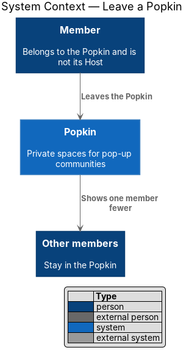
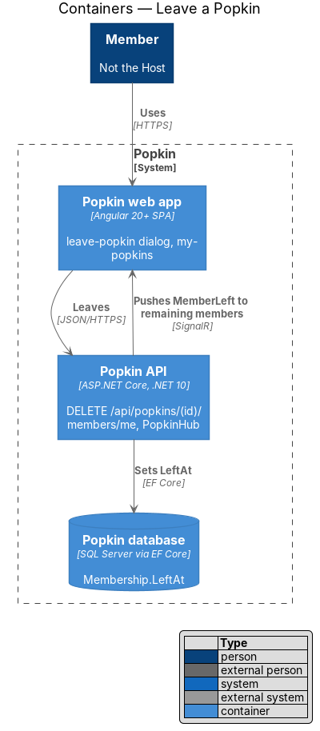
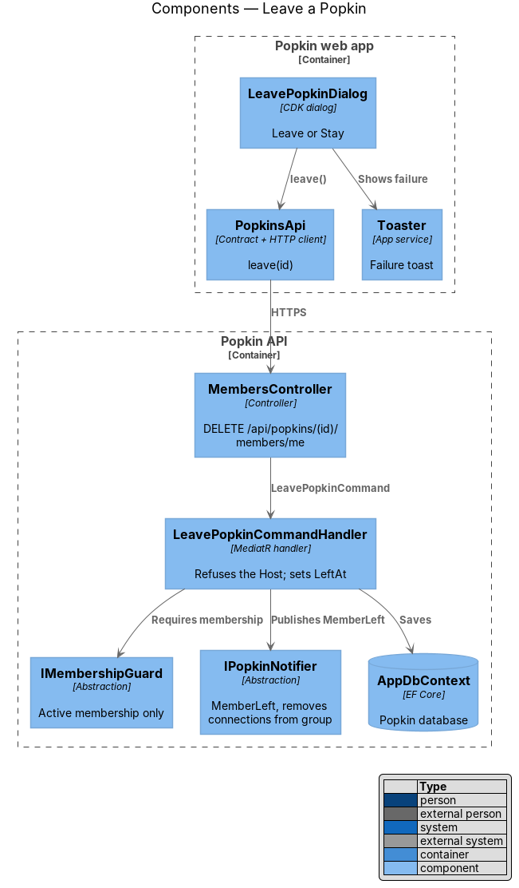
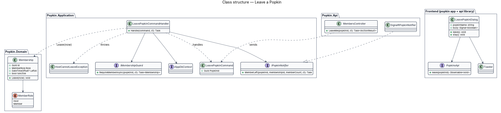
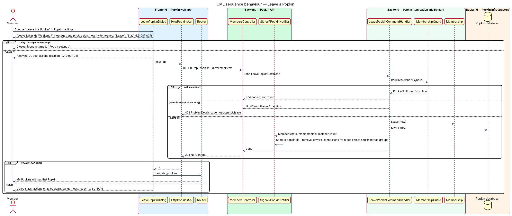
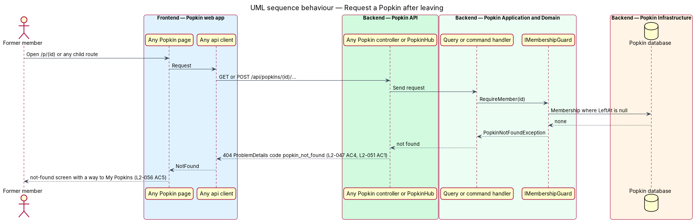

# Leave a Popkin

## Overview

A member who is not the Host may leave a Popkin at any time. Leaving ends the membership but
keeps what the member added: their messages and photos stay in the Popkin. To come back, the
person joins again with an invite. The Host has no way to leave; the Host wraps the Popkin up
instead (L2-043).

- **active membership** — `Membership` row whose `LeftAt` is null; the only kind that grants access
- **former member** — person whose membership in a Popkin has a `LeftAt` time

Leaving starts from "Leave this Popkin" in the member's Popkin settings menu
(`popkins/popkin-settings`), which opens a confirmation dialog. After a successful leave, My
Popkins opens without that Popkin, the remaining members see one member fewer, and every later
request the former member makes in that Popkin is answered as if it did not exist.

## Description

### Screens and states

- `docs/mocks/dialogs/leave-popkin/default.html` — "Leave Lakeside Weekend?", "Your messages and
  photos stay. To come back you'll need a new invite.", "Leave" and "Stay".
- `docs/mocks/dialogs/leave-popkin/busy.html` — "Leaving…".
- `docs/mocks/dialogs/popkin-settings/member.html` — the entry point.
- `docs/mocks/dialogs/leave-popkin/failed.html` — a danger `pk-alert` in the dialog's body,
  "We couldn't take you out." and "You're still in Lakeside Weekend. Try again.", drawn in
  journey 18 as `delete-experience/failed.html` draws its own ([Open questions](#open-questions)).

### API

- `DELETE /api/popkins/{popkinId}/members/me` — `204 No Content`. Failures: `403`
  `host_cannot_leave`; `404` `popkin_not_found`; `401` without a session.
- Real time: `MemberLeft(popkinId, membershipId)` to group `popkin:{popkinId}`, sent once the
  former member's connections are out of that group, so they are not told of their own
  leaving. A fact: the home and My Popkins read the count again, and the chat header counts
  one member fewer.

### Frontend (Popkin web app)

- **`LeavePopkinDialog`** (`dialogs/leave-popkin/leave-popkin.dialog.ts`) — CDK dialog in
  `pk-dialog`, opened with the Popkin's name. It names the Popkin and states what stays and how
  to return (L2-047 AC1), with `pk-button` "Leave" (danger) and "Stay". "Leave" sets `busy`,
  reads "Leaving…" and is disabled (L2-056 AC3), then calls `PopkinsApi.leave`; "Stay" stays
  as `busy.html` draws it. On
  `204` it closes and navigates to `/popkins` (L2-047 AC2). On failure it re-enables "Leave"
  and shows a danger `pk-alert` in its body, as "Delete this experience?" does.
  "Stay", Escape or the backdrop close it and return focus to "Popkin settings".
- **`PopkinsApi.leave(popkinId)`** — `HttpPopkinsApi` sends the `DELETE`.
- **My Popkins** — reloads on arrival, so the left Popkin is absent; the snapshot of
  `popkins/my-popkins` is replaced by that load.

### Backend

- **`MembersController.LeaveMe`** — `DELETE /api/popkins/{popkinId}/members/me`; sends
  `LeavePopkinCommand`.
- **`LeavePopkinCommandHandler`** — calls `IMembershipGuard.RequireMemberAsync` (`404`
  `popkin_not_found` for a non-member). A Host membership throws `HostCannotLeaveException`,
  mapped to `403` `host_cannot_leave`, so the rule holds even for a hand-made request
  (L2-047 AC3). Otherwise it calls `Membership.Leave(now)` with `TimeProvider`, saves, and calls
  `IPopkinNotifier.MemberLeft` with the new member count.
- **`Membership.Leave(now)`** — sets `LeftAt`. Messages, photos, reactions, ratings and comments
  keep their `…MembershipId` references and stay readable to the remaining members, shown with
  the display name the membership held.
- **`IMembershipGuard`** — treats a membership with `LeftAt` set as absent, so every later
  request from the former member in that Popkin is refused with `404` `popkin_not_found`
  (L2-047 AC4, L2-051 AC1). Joining again through an invite creates a new `Membership`
  (`invitations/join-popkin`).
- **After the save** — the handler takes the former member off the Popkin's call if they are on
  it (`CallLeaver`, as "Leave" on the call does), releases them from the Popkin's "here now"
  (`PresenceTracker.Leave`), removes the connections they hold from `popkin:{popkinId}`
  (`IPopkinConnections.RemoveFromPopkinAsync`), and then calls
  `IPopkinNotifier.MemberLeft`, so no further event of that Popkin reaches them.
- **`SignalRPopkinNotifier.MemberLeft`** — sends `MemberLeft` to `popkin:{popkinId}`, so the
  other members' home updates its count (L2-047 AC2).
- A wrapped-up Popkin does not refuse leaving: like leaving a call, it adds nothing to the
  Popkin, so `RequireMemberAsync` is the check, not `RequireActiveMemberAsync`.

### Open questions

- Leaving during a live group call ends the person's place on the call at once (decided in
  journey 18): a former member may hear nothing of the Popkin, and the call is one of its
  parts. The others see them go as if they had chosen "Leave" on the call.
- The failure copy of the dialog, which the mocks did not draw until journey 18, is "We couldn't take you out."
  with "You're still in {name}. Try again." (decided in journey 18), in the danger `pk-alert`
  the other confirm dialogs use, where this design first named a `pk-toast`.

## Requirements

| L2 ID | Refines (L1) | Requirement |
|-------|--------------|-------------|
| `L2-047` | `L1-006` | Leave a Popkin: A member who is not the Host leaves when they want. |
| `L2-051` | `L1-012` | Popkins are private to their members: Membership decides everything a person sees. |

## Diagrams

### System context

A member leaves the Popkin; the other members see one member fewer.

### Containers

The web app sends one request; the Popkin API sets `LeftAt` in the database and pushes
`MemberLeft` to the remaining members.

### Components

`LeavePopkinDialog` calls `PopkinsApi`; `LeavePopkinCommandHandler` checks membership and role,
saves and notifies.

### Class structure

`Membership.Leave` holds the state change; `HostCannotLeaveException` carries the Host refusal.

### Behaviour — leave a Popkin

"Leave" disables the dialog, the API refuses the Host and otherwise ends the membership, and the
person lands on My Popkins.

### Behaviour — request a Popkin after leaving

The membership guard finds no active membership and every request ends in `404`
`popkin_not_found` and the not-found screen.

