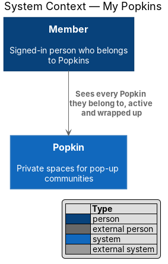
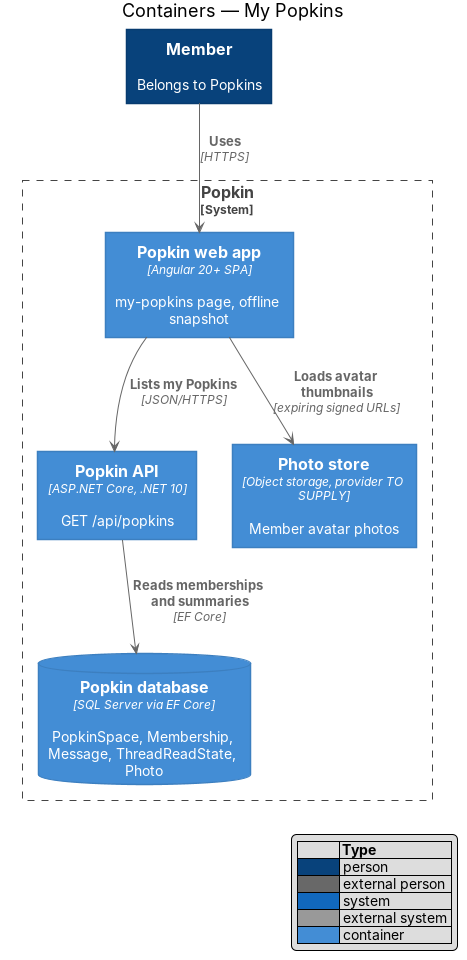
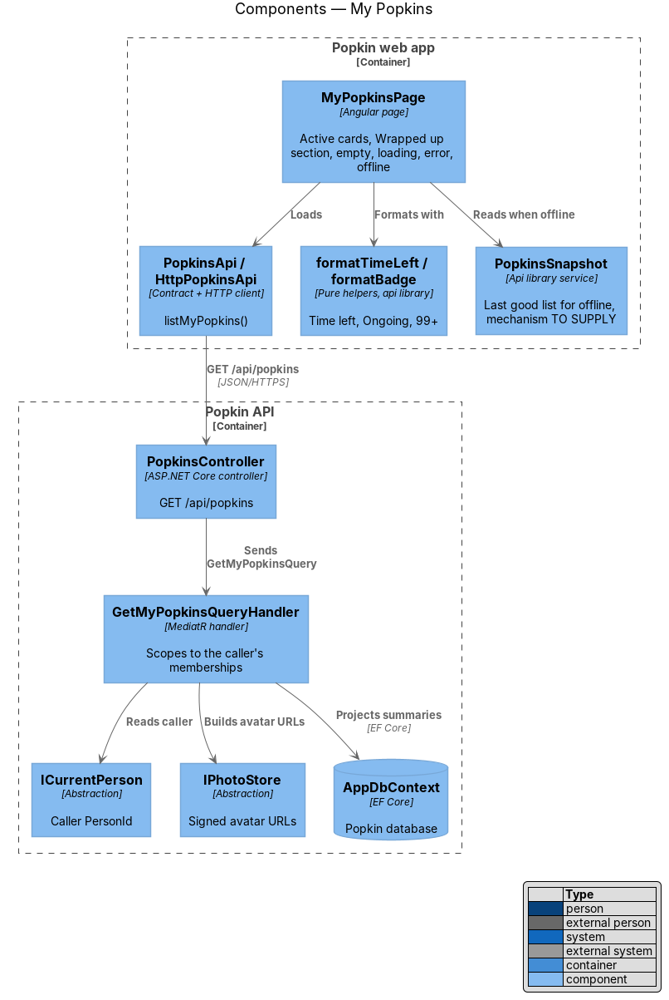
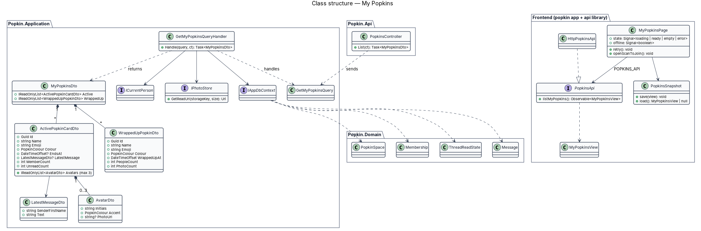
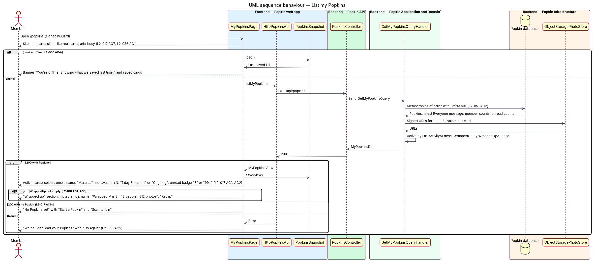
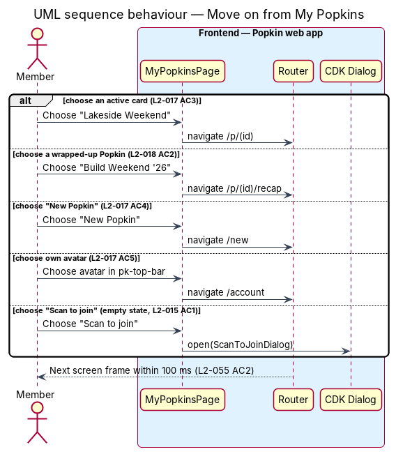

# My Popkins

## Overview

A person may belong to several Popkins at once: a weekend away, a weekly group, a season of
school sport. *My Popkins* is the signed-in person's starting screen. It lists every Popkin they
belong to, with what is new in each, and leads to a Popkin's home, its recap, a new Popkin, their
account or the scanner that joins another.

- **active Popkin** — Popkin whose `Status` is `Active`; it accepts messages, photos and members
- **wrapped-up Popkin** — Popkin whose `Status` is `WrappedUp`; it is read-only and has a recap
- **unread count** — number of messages in a Popkin's Everyone thread that the member has not read and did not send
- **time left** — remaining time before an active Popkin wraps up, or "Ongoing" when it has no end

Active Popkins come first as colour cards, the most recently active at the top. Wrapped-up
Popkins follow in a "Wrapped up" section that leads to each recap. The list contains only the
Popkins the caller belongs to (L2-051 AC3).

## Description

### Screens and states

- `docs/mocks/pages/my-popkins/default.html` — three active cards and two wrapped-up Popkins.
- `docs/mocks/pages/my-popkins/active-only.html` — no "Wrapped up" section (L2-018 AC3).
- `docs/mocks/pages/my-popkins/loading.html` — skeleton cards, "Loading your Popkins…".
- `docs/mocks/pages/my-popkins/empty.html` — "No Popkins yet", "Start a Popkin", "Scan to join".
- `docs/mocks/pages/my-popkins/error.html` — "We couldn't load your Popkins", "Try again".
- `docs/mocks/pages/my-popkins/offline.html` — banner "You're offline. Showing what we saved last
  time." over the saved list.

The screen's heading is "Your Popkins"; the requirements and the other screens call it My
Popkins.

### API

- `GET /api/popkins` — `200` with `MyPopkinsDto`: `active`, a list of cards (`id`, `name`,
  `emoji`, `colour`, `endsAt`, `memberCount`, up to three `avatars`, `latestMessage` with
  `firstName` and `text` or null, `unreadCount`, `everyoneThreadId`, `viewerMembershipId`), and
  `wrappedUp`, a list of rows (`id`, `name`, `emoji`, `colour`, `wrappedUpAt`, `peopleCount`,
  `photoCount`). A person in no Popkin gets two empty lists. Failures: `401` without a session.

### Frontend (Popkin web app)

- **`MyPopkinsPage`** (`pages/my-popkins/my-popkins.page.ts`, route `/popkins`, route data
  `{ shell: 'bare', page: 'my-popkins' }`, `signedInGuard`) — provides `MyPopkinsStore` and
  composes `pk-page-screen` with `pk-top-bar`, which holds `pk-logo`, `pk-icon-button` "Scan to
  join" and the person's `pk-avatar`, a link named "Your account, {name}" that opens `/account`
  (L2-017 AC5). Under it: `pk-popkin-grid` with one card per active Popkin, `pk-wrapped-list`
  "Wrapped up", "New Popkin" (opens `/new`, L2-017 AC4: a `pk-button` in the top bar on
  wider screens and a `pk-fab` on a phone), `pk-empty-state`, `pk-popkin-skeleton` and
  `pk-banner`. "New Popkin" shows with the list and while it loads; the empty state has its own
  way to start.
- **`MyPopkinsStore`** (`api` library, `popkins/my-popkins-store.ts`, with unit tests) — one
  per screen. Its `state` is `loading`, `ready`, `empty` or `error`, and `offline` says the list
  shown may be out of date. It reads the list, turns it into card and row views, and keeps it
  current: a `MessageAdded` event in a Popkin's Everyone thread sets that card's latest message
  and moves the card first, and `UnreadTracker`, shared with the chat and the home, raises its
  count; `MemberJoined`, a reconnect of the hub and the device coming back online read the list
  again quietly. The time on each card is redrawn every minute (L2-044 AC5).
- **Active card** — a card of `pk-popkin-grid` in the Popkin's colour with the emoji tile, the
  name, the latest Everyone message as "{first name}: {text}" or "No messages yet", a stack of
  up to 3 avatars with "+N", "{n} members", and the time (L2-017 AC1). The badge shows the
  unread count, "99+" above 99, with an accessible name such as "3 unread messages", or "More
  than 99 unread messages" (L2-017 AC2). The card links to `/p/:popkinId`, the Popkin home
  (AC3). The design is an `<a href>` to the Popkin's `AddressUrl`, opened as a full page load
  (L2-064 AC9, [Open a Popkin by its address](../open-by-address/README.md)); that arrives when
  addresses are built.
- **Wrapped-up row** — a row of `pk-wrapped-list`: the muted emoji tile, the name, "Wrapped
  {Mon d} · {n} people · {n} photos" and a "Recap" label (L2-018 AC1). It links to
  `/p/:popkinId/recap` (AC2), the recap, built in journey 9
  ([Recap](../../wrap-up/recap/README.md)). The section is rendered only when the list is not empty (AC3).
- **Empty state** — `pk-empty-state` explains what a Popkin is, with "Start a Popkin" (`/new`)
  and "Scan to join" (opens `ScanToJoinDialog`, `invitations/join-by-code`) (L2-017 AC6).
- **Loading** — `pk-popkin-skeleton`: skeleton cards the size of real cards, hidden from
  assistive technology, with a visually hidden "Loading your Popkins…" (L2-017 AC7, L2-056 AC1,
  L2-055 AC5).
- **Failed** — `pk-empty-state` "We couldn’t load your Popkins" with "Try again", which reads
  the list again.
- **Offline** — when the read fails with the device offline, the store shows the saved list
  under a warning `pk-banner`, "You’re offline. Showing what we saved last time." With nothing
  saved it opens the offline screen through `ErrorScreens.showOffline('/popkins')`
  ([Loading, failure and offline](../../reliability/loading-failure-offline/README.md)).
- **`cardTimeLeft(endsAt, now)`** (pure helper, `api` library, `popkins/my-popkins-text.ts`,
  with unit tests) — "Ongoing" for no end; the largest two units ("1 day 6 hrs left", "42 min
  left", L2-044 AC5) while the end is less than 7 days away; "Until {Mon d}" from 7 days away,
  with the year when it is not this one; and "Wrapping up" once the end has passed and the
  Popkin has not wrapped up yet.
- **`unreadBadge(count)`**, **`unreadLabel(count)`**, **`latestLine`**, **`wrappedLine`**,
  **`accountLabel`** (pure helpers, same file) — the badge and its accessible name, the line of
  the latest message, the line of a wrapped-up row and the name of the account link.
- **`PopkinsSnapshot`** / **`POPKINS_SNAPSHOT`** / **`LocalPopkinsSnapshot`** (`api` library,
  `popkins/popkins-snapshot.ts`) — keeps the last list that loaded in the browser's local
  storage, so the offline state can show it (L2-056 AC4). It is keyed to the person, so nobody
  else who signs in on the device reads it. The photo addresses are removed before it is saved,
  because they expire within the hour; a saved list shows initials. It is cleared when a 401
  signs the person out (`unauthorizedInterceptor`); sign out itself (journey 17) and account
  deletion (journey 19) must clear it too.
- **`PopkinsApi.listMine()`** — `HttpPopkinsApi` behind `POPKINS_API`.
- **Components** — introduced in the `components` library for this screen: `pk-page-screen`,
  `pk-popkin-grid`, `pk-wrapped-list` and `pk-popkin-skeleton`.

### Backend

- **`PopkinsController.List`** — `GET /api/popkins`; sends `GetMyPopkinsQuery`.
- **`GetMyPopkinsQueryHandler`** (`Popkins/GetMyPopkins.cs`) — reads the caller from
  `ICurrentPerson` and, through `IAppDbContext`, the caller's memberships with `LeftAt` null and
  their `PopkinSpace`s. It makes up to nine queries, each for the whole list and none per
  Popkin; the design asked for one, which the latest message per thread and the counts do not
  fit.
  - active cards, the most recently active first (L2-017): by the later of
    `PopkinSpace.LastActivityAt` and the time of the latest message in Everyone;
  - wrapped-up rows ordered by `WrappedUpAt` descending;
  - per card the latest `Message` a member wrote in the Everyone `ChatThread` (deleted messages
    and the notes Popkin writes itself are left out) and its author's first name, even when the
    author has left; the active member count, up to 3 avatars, the unread count, the id of the
    Everyone thread and the caller's own membership id, which the web app needs to count live;
  - per wrapped-up row the people count and the `Photo` count.
- **Unread count** — messages sent after the member's read point and not authored by them, in
  the Everyone thread and, since journey 11, in the member's direct messages of that Popkin
  whose other member has not left (`DirectThreads.Of`), counted by `ThreadUnread.CountsAsync`,
  the rule the Popkin home and the thread use. The query count stays as it was: the direct
  messages of every Popkin are read in one query.
- **Avatars** — `AvatarDto` carries initials, an accent from `AvatarAccent.For(personId)` (the
  colour that stays the same for a person, L2-013 AC6) and, for a member with a photo, an
  expiring URL from `IPhotoStore` (L2-051 AC2).
- **DTOs** — `MyPopkinsDto { Active, WrappedUp }`, `ActivePopkinCardDto`,
  `WrappedUpPopkinDto`, `LatestMessageDto`, `AvatarDto`. `ActivePopkinCardDto` and
  `WrappedUpPopkinDto` carry `AddressUrl`, built by `PopkinUrlBuilder` (L2-064 AC9), once
  addresses are built; neither carries it today.

### Tests

- API integration tests on InMemory: `Popkins/MyPopkinsTests.cs` (a card's content, an avatar's
  expiring address, the latest message, the unread count agreeing with the home and the thread,
  the order of active Popkins, only the caller's own Popkins, the wrapped-up rows and their
  counts) and `Popkins/LiveMyPopkinsTests.cs` (a member is told of a message in each of their
  Popkins over the hub).
- Unit tests of `MyPopkinsStore` and of the helpers in `my-popkins-text.ts`.
- Playwright: `e2e/tests/my-popkins.spec.ts`.

### Built in journey 6

Everything above except what it names as waiting: `AddressUrl` and the full page load to an
address (the addresses rework), the recap behind a wrapped-up row (built since, in journey 9), the account
screen behind the avatar (journey 17), direct messages in the unread count (built since, in
journey 11) and the clearing of the snapshot at sign out (journey 17).

One gap was found: `CreatePopkinCommandHandler` does not add the connections the creator
already holds to the new Popkin's group, as `JoinPopkinCommandHandler` does for a new member.
A person who starts a Popkin in one tab gets no event for it on My Popkins in another until
the hub reconnects (open decision 23 in [the register](../../README.md#known-gaps)).

## Requirements

| L2 ID | Refines (L1) | Requirement |
|-------|--------------|-------------|
| `L2-017` | `L1-005` | List my active Popkins: My Popkins lists the Popkins a member belongs to, the most recently active first. |
| `L2-018` | `L1-005` | List my wrapped-up Popkins: Wrapped-up Popkins stay within reach under the active ones. |
| `L2-051` | `L1-012` | Popkins are private to their members: Membership decides everything a person sees. |
| `L2-056` | `L1-013` | Loading, failure and offline are always explained: A person is never left guessing. |
| `L2-064` | `L1-016` | Open a Popkin by its address: The address is the Popkin's front door for its members and a closed door for everyone else. This feature realises AC9. |

## Diagrams

### System context

A member uses Popkin to see every Popkin they belong to; no external system takes part.

### Containers

The web app reads one list from the Popkin API, which reads the database; avatar photos come
from the photo store through expiring URLs.

### Components

`MyPopkinsPage` reads `MyPopkinsStore`, which loads through `PopkinsApi` and falls back to
`PopkinsSnapshot` offline;
`GetMyPopkinsQueryHandler` scopes the query to the caller.

### Class structure

`MyPopkinsDto` holds two lists, active cards and wrapped-up rows, each built from domain
entities the handler reads through `IAppDbContext`.

### Behaviour — list my Popkins

The page shows skeletons, then cards, the empty state or the error state; offline it shows the
saved list under a banner.

### Behaviour — move on from My Popkins

Each choice on the screen leads to one route or dialog: a home, a recap, a new Popkin, the
account or the scanner.

