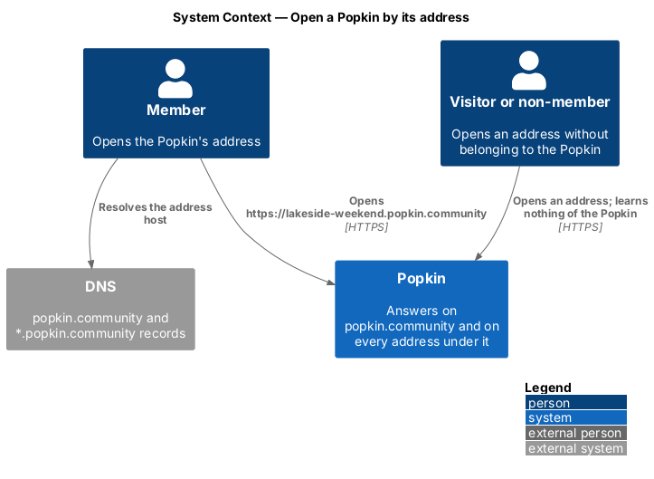
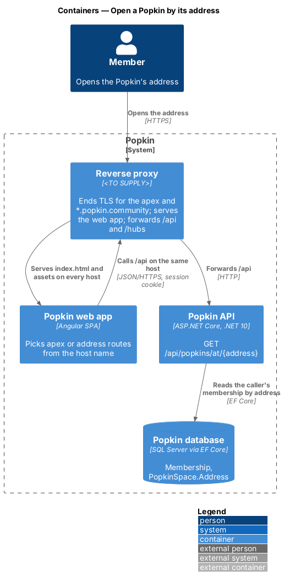
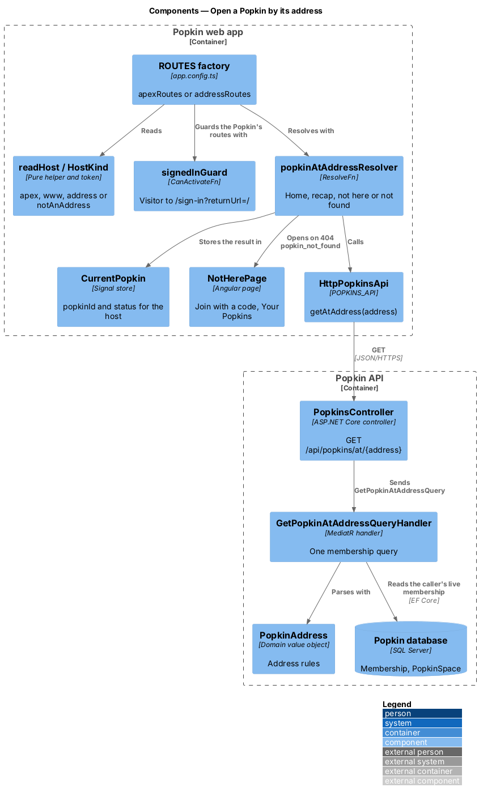
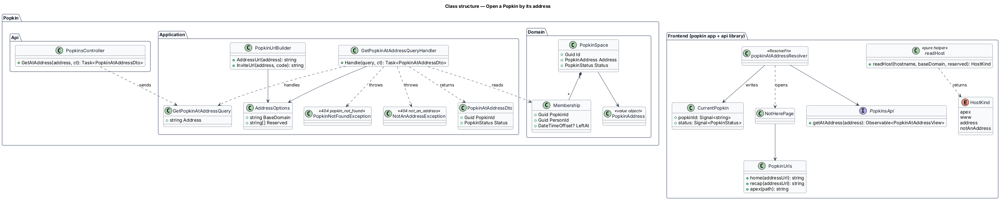
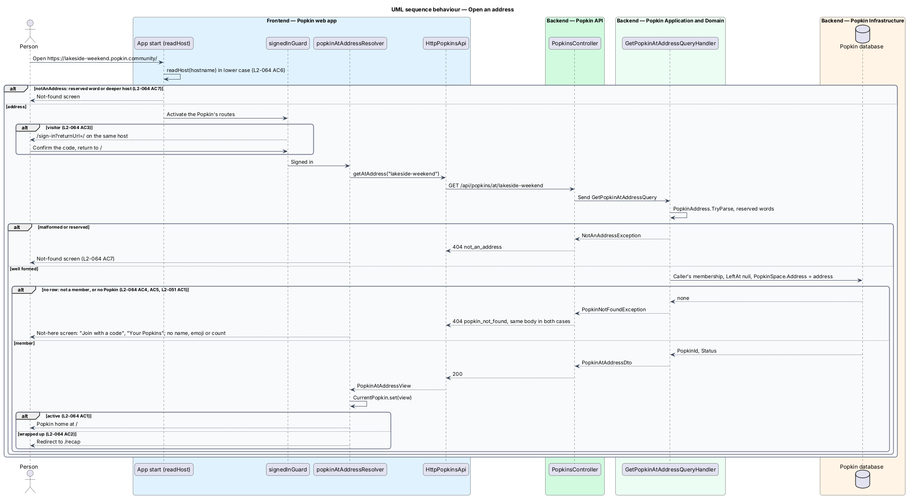
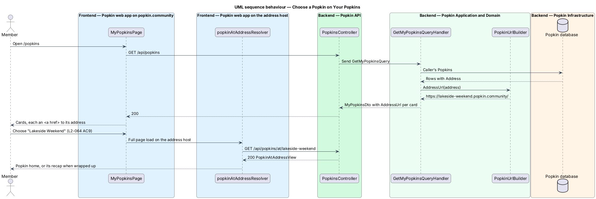

# Open a Popkin by its address

## Overview

Popkin is a platform for pop-up communities. Every Popkin has its own address,
`https://{address}.popkin.community` (L1-016), settled when it is started
([Choose the address](../choose-address/README.md)). This feature makes that address the
Popkin's front door: it opens the Popkin for its members and tells everyone else nothing.

- **apex** — `popkin.community` itself, with no address in front; it serves the landing page, sign up, Your Popkins, starting a Popkin and joining with a code
- **address host** — host name made of one address and `popkin.community`, such as `lakeside-weekend.popkin.community`
- **not-here screen** — screen that says there is no Popkin at an address for the person, with "Join with a code" and "Your Popkins"
- **base domain** — the domain under which addresses live: `popkin.community` in production, `localhost` in development

The same web app answers on the apex and on every address host. When it starts, it reads the
host name and picks one of two route tables. On the apex it serves the routes it serves today. On
an address host it serves the Popkin's own screens at the root of the host: the Popkin home at
`/`, its recap at `/recap`, and every screen the designs write as `/p/:popkinId/...` at the same
path without that prefix. Copying the address bar on the Popkin home therefore gives
`https://lakeside-weekend.popkin.community/`, which opens the same home on any device where the
member is signed in (L2-064 AC8).

A signed-in member is taken to the home, or to the recap of a wrapped-up Popkin (L2-064 AC1,
AC2). A visitor is sent to sign in on the same host and comes back to the address afterwards
(L2-064 AC3). A signed-in person who is not a member, and a person at an address no Popkin has,
see the same not-here screen, and the API's answer is the same in both cases (L2-064 AC4, AC5,
L2-051).

## Description

### Screens and states

- **Not here** (`not-here`, introduced) — no mock exists. It needs
  `docs/mocks/pages/not-here/default.html` before implementation: a sentence that there is no
  Popkin here for the person, "Join with a code" and "Your Popkins", and no name, emoji, colour,
  member or count (L2-064 AC4). Its copy is `<TO SUPPLY>`.
- **Not found** — `docs/mocks/pages/not-found/default.html`, existing. It serves a reserved word
  other than `www` and a host more than one label deep (L2-064 AC7).
- **Sign in** — `docs/mocks/pages/sign-in/default.html`, existing, served on the address host
  for a visitor (L2-064 AC3).
- **Opening** — while the address is resolved, the shell shows `pk-skeleton` in the shape of the
  Popkin home (L2-056 AC1); the mock is the home's loading state, `<TO SUPPLY>` until journey 4
  draws it.

### API

- `GET /api/popkins/at/{address}` — introduced. Authenticated by the fallback policy. `200`
  `PopkinAtAddressDto { popkinId, status }` for a member of the Popkin at that address, where
  `status` is `active` or `wrappedUp`. `404` `popkin_not_found` for a non-member and for an
  address no Popkin has, with the same body in both cases (L2-064 AC5). `404` `not_an_address`
  for a malformed address or a reserved word. `401` without a session.
- `GET /api/popkins` — changed. `ActivePopkinCardDto` and `WrappedUpPopkinDto` gain `AddressUrl`
  ([My Popkins](../my-popkins/README.md), L2-064 AC9).

### Frontend — Popkin web app and `api` library

- **`readHost(hostname, baseDomain, reserved)`** (pure helper, `api` library, introduced) —
  lower-cases the host name (L2-064 AC6) and returns one of `apex`, `www`, `address(address)` or
  `notAnAddress`. `notAnAddress` covers a reserved word, a host more than one label deep and a
  label that breaks a rule of `addressProblem` (L2-064 AC7). `reserved` is the default list of
  L2-063 AC5, shipped with the app. A word that operations add later through `Addresses:Reserved`
  reaches the web app only through the API's `404` `not_an_address`. Unit tests (ADR 0011) take
  one case per row of L2-064 AC6 and AC7.
- **`BASE_DOMAIN`** (injection token, introduced) — the base domain, provided in `app.config.ts`.
  How each build sets it (`popkin.community`, `localhost`) is `<TO SUPPLY>`.
- **`HostKind`** (injection token, introduced) — the result of `readHost(location.hostname, …)`,
  computed once at start.
- **Route tables** (changed) — `app.config.ts` provides `ROUTES` from a factory that reads
  `HostKind`:
  - `apex` — `apexRoutes`, the table of `app.routes.ts` today. It keeps `/p/:popkinId/created`
    ([Start a Popkin](../start-popkin/README.md)); it serves no other `/p/:popkinId/...` route.
  - `address` — `addressRoutes`, introduced: the public routes `sign-in`, `sign-up`, `verify`,
    `i/:code`, `i/:code/profile`, `i/:code/welcome`, `error` and `**` (not found), and one
    parent route at `''` with `signedInGuard` and `popkinAtAddressResolver` whose children are
    the Popkin's screens: `''` (home), `recap`, `chat`, `chat/:memberId`, `photos`,
    `experiences` and the rest of the `/p/:popkinId/...` routes of the other designs.
  - `notAnAddress` — a single `**` route to the not-found screen (L2-064 AC7).
  - `www` — never reached in a deployment: the proxy redirects it to the apex
    ([Address safety](../../security/address-safety/README.md)). The web app falls back to the
    apex routes.
- **`signedInGuard`** (existing) — on an address host it sends a visitor to
  `/sign-in?returnUrl=/` on the same host. After the code is confirmed, the auth flow returns to
  `/`, and the address opens again (L2-064 AC3, L2-007 AC2). The guard runs before the resolver,
  so a visitor's browser sends no request about the Popkin.
- **`popkinAtAddressResolver`** (introduced) — calls `PopkinsApi.getAtAddress(address)` and
  stores the result in `CurrentPopkin`. On `active` it lets the home open (L2-064 AC1). On
  `wrappedUp` it redirects `''` to `recap` (L2-064 AC2). On `404` `popkin_not_found` it opens the
  not-here screen. On `404` `not_an_address` it opens the not-found screen. On a 5xx it opens the
  server-error screen.
- **`CurrentPopkin`** (`api` library, introduced) — holds `popkinId` and `status` for the address
  host. Pages that the designs describe with the route parameter `:popkinId` read it from
  `CurrentPopkin` instead.
- **`NotHerePage`** (`pages/not-here/not-here.page.ts`, `data-page="not-here"`,
  `shell: 'bare'`, introduced) — `pk-empty-state` with the sentence, `pk-link` "Join with a code"
  to the apex `/join` and `pk-link` "Your Popkins" to the apex `/popkins`. It renders nothing it
  could have learned about the Popkin, because it learns nothing (L2-064 AC4).
- **`PopkinUrls`** (`api` library, introduced) — `home(addressUrl)`, `recap(addressUrl)` and
  `apex(path)` build absolute URLs from `BASE_DOMAIN` and the current scheme and port. A move from
  the apex to an address, or between two addresses, is a full page load through an `<a href>`,
  not a router navigation, because the origin changes.
- **`PopkinsApi.getAtAddress(address)`** (introduced) — returns `PopkinAtAddressView`; maps
  `404` by its `code`.

### Backend

- **`PopkinsController.GetAtAddress`** — `GET /api/popkins/at/{address}`; sends
  `GetPopkinAtAddressQuery`.
- **`GetPopkinAtAddressQueryHandler`** (`Popkin.Application.Popkins`, introduced) — parses the
  address with `PopkinAddress.TryParse` and checks `AddressOptions.Reserved`; a failure throws
  `NotAnAddressException` (`404` `not_an_address`). It then runs one query: the caller's
  membership with `LeftAt` null whose `PopkinSpace.Address` equals the address. No row throws
  `PopkinNotFoundException` (`404` `popkin_not_found`), the exception every Popkin read uses for a
  non-member (L2-051 AC1). A missing Popkin and a Popkin of which the caller is not a member take
  the same path and cost the same single query, so neither the answer nor its timing tells them
  apart (L2-064 AC5).
- **`PopkinAtAddressDto`** (introduced) — `PopkinId`, `Status`. It carries nothing else, so even
  a member's answer adds nothing the home does not read.
- **`NotAnAddressException`** (`Popkin.Application.Problems`, introduced) — `404` with `code`
  `not_an_address`.
- **`PopkinUrlBuilder`** (`Popkin.Application`, introduced; replaces `InviteLinkBuilder`) —
  builds `AddressUrl` (`https://{address}.{BaseDomain}/`) and the invite link
  ([Invite people](../../invitations/invite-people/README.md)) from `AddressOptions`. The scheme
  and port for development are `<TO SUPPLY>`.

### Tests

- API tests on InMemory: a member of an active Popkin receives `active`; a member of a wrapped-up
  Popkin receives `wrappedUp`; a person who left, a non-member and an address no Popkin has each
  receive `404` `popkin_not_found` with equal bodies; a reserved word receives `404`
  `not_an_address`; a visitor receives `401`; an address with capitals answers as its lower-case
  form.
- Unit tests in `frontend/`: `readHost`.
- Playwright behaviour specs open `http://lakeside-weekend.localhost:{port}/` (Chromium resolves
  every `*.localhost` name to the loopback address) with `GET /api/popkins/at/lakeside-weekend`
  stubbed: a member sees the home; a wrapped-up Popkin opens its recap; a visitor sees sign in
  and returns to the home after confirming the code; a non-member sees the not-here screen with
  no name; `api.localhost` shows the not-found screen. `e2e/fixtures/routes.ts` gains a host for
  each address route, and the dev server's `allowedHosts` admits `.localhost`.

## Requirements

| L2 ID | Refines (L1) | Requirement |
|-------|--------------|-------------|
| `L2-064` | `L1-016` | Open a Popkin by its address: The address is the Popkin's front door for its members and a closed door for everyone else. |
| `L2-051` | `L1-012` | Popkins are private to their members: Membership decides everything a person sees. |

## Diagrams

### System context

A member opens the Popkin's address in a browser, typed, saved or copied from another device;
Popkin answers with the Popkin for a member and with nothing about it for anyone else.

### Containers

The reverse proxy serves the web app on every address host and forwards `/api` to the Popkin
API on the same host; the API resolves the address to a Popkin through the caller's membership.

### Components

`readHost` picks the route table, `signedInGuard` turns a visitor to sign in, and
`popkinAtAddressResolver` asks `GetPopkinAtAddressQueryHandler`, which reads one membership.

### Class structure

`HostKind` decides the routes; `CurrentPopkin` carries the resolved Popkin to the pages; the
handler answers with `PopkinAtAddressDto` or one of two `404` exceptions.

### Behaviour — open an address

The web app classifies the host, sends a visitor to sign in, and resolves the address for a
signed-in person: home, recap, not here or not found (L2-064 AC1 to AC7).

### Behaviour — choose a Popkin on Your Popkins

Each card links to its Popkin's address, so choosing it is a page load on the address host,
which then resolves as above (L2-064 AC9).

