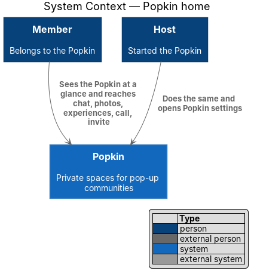
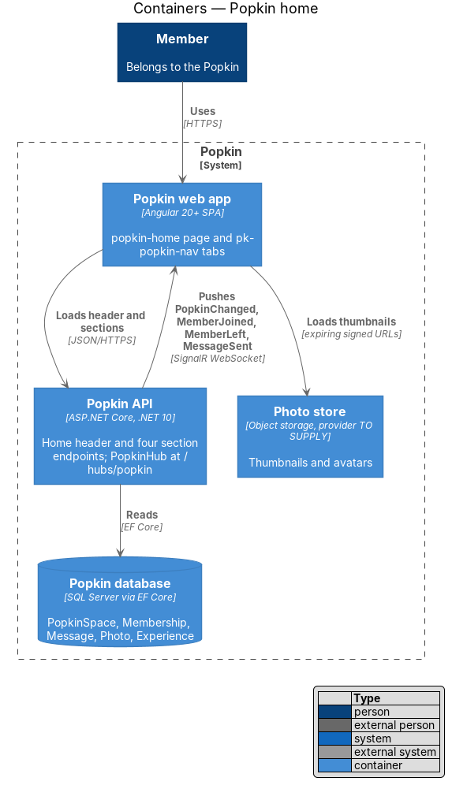
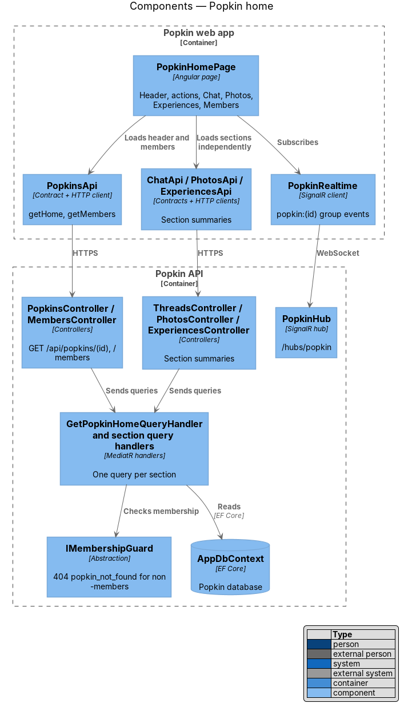
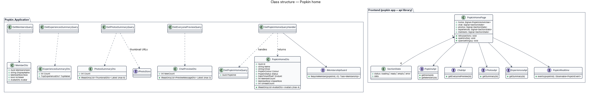
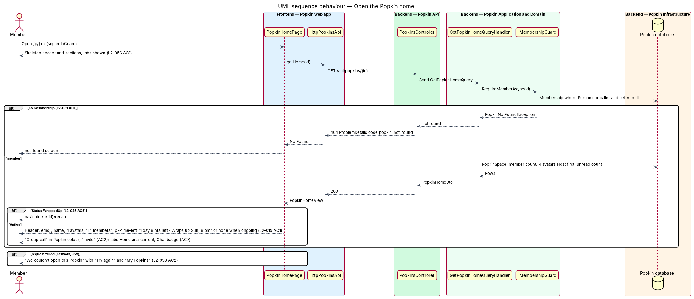
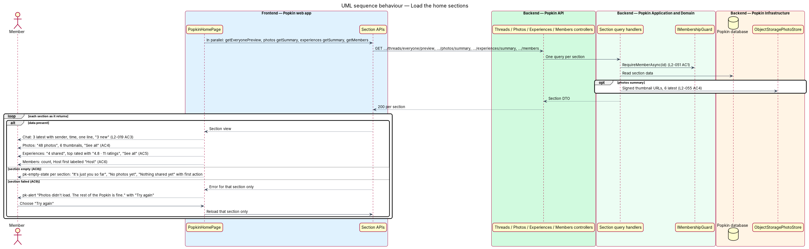
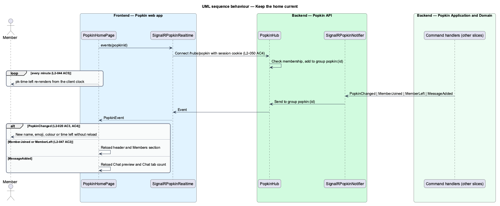

# Popkin home

## Overview

The *Popkin home* is the first screen of one Popkin. It summarises the Popkin at a glance — who
is in it, how long it has left, the latest chat, photos and experiences — and leads to everything
else: chat, photos, experiences, a group call, the invite and, through the "Popkin settings"
menu, the Host's changes.

- **section** — one independently loaded block of the home: Chat, Photos, Experiences or Members
- **tabs** — bottom navigation of a Popkin (`pk-popkin-nav`): Home, Chat, Photos, Experiences
- **Everyone** — chat thread that every member of a Popkin shares
- **experience** — something the group did, a restaurant, or something it wants to do, which members rate

The header and the four sections load separately, so one failing section leaves the others on
screen (L2-019 AC9). Only members see the home; anyone else receives the not-found response
(L2-051 AC1). A wrapped-up Popkin opens on its recap instead (L2-045 AC5).

## Description

### Screens and states

- `docs/mocks/pages/popkin-home/default.html` — header with time left, actions, all sections.
- `docs/mocks/pages/popkin-home/ongoing.html` — no end date, so no time left (L2-019 AC1).
- `docs/mocks/pages/popkin-home/loading.html` — skeletons, "Loading this Popkin…", tabs shown.
- `docs/mocks/pages/popkin-home/empty.html` — "It's just you so far" with "Invite people" and
  "Say hello", "No photos yet" with "Add the first photo", "Nothing shared yet" with "Share one".
- `docs/mocks/pages/popkin-home/partial.html` — "Photos didn't load. The rest of the Popkin is
  fine." with "Try again".
- `docs/mocks/pages/popkin-home/error.html` — "We couldn't open this Popkin" with "Try again"
  and "My Popkins".

### API

- `GET /api/popkins/{popkinId}` — `200` `PopkinHomeDto`; `404` `popkin_not_found`.
- `GET /api/popkins/{popkinId}/threads/everyone/preview` — `200` `ChatPreviewDto`; `404`
  `popkin_not_found`.
- `GET /api/popkins/{popkinId}/photos/summary` — `200` `PhotosSummaryDto`; `404`
  `popkin_not_found`.
- `GET /api/popkins/{popkinId}/experiences/summary` — `200` `ExperiencesSummaryDto`; `404`
  `popkin_not_found`.
- `GET /api/popkins/{popkinId}/members` — `200` `MemberDto[]`, Host first; `404`
  `popkin_not_found`.
- Real time: `PopkinHub` at `/hubs/popkin`, group `popkin:{popkinId}`, events `PopkinChanged`,
  `MemberJoined`, `MemberLeft`, `MessageSent`.

Every endpoint answers `401` without a session.

### Frontend (Popkin web app)

- **`PopkinHomePage`** (`pages/popkin-home/popkin-home.page.ts`, route `/p/:popkinId`,
  `data-page="popkin-home"`, `shell: 'app'`, `signedInGuard`) — container that composes:
  - **Header** — `pk-popkin-tile`, the name, a `pk-avatar` stack of up to 4 with "+N", "{n}
    members", and `pk-time-left` "1 day 6 hrs left · Wraps up Sun, 6 pm" only when `endsAt` is set
    (L2-019 AC1). A `pk-icon-button` "Popkin settings" opens `PopkinSettingsDialog`
    (`popkins/popkin-settings`). The header layout is the mock's `home-header` block, which has no
    design-system component page yet; its `pk-*` home is `<TO SUPPLY>`.
  - **Actions** — `pk-button` "Group call" in the Popkin's colour (opens `/p/:popkinId/call`,
    L2-029) and `pk-button` "Invite" (opens `InviteDialog`, `invitations/invite-people`)
    (L2-019 AC2).
  - **Chat** — `pk-card` link to `/p/:popkinId/chat` with the three latest Everyone messages
    (sender, time, one truncated line) and "{n} new" (L2-019 AC3). The rows are the mock's
    `chat-preview` block (`<TO SUPPLY>` component home).
  - **Photos** — "{n} photos", six latest thumbnails each linking to
    `/p/:popkinId/photos/:photoId`, and "See all" (L2-019 AC4).
  - **Experiences** — "{n} shared", the highest-rated experience with `pk-rating` "4.8 · 11
    ratings", and "See all" (L2-019 AC5).
  - **Members** — "{n}" and `pk-list-row`s, the Host first and labelled "Host", the viewer named
    "(you)" (L2-019 AC6).
  - **Tabs** — `pk-popkin-nav` with Home marked `aria-current="page"` and a heavier label and icon,
    and the Chat unread count (L2-019 AC7).
  - Per section, `pk-empty-state` with its first action (L2-019 AC8), `pk-skeleton` while
    loading, and `pk-alert` with "Try again" on failure (AC9).
- **`SectionState`** — `loading | ready | empty | error` plus data; the page holds one signal per
  section, and "Try again" reloads only that section.
- **API contracts** — `PopkinsApi.getHome`, `PopkinsApi.getMembers`, `ChatApi.getEveryonePreview`,
  `PhotosApi.getSummary`, `ExperiencesApi.getSummary`, each behind its injection token.
- **`PopkinRealtime` / `POPKIN_REALTIME` / `SignalRPopkinRealtime`** — `events(popkinId)` joins
  the Popkin's group; the page applies `PopkinChanged` in place (L2-020 AC3, AC4) and reloads the
  header and Members on `MemberJoined` and `MemberLeft` (L2-047 AC2), and the Chat section and
  tab count on `MessageSent`.

### Backend

- **`IMembershipGuard.RequireMember(popkinId)`** — every query below starts with it. It loads
  the caller's `Membership` with `LeftAt` null or throws `PopkinNotFoundException`, mapped to
  `404` with `code` `popkin_not_found`, so a non-member cannot tell whether the Popkin exists
  (L2-051 AC1).
- **`GetPopkinHomeQueryHandler`** (`PopkinsController`) — `PopkinHomeDto`: `Id`, `Name`, `Emoji`,
  `Colour`, `Status`, `EndsAt`, `MemberCount`, up to 4 `AvatarDto`s (Host first), `ViewerRole`
  and `UnreadCount` (rule in `popkins/my-popkins`).
- **`GetEveryonePreviewQueryHandler`** (`ThreadsController`) — the three latest Everyone
  messages and `NewCount` since the viewer's `ThreadReadState.LastReadAt`.
- **`GetPhotosSummaryQueryHandler`** (`PhotosController`) — photo count and the six latest, each
  with an expiring thumbnail URL from `IPhotoStore` no larger than twice its shown size
  (L2-055 AC4, L2-051 AC2). URL lifetime is `<TO SUPPLY>`.
- **`GetExperiencesSummaryQueryHandler`** (`ExperiencesController`) — experience count and the
  highest average rating with its rating count; the tie-break is `<TO SUPPLY>`.
- **`GetMembersQueryHandler`** (`MembersController`) — active members, Host first, then by
  `JoinedAt`; names and avatars only, never a phone number or email (L2-054 AC2).
- **`PopkinHub`** — accepts a connection only with a valid session (L2-050 AC4) and adds it to
  `popkin:{popkinId}` only for members.

## Requirements

| L2 ID | Refines (L1) | Requirement |
|-------|--------------|-------------|
| `L2-019` | `L1-006` | Popkin home: The home of a Popkin summarises it and leads to everything in it. |
| `L2-051` | `L1-012` | Popkins are private to their members: Membership decides everything a person sees. |
| `L2-056` | `L1-013` | Loading, failure and offline are always explained: A person is never left guessing. |

## Diagrams

### System context

Members and the Host see the Popkin at a glance in Popkin; the Host also reaches the settings.

### Containers

The web app reads the header and four sections from the Popkin API and receives changes over
the SignalR connection; thumbnails come from the photo store.

### Components

`PopkinHomePage` calls one API per section and subscribes to `PopkinRealtime`; every handler
starts with `IMembershipGuard`.

### Class structure

One query and one DTO per section; the page holds a `SectionState` for each so they load and
fail independently.

### Behaviour — open the Popkin home

The header request decides the screen: not-found for a non-member, the recap for a wrapped-up
Popkin, the error state on failure, and otherwise the header, actions and tabs.

### Behaviour — load the home sections

The four sections load in parallel; each shows its data, its empty state or its own failure
with "Try again" (L2-019 AC8, AC9).

### Behaviour — keep the home current

Events pushed to the Popkin's group update the home without a reload, and the time left is
redrawn at least once a minute.

