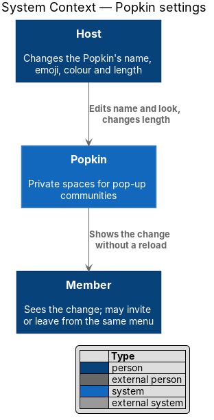
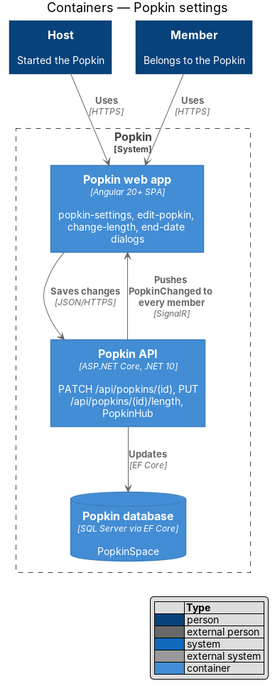
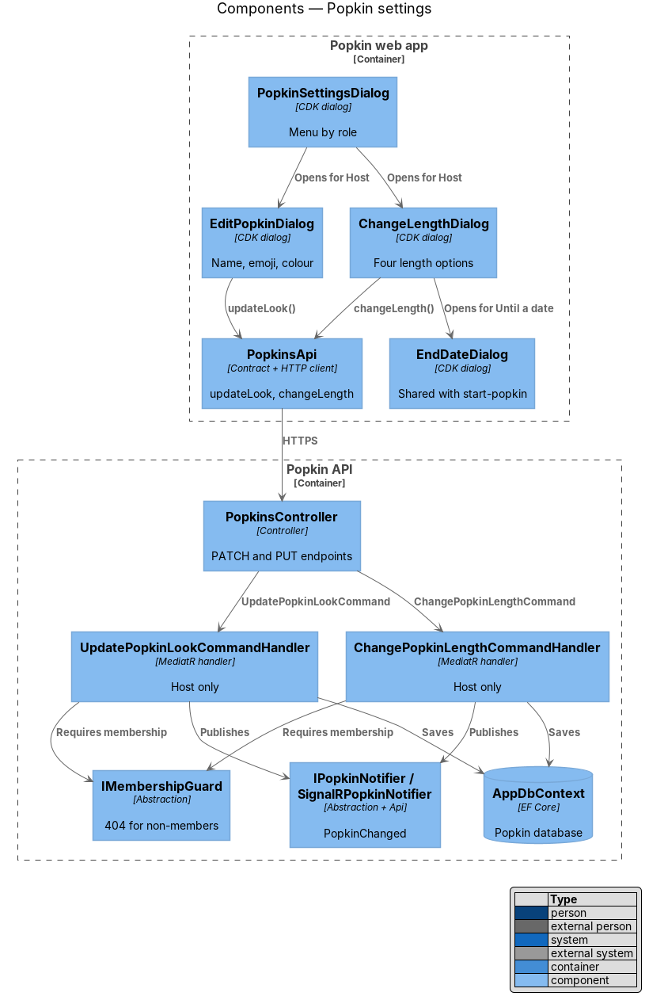
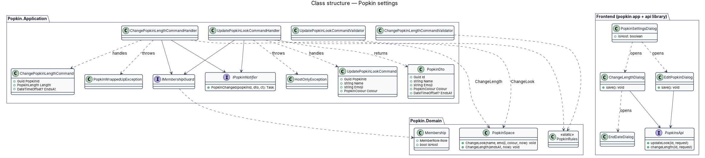
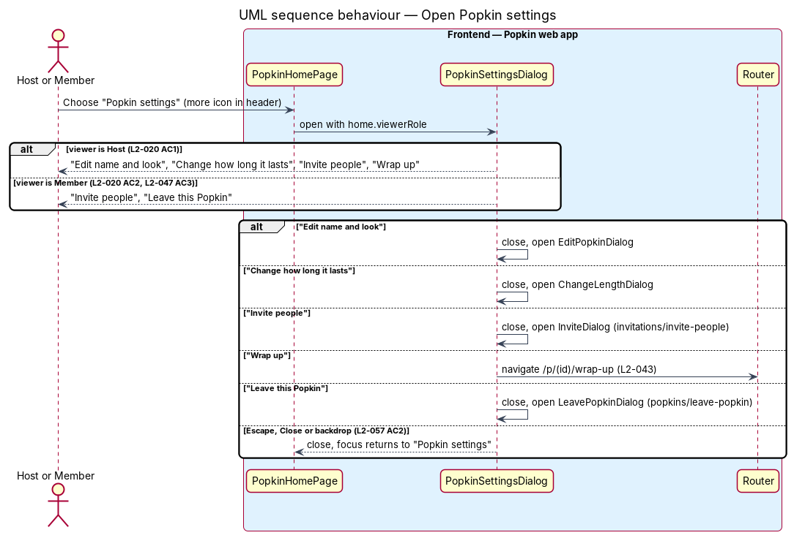
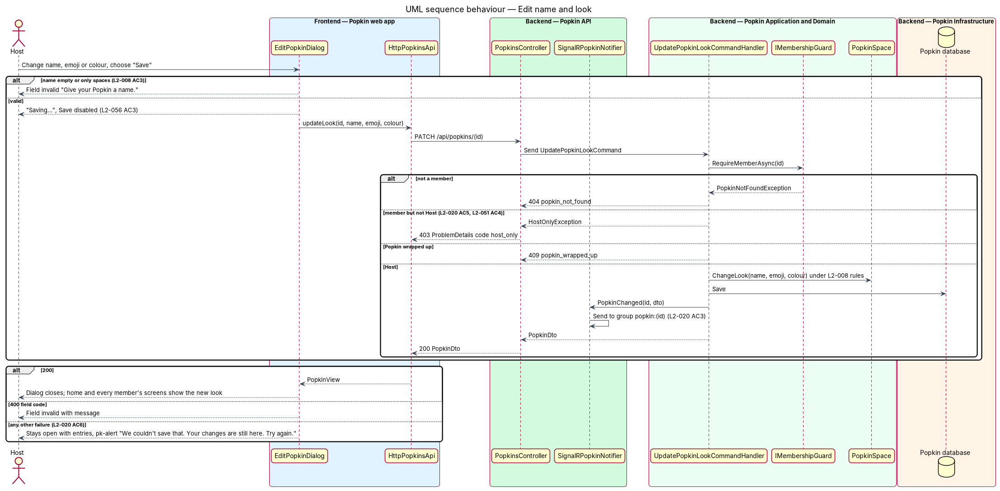
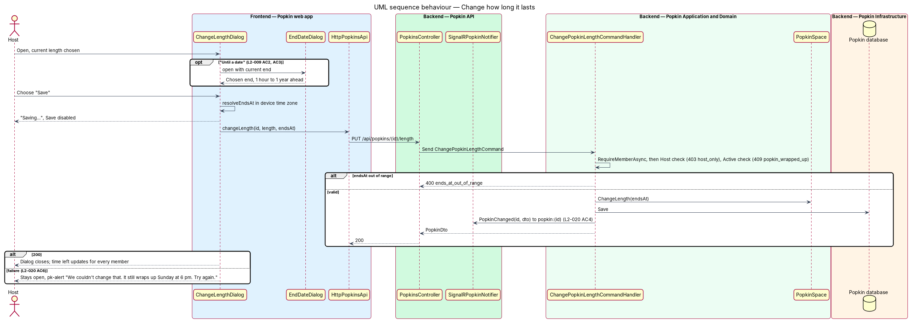

# Popkin settings

## Overview

Plans change after a Popkin starts: the name turns out wrong, the weekend runs long. *Popkin
settings* is the menu behind the "Popkin settings" button on the Popkin home. For the Host it
offers "Edit name and look", "Change how long it lasts", "Invite people" and "Wrap up"; for any
other member it offers "Invite people" and "Leave this Popkin" only.

- **look** — name, emoji and colour of a Popkin together
- **Host-only action** — request that only the Host may make; any other member is refused with `403`

A saved change reaches every member's open screens without a reload, through the Popkin's
real-time group. The same rules as when the Popkin was started apply: the name, emoji and colour
rules of L2-008 and the length rules of L2-009. "Invite people", "Wrap up" and "Leave this
Popkin" lead to `invitations/invite-people`, the wrap-up screen (L2-043) and
`popkins/leave-popkin`.

## Description

### Screens and states

- `docs/mocks/dialogs/popkin-settings/default.html` (Host menu) and `member.html` (member menu).
- `docs/mocks/dialogs/edit-popkin/default.html`, `busy.html` ("Saving…"), `invalid.html` ("Give
  your Popkin a name."), `failed.html` ("We couldn't save that. Your changes are still here. Try
  again.").
- `docs/mocks/dialogs/change-length/default.html`, `busy.html`, `failed.html` ("We couldn't
  change that. It still wraps up Sunday at 6 pm. Try again.").
- `docs/mocks/dialogs/end-date/default.html` and `invalid.html`, reused from
  `popkins/start-popkin`.

### API

- `PATCH /api/popkins/{popkinId}` — body `{ name, emoji, colour }`; `200` `PopkinDto`.
  Failures: `400` `name_required`, `name_too_long`, `emoji_not_allowed`, `colour_not_allowed`;
  `403` `host_only`; `404` `popkin_not_found`; `409` `popkin_wrapped_up`.
- `PUT /api/popkins/{popkinId}/length` — body `{ length, endsAt }`; `200` `PopkinDto`.
  Failures: `400` `length_not_allowed`, `ends_at_out_of_range`; `403` `host_only`; `404`
  `popkin_not_found`; `409` `popkin_wrapped_up`.
- Real time: `PopkinChanged` to group `popkin:{popkinId}`.

### Frontend (Popkin web app)

- **`PopkinSettingsDialog`** (`dialogs/popkin-settings/popkin-settings.dialog.ts`) — CDK dialog
  in `pk-dialog`, titled with the Popkin's name, listing `pk-list-row` menu rows (the
  `menu-list` variant) chosen by `viewerRole` from `PopkinHomeDto` (L2-020 AC1, AC2). The Host's
  menu has no leave row (L2-047 AC3); "Leave this Popkin" uses the danger row. Each row closes
  the menu and opens the next dialog, or for "Wrap up" navigates to `/p/:popkinId/wrap-up`.
- **`EditPopkinDialog`** (`dialogs/edit-popkin/edit-popkin.dialog.ts`) — "Edit name and look",
  "Everyone sees the change straight away.", `pk-text-field` (40 characters), `pk-emoji-picker`,
  `pk-colour-picker`, "Save" and "Cancel". An empty name marks the field invalid with "Give your
  Popkin a name." and sends nothing (L2-008 AC3). While saving, "Save" reads "Saving…" and is
  disabled (L2-056 AC3). On failure the dialog stays open with the entries and `pk-alert`
  (L2-020 AC6).
- **`ChangeLengthDialog`** (`dialogs/change-length/change-length.dialog.ts`) — "How long should
  it last?", "Everyone sees the new time left.", the four `pk-choice-card` options of
  `HowLongPage` with the current one chosen, and the date control that opens `EndDateDialog`.
  It resolves `endsAt` with `resolveEndsAt` and saves; failure keeps the dialog open with the
  current end stated (L2-020 AC6).
- **`PopkinsApi`** — `updateLook(popkinId, request)` and `changeLength(popkinId, request)`.
- Every dialog closes on Escape, "Close" or the backdrop and returns focus to the control that
  opened it (L2-057 AC2); under 640 px each is a bottom sheet.
- The home applies the `PopkinChanged` event for every member, the Host included, through
  `PopkinRealtime` (`popkins/popkin-home`).

### Backend

- **`UpdatePopkinLookCommand`** / **`UpdatePopkinLookCommandValidator`** /
  **`UpdatePopkinLookCommandHandler`** — the validator applies `PopkinRules` as at creation. The
  handler calls `IMembershipGuard.RequireMemberAsync` (`404` for a non-member), then requires
  `Membership.Role == Host` or throws `HostOnlyException` (`403` `host_only`, L2-020 AC5,
  L2-051 AC4), then requires `Status == Active` or throws `PopkinWrappedUpException` (`409`
  `popkin_wrapped_up`). It calls `PopkinSpace.ChangeLook`, saves, and calls
  `IPopkinNotifier.PopkinChanged` (L2-020 AC3).
- **`ChangePopkinLengthCommand`** / **`ChangePopkinLengthCommandValidator`** /
  **`ChangePopkinLengthCommandHandler`** — the same guard, Host and status checks; the validator
  applies the length rules of `CreatePopkinCommandValidator` against `TimeProvider`. The handler
  calls `PopkinSpace.ChangeLength`, saves and notifies (L2-020 AC4). The wrap-up job
  (`WrapUpDuePopkinsJob`, L2-044) reads `EndsAt` at each run, so a changed end takes effect
  without further work.
- **`SignalRPopkinNotifier`** (`Popkin.Api`) — implements `IPopkinNotifier`; sends
  `PopkinChanged` with the `PopkinDto` to `popkin:{popkinId}`.
- The order of checks — membership, then role, then status — keeps a non-member's answer at
  `404` whatever the Popkin's state.

## Requirements

| L2 ID | Refines (L1) | Requirement |
|-------|--------------|-------------|
| `L2-020` | `L1-006` | Popkin settings: The Host changes how a Popkin looks and how long it lasts. |
| `L2-008` | `L1-003` | Name a Popkin and pick its emoji and colour: The first step of starting a Popkin gives it a name, an emoji and a colour, with a preview that changes as they are chosen. |
| `L2-009` | `L1-003` | Choose how long a Popkin lasts: The second step sets when the Popkin wraps up. |
| `L2-051` | `L1-012` | Popkins are private to their members: Membership decides everything a person sees. |

## Diagrams

### System context

The Host changes the Popkin in Popkin, and every member sees the change.

### Containers

The web app sends the change to the Popkin API, which updates the database and pushes
`PopkinChanged` back to every member's web app.

### Components

Three dialogs reach two Host-only handlers; both pass through `IMembershipGuard` and publish
through `IPopkinNotifier`.

### Class structure

Each change has a command, a validator that reuses `PopkinRules`, and a handler that mutates
`PopkinSpace` and raises a typed exception for the `403` and `409` refusals.

### Behaviour — open Popkin settings

The menu offers four actions to the Host and two to any other member, and routes each choice.

### Behaviour — edit name and look

The Host saves; a non-Host is refused with `403`; a failure keeps the dialog open with the
entries; success reaches every member without a reload.

### Behaviour — change how long it lasts

The new end follows the same range rules as at creation and updates the time left for every
member.

