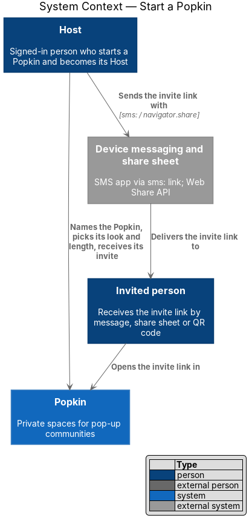
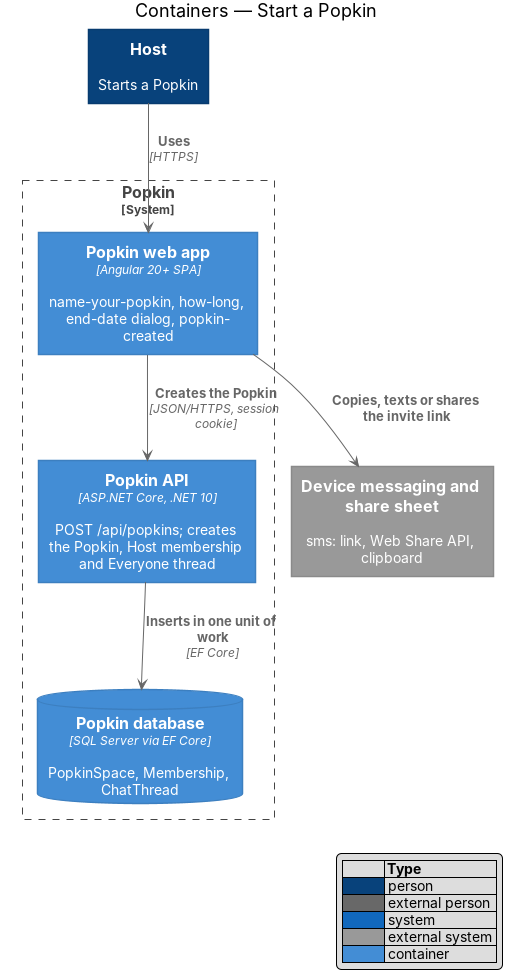
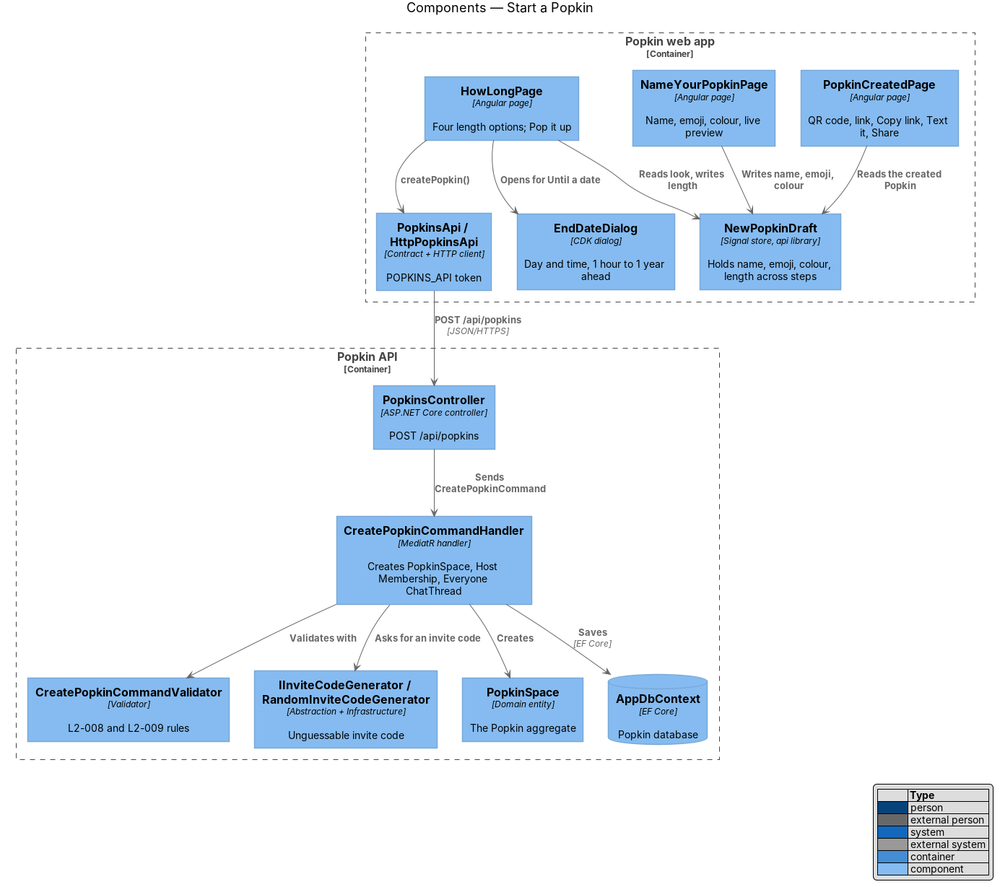
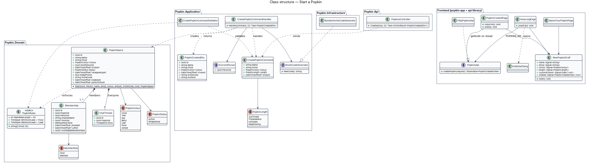
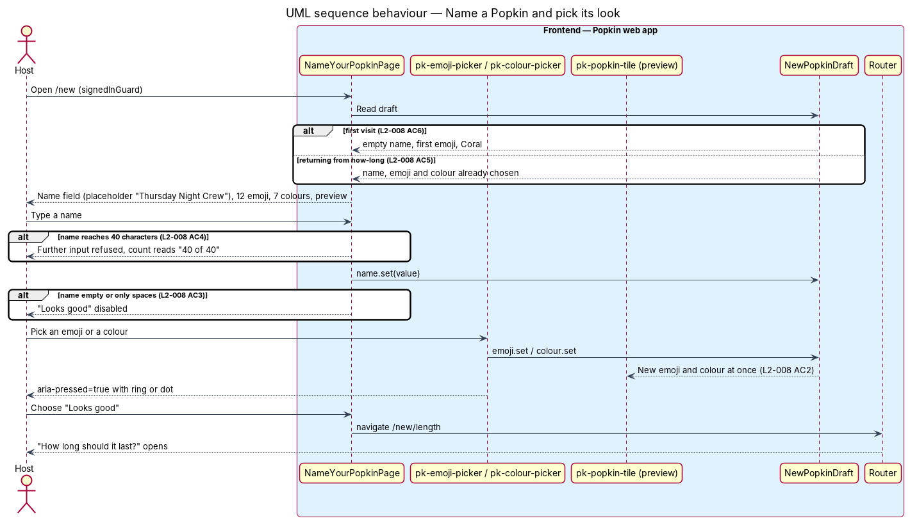
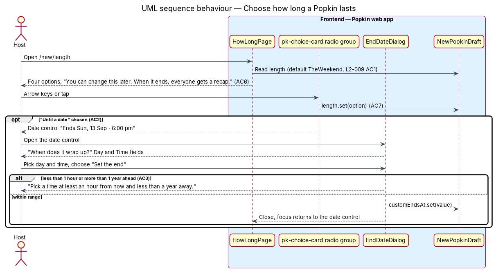
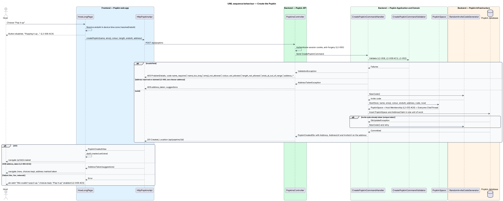
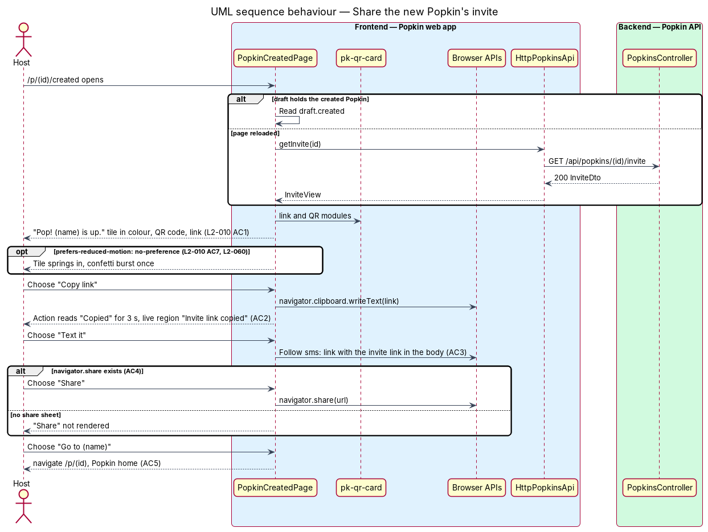

# Start a Popkin

## Overview

Popkin is a free platform for pop-up communities. A *Popkin* is a private space for one group,
with a name, an emoji, a colour, members and a length. This feature covers how a signed-in person
starts one: two short steps, then a screen that hands over the invite at once.

- **Host** — member who started a Popkin; the only member who changes its look and length and wraps it up
- **colour** — one of seven accents a Popkin carries: Coral, Teal, Sky, Berry, Leaf, Plum, Amber
- **length** — time a Popkin runs before it wraps up, or no end at all ("Keep it going")
- **invite** — QR code, invite link or code that lets a person join one Popkin
- **wrap up** — end of a Popkin; a wrapped-up Popkin is read-only and has a recap

The first step, "Name your Popkin", collects the name, one of twelve emoji and a colour, with a
preview tile that follows each choice. The second step, "How long should it last?", offers four
lengths. "Pop it up" creates the Popkin; the person who created it becomes its Host and first
member, and the created screen shows the QR code and link to pass around.

This feature introduces the domain entity for a Popkin. The entity is named **`PopkinSpace`**,
not `Popkin`: a class named `Popkin` would collide with the root namespace `Popkin` that every
backend project uses (`Popkin.Domain`, `Popkin.Application`, …), and every reference would need
qualifying. Every other design in this tree uses `PopkinSpace` for the entity and "Popkin" for
the product term.

## Description

### Screens and states

- `docs/mocks/pages/name-your-popkin/default.html`, `blank.html` (name empty, "Looks good"
  disabled), `edge.html` (40 characters, count "40 of 40").
- `docs/mocks/pages/how-long/default.html` ("The weekend" chosen), `custom.html` ("Until a date"
  with "Ends Sun, 13 Sep · 6:00 pm"), `forever.html` ("Keep it going"), `submitting.html`
  ("Popping it up…"), `error.html` ("We couldn't pop it up. … Your choices are still here.").
- `docs/mocks/dialogs/end-date/default.html` ("When does it wrap up?", Day and Time,
  "Set the end") and `invalid.html` ("Pick a time at least an hour from now and less than a year
  away.").
- `docs/mocks/pages/popkin-created/default.html` and `copied.html` ("Copied", live announcement
  "Invite link copied").

### API

- `POST /api/popkins` — `201 Created` with `PopkinCreatedDto` and a `Location` header.
  Failures: `400` ProblemDetails with `code` `name_required`, `name_too_long`,
  `emoji_not_allowed`, `colour_not_allowed`, `length_not_allowed` or `ends_at_out_of_range`;
  `401` without a session.
- `GET /api/popkins/{popkinId}/invite` — read by the created screen only after a reload; defined
  in `invitations/invite-people`.

### Frontend (Popkin web app)

- **`NameYourPopkinPage`** (`pages/name-your-popkin/name-your-popkin.page.ts`, route `/new`,
  `data-page="name-your-popkin"`, `signedInGuard`) — composes `pk-top-bar` (back, title, step
  indicator), `pk-text-field` (name, `maxlength` 40, placeholder "Thursday Night Crew"),
  `pk-emoji-picker` (twelve emoji), `pk-colour-picker` (seven colours) and `pk-popkin-tile` as the
  preview, and `pk-button` "Looks good". The pickers expose `aria-pressed` and draw a ring or dot,
  so the choice is not carried by colour alone (L2-008 AC2, L2-057 AC5). "Looks good" is disabled
  while the trimmed name is empty (L2-008 AC3). The character count appears at the limit, as in
  the `edge` mock; whether it shows earlier is `<TO SUPPLY>`. As built, the name field and its
  tile are one component, `pk-name-preview`. From 768 px the screen is split and
  `pk-split-aside` holds `pk-preview-card`, the Popkin as others will see it (L2-058 AC10).
- **`HowLongPage`** (`pages/how-long/how-long.page.ts`, route `/new/length`) — one radio group of
  four `pk-choice-card` options with arrow-key movement (L2-009 AC1, AC7), the line about changing
  later and the recap (AC6), a date control for "Until a date" that opens `EndDateDialog` (AC2),
  `pk-alert` for the failure state and `pk-button` "Pop it up" / "Popping it up…" (AC4, AC5). The
  date control is the mock's `date-btn` block, which has no design-system component page yet;
  its `pk-*` home is `<TO SUPPLY>`. From 768 px the screen is split and `pk-split-aside` holds
  `pk-timeline`, which shows the chosen length (L2-058 AC10).
- **`EndDateDialog`** (`dialogs/end-date/end-date.dialog.ts`) — CDK dialog inside `pk-dialog` with
  Day and Time `pk-text-field`s. It refuses an end less than 1 hour or more than 1 year ahead
  with the mock's message (L2-009 AC3). Nothing is sent until "Pop it up". The same dialog
  serves `ChangeLengthDialog` in `popkins/popkin-settings`.
- **`PopkinCreatedPage`** (`pages/popkin-created/popkin-created.page.ts`, route
  `/p/:popkinId/created`, `shell: 'bare'`) — "Pop! {name} is up.", `pk-popkin-tile` in the
  Popkin's colour, `pk-qr-card` with the QR code and link (L2-010 AC1), and three share actions:
  "Copy link" writes to `navigator.clipboard`, reads "Copied" for 3 s and announces "Invite link
  copied" through a visually hidden live region (AC2); "Text it" follows an `sms:` link whose body
  is the invite link (AC3); "Share" calls `navigator.share` and is not rendered when the browser
  has no `navigator.share` (AC4). "Go to {name}" opens `/p/:popkinId` (AC5). The tile springs in
  and confetti bursts once, within 320 ms, only under `prefers-reduced-motion: no-preference`
  (AC7, L2-060). The share row is the mock's `share-actions` block, which has no design-system
  component page yet (`<TO SUPPLY>`). From 768 px the screen is split and the QR card, at
  `size="lg"`, is the picture in `pk-split-aside` (L2-058 AC10).
- **`NewPopkinDraft`** (`api` library, `providedIn: 'root'`) — signal store holding `name`,
  `emoji`, `colour`, `length`, `customEndsAt` and `created`. Both steps read and write it, so
  going back keeps all three choices (L2-008 AC5); a failed create keeps them too (L2-009 AC5).
  Its first state is an empty name, the first emoji and Coral (L2-008 AC6).
- **`resolveEndsAt(length, now, customEndsAt)`** (pure helper, `api` library) — resolves the end
  in the device's time zone: "Just today" → next local midnight; "The weekend" → the coming
  Sunday at 18:00; "Until a date" → the chosen value; "Keep it going" → `null`. The rule for "The
  weekend" when that Sunday at 18:00 is less than 1 hour ahead is `<TO SUPPLY>`.
- **`PopkinsApi` / `POPKINS_API` / `HttpPopkinsApi`** — `createPopkin(request)` returns a
  `PopkinCreatedView`. Pages inject the token, never the class.

### Backend

- **`PopkinsController`** (`/api/popkins`) — authenticated by the fallback policy (L2-050);
  sends `CreatePopkinCommand` and maps the result to `201`.
- **`CreatePopkinCommand`** — `Name`, `Emoji`, `Colour`, `Length` (`PopkinLength`:
  `JustToday`, `TheWeekend`, `UntilDate`, `KeepItGoing`) and `EndsAt`. The client resolves
  `EndsAt` because only the device knows its local midnight and Sunday; the server checks it.
- **`CreatePopkinCommandValidator`** — trims the name; refuses an empty name and one longer than
  40 characters; accepts only the twelve emoji and the seven colours; requires `EndsAt` to be
  `null` for `KeepItGoing` and otherwise in the future and at most 1 year ahead, and at least 1
  hour ahead for `UntilDate` (L2-008, L2-009 AC3, L2-052 AC1). The validation library is
  `<TO SUPPLY>`.
- **`PopkinRules`** (`Popkin.Domain`) — the shared constants: name length 40, the twelve emoji,
  the 1-hour and 1-year bounds. `popkins/popkin-settings` reuses them.
- **`CreatePopkinCommandHandler`** — reads the caller from `ICurrentPerson`, the clock from
  `TimeProvider` and a code from `IInviteCodeGenerator`, calls `PopkinSpace.Start`, and saves
  through `IAppDbContext` in one unit of work. A unique index on `PopkinSpace.InviteCode` turns a
  collision into a retry with a new code.
- **`PopkinSpace`** (`Popkin.Domain`) — the Popkin aggregate: `Id`, `Name`, `Emoji`, `Colour`
  (`PopkinColour`), `HostPersonId`, `EndsAt` (`null` = ongoing), `Status` (`PopkinStatus`:
  `Active`, `WrappedUp`), `WrappedUpAt`, `KeepPhotos`, `InviteCode`, `CreatedAt`,
  `LastActivityAt`. `Start(...)` creates it `Active` together with the Host's `Membership`
  (`Role = Host`, `DisplayName` = the person's name, `JoinedAt` = now; L2-010 AC6) and the
  Popkin's Everyone `ChatThread` (`Kind = Everyone`).
- **`IInviteCodeGenerator` / `RandomInviteCodeGenerator`** — 10 characters from the alphabet
  `abcdefghjkmnpqrstuvwxyz23456789`, drawn with `RandomNumberGenerator`, above the 8-character
  minimum of L2-011 AC5. A slug chosen by the Host (the mock link `popk.in/lakeside`) has no
  screen in the mocks; how a Host picks one is `<TO SUPPLY>`.
- **`PopkinCreatedDto`** — `Id`, `Name`, `Emoji`, `Colour`, `EndsAt`, `InviteCode`, `InviteUrl`
  (built by `InviteLinkBuilder`, see `invitations/invite-people`).
- **Infrastructure** — `PopkinSpaceConfiguration`, `MembershipConfiguration` and
  `ChatThreadConfiguration` (`IEntityTypeConfiguration<T>`) add the tables and the unique
  `InviteCode` index; `IAppDbContext` gains `DbSet<PopkinSpace>`, `DbSet<Membership>` and
  `DbSet<ChatThread>`.

### Open questions settled in journey 1

- **Back from Name your Popkin** — leads to My Popkins (`/popkins`), not to sign up: the person
  is signed in by then. The step dots still read "Step 2 of 3" and "Step 3 of 3".
- **The count** — shows only at the limit ("40 of 40"), as the `edge` mock draws it, and becomes
  the field's description.
- **The weekend near its end** — when Sunday at 6 pm is less than an hour away, "The weekend"
  resolves to the next Sunday.
- **Until a date** — before a date is picked, it shows the weekend's end.
- **The date control** — `pk-date-button` (`button[pk-date-button]`, the mocks' `date-btn`); the
  share row is `pk-share-actions` with `pk-share-action`; the celebration is `pk-pop`, which owns
  the screen's heading so its spacing matches the mock.
- **Text it** — `sms:?&body={link}`, the form both phone platforms read.
- **Share** — `navigator.share({ title, url })`; closing the sheet is not a failure.
- **Reduced motion** — the confetti dots are not drawn at all (the design system now says so).
- **Created screen data** — it reads `GET /api/popkins/{id}/invite` every time, not only after a
  reload, so a direct link and a reload behave the same; a 5xx opens the server-error screen.

### Settled when the wide layouts were built

The three screens are built for the five form factors of L2-058
([Responsive layout](../../accessibility/responsive-layout/README.md)). Each is `pk-screen` with
`layout="split"`: the form stays in a column of 28 rem, 32 rem from 640 px and 36 rem from
1024 px (L2-058 AC3), and from 768 px a `pk-split-aside` beside it holds a picture of what the
step makes (L2-058 AC10). Below 768 px the aside is `display: none`, not drawn and then covered,
so it is out of the tab order and the accessibility tree (L2-058 AC13).

- **Name your Popkin** — the aside, labelled "Preview", shows `pk-preview-card` under "How it’ll
  look to everyone". The card reads the same draft as the form, so it follows the name, the
  emoji and the colour as they change (L2-008 AC2). It shows "Your Popkin" while the name is
  empty, the emoji tile, "You: Welcome, everyone! 👋", the Host's avatar beside "Just you, for
  now", and "Just started". The row above the form still previews the Popkin at every width.
- **The Host's avatar** — the mock's card shows Mara's photograph. A person has no photo until
  the account screen is built (journey 17), so `pk-avatar` shows the initials of the first and
  last word of their name on Coral. It shows the photo when the session carries one.
- **How long** — the aside, labelled "What happens", shows the chosen option's emoji and title,
  `pk-timeline` from "Now" to the end in words, and a line of text. It follows the choice:

  | Length | Bar | End | Text |
  |---|---|---|---|
  | Just today | 30 % | "Midnight" | "Then it wraps up on its own and everyone gets the recap: the people, the photos, the best moment." |
  | The weekend | 65 % | "Sunday, 6 pm" | The same |
  | Until a date | 85 % | The end as the date control shows it, such as "Sun, 13 Sep · 6:00 pm" | The same |
  | Keep it going | 100 % | "Whenever you say" | "It stays open until you wrap it up. Then everyone gets the recap." |

- **Just today** — no mock draws its timeline. The app derives it from the option's own copy
  ("Wraps up at midnight"): a 30 % bar that ends at "Midnight".
- **The timeline's emoji** — the mocks first drew it as `timeline__icon`, outside the `timeline`
  block. It is an element of the aside, so the mocks, the design system and the app name it
  `split-aside__icon`.
- **The bar** — decoration, hidden from assistive technology; the two ends say the same in words
  (L2-057 AC6).
- **Popkin created** — the aside, labelled "Invite code", shows `pk-qr-card` at `size="lg"`. The
  QR card in the body carries `only-below-m`, so the code is on screen once at every width and
  nothing a person needs is at one width only (L2-058 AC13). From 768 px the headline, the share
  actions and "Go to {name}" sit together in the middle of their part.
- **Tests** — behaviour specs prove each picture at 768 px, that the card and the timeline
  follow the choices at 1024 px, that the QR code still scans from the aside, and that no
  picture is there at 360 px. Parity specs for `pk-split-aside`, `pk-preview-card`, `pk-avatar`,
  `pk-time-left` and `pk-timeline` run at 1280 px only, as these parts do not exist at 360 px.

## Requirements

| L2 ID | Refines (L1) | Requirement |
|-------|--------------|-------------|
| `L2-008` | `L1-003` | Name a Popkin and pick its emoji and colour: The first step of starting a Popkin gives it a name, an emoji and a colour, with a preview that changes as they are chosen. |
| `L2-009` | `L1-003` | Choose how long a Popkin lasts: The second step sets when the Popkin wraps up. |
| `L2-010` | `L1-003` | The Popkin is created: When a Popkin exists, its Host is given its invite straight away. |
| `L2-052` | `L1-012` | Input is validated and output is encoded: Nothing a person types can harm another person or the system. |
| `L2-060` | `L1-014` | Motion is optional: Motion explains; it never gets in the way. |

## Diagrams

### System context

The Host starts the Popkin in Popkin and passes the invite on through the device's messaging app
or share sheet; the invited person opens the link back in Popkin.

### Containers

The web app holds the two steps on the device and makes one request to the Popkin API, which
writes the Popkin, the Host's membership and the Everyone thread to the database.

### Components

`NewPopkinDraft` carries the choices between the pages; `CreatePopkinCommandHandler` validates
them, takes an invite code and creates the `PopkinSpace`.

### Class structure

`PopkinSpace` owns its memberships and its Everyone thread and enforces `PopkinRules`; the
command, validator and handler sit in the application layer, the pages and draft in the web app.

### Behaviour — name a Popkin and pick its look

The first step runs on the device only: every pick updates the draft and the preview at once,
and the draft survives going back (L2-008 AC5).

### Behaviour — choose how long it lasts

The radio group writes the length to the draft; "Until a date" opens `EndDateDialog`, which
refuses an end outside 1 hour to 1 year (L2-009 AC3).

### Behaviour — create the Popkin

"Pop it up" disables itself, sends one request and either opens the created screen or keeps the
choices with a message (L2-009 AC4, AC5); an invite-code collision is retried inside the handler.

### Behaviour — share the new Popkin's invite

The created screen shows the QR code and link and offers copy, text and share, the last only
where the browser has a share sheet (L2-010 AC2 to AC4).

