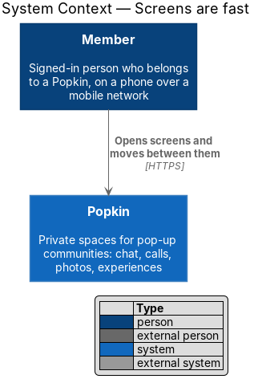
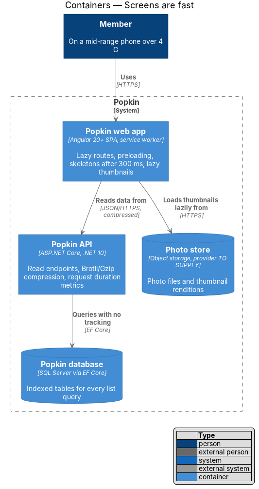
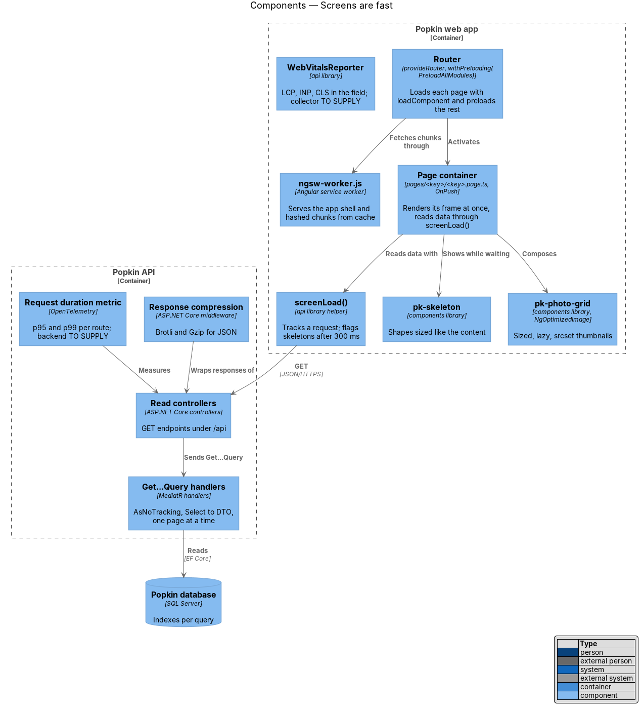
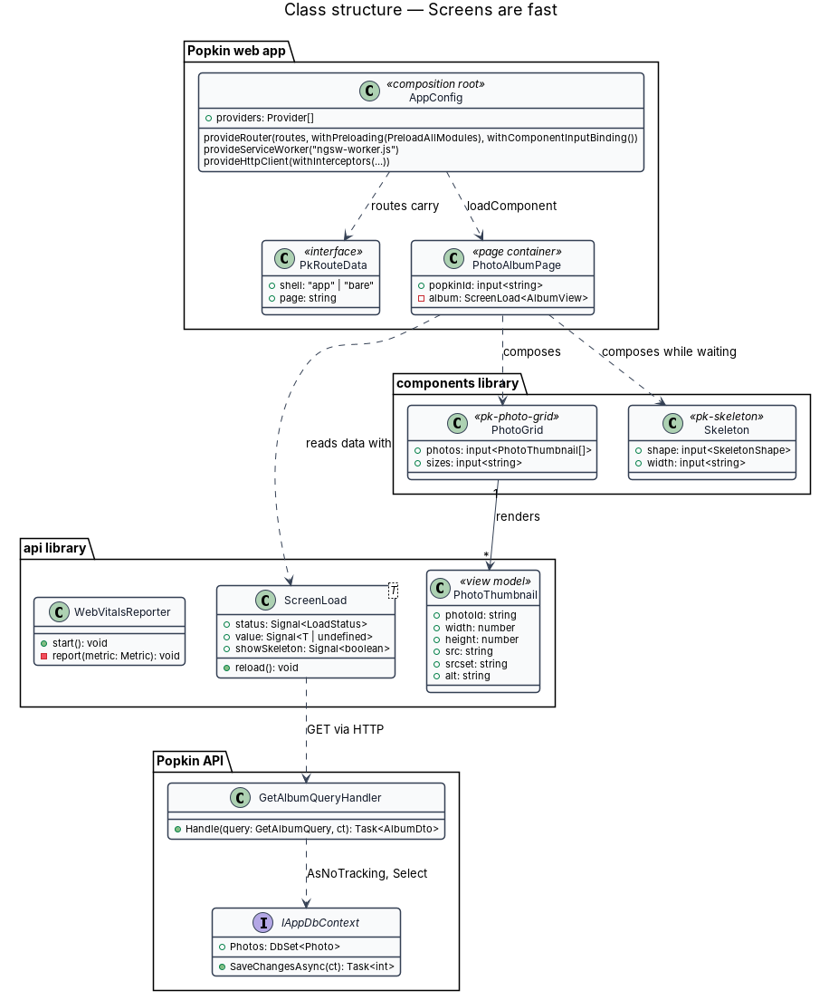
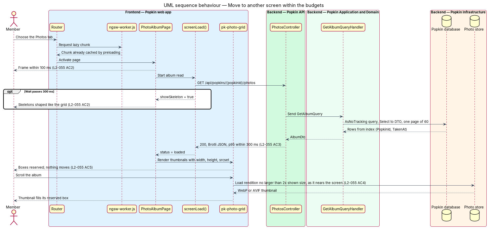

# Screens are fast

## Overview

Popkin is used on a phone, often on a mobile network, in the middle of whatever the group is
doing. A screen that hesitates breaks that moment. This feature is the cross-cutting mechanism
that keeps every screen of the Popkin web app inside a set of performance budgets, and keeps the
Popkin API's read endpoints inside a latency budget.

The feature does not add a screen of its own. It sets how routes load, how the web app shows a
screen before its data arrives, how photos in lists are served and loaded, how responses are
cached and compressed, and how the budgets are measured. Every other feature in Popkin inherits
these rules.

The budgets are taken from L2-055 without change:

- **first open** — main content visible within 2.5 s and input answered within 200 ms on a
  mid-range phone over 4G (L2-055 AC1)
- **move between screens** — the next screen's frame within 100 ms; its content, or skeletons
  shaped like it, within 300 ms (L2-055 AC2)
- **read latency** — 95 % of data-reading API requests within 300 ms and 99 % within 1 s under
  normal load (L2-055 AC3)
- **photo in a list** — a thumbnail no larger than twice its displayed size, in a modern format,
  loaded only as it nears the screen (L2-055 AC4)
- **stable layout** — content that arrives later never moves what is already on screen
  (L2-055 AC5)

Local terms:

- **frame** — chrome of a screen (top bar, Popkin tabs, page background and headings) that
  renders without waiting for data
- **lazy route** — route whose page code is a separate JavaScript chunk, fetched on first need
  through `loadComponent`
- **thumbnail rendition** — smaller copy of a photo, produced for display in a list
- **normal load** — traffic level at which the read-latency budget applies; its definition is
  `<TO SUPPLY>`
- **mid-range phone** — reference device for the first-open budget; the exact device profile and
  network throttling used for measurement are `<TO SUPPLY>`

The sibling feature `reliability/loading-failure-offline` owns what the person sees while data is
pending, has failed or is unavailable offline; this feature owns how fast those moments arrive.

## Description

The slice runs from the browser to the database. What exists today is described as existing;
everything else is introduced by this design.

### Web app (`frontend/projects/popkin`)

- **`app.routes.ts` (existing)** — every route already uses `loadComponent`, so every page is a
  lazy route. The design keeps this rule for all pages, dialogs opened from pages, and the
  error pages (`not-found`, `server-error`, `offline`).
- **`app.config.ts` (existing composition root)** — the design extends `provideRouter(routes)`
  with `withPreloading(PreloadAllModules)`, so that every lazy chunk is fetched in the background
  once the first screen has rendered, and a later move between screens needs no network round
  trip for code (L2-055 AC2). It adds `withComponentInputBinding()` so route parameters reach a
  page as inputs without a subscription. It adds `provideServiceWorker('ngsw-worker.js')` from
  `@angular/service-worker`, registered after the app is stable.
- **`ngsw-config.json` (introduced)** — Angular service worker configuration. One `assetGroup`
  prefetches the app shell (`index.html`, the main bundle, the global stylesheet, the three font
  files); a second lazily caches every other hashed chunk and image under `/assets/`. API
  responses are not in a `dataGroup`; API data caching is owned by `ResponseCache` in
  `reliability/loading-failure-offline`, so that it is per person and cleared on sign-out.
- **Build budgets (existing, `frontend/angular.json`)** — the production build already warns at
  550 kB and fails at 1 MB of initial JavaScript and CSS, and warns at 4 kB and fails at 8 kB per
  component stylesheet. The design keeps these as the build gate. The relation between the
  550 kB budget and the 2.5 s first-open budget on the reference device is `<TO SUPPLY>`.
- **`index.html` (existing)** — the design adds `<link rel="preload" as="font" type="font/woff2"
  crossorigin>` for the Nunito and Inter files used above the fold, so text does not reflow when
  the faces arrive (L2-055 AC5). The fonts are self-hosted copies of
  `docs/design-system/assets/fonts/` (AGENTS.md); Rubik is loaded on demand.
- **Pages** — each page is a container under `pages/<key>/` with `ChangeDetectionStrategy.OnPush`
  and signals. A page renders its frame synchronously and reads its data through `screenLoad()`
  (introduced in `reliability/loading-failure-offline`), which shows skeletons only once a wait
  passes 300 ms. Data is never awaited in a route resolver, because a resolver delays the frame.
- **Lists** — lists of messages, photos and Popkins render with `@for` and a `track` expression on
  the item id. Long lists load in pages (50 messages, L2-027; 60 photos, L2-032) as the person
  scrolls; the design does not add virtual scrolling.

### Components library (`frontend/projects/components`)

- **`pk-skeleton`** — the Skeleton component (`docs/design-system/components/skeleton.html`).
  Its shapes take the exact size of the content they stand in for, so nothing moves when the
  content arrives (L2-055 AC5).
- **`pk-photo-grid`, `pk-avatar`, `pk-card`** — every `` they render carries `width` and
  `height` (or an `aspect-ratio` from the photo's stored `Width` and `Height`), `loading="lazy"`
  except for the first visible row, `decoding="async"`, and a `srcset` with `sizes` that lets the
  browser pick a thumbnail rendition no larger than twice the displayed size (L2-055 AC4).
  Angular's `NgOptimizedImage` (`ngSrc`) is used for these images, which enforces the dimensions
  and warns on oversized images in development.

### Popkin API (`backend/src/Popkin.Api`)

- **Response compression (introduced)** — `AddResponseCompression` with Brotli and Gzip
  providers for JSON, enabled over HTTPS. `UseResponseCompression` sits before `UseRouting` in
  `Program.cs`.
- **Caching headers (introduced)** — static files of the web app are served with hashed names and
  `Cache-Control: public, max-age=31536000, immutable`; `index.html` and `ngsw.json` with
  `Cache-Control: no-cache`. API responses carry `Cache-Control: private, no-store`, because they
  hold personal data (L2-054); the web app's own `ResponseCache` keeps what the offline mode
  needs. The web app is served by the reverse proxy in front of the API, on the same origin
  ([ADR 0013](../../../adr/0013-deployment-shape.md)); the proxy sets the `Cache-Control` and
  compression of its files.
- **Read queries** — every `Get…Query` handler in `Popkin.Application` reads with `AsNoTracking`,
  projects straight to its `…Dto` with `Select`, and loads one page at a time. Each entity
  configuration in `Popkin.Infrastructure` declares the indexes its queries filter and order by,
  for example `Message (ThreadId, SentAt)`, `Membership (PersonId, LeftAt)` and
  `Photo (PopkinId, TakenAt)`.
- **Latency measurement (introduced)** — ASP.NET Core's built-in `http.server.request.duration`
  metric is exported through OpenTelemetry (`AddOpenTelemetry().WithMetrics(...)`), with the
  route template as a dimension, so the 95th and 99th percentiles of each `GET` endpoint are
  observable (L2-055 AC3). The set-up is `AddPopkinTelemetry`
  ([ADR 0012](../../../adr/0012-opentelemetry.md)). The metrics backend and its alert
  thresholds are `<TO SUPPLY>`.

### Photo store

- **Thumbnail renditions** — produced when a photo is added and served from the Photo store,
  owned by the photos subsystem designs (`photos/add-photos`, `photos/browse-album`). This design
  sets their budget: no larger than twice the displayed size, and in a modern format. The
  rendition widths and the format (WebP or AVIF) are `<TO SUPPLY>`.

### Field measurement

- **`WebVitalsReporter` (introduced, `api` library)** — reads Largest Contentful Paint,
  Interaction to Next Paint and Cumulative Layout Shift in the browser with the `web-vitals`
  library and posts them to a collector. Whether field measurement is wanted, and its collector,
  are `<TO SUPPLY>`; if it is not wanted, the budgets are measured by hand with Lighthouse on the
  reference device. No third-party analytics script is loaded (L2-061).

### Screens and states

The mechanism applies to every screen. The mocks that show a screen before its data arrives are
the loading states, which the frame plus skeletons reproduce:
`docs/mocks/pages/my-popkins/loading.html`, `docs/mocks/pages/popkin-home/loading.html`,
`docs/mocks/pages/conversations/loading.html`, `docs/mocks/pages/group-chat/loading.html`,
`docs/mocks/pages/direct-message/loading.html`, `docs/mocks/pages/photo-album/loading.html`,
`docs/mocks/pages/photo-view/loading.html`, `docs/mocks/pages/experiences/loading.html`,
`docs/mocks/pages/experience-detail/loading.html`, `docs/mocks/pages/wrapped-up/loading.html`,
`docs/mocks/pages/account/loading.html`, `docs/mocks/pages/join-invite/loading.html` and
`docs/mocks/pages/video-call/loading.html`. Lazy-loaded thumbnails appear in
`docs/mocks/pages/photo-album/default.html` and `docs/mocks/pages/popkin-home/default.html`.

### API

The feature adds no endpoint. It applies to every `GET` endpoint under `/api` (for example
`GET /api/popkins` 200, `GET /api/popkins/{popkinId}` 200 or 404 `popkin_not_found`), which shall
meet the read-latency budget, and adds response compression and `Cache-Control` headers to all
responses.

### Verification

- Behaviour specs in `e2e/tests/` cover the observable parts that Playwright can prove without a
  real backend (ADR 0005): a page shows its frame before its stubbed request answers, a delayed
  answer (stubbed in `e2e/fixtures/stubs.ts`) shows skeletons, and a thumbnail `` carries
  `loading="lazy"` and explicit dimensions.
- Timing budgets on a reference device are not asserted in the Playwright suite, because
  CI timing is not representative. They are measured with Lighthouse and the API metrics;
  the cadence and owner of that measurement are `<TO SUPPLY>`.

## Requirements

| L2 ID | Refines (L1) | Requirement |
|-------|--------------|-------------|
| `L2-055` | `L1-013` | Screens are fast: Popkin feels immediate on a phone. |

## Diagrams

### System context

A member opens Popkin on a phone. Popkin serves the web app and its data; photos come from the
Photo store, which is part of Popkin.

### Containers

The Popkin web app loads its shell from the service worker cache, fetches lazy chunks in the
background, and reads data from the Popkin API, which queries the Popkin database and returns
compressed JSON. Thumbnails come from the Photo store.

### Components

Inside the web app, the router loads each page lazily and preloads the rest; the page renders its
frame and reads data through `screenLoad()`. Inside the API, the compression middleware wraps
every response, and query handlers read with no tracking against indexed tables.

### Class structure

`AppConfig` composes the router features, the service worker and the image loader. A page
depends on `screenLoad()` and composes `pk-skeleton` and `pk-photo-grid`, whose `PhotoThumbnail`
view model carries the dimensions and rendition sources. On the server, a `Get…Query` handler
projects to a DTO through `IAppDbContext`.

### Behaviour — move to another screen

A member moves from the Popkin home to Photos. The chunk is already preloaded, so the frame
renders at once (L2-055 AC2); skeletons appear only if the data takes longer than 300 ms; the
API answers from an indexed, untracked query (L2-055 AC3); thumbnails load lazily at their
rendition size into reserved boxes (L2-055 AC4, AC5).

