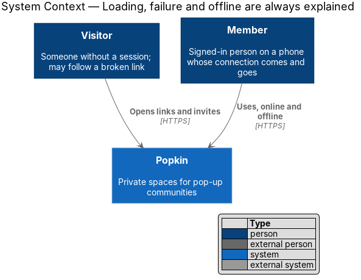
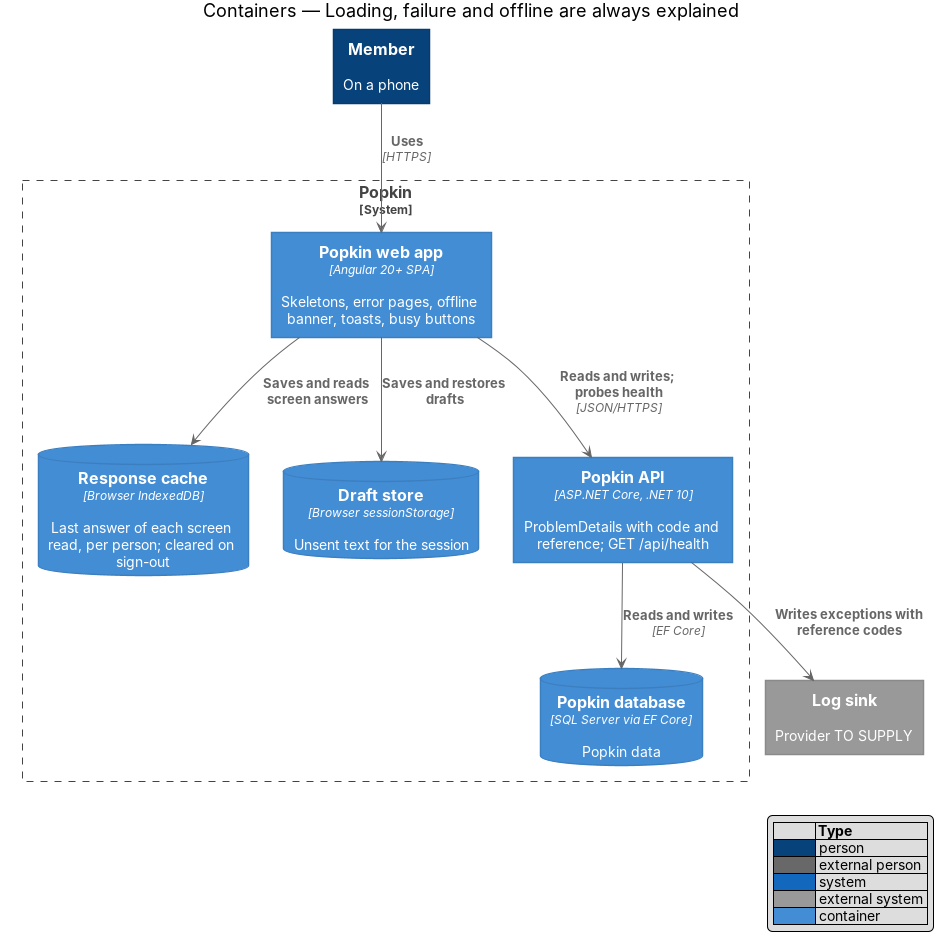
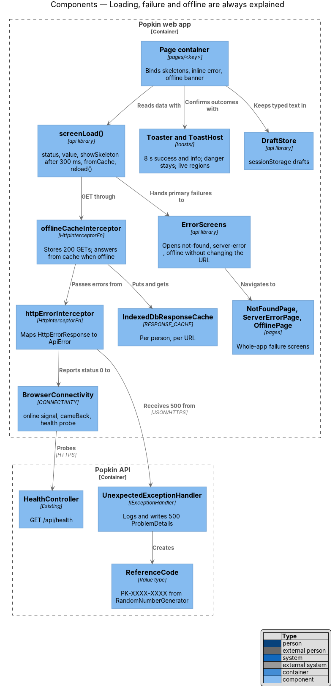
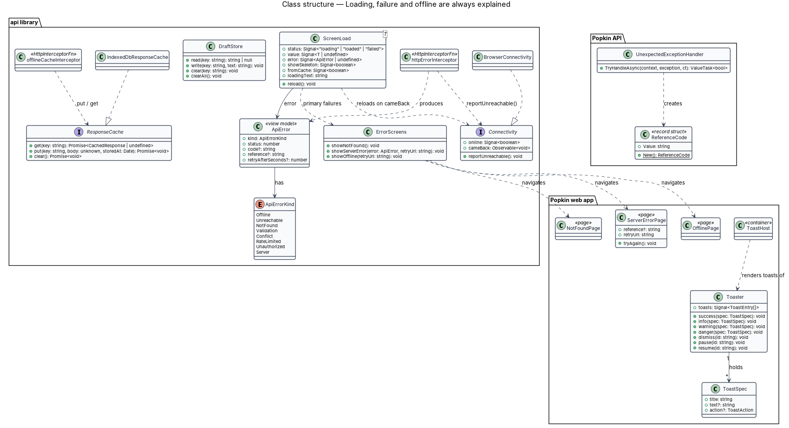
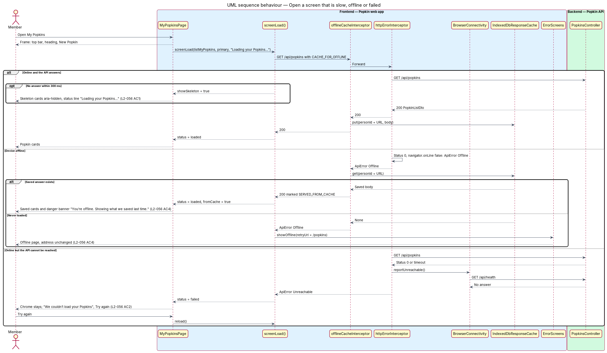
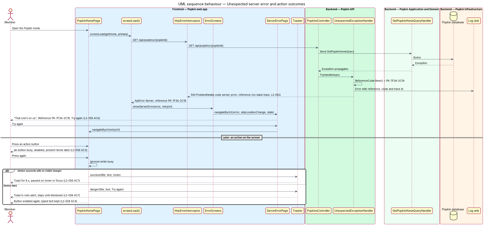

# Loading, failure and offline are always explained

## Overview

People use Popkin on phones, at campsites, on trains and in school car parks, where the
connection comes and goes. A screen that sits blank, a button that seems to do nothing, or a
message that disappears leaves the person guessing. This feature is the cross-cutting mechanism
that tells the person, in plain words, when a screen is loading, when something has failed, when
the device is offline, and when an action has worked. It also keeps what the person typed when
something goes wrong.

The feature owns three whole-app screens (not found, something went wrong, offline), the rules
for skeletons, busy buttons, toasts and the offline banner, and the services behind them: an HTTP
error interceptor, a connectivity service, a cache of the last answers each screen received, and
a store for unsent text. Every screen of the Popkin web app uses these; each screen's own design
supplies only its copy.

Local terms:

- **skeleton** — sand-coloured shape in the layout of content that is still loading, hidden from
  assistive technology
- **status line** — visually hidden live region (`role="status"`) that tells assistive
  technology what is loading, for example "Loading your Popkins…"
- **busy button** — button whose action is in flight: disabled, labelled in the present tense
  ("Joining…") and unable to send twice
- **toast** — ink card that rises above the tabs to confirm an outcome with no visible change, or
  to report a failure
- **banner** — full-width strip under the header for a condition that lasts, such as being
  offline
- **reference code** — short identifier of one server failure, shown to the person and written to
  the server log with the exception, in the form `PK-7F3A-2C19`
- **primary read** — request whose data the screen cannot show without, such as the list on My
  Popkins; a **section read** fills one section of a screen that can show the rest without it,
  such as the photo strip on the Popkin home
- **draft** — text typed into a message field, comment or form that has not been sent yet

The sibling feature `reliability/fast-screens` owns how quickly screens appear; this feature owns
what they say while waiting and when something goes wrong.

## Description

All parts below are introduced by this design unless marked existing.

### What the person sees, by situation

| Situation | What shows | Criterion |
|-----------|-----------|-----------|
| A screen's data takes more than 300 ms | Skeletons shaped like the content, `aria-hidden="true"`, with a status line naming what is loading | `L2-056 AC1` |
| A primary or section read fails because the API cannot be reached or times out | The screen keeps its top bar and Popkin tabs; `pk-empty-state` in its error variant says what happened, that nothing was lost, and offers "Try again" and a way back | `L2-056 AC2` |
| An action is in flight | Its `pk-button` is busy: disabled, `aria-busy="true"`, a present-tense label, and a second press is ignored | `L2-056 AC3` |
| The device is offline and the screen has a saved answer | The screen shows the saved answer with a danger `pk-banner` (`role="alert"`) that says it is offline | `L2-056 AC4` |
| The device is offline and the screen has never loaded | The `offline` page: "You’re offline", "Try again", "My Popkins"; the address does not change | `L2-056 AC4` |
| The address matches no route, or a Popkin screen answers 404 `popkin_not_found` | The `not-found` page: "My Popkins" and "Popkin home page" | `L2-056 AC5` |
| A primary read answers 5xx | The `server-error` page with its reference code and "Try again"; the address does not change, so "Try again" reloads the same screen | `L2-056 AC6` |
| A section read answers 5xx | The section's inline error, compact `pk-empty-state` with the reference code; the rest of the screen works | `L2-056 AC2`, `AC6` |
| An action succeeds with no visible change | A success or info `pk-toast` for 8 seconds, paused while hovered or focused | `L2-056 AC7` |
| An action fails | A danger `pk-toast` that stays until dismissed, with "Try again"; or, for a form or dialog, its failed state (`pk-alert`), which keeps every value typed | `L2-056 AC7`, `L2-028 AC4` |

Whether an action's failure toast or failed alert also shows the reference code is `<TO SUPPLY>`;
the mocks show none. The duration of a warning toast (for example "Slow down a little",
`L2-053`) is `<TO SUPPLY>`; the mocks state 8 seconds for success and info and "until
dismissed" for errors only.

### Web app pages (`frontend/projects/popkin/src/app/pages/`)

- **`NotFoundPage`** — `pages/not-found/not-found.page.ts` + `.html`, selector
  `pk-not-found-page`. Route `**` (last in `app.routes.ts`), data
  `{ shell: 'bare', page: 'not-found' }`, title "Not found". Composes the root `pk-top-bar` with
  the logo and `pk-empty-state` with the heading "This page popped off somewhere", the text "The
  link is broken or the page has moved. Your Popkins are right where you left them.", a primary
  `pk-button` "My Popkins" (`/popkins`) and a secondary `pk-button` "Popkin home page" (`/`). A
  visitor who chooses "My Popkins" is sent on by `signedInGuard`.
- **`ServerErrorPage`** — `pages/server-error/server-error.page.ts` + `.html`, route `/error`,
  data `{ shell: 'bare', page: 'server-error' }`. Heading "That one’s on us", text "Something went
  wrong on Popkin’s side. Nothing of yours was lost. Try again in a moment.", "Try again" (primary),
  "My Popkins" (secondary), and "Reference {code}". It reads `reference` and `retryUrl` from
  `Router.getCurrentNavigation()?.extras.state` (or `history.state` after a reload); opened
  directly with no state, it shows no reference line and "Try again" opens `/popkins`.
- **`OfflinePage`** — `pages/offline/offline.page.ts` + `.html`, route `/offline`, data
  `{ shell: 'bare', page: 'offline' }`. Heading "You’re offline", text "This screen needs a
  connection the first time it opens. Popkins you’ve opened before still show what they had.",
  "Try again" (primary, `retryUrl`) and "My Popkins" (secondary). "Try again" while still offline
  stays on the page and moves focus to the heading.

Each of the three pages has one `h1`, sits in `main`, and declares no stylesheet (ADR 0007).

### Web app shell and toasts

- **`App` (existing, `app.ts`)** — the shell gains `ToastHost` beside `main`, so toasts survive
  navigation.
- **`Toaster` (`toasts/toaster.ts`)** — root service with `success(toast)`, `info(toast)`,
  `warning(toast)` and `danger(toast)`, where a `ToastSpec` holds `title`, `text?` and an optional
  `action` (`label`, `run`). It holds the list as a signal, newest last. Success and info dismiss
  after 8 seconds; the timer pauses while the toast is hovered or holds focus and resumes when it
  leaves; danger stays until dismissed (L2-056 AC7). The maximum number of toasts shown at once is
  `<TO SUPPLY>`.
- **`ToastHost` (`toasts/toast-host.ts` + `.html`)** — container that composes one `pk-toast` per
  entry above the Popkin tabs. It renders two live regions from first load: a polite region for
  success, info and warning, and an assertive region (`role="alert"`) for danger, so screen
  readers announce each toast once.

### `api` library (`frontend/projects/api/src/lib/`)

- **`ApiError` (`models/api-error.ts`)** — the normalised failure every service returns:
  `kind: ApiErrorKind` (`Offline`, `Unreachable`, `NotFound`, `Validation`, `Conflict`,
  `RateLimited`, `Unauthorized`, `Server`), `status`, `code` (the ProblemDetails `code`
  extension), `reference` (the ProblemDetails `reference` extension) and `retryAfterSeconds`.
- **`httpErrorInterceptor` (`api/http-error.interceptor.ts`)** — functional `HttpInterceptorFn`
  registered in `app.config.ts` with `provideHttpClient(withInterceptors([...]))`. It maps every
  `HttpErrorResponse` to an `ApiError`: status 0 with the device offline to `Offline`, status 0
  or a timeout with the device online to `Unreachable`, 400 and 422 to `Validation`, 404 to
  `NotFound`, 409 to `Conflict`, 429 to `RateLimited` (reading `Retry-After`), 401 to
  `Unauthorized`, 5xx to `Server`. On status 0 it calls `Connectivity.reportUnreachable()`. The
  client request timeout is `<TO SUPPLY>`; L2-055 sets only the server budget (99 % within 1 s).
- **`Connectivity` / `CONNECTIVITY` / `BrowserConnectivity` (`api/connectivity.ts`)** — contract,
  injection token and implementation. `online: Signal<boolean>` starts from `navigator.onLine`
  and follows the window's `online` and `offline` events. `reportUnreachable()` probes
  `GET /api/health` (existing, anonymous) once, so a captive portal or a dead API is not
  reported as offline. `cameBack: Observable<void>` fires when the device returns online, which
  pages use to reload and the chat uses to send waiting messages (`L2-028 AC2`, owned by the
  chat designs).
- **`ResponseCache` / `RESPONSE_CACHE` / `IndexedDbResponseCache` (`api/response-cache.ts`)** —
  keeps the last successful answer of each screen read in IndexedDB, keyed by the signed-in
  person's id and the request URL. `get(key)`, `put(key, body, storedAt)`, `clear()`. The
  sign-out and delete-account flows call `clear()` (L2-054). The retention period and the size
  cap are `<TO SUPPLY>`.
- **`offlineCacheInterceptor` (`api/offline-cache.interceptor.ts`)** — for a `GET` request whose
  `HttpContext` carries `CACHE_FOR_OFFLINE = true` (set by `screenLoad()`), stores each 200 answer
  in `ResponseCache`; when the request fails as `Offline`, answers from the cache instead and
  marks the response with the context token `SERVED_FROM_CACHE`. Requests that change data are
  never cached.
- **`screenLoad<T>()` (`api/screen-load.ts`)** — helper that pages call in an injection context:
  `screenLoad(() => api.listMyPopkins(), { kind: 'primary' | 'section', loadingText })`. It
  returns a `ScreenLoad<T>` with signals `status` (`loading`, `loaded`, `failed`), `value`,
  `error`, `showSkeleton` (true only once a wait passes 300 ms), `fromCache` and `loadingText`,
  and a `reload()` method. It reloads on `Connectivity.cameBack`. It hands a primary read's
  `Server`, `NotFound` and uncached `Offline` failures to `ErrorScreens`; every other failure
  stays in the page as `status = failed`.
- **`ErrorScreens` (`api/error-screens.ts`)** — `showNotFound()`, `showServerError(error,
  retryUrl)` and `showOffline(retryUrl)`. Each calls `Router.navigateByUrl` with
  `skipLocationChange: true` and `state: { reference, retryUrl }`, so the address bar keeps the
  failed screen's URL and a reload retries it.
- **`DraftStore` (`api/draft-store.ts`)** — `read(key)`, `write(key, text)`, `clear(key)` and
  `clearAll()` over `sessionStorage`, so text survives leaving and returning in the same session
  (L2-028 AC4) and is gone when the tab closes. Keys name their place, for example
  `draft:{popkinId}:{threadId}`. `clearAll()` runs on sign-out.

### Router error handling (`app.config.ts`)

- `provideRouter(routes, withNavigationErrorHandler(...))` sends a failed lazy-chunk load to
  `ErrorScreens.showOffline()` when `Connectivity.online()` is false, and to
  `ErrorScreens.showServerError()` otherwise.
- A guard (for example `memberGuard`) that receives an `ApiError` of kind `Server` returns a
  `RedirectCommand` to `/error` with `skipLocationChange`, because no page exists yet to hold an
  inline error.

### Components library (`frontend/projects/components/src/lib/`)

The feature composes these design-system components and relies on their contracts:

- **`pk-skeleton`** — shapes (`text`, `title`, `circle`, `tile`, `card`, `media`, `bubble`,
  `btn`, `pill`, `square`); the host is `aria-hidden="true"`.
- **`pk-empty-state`** — first-use, filtered and error variants; the error variant takes an
  optional `reference` and renders "Reference {code}".
- **`pk-button`** — inputs `busy` and `busyLabel`; while busy it sets `disabled` and
  `aria-busy="true"`, shows the spinner and replaces its label with `busyLabel`.
- **`pk-toast`** — success, info, warning, danger; title, text, an action, a "Dismiss" icon
  button.
- **`pk-banner`** — success, warning, danger and Popkin; the offline banner is the danger variant
  with `role="alert"` (docs/design-system/components/banner.html).
- **`pk-alert`** — the failed state of a form or dialog.
- **`pk-top-bar`** — the root variant with the logo on the three error pages.

### Keeping typed text

- A form or dialog whose send fails keeps every field value and stays open; its button returns
  from busy to enabled and `pk-alert` says nothing was lost
  (`docs/mocks/dialogs/edit-popkin/failed.html`).
- A message field writes its text to `DraftStore` as it changes and reads it back when the thread
  opens again (L2-028 AC4). A message that fails to send stays in the thread marked "Not sent"
  (`docs/mocks/pages/group-chat/failed-send.html`); that behaviour belongs to the chat designs.
- An offline primary read never discards a cached answer it cannot replace.

### Popkin API (`backend/src/Popkin.Api`)

- **`AddProblemDetails` and `UseExceptionHandler` (existing)** — kept.
- **`UnexpectedExceptionHandler` (introduced)** — `IExceptionHandler` registered with
  `AddExceptionHandler<UnexpectedExceptionHandler>()`. For any unhandled exception it creates a
  `ReferenceCode`, logs the exception at `Error` with the code, the route and the trace
  identifier, and writes a 500 ProblemDetails through `IProblemDetailsService` with
  `title = "Something went wrong"`, `code = "server_error"` and `reference = "PK-7F3A-2C19"`. It
  never writes the exception message or stack trace into the response (L2-052).
- **`ReferenceCode` (introduced, `Popkin.Api.Errors`)** — value type; `New()` takes eight hex
  digits from `RandomNumberGenerator` and formats them `PK-XXXX-XXXX`, the format the mocks show.
- **Request logging** — sits before `UseExceptionHandler` in `Program.cs`, outside it, so the
  logged status of a handled failure is the 500 the person received (AGENTS.md). It is
  `RequestLoggingMiddleware`
  ([Personal data protection](../../security/personal-data-protection/README.md)). Logs leave
  through OpenTelemetry ([ADR 0012](../../../adr/0012-opentelemetry.md)), and the reference code
  of a failure is also set on the active span as `popkin.reference`, so the code a person reads
  out finds the trace. The telemetry backend and its retention are `<TO SUPPLY>`.
- **`HealthController` (existing, changed)** — two anonymous endpoints. `GET /api/health` is
  liveness: it answers a constant and touches nothing, which is what the browser's
  `Connectivity` probe needs. `GET /api/health/ready` is readiness, for the platform that routes
  traffic: it sends `CheckReadinessQuery`, whose handler asks the database one cheap question
  through `IAppDbContext`, and answers 200 `{ status: "ready" }` or 503
  `{ status: "unavailable" }`. Neither says anything but a status: no version, no dependency
  name, no exception (L2-050 AC5, L2-052 AC5). A failed check is logged at `Warning`.

### Screens and states

- `docs/mocks/pages/not-found/default.html`
- `docs/mocks/pages/server-error/default.html`
- `docs/mocks/pages/offline/default.html`
- `docs/mocks/pages/my-popkins/loading.html`, `docs/mocks/pages/my-popkins/error.html`,
  `docs/mocks/pages/my-popkins/offline.html` — the representative loading, failed and offline
  states; every other `pages/*/loading.html` and `pages/*/error.html` follows them
- `docs/mocks/pages/popkin-home/partial.html` — a section read that failed
- `docs/mocks/pages/how-long/submitting.html` — a busy button
- `docs/mocks/dialogs/edit-popkin/failed.html` — a dialog that failed and kept its values
- `docs/mocks/notifications/toast/success.html`, `info.html`, `warning.html`, `danger.html`,
  `stacked.html`
- `docs/mocks/notifications/banner/danger.html` — the offline banner in a thread

### API

- `GET /api/health` — 200 `{ status: "ok" }`, anonymous (existing); probed by `Connectivity`.
- `GET /api/health/ready` — 200 `{ status: "ready" }` when the database can be reached, 503
  `{ status: "unavailable" }` when it cannot; anonymous (L2-050 AC5). Called by the platform,
  never by the web app.
- Every endpoint — on an unhandled exception, 500 ProblemDetails with `code` `server_error` and a
  `reference` extension.
- Codes the web app branches on through `ApiError`: `popkin_not_found` (404, `L2-051`) and
  `server_error` (500). Other codes are owned by the features that raise them.

### Verification

Behaviour specs in `e2e/tests/` answer every request from the recording and stub the failures in
`e2e/fixtures/stubs.ts` (ADR 0005): a delayed answer shows skeletons and a status line; an
aborted request shows the inline error with "Try again"; a 500 with a `reference` opens the
server-error page with that code and an unchanged address; an unknown address shows not-found;
`context.setOffline(true)` after a first visit shows the saved list with the offline banner; a
success toast leaves after 8 seconds and a danger toast stays. Backend integration tests on the
InMemory provider cover `UnexpectedExceptionHandler` by injecting a fault through
`IAppDbContext` (ADR 0005).

### Built in journey 1

- `UnexpectedExceptionHandler` and `ReferenceCode`, `ErrorScreens.showServerError()` and the
  server-error page. The created screen is the first screen to hand a 5xx read to it. The rest of
  this design (offline cache, `screenLoad()`, drafts) arrives with the screens that need it.

## Requirements

| L2 ID | Refines (L1) | Requirement |
|-------|--------------|-------------|
| `L2-056` | `L1-013` | Loading, failure and offline are always explained: A person is never left guessing. |
| `L2-028` | `L1-007` | Messages that cannot be sent: A message is never lost silently. |

`L2-028` is listed because `DraftStore` and `Connectivity` enforce its criteria 2 to 4 for every
feature; the chat designs own the failed-message states.

## Diagrams

### System context

A member uses Popkin over a connection that may drop. Popkin tells them what is happening at
each moment.

### Containers

The Popkin web app keeps the last answers in the browser's IndexedDB and drafts in session
storage, and reads from the Popkin API. The API turns any unexpected exception into a
ProblemDetails with a reference code and logs it.

### Components

In the web app, `screenLoad()` drives every screen's states; the two interceptors normalise
errors and serve saved answers; `ErrorScreens` opens the three whole-app pages; `Toaster` and
`ToastHost` confirm outcomes. In the API, `UnexpectedExceptionHandler` writes the 500.

### Class structure

`ScreenLoad<T>` exposes the status signals a page binds to and depends on `Connectivity` and
`ErrorScreens`. `httpErrorInterceptor` produces `ApiError`; `offlineCacheInterceptor` uses
`ResponseCache`. On the server, `UnexpectedExceptionHandler` creates a `ReferenceCode`.

### Behaviour — open a screen: slow, offline, failed

My Popkins opens. A wait over 300 ms shows skeletons (L2-056 AC1). Offline, a saved answer shows
with the banner, and with no saved answer the offline page opens (AC4). An unreachable API keeps
the chrome and offers "Try again" (AC2).

### Behaviour — unexpected server error and action outcomes

A primary read answers 500. The API logs the exception with a reference code; the web app shows
the server-error page with that code and the same address (L2-056 AC6). An action then succeeds
with a toast for 8 seconds, or fails with a toast that stays and a field that keeps its text
(AC3, AC7).

