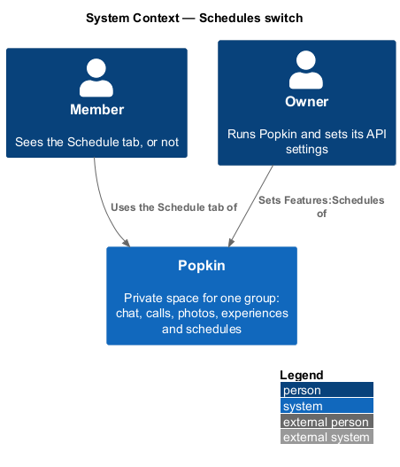
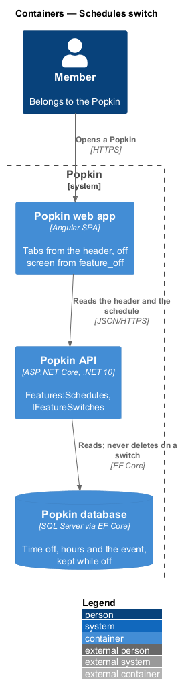
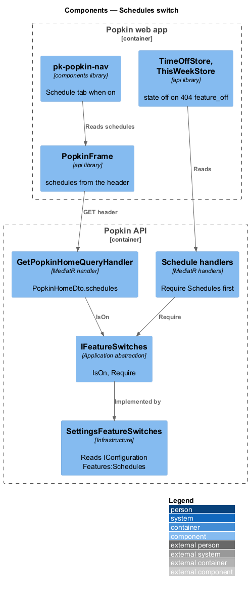
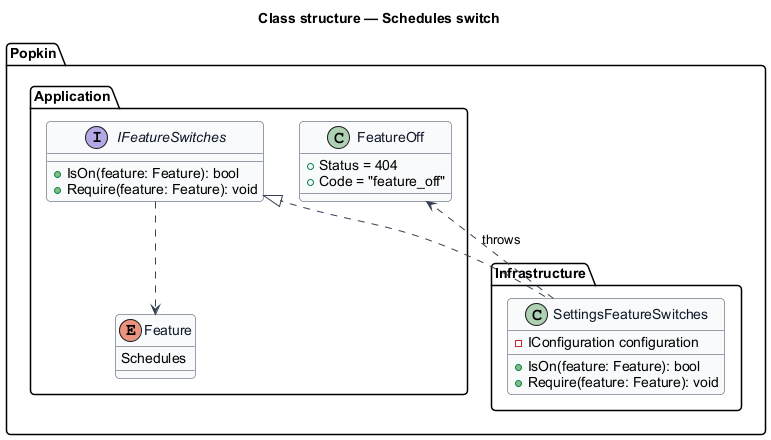
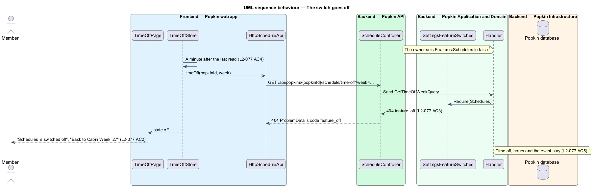

# Schedules switch

## Overview

Popkin is a platform for pop-up communities. Schedules, the tab where a *Popkin*'s members see
when their people are free, is a feature that can be switched on and off for every Popkin at
once. When it is off, the Schedule tab is not there, its screens say so, and the API refuses its
requests, keeping every entry for when it returns.

- **feature switch** — an on/off setting for one feature across every Popkin (L1-019)
- **Schedules** — the feature of [Time off](../time-off/README.md),
  [This week](../this-week/README.md) and [Set the event](../set-the-event/README.md)

L1-019 puts the switch in a separate admin app, which journey 23 builds. Until then the switch is
an API setting, `Features:Schedules`, as [ADR 0023](../../../adr/0023-features-switched-on-by-a-setting.md)
decides for features that are switched on by their owner. Journey 22 builds it.

[Feature switches](../../admin-platform/feature-switches/README.md) replaces the setting with a
switch the admin app keeps, Off, on for chosen Popkins or on for everyone, behind the same
`IFeatureSwitches` ([ADR 0024](../../adr/0024-admins-moderation-and-switches-in-the-database.md)).

## Description

### Screens and states

- Every screen of a Popkin shows the tabs Home, Chat, Schedule, Photos and Experiences when
  Schedules is on, and Home, Chat, Photos and Experiences when it is off (L2-077 AC1). Plan is not
  built, so Schedule follows Chat (L2-072 AC1).
- `docs/mocks/pages/time-off/off.html` — "Schedules is switched off", that the Popkin's host can
  ask Popkin to find out more, and "Back to Cabin Week ’27"; no time off or hours (L2-077 AC2).
  This week shows the same.
- The home leaves its Schedule section out, and the settings menu its "Set the event" row.

### API

- **`Features:Schedules`** — an API setting, off unless `true`, listed in `docs/deployment.md`,
  set by the parameter `schedules` in `infra/main.bicep`. `ApiFactory` and `eng/Start-E2eApi.ps1`
  set it to `true`; the tests of the off state turn it off.
- **`IFeatureSwitches`** (Application) — `IsOn(Feature)` and `Require(Feature)`, which throws
  `404` `feature_off` ("Schedules is switched off."). `SettingsFeatureSwitches` (Infrastructure)
  reads `IConfiguration` at each call, so a changed setting needs no new release. Journey 23
  replaces it with switches kept by the admin app, behind the same interface; no endpoint
  changes.
- Every Schedules endpoint calls `Require(Feature.Schedules)` first, before membership, so
  nothing of the feature answers while it is off (L2-077 AC3). A non-member of a Popkin learns
  only that the feature is off, which says nothing about the Popkin.
- `GET /api/popkins/{popkinId}` (the home header, `PopkinHomeDto`) gains `schedules` (bool), the
  web app's only source for the tab.

### Frontend (`frontend/projects/`)

- **`PopkinFrame.schedules`** — from the header; false until it is read and when it fails.
- **`pk-popkin-nav`** — input `schedule` (bool) adds the Schedule tab between Chat and Photos,
  with the calendar icon; `current` gains `'schedule'`.
- **Every page with tabs** passes `[schedule]="frame.schedules()"`.
- **`TimeOffStore`, `ThisWeekStore`** — a `404` `feature_off` is the state `off`; the page shows
  `pk-empty-state` with "Schedules is switched off" and "Back to {Popkin name}". The stores read
  every 60 seconds while open, so an open screen turns to it within a minute (L2-077 AC4).

### Decisions

- The switch is read on every request (`IConfiguration`), not cached, so turning it off is
  honoured at once by the API and within a minute by an open screen.
- Data is never deleted by the switch (L2-077 AC5).

## Requirements

| L2 ID | Refines (L1) | Requirement |
|-------|--------------|-------------|
| `L2-077` | `L1-019` | A feature that is off: A feature that is off is not there. |
| `L2-072` | `L1-018` | Time off: The Schedule tab opens on time off: a week of the group's days off at a time (AC1). |
| `L2-075` | `L1-017` | Plan and Schedules on the home and in the recap (AC3). |

## Diagrams

The owner switches Schedules in the API's settings; members see the tab or not.

The API reads the setting; the web app reads the header.

The switch's interface, its implementation, and its readers.

`IFeatureSwitches` and the feature enum.

A screen that is open when the switch goes off.

