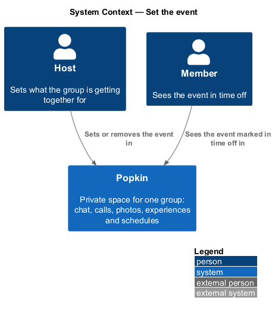
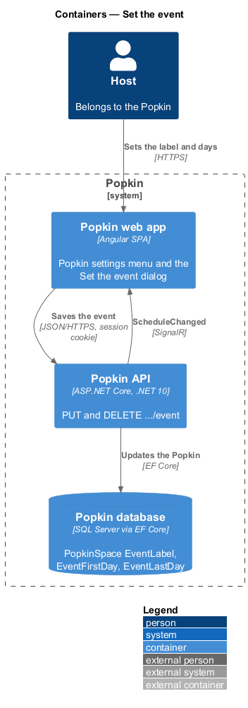
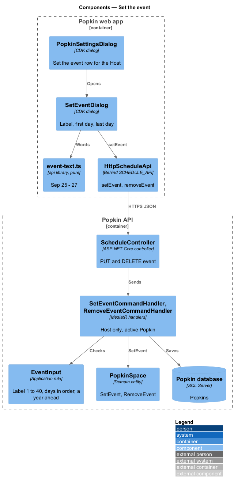
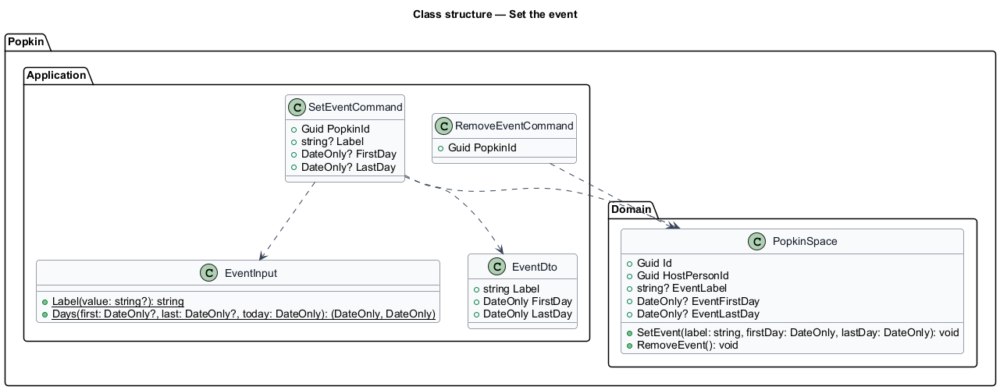
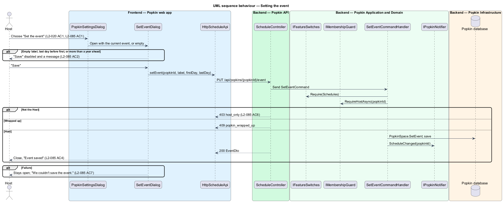

# Set the event

## Overview

Popkin is a platform for pop-up communities. A *Popkin*, a private space for one group, gathers
for some event: a week away, a wedding, a reunion. When Schedules is on, the Host says what the
event is and on which days, so [Time off](../time-off/README.md) can mark its week with a dot,
tint its days and head them with its label, and open on it.

- **event** — what the Popkin is getting together for: a label of at most 40 characters and a
  first and last day; a Popkin has one event or none
- **Host** — the member who started the Popkin; the only member who sets the event

The owner settled what the event is in journey 22 (L2-085): the requirements and designs had
named it without saying where it comes from. "Set the event" is a row of the Host's
[Popkin settings](../../popkins/popkin-settings/README.md) menu while Schedules is on.

## Description

### Screens and states

- `docs/mocks/dialogs/popkin-settings/schedules.html` — the Host's menu: "Edit name and look",
  "Change how long it lasts", "Set the event" ("Lake weekend · Sep 25 – 27", or "Not set"),
  "Invite people", "Wrap up".
- `docs/mocks/dialogs/set-event/default.html` — "Set the event", "What you're getting together
  for. Time off marks its days for everyone.", "Label", "First day", "Last day", "Save" and
  "Remove the event" (only when there is an event).
- `busy.html` — the fields read-only and "Saving…". `invalid.html` — "The last day is before the
  first day." and "Save" disabled. `failed.html` — "We couldn't save the event. What you entered
  is still here. Try again."
- After a save the dialog closes and a success toast reads "Event saved" (`toasts`), and time off
  shows the event.

### Form factors

A bottom sheet below 640 px and a centred dialog above, as every dialog
(`pk-dialog`). Nothing reads the viewport width.

### API

- `PUT /api/popkins/{popkinId}/event` with `{ label, firstDay, lastDay }` → `200` `EventDto`.
- `DELETE /api/popkins/{popkinId}/event` → `204`.
- The event is read with time off (`TimeOffWeekDto.event`) and with the home header
  (`PopkinHomeDto.event`), which the settings menu shows.
- Refusals: `404` `popkin_not_found`; `404` `feature_off`; `403` `host_only`; `409`
  `popkin_wrapped_up`; `400` `invalid_event` on `label` (empty or over 40 characters), on
  `lastDay` (before `firstDay`) and on `firstDay` (more than 365 days after the server's date).
  Writes are counted with messages.
- `ScheduleChanged` follows a save or a removal, so open time-off screens read again.

### Frontend (`frontend/projects/`)

- **`PopkinSettingsDialog`** — adds the "Set the event" row for the Host when the frame says
  Schedules is on, with the event's label and days or "Not set".
- **`SetEventDialog`** (`dialogs/set-event`) — the label field (`maxlength="40"`) and two `date`
  fields set to the event; "Save" disabled with the message of the first rule broken (an empty
  label: "Give the event a label.", the last day before the first, the first day more than a
  year ahead: "The event can be set up to a year ahead."); "Saving…"; the failure alert keeps
  what was entered.
- **`event-text.ts`** (`api`) — "Sep 25 – 27", "Feb 27 – Mar 2", across years "Dec 30 2026 –
  Jan 2 2027".
- **`ScheduleApi.setEvent`, `.removeEvent`**.

### Backend (`backend/src/`)

- **`PopkinSpace.SetEvent(label, firstDay, lastDay)`**, **`RemoveEvent()`** — `EventLabel`,
  `EventFirstDay`, `EventLastDay`, all null together.
- **`SetEventCommand`**, **`RemoveEventCommand`** / handlers — the switch, then
  `RequireHostAsync` and a check that the Popkin is active; `EventInput` checks the label (trimmed,
  1 to 40 characters) and the days; save; `ScheduleChanged`.

### Decisions

- The event is kept with the Popkin when Schedules is off and on again (L2-077 AC5).
- An event has no limit on its length beyond a year ahead for its first day.

## Requirements

| L2 ID | Refines (L1) | Requirement |
|-------|--------------|-------------|
| `L2-085` | `L1-018` | Set the event: The Host says what the group is getting together for and on which days, so time off can mark it. |
| `L2-020` | `L1-006` | Popkin settings: The Host changes how a Popkin looks and how long it lasts (AC1, "Set the event"). |
| `L2-072` | `L1-018` | Time off: The Schedule tab opens on time off: a week of the group's days off at a time (AC3, AC4, AC7, AC8). |

## Diagrams

The Host sets the event; every member sees it in time off.

The web app sends the event to the API, which keeps it with the Popkin.

The settings menu, the dialog and the API's handlers.

The event's three fields live on `PopkinSpace`.

Setting the event.

