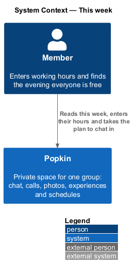
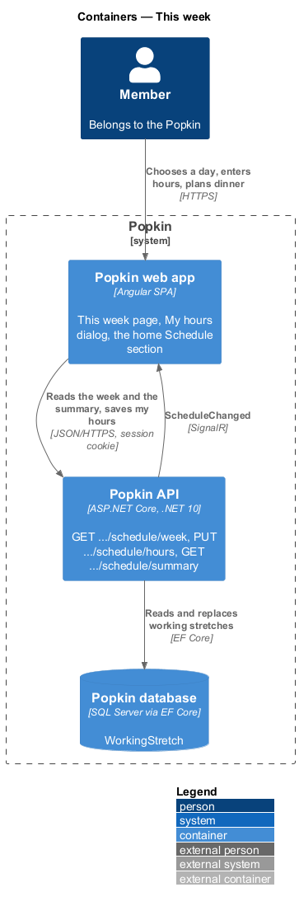
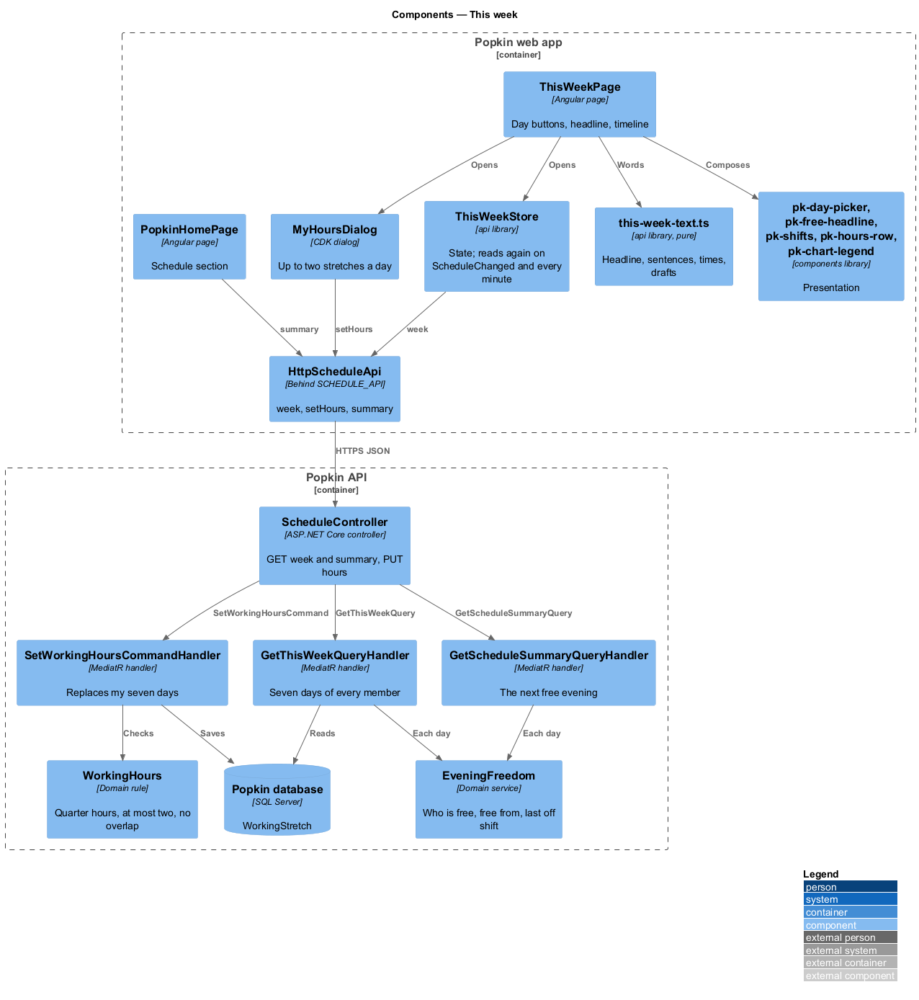
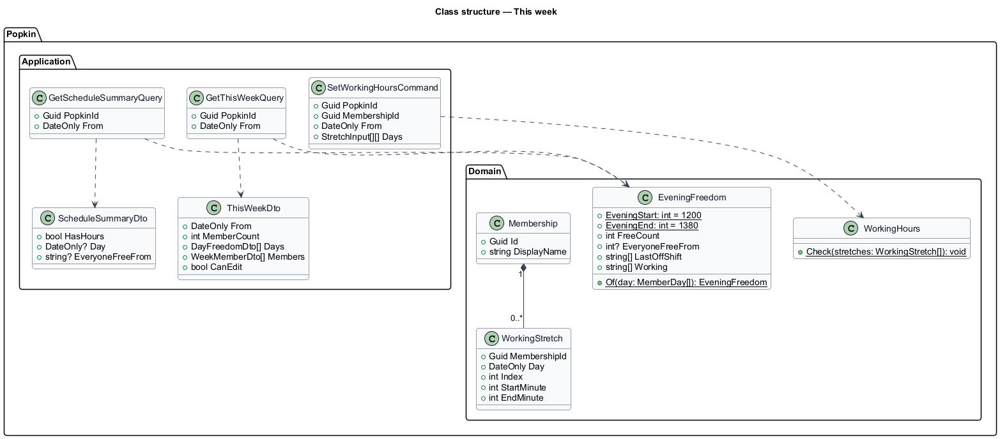
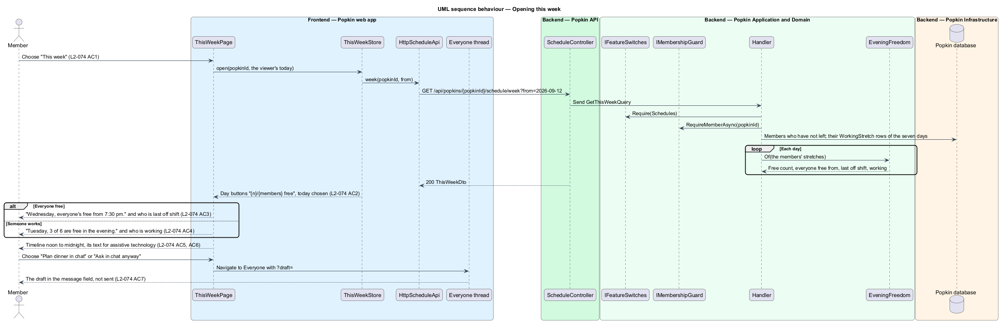
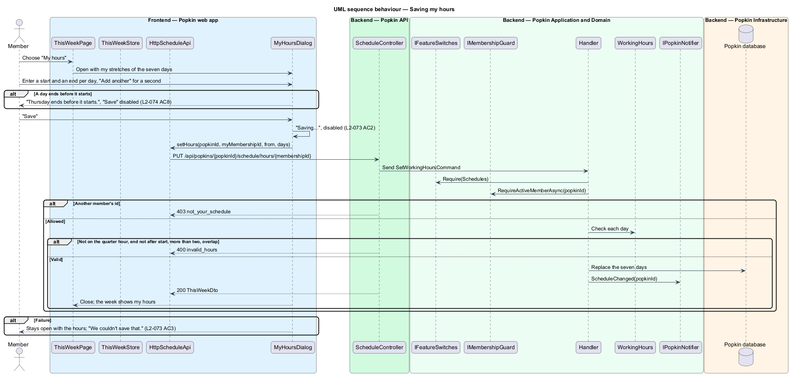

# This week

## Overview

Popkin is a platform for pop-up communities. When Schedules is on, the Schedule tab of a
*Popkin*, a private space for one group, has a second view: **this week**. It shows each
member's working hours over the seven days starting today and finds the evening everyone is
free, so the group can take the plan to chat. Each member enters their own hours with
"My hours". The Popkin home names the next free evening in a "Schedule" section.

- **working hours** — the stretches of a day a member works, at most two a day, each a start and
  an end on the quarter hour; a day with none is a day off
- **free** — not working between 8 and 11 pm
- **everyone's free from** — on a day everyone is free, the latest time any member finishes
  work before the evening, or 5 pm when nobody works past it
- **last off shift** — the member, or members, who finish at that time

This week sits beside [Time off](../time-off/README.md) and exists only while the Schedules
switch is on ([Schedules switch](../schedules-switch/README.md)). Journey 22 builds it.

## Description

### Screens and states

- `docs/mocks/pages/this-week/default.html` — "This week", "Sep 12 – 18 · everyone's working
  hours" and "My hours"; seven day buttons (`ul.day-picker`, links with `aria-pressed`), the
  weekday, the date and "{n}/6 free", Wednesday chosen and "6/6 free" in the Popkin's colour;
  "Free means not working between 8 and 11 pm."; the headline "Wednesday, everyone's free from
  7:30 pm." with "Ellie is the last off shift. The only evening this week all six of you are
  around." and "Plan dinner in chat"; the timeline (`figure.shifts`) from 12 pm to Midnight, a
  row per member, "Working till 5:30 pm" blocks, the tint from 7:30 pm, and its text for
  assistive technology ("Mara: working 9 am to 5:30 pm; …"); the legend "At work" and "All six
  free from 7:30 pm".
- `working.html` — Tuesday: "Tuesday, 3 of 6 are free in the evening.", "Dev, Ellie and Sam are
  working. Wednesday is the one evening everyone is free." and "Ask in chat anyway".
- `empty.html` — nobody has entered hours: every day "6/6 free", no timeline, a line that each
  member adds their own hours, and "My hours" (L2-074 AC9).
- `loading.html`, `error.html` (with "Try again").
- `docs/mocks/dialogs/my-hours/` — `default` ("Your working hours, Sep 12 – 18. Leave a day
  blank if you're not working. Times are on the quarter hour.", a row per day with a start and
  an end, "Add another" under a filled day, "Save"), `busy`, `invalid` ("Thursday ends before it
  starts.") and `failed` ("We couldn't save that. Your hours are still here. Try again.").
- `docs/mocks/pages/popkin-home/schedule.html` and `schedule-none.html` — the home's "Schedule"
  section: "Everyone's free Wednesday from 7:30 pm" or "No evening this week is free for
  everyone", and "See all", which opens this week.

### Form factors

From 1024 px the headline and the chat action sit side by side (`.free`, a row); narrower, the
action is under the headline (L2-074 AC10). The day buttons take the width in seven equal
columns at every width. The timeline's track grows with the screen. On the home the section is
in the side column from 1024 px and in the single column below. Nothing reads the viewport
width.

### API

- `GET /api/popkins/{popkinId}/schedule/week?from=2026-09-12` → `200` `ThisWeekDto`: `from`,
  `memberCount`, `canEdit`, `days` (seven, each `date`, `freeCount`, `everyoneFreeFrom`
  ("19:30") or null, `lastOffShift` (first names), `working` (first names of those working in
  the evening)), and `members` (each `membershipId`, `firstName`, `avatarUrl`, `accent`, `isMe`
  and `days`: seven lists of `{ start, end }` as "HH:mm", the end "24:00" for midnight).
- `PUT /api/popkins/{popkinId}/schedule/hours/{membershipId}` with `{ from, days: [7] }`, each
  a list of at most two `{ start, end }` → `200` `ThisWeekDto`.
- `GET /api/popkins/{popkinId}/schedule/summary?from=2026-09-12` → `200`
  `ScheduleSummaryDto`: `hasHours` (any member has hours in the seven days), `day` (the first
  day everyone is free) or null, and `everyoneFreeFrom` or null.
- Refusals as in [Time off](../time-off/README.md): `404` `popkin_not_found`, `404`
  `feature_off`, `403` `not_your_schedule`, `409` `popkin_wrapped_up`; `400` `invalid_hours` on
  `days` for a time not on the quarter hour, an end not after its start, more than two
  stretches, or stretches that overlap. `ScheduleChanged` follows a save.

### Frontend (`frontend/projects/`)

- **`ThisWeekPage`** (`/p/:popkinId/schedule/week`, `data-page="this-week"`) — the chosen day is
  in the address (`?day=2026-09-16`); without it, today. "My hours" opens `MyHoursDialog`.
  "Plan dinner in chat" or "Ask in chat anyway" navigates to the Everyone thread with the draft
  (`?draft=`), which the composer takes as its text, not sent (L2-074 AC7).
- **`ThisWeekStore`** (`api`) — `open(popkinId, from)`, reads again on `ScheduleChanged`,
  `reconnected$` and every 60 seconds; `state` as in `TimeOffStore`.
- **`this-week-text.ts`** (`api`, pure, unit-tested) — the subtitle, "{n}/{members} free", the
  headline (L2-074 AC3, AC4), the sentence under it, the times ("7:30 pm", "Midnight"), the
  blocks ("Working till 5:30 pm", a stretch past midnight reads "Working"), the timeline's text,
  the legend ("All six free from 7:30 pm"), the chat drafts, the action's words, and the home's
  line.
- **`MyHoursDialog`** (`dialogs/my-hours`) — a row per day, two `time` fields with
  `step="900"`, "Add another" for the second stretch; the first invalid day gives its message
  ("Thursday ends before it starts.") and disables "Save" (L2-074 AC8, L2-073 AC2, AC3).
- **`PopkinHomePage`** — reads the summary when Schedules is on; shows the section when
  `hasHours` (L2-075 AC2, AC3).
- **Components**: `pk-day-picker`, `pk-free-headline` (the `.free` block, with the action as
  its slot), `pk-shifts` (the timeline: ticks, rows, blocks and tint, a visually hidden
  paragraph with the text) and `pk-chart-legend`; the dialog's rows are `pk-hours-row`.

### Backend (`backend/src/`)

- **`WorkingStretch`** (Domain) — `MembershipId`, `Day` (`DateOnly`), `Index` (0 or 1),
  `StartMinute`, `EndMinute` (0 to 1440, multiples of 15); key `(MembershipId, Day, Index)`.
- **`EveningFreedom`** (Domain, unit-tested one case per row) — for one day's stretches of
  every member: who is free (no stretch overlaps 20:00–23:00), `everyoneFreeFrom` (the latest end
  of any stretch that ends by 8 pm, at least 17:00, when everyone is free), `lastOffShift`, `working`.
- **`WorkingHours`** (Domain) — checks a day's stretches (quarter hours, end after start, at most
  two, no overlap).
- **`GetThisWeekQuery`**, **`SetWorkingHoursCommand`**, **`GetScheduleSummaryQuery`** and their
  handlers — the switch, the guard, the member's own id, the rules above; the command replaces
  the seven days, saves and sends `ScheduleChanged`.

### Decisions

- The seven days start on the day the web app sends, the viewer's today.
- "Free" ignores time off: a member on a day off with no hours is free.
- The sentence under the headline: "{Name} is the last off shift." (several: "Ellie and Walt are
  the last off shift."; nobody past 5 pm: "Nobody works past 5 pm."), followed by "The only
  evening this week all {members} of you are around." when no other day is free for everyone;
  on a day someone works, "{names} are working." (one: "is working"), followed by "{Weekday} is
  the one evening everyone is free." when exactly one day is. Numbers of members are words from
  two to twelve ("six"), digits above.
- A stretch may end at midnight ("24:00"), and the timeline clips stretches to noon to midnight.
- The draft goes to the Everyone thread through the address; Everyone keeps it in its composer
  until it is sent or cleared.

## Requirements

| L2 ID | Refines (L1) | Requirement |
|-------|--------------|-------------|
| `L2-074` | `L1-018` | This week: This week finds the evening everyone is free. |
| `L2-075` | `L1-017` | Plan and Schedules on the home and in the recap: The home and the recap show the plan when the features are on (AC2, AC3). |
| `L2-073` | `L1-018` | Add my time off: Each member enters their own time off; nobody enters another's (AC2, AC3, the rules My hours shares). |
| `L2-077` | `L1-019` | A feature that is off: A feature that is off is not there. |
| `L2-051` | `L1-012` | Popkins are private to their members: Membership decides everything a person sees. |

## Diagrams

The system context: members enter their hours and find the evening everyone is free.

The web app reads the week and the summary from the API.

The page, the dialog, the store and the text helpers; the handlers and `EveningFreedom`.

`WorkingStretch` belongs to a membership; `EveningFreedom` reads a day of them.

Opening this week, choosing a day and taking it to chat.

Saving my hours.

