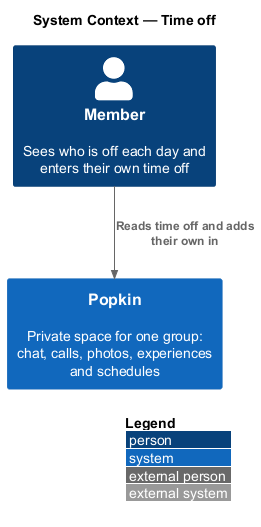
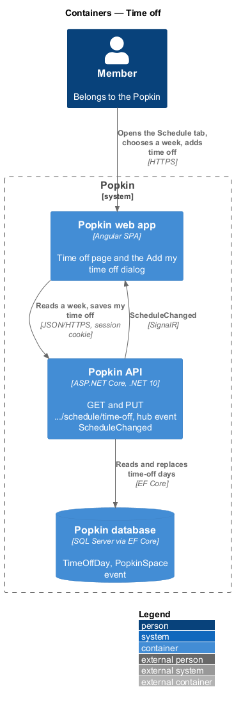
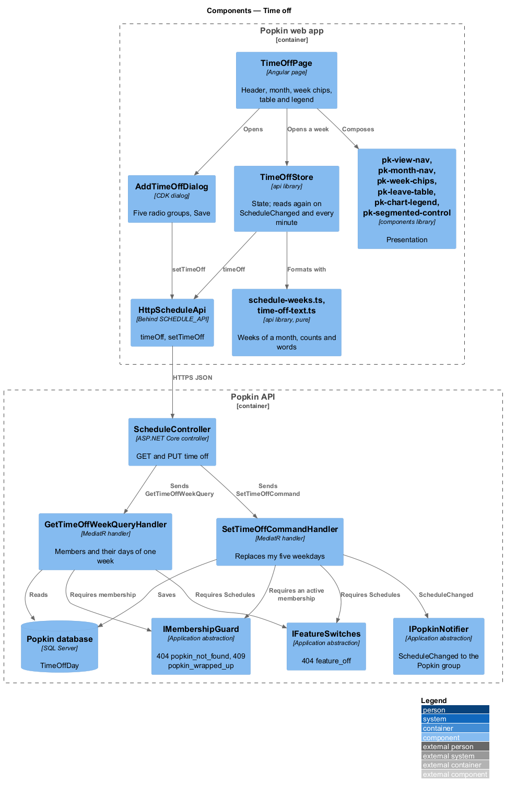
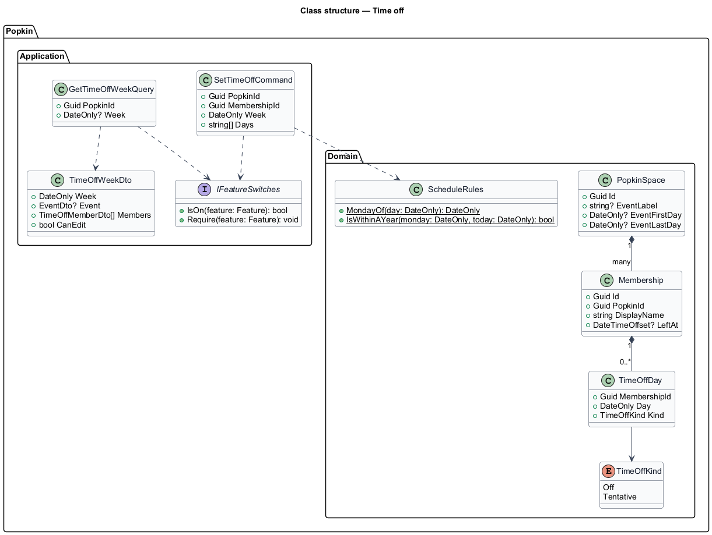
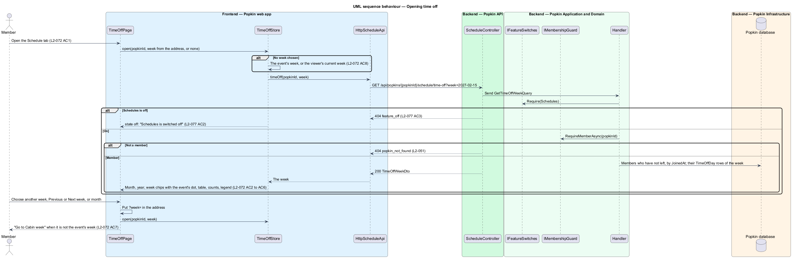
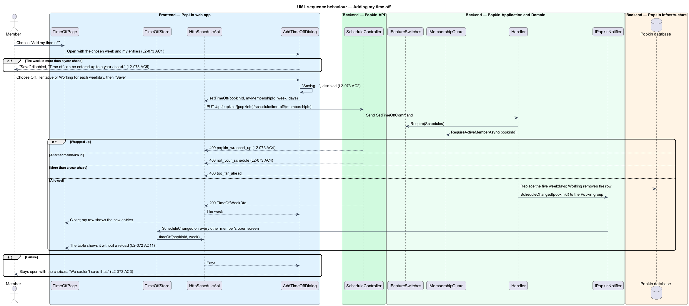

# Time off

## Overview

Popkin is a platform for pop-up communities. When Schedules is on, a *Popkin*, a private space
for one group, has a **Schedule** tab where its members see when their people are free. The tab
opens on **time off**: one week at a time, a row per member and a column per day, each weekday
marked Off, Tentative or Working. Each member enters their own time off with "Add my time off";
nobody enters another's.

- **time off** — a member's days off around the group's event, week by week
- **Off** — a day the member has booked off work
- **Tentative** — a day the member plans to be off but has not confirmed with work
- **Working** — a day the member works; every weekday is Working until the member says otherwise
- **event** — what the Popkin is getting together for, with a label and a first and last day,
  set by the Host ([Set the event](../set-the-event/README.md)); a Popkin may have none
- **week** — Monday to Sunday; a weekend day has no entry and reads "Weekend"

Time off sits beside [This week](../this-week/README.md), the other view of the tab, and both
exist only while the Schedules switch is on ([Schedules switch](../schedules-switch/README.md)).
The Schedule tab follows Plan when Plan is on, and Chat when it is off
([Plan switch](../../plan/plan-switch/README.md), L2-072 AC1). Journey 22 builds it.

## Description

### Screens and states

- `docs/mocks/pages/time-off/default.html` — Cabin Week ’27, six members, the week of
  Feb 15 – 21 2027: the header "Schedule" with the view switch ("Time off" current, "This week")
  and "Add my time off"; "February" between "Previous month" and "Next month", and the year
  "2027" as a label; the week
  chips "Feb 1 – 7" to "Feb 22 – 28", the event's week with a dot and pressed; "Previous week" and
  "Next week"; the table (`table.leave`) with "Cabin week" over the event's days and
  "5 of 6 off" in bold; the legend "Off", "Tentative", "Working", "Event days".
- `empty.html` — nobody has entered time off: every cell "Working", "0 of 6 off", and the line
  "Nobody has added time off yet. Each of you adds your own; the table fills in as you go. Add
  yours to get it started." (L2-072 AC10).
- `confirmed.html` — everyone is Off on the event's days: "6 of 6 off".
- `loading.html` — "Loading time off…" under the header. `error.html` — a failure with "Try
  again". `off.html` — Schedules is switched off ([Schedules switch](../schedules-switch/README.md)).
- `docs/mocks/dialogs/add-time-off/` — `default` ("Your week of Feb 15 – 19.", the Tentative
  line, five weekdays, each a radio group Off / Tentative / Working, "Save"), `busy` ("Saving…"),
  `invalid` (a week more than a year ahead: "That's more than a year ahead. Time off can be
  entered up to a year ahead. Pick a nearer week.", "Save" disabled) and `failed` ("We couldn't
  save that. Your choices are still here. Try again.").

### Form factors

Below 640 px the table scrolls sideways inside `.table-wrap`, its member column fixed on the
left (`position: sticky`), and the page does not scroll sideways (L2-072 AC9). From 640 px the
whole week fits. The tabs follow `pk-popkin-nav`: along the bottom on a phone, a rail from
768 px and a sidebar from 1024 px (L2-058 AC8). The dialog is a bottom sheet below 640 px and a
centred dialog above. Nothing reads the viewport width.

### API

- `GET /api/popkins/{popkinId}/schedule/time-off?week=2027-02-15` → `200` `TimeOffWeekDto`:
  `week` (the Monday asked for; any other day is moved back to its Monday), `event`
  (`EventDto` or null: `label`, `firstDay`, `lastDay`), `members` (each a `membershipId`, a
  `firstName`, an `avatar` (`initials`, `accent`, `photoUrl`, as everywhere else a member is
  drawn), `isMe`, and `days`: seven entries, `Off`, `Tentative`, `Working` or `Weekend`), and
  `canEdit` (the Popkin is active). Without `week` the API answers the event's week, or else the
  week of `today`, the viewer's date the web app sends, or of the server's date without one
  (L2-072 AC8).
- `PUT /api/popkins/{popkinId}/schedule/time-off/{membershipId}` with `{ week, days: [5] }`
  (Monday to Friday, each `Off`, `Tentative` or `Working`) → `200` `TimeOffWeekDto` of that
  week. "Working" removes the day's entry.
- Refusals: `401` without a session; `404` `popkin_not_found` (L2-051); `404` `feature_off`
  when Schedules is off (L2-077 AC3); `403` `not_your_schedule` for another member's
  `membershipId` (L2-073 AC4); `409` `popkin_wrapped_up` (L2-045 AC2); `400` `too_far_ahead`
  on `week` when its Monday is more than 365 days after the server's date (L2-073 AC5); `400`
  `invalid_time_off` on `days` for anything but five known values. Writes are counted with
  messages (`RateLimitPolicyNames.Messages`, 60 a minute per person).
- Hub: `ScheduleChanged(popkinId)`, a fact event sent to the Popkin's group after a save. It
  carries nothing but the Popkin; the recovery read is the `GET` of the week on screen
  (L2-072 AC11).

### Frontend (`frontend/projects/`)

- **`TimeOffPage`** (`/p/:popkinId/schedule`, `data-page="time-off"`) — composes
  `pk-app-screen`, the Schedule header, `pk-month-nav`, `pk-week-chips`, `pk-leave-table` and
  the legend, and `pk-popkin-nav` with `current="schedule"`. The chosen week is in the address
  (`?week=2027-02-15`), so a reload keeps it. "Add my time off" opens `AddTimeOffDialog`.
- **`TimeOffStore`** (`api`) — `open(popkinId, week)`, `state` (`loading`, `ready`, `error`,
  `off`, `not-found`), the `view`; it reads the week again on `ScheduleChanged` and on
  `reconnected$`, and every 60 seconds while open, so a switch turned off reaches an open screen
  within a minute (L2-077 AC4).
- **`schedule-weeks.ts`** (`api`, pure, unit-tested) — the weeks of a month as chips
  ("Feb 15 – 21", a week belongs to the month of its Monday), the month and year of a week, the
  next and previous week and month, the event's week and whether a day is the event's.
- **`time-off-text.ts`** (`api`, pure, unit-tested) — "{n} of {members} off", whether the count
  is bold (every member but at most one off, L2-072 AC6), "Weekend", and "Go to {label}".
- **`AddTimeOffDialog`** (`dialogs/add-time-off`) — five radio groups set to the member's
  entries; "Save" disabled with the "more than a year ahead" message when the week's Monday is
  more than 365 days after the viewer's today; "Saving…" while it runs; the failure alert keeps
  the choices (L2-073).
- **`SCHEDULE_API`** / **`HttpScheduleApi`** — `timeOff`, `setTimeOff`, and the reads and
  writes of [This week](../this-week/README.md) and [Set the event](../set-the-event/README.md).
- **Components**: `pk-view-nav` (the "Time off" / "This week" switch, links with
  `aria-current`), `pk-month-nav`, `pk-week-chips` (links with `aria-pressed`, the event's dot as
  an image named "Event this week"), `pk-leave-table` (`table.leave` with `caption`, `th
  scope`, cells `leave__cell--off`, `--tentative`, a weekend cell named "Weekend") and
  `pk-chart-legend`. Each weekday of the dialog is a `pk-segmented-control` (`role="radiogroup"`, options `role="radio"` with `aria-checked`).

### Backend (`backend/src/`)

- **`TimeOffDay`** (Domain) — `MembershipId`, `Day` (`DateOnly`), `Kind` (`Off` or
  `Tentative`); key `(MembershipId, Day)`. A weekday with no row is Working.
- **`PopkinSpace` event** — `EventLabel`, `EventFirstDay`, `EventLastDay`
  ([Set the event](../set-the-event/README.md)).
- **`GetTimeOffWeekQuery`** / handler — `IFeatureSwitches.Require(Feature.Schedules)`, then
  `IMembershipGuard.RequireMemberAsync`; reads the members who have not left, by `JoinedAt`, and
  their entries in the week.
- **`SetTimeOffCommand`** / handler — the switch, then `RequireActiveMemberAsync`; refuses
  another member's id with `403` `not_your_schedule`; checks the week (`ScheduleRules`); replaces
  the five days; saves; sends `ScheduleChanged`; answers the week as the query does.
- **`ScheduleRules`** (Domain) — `MondayOf(day)`, `IsWithinAYear(monday, today)`.
- A member who leaves (L2-047) or whose account is erased (L2-049) has their time off and hours
  removed in the same save, and stops being a row.

### Decisions

- A day is a calendar date, the same for every member; "today" and "the current week" are the
  viewer's own, sent by the web app (L2-072).
- The count is bold when every member but at most one is off (L2-072 AC6, "five of six").
- A week belongs to the month of its Monday; "Previous month" and "Next month" choose the first
  week of that month.
- A member who has left is not a row and is not counted.
- Saving "Working" for a day removes the day's entry; nothing is stored for Working.

### Open points

- A group across time zones sees one calendar date for everyone; a member's day is not converted.

## Requirements

| L2 ID | Refines (L1) | Requirement |
|-------|--------------|-------------|
| `L2-072` | `L1-018` | Time off: The Schedule tab opens on time off: a week of the group's days off at a time. |
| `L2-073` | `L1-018` | Add my time off: Each member enters their own time off; nobody enters another's. |
| `L2-077` | `L1-019` | A feature that is off: A feature that is off is not there. |
| `L2-045` | `L1-011` | A wrapped-up Popkin is read-only: Nothing new is added to a Popkin that has ended. |
| `L2-051` | `L1-012` | Popkins are private to their members: Membership decides everything a person sees. |

## Diagrams

The system context: members see each other's time off, and each enters their own.

The web app reads a week from the API, which reads the database and tells the other members
through the hub.

The page, its store and the pure helpers on the web side; the controller, two handlers, the
switch and the guard on the API side.

`TimeOffDay` belongs to a membership; the event belongs to the Popkin.

Opening time off and moving between weeks.

Adding my time off, and another member's table following without a reload.

