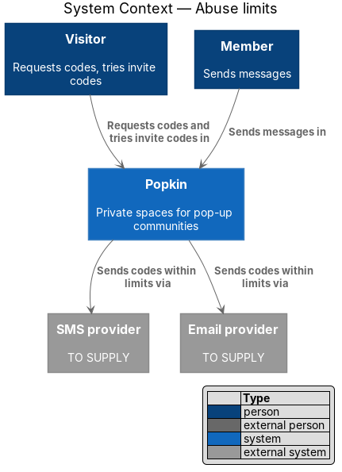
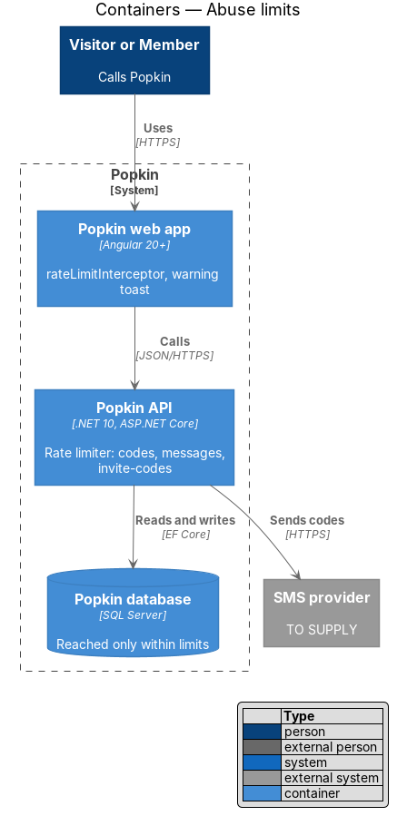
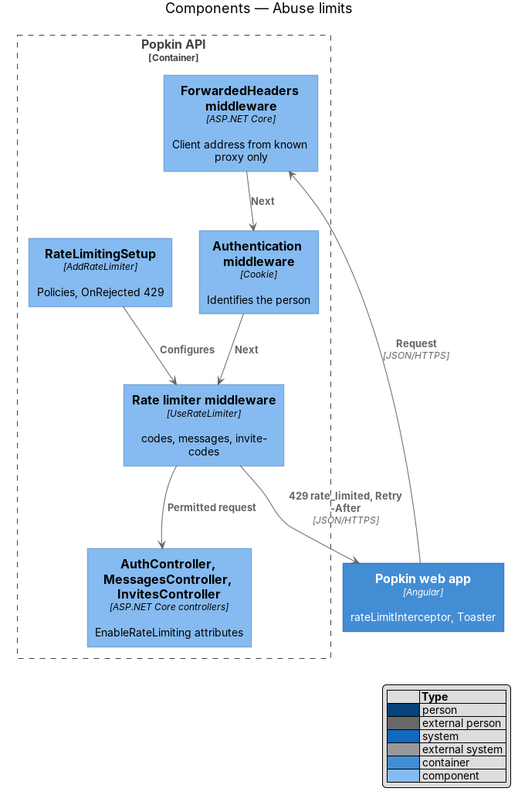
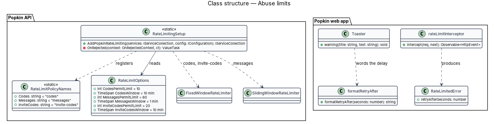
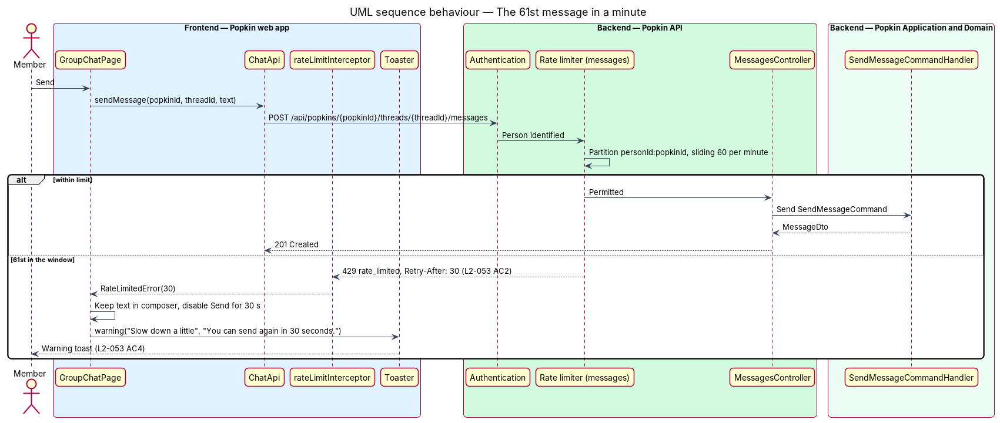
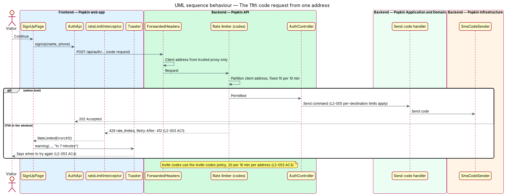

# Abuse limits

## Overview

Popkin is free and needs no password, so its most exposed operations cost nothing to call: asking
for a six-digit code, guessing an invite code and sending messages. Without limits, one person
could flood a phone with codes, enumerate invite codes or drown a chat. This feature is the
mechanism that caps those three operations per address or per member, and tells the person when
they can try again. It has no screen of its own; it shows through a toast.

**rate limit** — maximum number of requests of one kind that one partition may make in one
window

**partition** — the key a rate limit counts by: the client address or the person

**client address** — IP address of the person's device as seen by the Popkin API after the
trusted reverse proxy has forwarded it. The proxy is the one of
[ADR 0013](../../../adr/0013-deployment-shape.md), named to the API by `Proxy:KnownProxies` and
`Proxy:KnownNetworks`

**retry delay** — number of seconds until the partition may try again, sent in the `Retry-After`
header

The limits come from L2-053:

| Policy | Partition | Limit | Window |
|--------|-----------|-------|--------|
| Code requests | client address | 10 | 10 minutes |
| Messages | person | 60 | 1 minute |
| Invite codes tried | client address | 20 | 10 minutes |
| Call signals | hub connection | 600 | 1 minute |
| Photo uploads | person | 60 | 1 minute |

The first three limits are L2-053's. The fourth protects one member's browser from another's:
`SendSignal` relays a payload from one participant to another
([Group call](../../calls/group-call/README.md)), and L2-053 says one person cannot flood another.
Its value is a design value, well above what setting up a call with 12 people needs. The fifth
keeps one person from filling an album or the photo store
([Add photos](../../photos/add-photos/README.md)). L2-053 names no limit for photos, so its
value is a design value too: three full selections of 20 photos in a minute.

These limits sit beside the per-destination limits of L2-005 (five codes per phone number or
email per hour, five wrong attempts per code). Those are counted in the database by
[Confirm the code](../../accounts/confirm-code/README.md) and are not repeated here.

## Description

### Screens and states

- `docs/mocks/notifications/toast/warning.html` — over the Everyone thread, a warning toast "Slow
  down a little" with "You can send again in 30 seconds." (L2-053 AC2, AC4). L2-053 AC2 says the
  composer says to slow down; the mock places that message in a toast above the composer, and the
  design follows the mock.
- `docs/mocks/pages/verify-code/default.html` and `docs/mocks/pages/join-code/default.html` — the
  screens that send code requests and invite codes. Their rate-limited state is not drawn; the
  design shows the same warning toast there with the retry delay. A dedicated mock state is
  `<TO SUPPLY>` if the toast is not the intended treatment.

### API

The mechanism adds no endpoint. A refused request answers:

- `429` `rate_limited` — ProblemDetails with `code: "rate_limited"` and the extension
  `retryAfterSeconds`, plus the header `Retry-After: <seconds>` (L2-053 AC1, AC4).

Policies apply to these endpoints, whose exact paths belong to the designs named:

| Policy | Endpoints |
|--------|-----------|
| `codes` | the sign-up, sign-in and resend endpoints under `/api/auth` that send a code ([Sign up](../../accounts/sign-up/README.md), [Sign in](../../accounts/sign-in/README.md), [Confirm the code](../../accounts/confirm-code/README.md)) |
| `messages` | `POST /api/popkins/{popkinId}/threads/{threadId}/messages` ([Send a message to everyone](../../chat/send-message-to-everyone/README.md), [Direct messages](../../chat/direct-messages/README.md)) |
| `invite-codes` | `GET /api/invites/{code}` and `POST /api/invites/{code}/join` ([Preview an invite](../../invitations/preview-invite/README.md), [Join by code](../../invitations/join-by-code/README.md)) |
| `address-checks` | `GET /api/addresses/{address}` ([Choose the address](../../popkins/choose-address/README.md)) |
| `photos` | `POST /api/popkins/{popkinId}/photos` ([Add photos](../../photos/add-photos/README.md)) |

### Backend — Popkin API

- **`RateLimitPolicyNames`** (`Popkin.Api/RateLimiting/`) — introduced static class of constant
  policy names: `Codes = "codes"`, `Messages = "messages"`, `InviteCodes = "invite-codes"`, and, for L2-067 AC7,
  `AddressChecks = "address-checks"`, and, for photo uploads, `Photos = "photos"`. The
  shared architecture names this `IRateLimitPolicy`; a static class of constants is the .NET
  convention for policy names, so the design uses it instead.
- **`RateLimitingSetup.AddPopkinRateLimiting(IServiceCollection)`** — introduced extension called
  from `Program.cs`. It configures `AddRateLimiter` with five policies:
  - `codes` — `FixedWindowRateLimiter`, `PermitLimit = 10`, `Window = 10 min`, `QueueLimit = 0`,
    partitioned by client address (L2-053 AC1).
  - `messages` — `SlidingLogRateLimiter` (`Popkin.Api/RateLimiting/`), 60 permits in any one
    minute, no queue, partitioned by the person id of the session (L2-053 AC2); a request
    without a session is not counted, and authorisation refuses it. The limiter keeps the time
    of each permit and reads the clock from `TimeProvider`: unlike a fixed window it cannot be
    doubled across the boundary of two windows, and unlike the framework's segmented sliding
    window it knows to the second when the oldest permit ages out, so `Retry-After` is exact.
    One count per person covers every Popkin they are in.
  - `invite-codes` — `FixedWindowRateLimiter`, `PermitLimit = 20`, `Window = 10 min`,
    `QueueLimit = 0`, partitioned by client address (L2-053 AC3).
  - `address-checks` — `SlidingWindowRateLimiter`, `PermitLimit = 30`, `Window = 1 min`,
    `SegmentsPerWindow = 6`, `QueueLimit = 0`, partitioned by the person id from the session
    (L2-067 AC7). It also bounds how fast one person can learn which addresses are taken.
  - `photos` — the same `SlidingLogRateLimiter` as `messages`, 60 permits in any one minute, no
    queue, partitioned by the person id of the session. Every upload that reaches the limiter
    is counted, a refused one too (a file too large, a type not allowed), so trying files over
    and over is bounded as well. One count per person covers every Popkin they are in.
  Values bind from configuration section `RateLimits` to `RateLimitOptions`, with these defaults, so operations can tune
  them without a build.
- **`OnRejected`** — sets status `429`, reads `MetadataName.RetryAfter` from the lease, writes the
  `Retry-After` header in whole seconds rounded up, and writes the ProblemDetails above through
  `IProblemDetailsService`. It logs the policy name and partition kind, never the address or the
  person id in clear (see [Personal data protection](../personal-data-protection/README.md)).
- **Controllers** — the actions above carry
  `[EnableRateLimiting(RateLimitPolicyNames.Codes)]`, `…Messages`, `…InviteCodes` and
  `…Photos`.
- **Pipeline order** — `UseRateLimiter()` runs after `UseRouting()` (so endpoint metadata is known)
  and after `UseAuthentication()` (so the `messages` partition can read the person id), and before
  `UseAuthorization()`.
- **`ForwardedHeadersSetup.AddPopkinForwardedHeaders` / `UsePopkinForwardedHeaders`**
  (`Popkin.Api/Proxy/`) — `UseForwardedHeaders()` runs first in the pipeline, before the request
  log, HSTS and the HTTPS redirect. It reads `X-Forwarded-For` and `X-Forwarded-Proto`, one hop,
  and only from the addresses in `Proxy:KnownProxies` and the networks in `Proxy:KnownNetworks`
  (CIDR); the framework's default trust of loopback is removed. A request from any other address
  keeps the address of its connection, so a client cannot choose its own address through
  `X-Forwarded-For`. With neither setting, forwarded headers are ignored altogether, which is
  right for the local API and wrong behind a proxy: there every person would share the proxy's
  address and one allowance of 10 codes, and the HTTPS redirect would loop. The deployment
  document names both settings as required ([`docs/deployment.md`](../../../deployment.md)).
- **Scale-out** — ASP.NET Core's limiters count in process memory. Popkin runs one API instance
  ([ADR 0009](../../../adr/0009-one-api-instance.md)), so each limit is the limit. More than one
  instance needs a shared counter store first, by the record that supersedes ADR 0009.
- **Real-time messages** — messages are sent over HTTP, not through `PopkinHub`, so the
  `messages` policy covers every message. Should a hub method ever accept messages, it applies
  the same limiter through `PartitionedRateLimiter` in the hub filter.
- **Call signals** — `SignalRateLimitFilter`, an `IHubFilter`, applies a token bucket of 600
  signals a minute per connection to `SendSignal`. A refused signal fails the hub call with
  `rate_limited`; it is never dropped silently, because a signal is an edge that must arrive or
  fail visibly.
- **Measurement** — `OnRejected` and the hub filter add one to the counter
  `popkin.rate_limit.rejections`, with the policy name as its only dimension
  ([ADR 0012](../../../adr/0012-opentelemetry.md)). The partition is never a dimension. The
  counter is not built yet.

### Frontend — Popkin web app

- **`rateLimitInterceptor`** (`frontend/projects/api/src/lib/api/rate-limit.interceptor.ts`) —
  introduced `HttpInterceptorFn`. On a `429` it turns the response into a `RateLimitedError`
  carrying `retryAfterSeconds` (from the header, else from the body).
- **`formatRetryAfter(seconds: number): string`** (`frontend/projects/api/src/lib/api/`) —
  introduced pure helper: "in 30 seconds", "in 1 minute", "in 9 minutes", rounding up to whole
  minutes from 60 seconds (L2-053 AC4).
- **`Toaster`** (`frontend/projects/popkin/src/app/toasts/`) — shows `pk-toast` (warning) with the
  title "Slow down a little" and the line "You can send again {formatRetryAfter}." for messages.
  The title and line for code requests and invite codes are `<TO SUPPLY>`. A warning toast stays
  until dismissed (L2-056 AC7 treats it as a failure message).
- **`GroupChatPage`** and **`DirectMessagePage`** — lose nothing typed on a `429`: the message
  stays in the thread marked "Not sent" with "Try again" and "Delete", the queue of its thread
  holds behind it, and the warning toast says when to send again
  ([Failed messages](../../chat/failed-messages/README.md)). Send is not disabled for the retry
  delay; a message sent too soon is refused again with a new delay.
- **`VerifyCodePage`**, **`SignUpPage`**, **`SignInPage`** and **`JoinCodePage`** — show the toast
  and disable the submitting action until the retry delay has passed.

### Built in steps

The limits were built with the journeys that needed them, and part of this design waits:

- `codes-per-address` (this design's `codes`) with sign up, journey 1; `invite-codes` with
  joining, journey 2; `messages` with the Everyone thread, journey 3; `photos` with the album,
  journey 5. The policies and
  `OnRejected` are registered by `RateLimitPolicyNames.AddPopkinRateLimits`, which stands where
  this design names `RateLimitingSetup`.
- The values are constants there; binding them from the `RateLimits` section is not built.
- `UseForwardedHeaders` and the `Proxy:` settings are not built
  ([`docs/deployment.md`](../../../deployment.md)); until then the address limits count by the
  address of the connection.
- The counter `popkin.rate_limit.rejections` is not built.
- The web app has no `rateLimitInterceptor` and no `formatRetryAfter`: `toApiProblem` reads
  `retryAfterSeconds` from the answer's body and each page words the delay.
- The call-signal limit: with the group call, journey 7.

## Requirements

| L2 ID | Refines (L1) | Requirement |
|-------|--------------|-------------|
| `L2-053` | `L1-012` | Abuse is limited: One person cannot flood the system or another person. |
| `L2-067` | `L1-012` | Addresses are safe: An address per Popkin must not weaken the privacy of a Popkin or the session of a person. This feature realises AC7. |

## Diagrams

### System context

A person, signed in or not, calls Popkin; Popkin refuses calls beyond the limits before they
reach the SMS or email provider or the database.

### Containers

The rate limiter runs inside the Popkin API, in front of the controllers; the web app explains a
refusal with a toast.

### Components

`UseForwardedHeaders` fixes the client address, the authentication middleware identifies the
member, and the rate limiter middleware applies the endpoint's policy before any controller runs.

### Class structure

`RateLimitingSetup` builds the three policies named in `RateLimitPolicyNames`; the web app's
interceptor produces `RateLimitedError` and `formatRetryAfter` words the delay.

### Behaviour — the 61st message in a minute

A representative request, a message from a member who has sent 60 in the last minute, is refused
with `429` and `Retry-After`; the toast says when to try again (L2-053 AC2, AC4).

### Behaviour — the 11th code request from one address

Code requests beyond 10 in 10 minutes from one address are refused before any code is sent
(L2-053 AC1); invite codes follow the same path with their own policy (L2-053 AC3).

