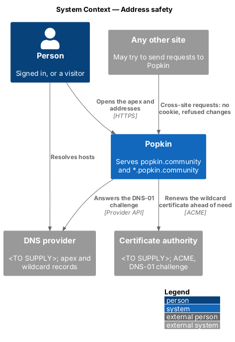
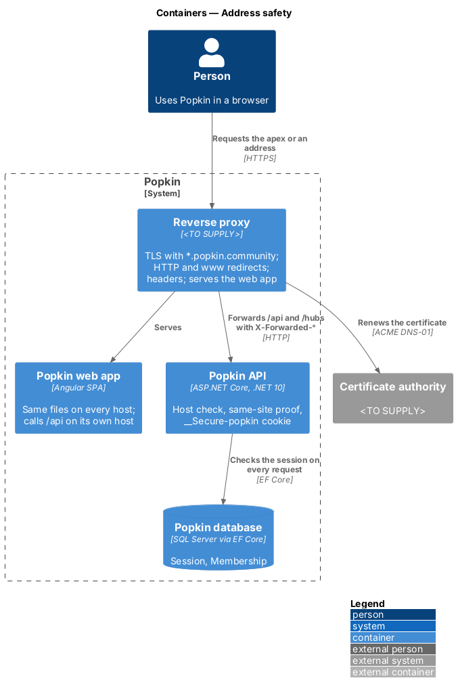
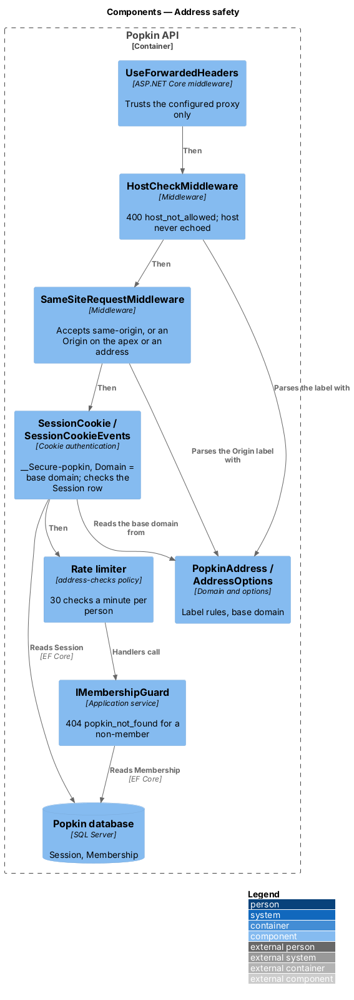
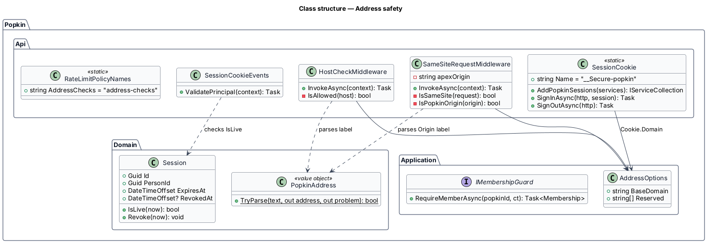
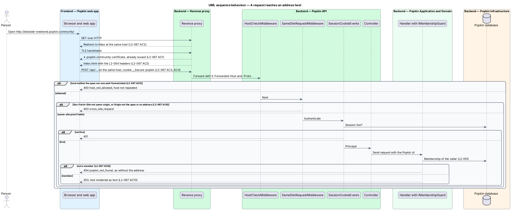
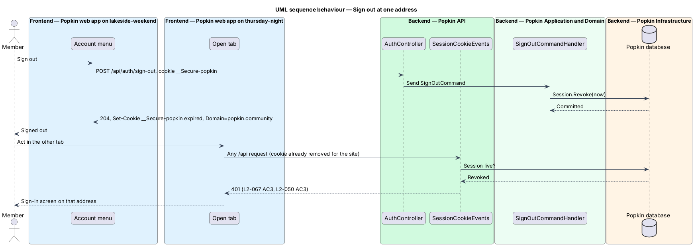

# Address safety

## Overview

Popkin is a platform for pop-up communities, and a Popkin is private to its members
(L1-012). Every Popkin has its own address, `https://{address}.popkin.community` (L1-016). One
host per Popkin changes the web's unit of trust, the origin: the web app, its session and its
requests now span many hosts instead of one. This feature keeps the privacy of a Popkin and the
session of a person as strong across those hosts as they were on one.

- **origin** — scheme, host and port of a URL; browsers isolate storage and scripts by it
- **site** — registrable domain of a host, here `popkin.community`; every address host is on the same site
- **wildcard certificate** — TLS certificate valid for every one-label host under a domain, such as `*.popkin.community`
- **host check** — refusal of a request whose `Host` is neither the apex nor one well-formed label under it
- **apex** — `popkin.community` itself

The design changes four existing mechanisms rather than adding a new one: the reverse proxy
answers on every address host with a certificate issued before any Popkin exists; the session
cookie moves from one host to the whole site; the same-site proof accepts any address host as an
origin; and a host check replaces `AllowedHosts: "*"`. Authorisation does not change: membership
alone decides what a person sees, and a host never grants access (L2-051).

## Description

### Screens and states

None of its own. The rate-limited state of the address field belongs to
[Choose the address](../../popkins/choose-address/README.md); the not-found screen serves a
refused host where the browser reaches the web app at all.

### Reverse proxy and DNS (deployment)

- **DNS** — an `A`/`AAAA` record for `popkin.community` and a wildcard record for
  `*.popkin.community`, both to the proxy. The DNS provider is `<TO SUPPLY>`.
- **Certificate** — one certificate for `popkin.community` and `*.popkin.community`, issued and
  renewed before it is needed through ACME with the DNS-01 challenge, which a wildcard requires.
  A new Popkin is served under the existing certificate at once; nobody waits for one to be
  issued (L2-067 AC1). The certificate authority and the renewal job are `<TO SUPPLY>`.
- **HTTP** — every request over HTTP to the apex or an address host is redirected to HTTPS at the
  same host and path (L2-067 AC2). `Strict-Transport-Security` on the apex carries
  `includeSubDomains`, so a browser that has seen the apex never tries an address over HTTP.
- **`www`** — `www.popkin.community` is redirected to `https://popkin.community` with the same
  path (L2-064 AC7).
- **Hosts more than one label deep** — the wildcard certificate does not cover
  `a.b.popkin.community`, so the browser refuses the connection before the proxy answers. L2-064
  AC7 asks for the not-found screen there; the design follows L2-067 AC5, which refuses such a
  host. A certificate for deeper hosts would settle the conflict and is `<TO SUPPLY>`.
- **Web app and API on every host** — the proxy serves the built web app and forwards `/api` and
  `/hubs` to the Popkin API for the apex and every address host, so each host is one origin, as
  ADR 0013 requires of the one host it described. The content security policy stays `'self'`.
- **Response headers** — the headers of L2-054 ([Personal data
  protection](../personal-data-protection/README.md)) are copied by the proxy onto the web app's
  files and set by the API on its responses, at every host (L2-067 AC2).
- **Nothing else under the site** — no other service, page or file host may be served under
  `popkin.community`. The session cookie goes to every host on the site; a host outside Popkin's
  control would receive it.

### Backend — Popkin API

- **`HostCheckMiddleware`** (`Popkin.Api/Hosting/`, introduced) — runs straight after
  `UseForwardedHeaders()`, before the request log. It accepts a request whose host, without its
  port, is `AddressOptions.BaseDomain` or one label under it that `PopkinAddress.TryParse`
  accepts. Any other request, including a host more than one label deep, receives `400`
  ProblemDetails with `code` `host_not_allowed` and a fixed title; nothing in the response repeats
  the host (L2-067 AC5). It replaces `"AllowedHosts": "*"` in `appsettings.json`; ASP.NET Core's
  `HostFilteringMiddleware` checks names against patterns but not the label rules, and answers
  plain text. Reserved words pass the host check, as they are well-formed labels; the web app and
  `GET /api/popkins/at/{address}` treat them as not an address
  ([Open a Popkin by its address](../../popkins/open-by-address/README.md)).
- **Session cookie** (`SessionCookie`, changed) — the name moves from `__Host-popkin` to
  `__Secure-popkin`, and `Cookie.Domain` is set to `AddressOptions.BaseDomain`. The cookie stays
  `HttpOnly`, `Secure`, `SameSite=Strict` and `Path=/` (L2-067 AC4, L2-007 AC4). A request from
  one address to another is same-site, so the Strict cookie goes with it, while a request from any
  other site carries no cookie. The `__Host-` prefix forbids a `Domain` attribute, so it cannot
  serve the whole site; `__Secure-` keeps the browser's guarantee that only HTTPS sets the cookie.
  One cookie for the whole site means a person signed in at the apex is signed in at every
  address (L2-067 AC3). The design reverses the reason for `__Host-` given in
  [Sessions](../../accounts/sessions/README.md) and records it there.
- **Sign out at any address** — `SessionCookie.SignOutAsync` deletes the cookie with the same
  `Domain`, and the sign-out handler revokes the `Session` row. `SessionCookieEvents` checks the
  row on every request, so the session stops at every address at once, in every tab
  (L2-067 AC3, L2-050 AC3).
- **Existing sessions** — a `__Host-popkin` cookie set before the change is not read after it;
  each person signs in once more. Popkin has no deployment yet, so the design accepts this.
- **Development** — browsers refuse a `Domain=localhost` attribute, so with `BaseDomain`
  `localhost` the cookie is set without a `Domain` and each address host signs in on its own.
  Whether development needs one session across `*.localhost` hosts is `<TO SUPPLY>`.
- **Same-site proof** (`SameSiteRequestMiddleware`, changed) — `Sec-Fetch-Site: same-origin` is
  still the first proof; the web app calls `/api` on its own host, so its requests are
  same-origin on every address. Where a client sends no fetch metadata, `Origin` is accepted when
  it is `App:Origin` (the apex origin) or the same scheme and port with one well-formed label in
  front of the apex host. Any other origin receives `403` `cross_site_request` (L2-067 AC6,
  L2-050 AC2). `Sec-Fetch-Site: same-site` stays refused: the web app never sends a change to
  another address.
- **Authorisation** (unchanged) — every Popkin read and write takes the Popkin's id and calls
  `IMembershipGuard`, whatever host the request came to. A non-member who asks for anything of a
  Popkin through its address receives `404` `popkin_not_found` exactly as without the address
  (L2-067 AC9, L2-051).
- **Address checks** — `GET /api/addresses/{address}` answers `401` to a visitor through the
  fallback policy (L2-067 AC8) and is limited to 30 checks a minute per person by the
  `address-checks` policy (L2-067 AC7); see [Choose the address](../../popkins/choose-address/README.md)
  and [Abuse limits](../abuse-limits/README.md).
- **Telemetry** (ADR 0012) — the request log, the metrics and the spans record the route
  template and never the `Host` header or an address. An address in the log would record which
  Popkin a person visited. `HostCheckMiddleware` counts a refusal on
  `popkin.host_check.rejections`, with no dimension.

### Frontend — Popkin web app

- **Text, never markup** — every address the web app shows, in the address field, on the created
  screen, in the invite dialog and in Edit name and look, is bound as text through interpolation
  (L2-067 AC10, L2-052 AC2). An address is only ever a `PopkinAddress` the API has parsed, so it
  holds no character outside `a-z`, `0-9` and `-`.
- **Links** — an `href` to an address is built by `PopkinUrls` from `BASE_DOMAIN` and a parsed
  address, never by joining text the person typed.
- **Return URLs** — `safeReturnUrl` still accepts a path only. Sign in on an address host returns
  to a path on the same host, so no return URL ever names another host.

### Tests

- API tests on InMemory, through `ApiFactory` with the `Host` header set: the apex and
  `lakeside-weekend.popkin.community` pass; `a.b.popkin.community`, `evil.example` and a label
  with `--` at its start receive `400` `host_not_allowed`, and the body does not contain the
  host; the `Set-Cookie` of a confirmed code carries `__Secure-popkin`,
  `Domain=popkin.community`, `HttpOnly`, `Secure`, `SameSite=Strict` and `Path=/`; a `POST` with
  `Origin: https://lakeside-weekend.popkin.community` and no fetch metadata passes, and one with
  `Origin: https://popkin.community.evil.example` receives `403` `cross_site_request`; after sign
  out from one address, a request with the same cookie to another address receives `401`.
- The certificate and the HTTP redirect are the proxy's and are checked by the smoke test of
  `docs/deployment.md`, not by the suites.

## Requirements

| L2 ID | Refines (L1) | Requirement |
|-------|--------------|-------------|
| `L2-067` | `L1-012` | Addresses are safe: An address per Popkin must not weaken the privacy of a Popkin or the session of a person. |
| `L2-050` | `L1-012` | Every request is authenticated: Nothing private is served without a session. |
| `L2-007` | `L1-002` | Sessions: A signed-in person stays signed in on their device until they sign out or the session ends. |

## Diagrams

### System context

A person reaches Popkin on the apex and on every address host; DNS and a certificate authority
make every address reachable over HTTPS before its Popkin exists.

### Containers

The reverse proxy ends TLS with the wildcard certificate, redirects HTTP and `www`, and forwards
`/api` on every host to the Popkin API, which checks the host before anything else.

### Components

In the API, the host check, the same-site proof and the session cookie run in that order before
any controller; the membership guard is unchanged.

### Class structure

`HostCheckMiddleware` and `SameSiteRequestMiddleware` share `PopkinAddress` and
`AddressOptions`; `SessionCookie` reads the base domain for the cookie's `Domain`.

### Behaviour — a request reaches an address host

A request is redirected to HTTPS, served under the wildcard certificate, checked for its host,
checked for same-site proof when it changes data, and authenticated by the site-wide cookie
(L2-067 AC1 to AC6).

### Behaviour — sign out at one address

Sign out revokes the session row and deletes the site-wide cookie, so the next request at any
other address is refused (L2-067 AC3).

