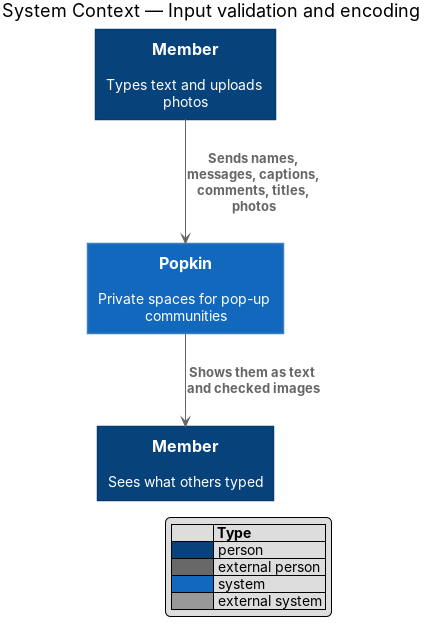
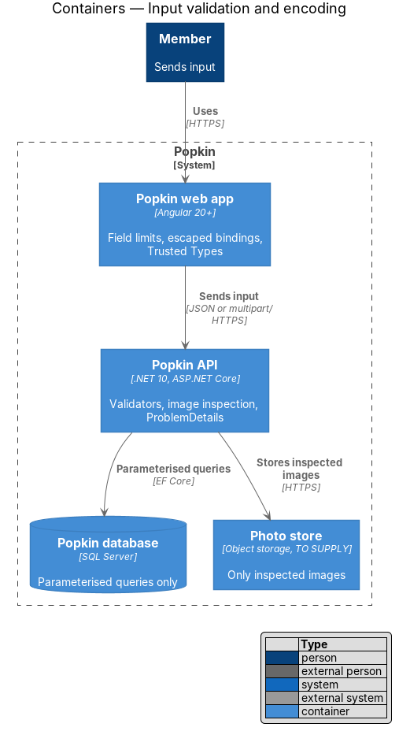
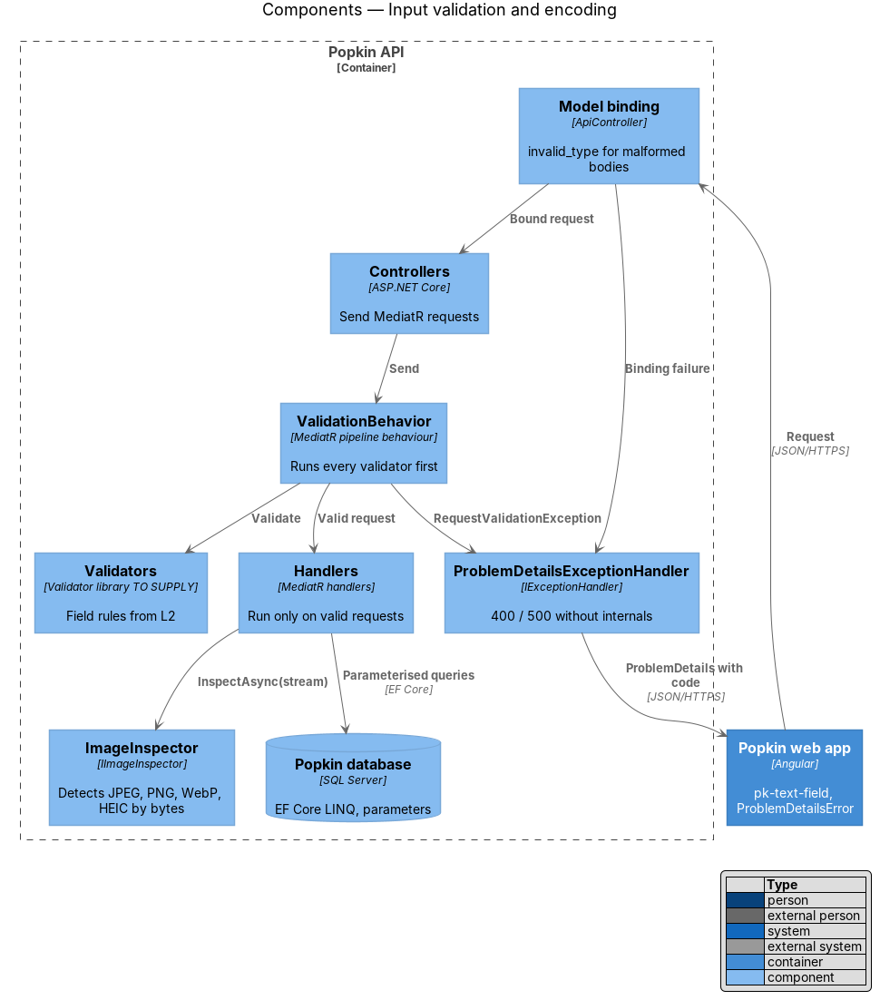
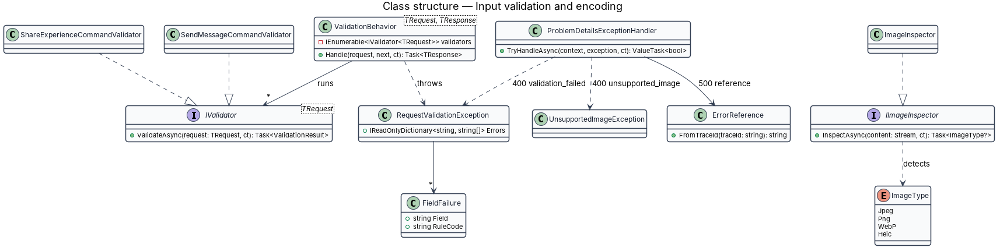
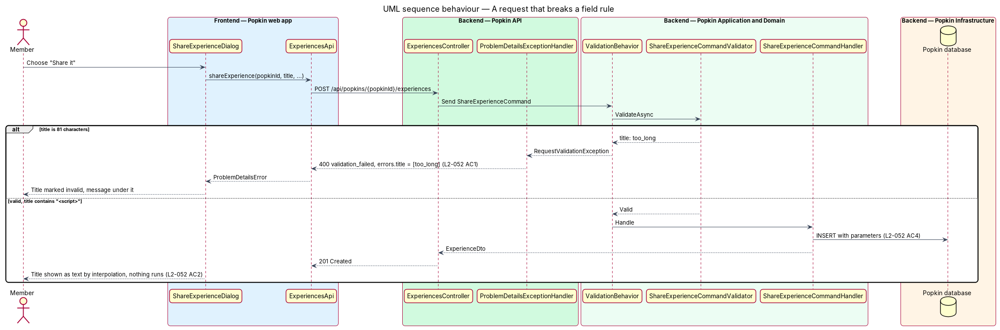
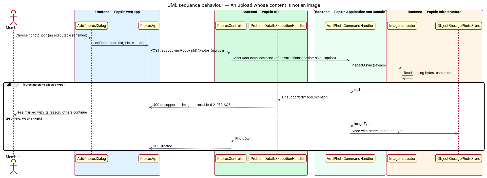
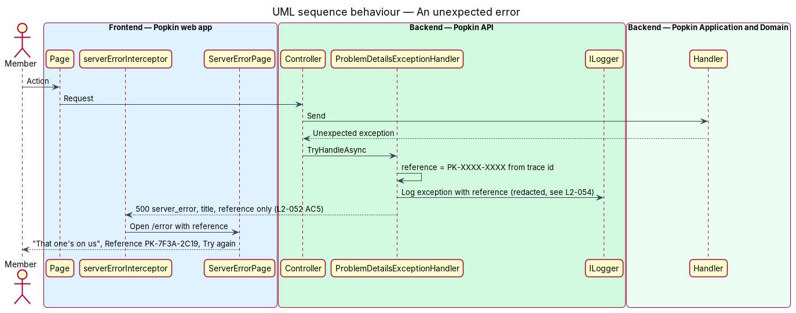

# Input validation and encoding

## Overview

People type names, messages, captions, comments and titles into Popkin, and upload photos.
Everything a person sends can reach other members' screens. This feature is the mechanism that
keeps that input from harming another person or the system. It has no screen of its own; it
runs on every request the Popkin API receives and in every template the Popkin web app renders.

**field rule** — constraint on one request field: its type, its length or its set of allowed
values

**validation failure** — `400` answer that names each field that broke its rule and carries a
`code`

**output encoding** — conversion of text into a form a browser displays as text and never runs

**content sniffing** — identification of a file's type from its leading bytes rather than from
its name or declared type

The mechanism covers five rules (L2-052): every field is checked against its rule and refused
with a named field and a code; text that contains HTML or script shows as text; an uploaded file
whose bytes are not an allowed image is refused whatever its name says; every database query is
parameterised; and no error carries a stack trace, query or internal name. Each feature that
accepts input declares its own field rules in a validator; this design defines how those
validators run and how their failures look.

## Description

### Screens and states

The mechanism shows through these mocks:

- `docs/mocks/pages/sign-up/invalid.html` — a field marked invalid with a message under it.
- `docs/mocks/dialogs/add-photos/invalid.html` — a file refused with its reason ("This file is 14
  MB. Photos can be up to 10 MB."), and the allowed types "JPEG, PNG, WebP or HEIC, up to 10 MB
  each" (L2-052 AC3).
- `docs/mocks/dialogs/share-experience/invalid.html` — a title over its limit, marked invalid.
- `docs/mocks/pages/server-error/default.html` — "That one's on us" with "Reference PK-7F3A-2C19"
  and no internal detail (L2-052 AC5, L2-056 AC6).

### API

The mechanism adds no endpoint. Every endpoint answers with these shapes:

- `400` `validation_failed` — `ValidationProblemDetails` with `code: "validation_failed"` and
  `errors` keyed by field name in camelCase, each value a list of rule codes: `required`,
  `too_long`, `too_short`, `not_allowed`, `invalid_format`, `invalid_type` (L2-052 AC1). The web
  app owns the wording of each message.
- `400` `unsupported_image` — an uploaded file whose content is not JPEG, PNG, WebP or HEIC; the
  `errors` entry names the file field (L2-052 AC3).
- `400` `image_too_large` — a file over 10 MB (L2-013 AC2, L2-031 AC2).
- `500` `server_error` — ProblemDetails with `title` "Something went wrong", `code` and a
  `reference`; nothing else (L2-052 AC5).

### Field rules from the specs

Validators take their limits from L2. The limits that apply across features:

| Field | Rule | Source |
|-------|------|--------|
| Person name, display name | 1 to 40 characters, not only spaces | L2-003, L2-013, L2-048 |
| Popkin name | 1 to 40 characters | L2-008 |
| Popkin emoji, colour | one of the allowed sets (`PopkinColour`) | L2-008 |
| Message text | 1 to 2,000 characters | L2-021 |
| Photo caption | 0 to 200 characters | L2-031 |
| Photo or experience comment | 1 to 500 characters | L2-035, L2-041 |
| Experience title | 1 to 80 characters | L2-040 |
| Experience place | 0 to 80 characters | L2-040 |
| Rating | 1 to 5 stars | L2-039 |
| Photo file | JPEG, PNG, WebP or HEIC by content, at most 10 MB, at most 20 per request | L2-013, L2-031 |
| Ids | non-empty GUID | L2-052 |

Lengths count Unicode text elements (grapheme clusters) so an emoji counts as one character, as
it does in the web app's counters. Text is stored as typed after trimming and Unicode NFC
normalisation; it is never HTML-sanitised on input, because encoding happens on output.

### Backend — Popkin Application and Domain

- **Validator library** — `<TO SUPPLY>`. FluentValidation (Apache 2.0) is the candidate; it is
  not yet in `backend/Directory.Packages.props`. The design calls each rule set a validator.
- **`…Validator`** — one per command or query that carries input, beside its request type, for
  example `SendMessageCommandValidator` and `ShareExperienceCommandValidator`. Each declares the
  rules in the table above for its fields and the rule code each failure carries.
- **`ValidationBehavior<TRequest, TResponse>`** (`Popkin.Application/Behaviors/`) — introduced
  MediatR pipeline behaviour, registered in `AddApplication()`. It runs every validator for the
  request before the handler and, on any failure, throws `RequestValidationException` with the
  failures grouped by field. The handler never sees an invalid request.
- **`IImageInspector`** (`Popkin.Application.Abstractions`) — introduced; `InspectAsync(stream)`
  returns the detected `ImageType` (`Jpeg`, `Png`, `WebP`, `Heic`) or `null`. Handlers that accept
  photos call it and throw `UnsupportedImageException` on `null`, before storing anything
  (L2-052 AC3). The stored `Photo.ContentType` comes from the detected type, never from the
  client's header or file name.

### Backend — Popkin Infrastructure

- **`ImageInspector`** (`Popkin.Infrastructure/Media/`) — introduced implementation. It reads the
  leading bytes: JPEG `FF D8 FF`; PNG `89 50 4E 47 0D 0A 1A 0A`; WebP `RIFF` then `WEBP` at offset
  8; HEIC an `ftyp` box with brand `heic`, `heix`, `mif1` or `msf1`. It then decodes the image
  header to confirm the file parses. Re-encoding to strip location data ("Location data is
  removed", `docs/mocks/dialogs/add-photos/default.html`) uses an image library that is
  `<TO SUPPLY>`.
- **Queries** — every query is EF Core LINQ, which sends values as parameters (L2-052 AC4). Raw
  SQL, where a feature needs it, uses `FromSql` / `ExecuteSql` with an interpolated string, which
  EF Core turns into parameters. `FromSqlRaw` with joined input is not used; EF Core's analyser
  warning for it is an error under `TreatWarningsAsErrors`.

### Backend — Popkin API

- **`[ApiController]` binding failures** — `ApiBehaviorOptions.InvalidModelStateResponseFactory`
  is replaced so that a body that is not JSON or a field of the wrong type answers the same
  `validation_failed` shape, with `invalid_type` as the rule code.
- **`ProblemDetailsExceptionHandler`** (from
  [Membership authorisation](../membership-authorisation/README.md)) — maps
  `RequestValidationException` to `400 validation_failed`, `UnsupportedImageException` to
  `400 unsupported_image`, and any other exception to `500 server_error`.
- **`AddProblemDetails(options => options.CustomizeProblemDetails = …)`** — every ProblemDetails
  gets a `traceId` and, for `500`, a `reference` in the form `PK-XXXX-XXXX` derived from the
  trace id, as on the server-error mock. The handler removes `detail` and any `exception`
  extension in every environment, so no stack trace, query, type name or connection detail
  leaves the API (L2-052 AC5). The full exception is logged with the same reference.
- **JSON output** — `System.Text.Json` with its default encoder escapes `<`, `>`, `&`, `'` and
  `"`, so a JSON response read as HTML runs nothing. Responses carry
  `Content-Type: application/json` and `X-Content-Type-Options: nosniff`
  ([Personal data protection](../personal-data-protection/README.md)).

### Frontend — Popkin web app

- **Output encoding** — every name, message, caption, comment and title is bound with Angular
  interpolation (`{{ }}`) or a property binding, which Angular escapes (L2-052 AC2). Templates use
  no `[innerHTML]`, and no code calls `DomSanitizer.bypassSecurityTrust…`. Links that come from
  input are not rendered as `href`. The content security policy requires Trusted Types, so a
  stray DOM sink fails closed ([Personal data protection](../personal-data-protection/README.md)).
- **Client limits** — `pk-text-field` and `pk-textarea` stop input at the field's limit and show
  the count, as each feature's L2 says. These limits help the person; the API's validators are
  the authority.
- **`ProblemDetailsError`** (`frontend/projects/api/src/lib/models/`) — introduced view model
  that the HTTP implementations produce from a `400`: a map from field to rule codes. Dialogs and
  pages map it onto `pk-text-field` (`aria-invalid="true"` and the message under the field) and
  `pk-form-summary`.
- **`serverErrorInterceptor`** (`frontend/projects/api/src/lib/api/`) — introduced; on a `500`
  outside a dialog it opens `/error` with the `reference`, as on the server-error mock.

## Requirements

| L2 ID | Refines (L1) | Requirement |
|-------|--------------|-------------|
| `L2-052` | `L1-012` | Input is validated and output is encoded: Nothing a person types can harm another person or the system. |

## Diagrams

### System context

People send text and photos to Popkin; Popkin shows them to other members only as text and as
images whose content has been checked.

### Containers

The web app limits and encodes; the Popkin API validates, inspects files and queries the database
with parameters only.

### Components

`ValidationBehavior` runs each request's validators before the handler; `ImageInspector` checks
file content; `ProblemDetailsExceptionHandler` shapes every failure.

### Class structure

Validators are discovered by request type and run by `ValidationBehavior`; failures become
`RequestValidationException`, and file checks go through `IImageInspector`.

### Behaviour — a request that breaks a field rule

A representative write, sharing an experience with an 81-character title, is refused with `400`,
a named field and a code before the handler runs (L2-052 AC1). A valid title is stored as typed
and rendered as text (L2-052 AC2).

### Behaviour — an upload whose content is not an image

A file named `photo.jpg` whose bytes are not an allowed image is refused with
`400 unsupported_image` and nothing is stored (L2-052 AC3).

### Behaviour — an unexpected error

An unexpected exception is logged in full and answered with a reference only (L2-052 AC5).

