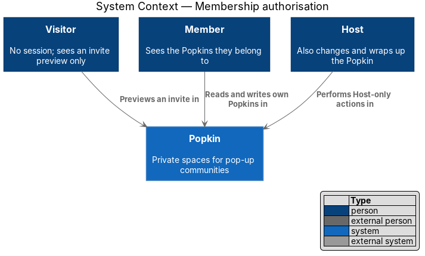
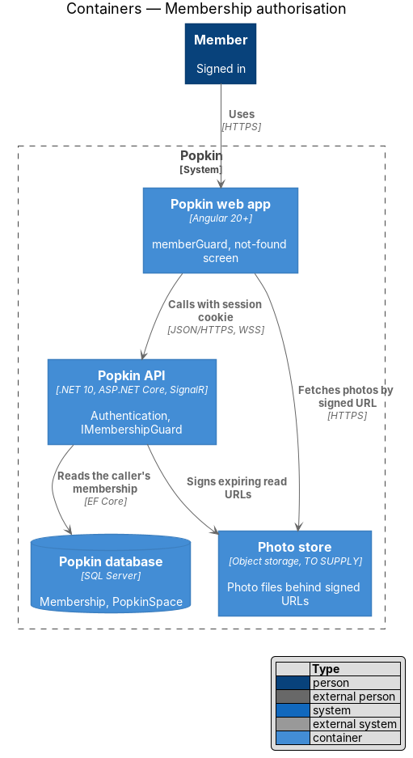
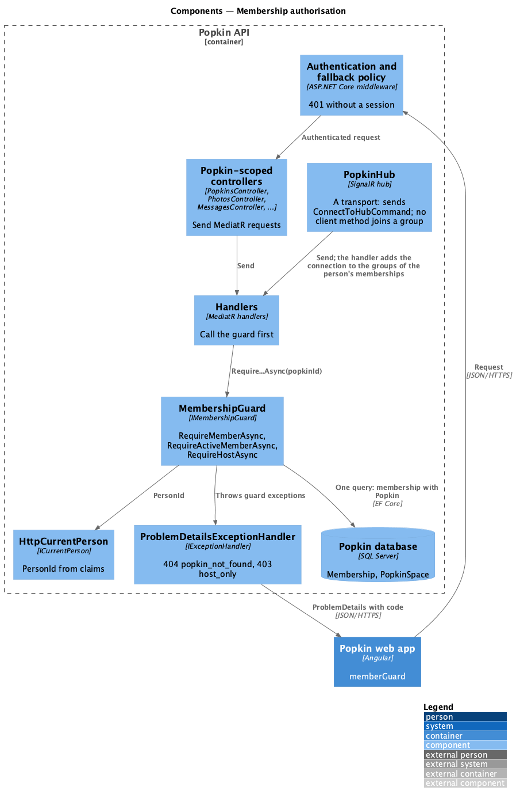
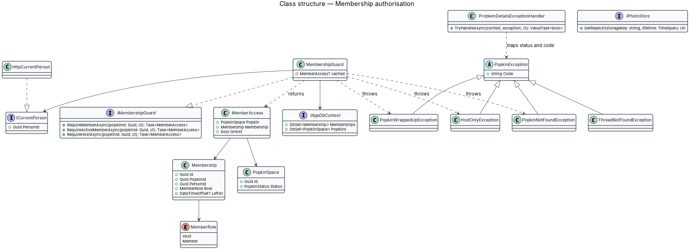
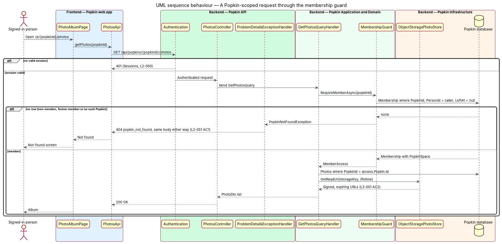
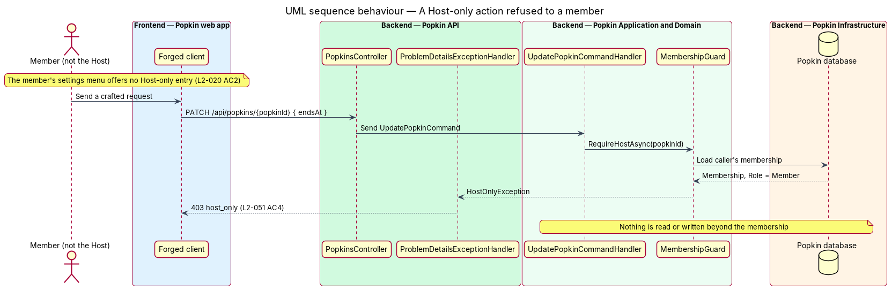

# Membership authorisation

## Overview

Popkin is a set of private spaces. A person sees and changes only the Popkins they belong to,
and inside a Popkin only the Host changes its name, look and length or wraps it up. This feature
is the mechanism that enforces that rule on every request. It has no screen of its own; it sits
between authentication and every handler that reads or writes Popkin data.

**member** — signed-in person with a `Membership` in a Popkin whose `LeftAt` is empty

**non-member** — any signed-in person who is not a member of the Popkin a request names,
including a former member who left (L2-047 AC4)

**Host-only action** — action reserved for the Host: changing the name, emoji, colour or length
(L2-020) and wrapping up (L2-043)

**existence disclosure** — leak that tells a non-member a Popkin exists, for example by
answering `403` where an unknown Popkin answers `404`

Authentication comes first and is designed in [Sessions](../../accounts/sessions/README.md)
(L2-050): a request without a valid session receives `401` before this mechanism runs. Once the
caller is known, the membership guard decides. A non-member receives `404` with code
`popkin_not_found`, exactly as for a Popkin that does not exist, so the response never discloses
whether the Popkin exists. A member who asks for a Host-only action receives `403` with code
`host_only`; the member already knows the Popkin exists, so a `403` discloses nothing.

## Description

### Screens and states

The mechanism shows through existing screens only:

- `docs/mocks/pages/not-found/default.html` — "This page popped off somewhere", the screen the web
  app shows when a Popkin address answers `404` (L2-051 AC1, L2-056 AC5).
- `docs/mocks/pages/join-invite/default.html` and `docs/mocks/pages/join-invite/not-found.html` —
  the invite preview, which shows only what L2-012 allows (L2-051 AC5), owned by
  [Preview an invite](../../invitations/preview-invite/README.md).
- `docs/mocks/pages/direct-message/default.html` — a direct thread, visible only to its two
  members.
- `docs/mocks/dialogs/popkin-settings/member.html` — a member's settings menu, which offers no
  Host-only action (L2-020 AC2); the API refuses a forged request regardless.

### API

The mechanism adds no endpoint. It defines the answers every Popkin-scoped endpoint gives:

- `401` — no valid session ([Sessions](../../accounts/sessions/README.md)).
- `404` `popkin_not_found` — the caller is not a member, or the Popkin does not exist. The body is
  byte-for-byte the same in both cases (L2-051 AC1).
- `404` `thread_not_found` — a direct thread the caller is not one of the two members of.
- `403` `host_only` — a member who is not the Host requests a Host-only action (L2-051 AC4).
- `409` `popkin_wrapped_up` — defined by [Read-only Popkin](../../wrap-up/read-only-popkin/README.md).

`GET /api/popkins` lists only the caller's Popkins (L2-051 AC3); its handler starts from the
caller's memberships ([My Popkins](../../popkins/my-popkins/README.md)).

### Backend — Popkin Application and Domain

- **`ICurrentPerson`** (`Popkin.Application.Abstractions`) — introduced; `PersonId` of the
  authenticated caller, read from the session's claims. Implemented in `Popkin.Api` by
  `HttpCurrentPerson` over `IHttpContextAccessor`.
- **`IMembershipGuard`** (`Popkin.Application.Abstractions`) — introduced. Three methods:
  - `RequireMemberAsync(popkinId)` — loads the caller's `Membership` in the Popkin, with the
    `PopkinSpace`, in one query filtered by `PersonId == currentPerson.PersonId` and
    `LeftAt == null`. No row throws `PopkinNotFoundException`. The query never loads the Popkin
    first, so a missing Popkin and a non-member take the same path.
  - `RequireActiveMemberAsync(popkinId)` — `RequireMemberAsync`, then throws
    `PopkinWrappedUpException` when the Popkin is wrapped up (L2-045 AC2).
  - `RequireHostAsync(popkinId)` — `RequireMemberAsync`, then throws `HostOnlyException` when
    `Membership.Role` is not `MemberRole.Host`.
  Each returns `MemberAccess` (`Popkin`, `Membership`, `IsHost`) for the handler to use.
- **`MembershipGuard`** (`Popkin.Application.Security`) — introduced implementation over
  `IAppDbContext` and `ICurrentPerson`, registered as scoped. It caches the loaded `MemberAccess`
  for the request, so a handler that calls it twice reads once.
- **Handler rule** — every handler of a Popkin-scoped request calls the guard before it reads or
  writes anything else. Child resources are then loaded through the Popkin:
  `Photos.Where(p => p.PopkinId == access.Popkin.Id && p.Id == photoId)`. A photo, message,
  thread, call or experience id that belongs to another Popkin is therefore not found (`404`),
  which closes insecure direct object references (OWASP A01).
- **Direct threads** — `ChatThread` of kind `Direct` is loaded with
  `MemberAId == access.Membership.Id || MemberBId == access.Membership.Id`; otherwise
  `ThreadNotFoundException` (`404 thread_not_found`).
- **Photo file addresses** — photo DTOs carry read URLs from `IPhotoStore.GetReadUrl(storageKey,
  lifetime)`, issued only after the guard. Storage keys are random 128-bit values, never derived
  from names or sequence numbers, and the URLs are signed and expire (L2-051 AC2). The lifetime
  is `<TO SUPPLY>`; the signing scheme depends on the photo store provider, `<TO SUPPLY>`.
- **Exceptions** (`Popkin.Domain`) — `PopkinNotFoundException`, `ThreadNotFoundException`,
  `HostOnlyException`, `PopkinWrappedUpException`. Each carries its `code`.

### Backend — Popkin API

- **`ProblemDetailsExceptionHandler`** (`Popkin.Api/Errors/`) — introduced `IExceptionHandler`
  registered with `AddExceptionHandler<ProblemDetailsExceptionHandler>()` and run by the existing
  `UseExceptionHandler()`. It maps each exception above to its status and writes ProblemDetails
  through `IProblemDetailsService` with the `code` extension. Its `404` for
  `PopkinNotFoundException` carries no Popkin id, name or hint.
- **`PopkinHub`** — no hub method joins a group, so a client cannot ask for one. When a
  connection opens, `ConnectToHubCommandHandler` adds it to `popkin:{popkinId}` for each Popkin
  the person is an active member of, and to no other; `JoinPopkinCommandHandler` adds the
  connections a new member already holds ([Live messages](../../chat/live-messages/README.md)).
  A person who is not a member therefore receives nothing from a Popkin. The checks for a direct
  thread and a call, and removing the connections of a membership that ends (leave, account
  deletion), arrive with those features.
- **Invite preview** — `InvitesController` keeps `[AllowAnonymous]` on `GET /api/invites/{code}`
  and returns `InvitePreviewDto` with only the fields L2-012 shows: inviter's first name and
  avatar, emoji, colour, name, member count, up to five avatars and the end time (L2-051 AC5).

### Frontend — Popkin web app

- **`memberGuard`** (`frontend/projects/popkin/src/app/guards/member.guard.ts`) — introduced
  functional guard on every `/p/:popkinId/...` route. It loads the Popkin through
  `CurrentPopkinStore`; a `404 popkin_not_found` returns a `UrlTree` to the not-found screen.
  The guard is a convenience for the person; the API is the authority.
- **Host-only entries** — pages show Host-only actions only when `PopkinView.isHost` is true
  (L2-020 AC2). A forged request still receives `403`.

## Requirements

| L2 ID | Refines (L1) | Requirement |
|-------|--------------|-------------|
| `L2-051` | `L1-012` | Popkins are private to their members: Membership decides everything a person sees. |

Authentication and sessions (`L2-050`) are designed in
[Sessions](../../accounts/sessions/README.md) and are not repeated here.

## Diagrams

### System context

A signed-in person reaches only the Popkins they belong to; a visitor reaches only the invite
preview.

### Containers

The Popkin API authenticates the request, then the guard reads the caller's membership in the
Popkin database. Photo files are fetched from the photo store through signed, expiring URLs.

### Components

Controllers and `PopkinHub` pass every Popkin-scoped request to a handler that calls
`IMembershipGuard` first; `ProblemDetailsExceptionHandler` turns the guard's exceptions into
`404` or `403`.

### Class structure

`MembershipGuard` implements `IMembershipGuard`, depends on `IAppDbContext` and `ICurrentPerson`,
and returns `MemberAccess` or throws one of the guard exceptions.

### Behaviour — a member and a non-member request a Popkin's photos

A representative read, listing photos, answers `404 popkin_not_found` to a non-member and to an
unknown Popkin alike (L2-051 AC1), and returns expiring photo URLs to a member (L2-051 AC2).

### Behaviour — a member requests a Host-only action

A member who is not the Host asks to change the Popkin's length and receives `403 host_only`
(L2-051 AC4).

