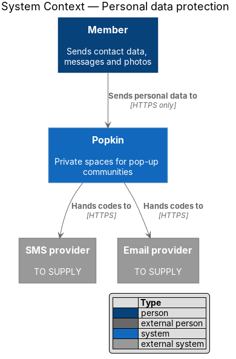
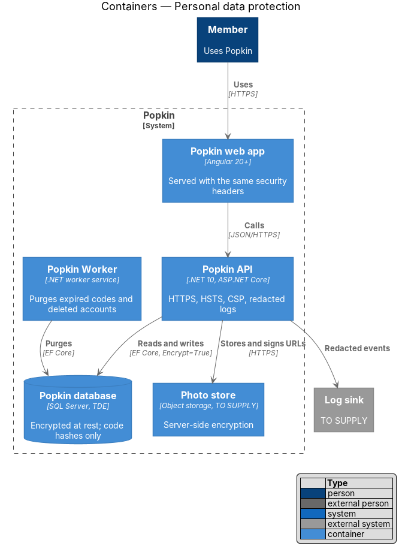
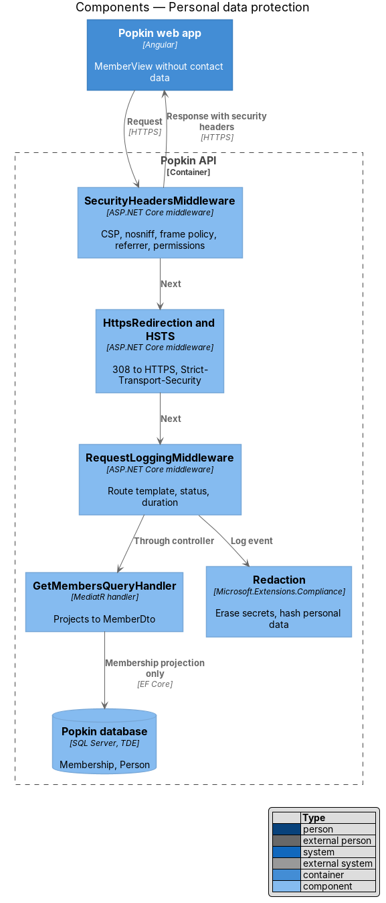
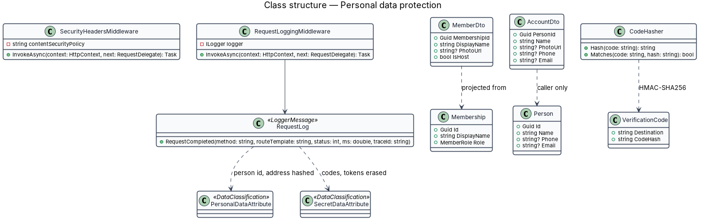
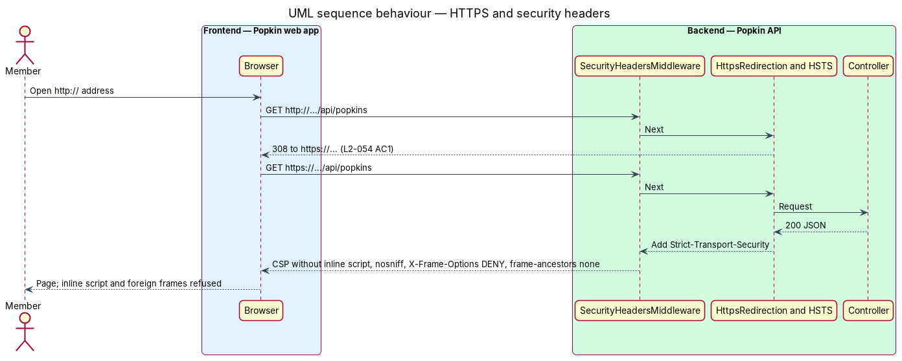
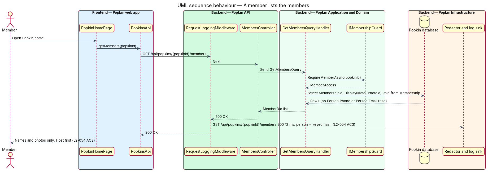

# Personal data protection

## Overview

Popkin holds personal data: the phone number or email each person signs in with, their name and
photo, the messages they write and the photos they share. This feature is the mechanism that
protects that data in transit, at rest, on screen and in logs. It has no screen of its own; it
shapes every response, every log line and every stored row.

**personal data** — data that identifies a person or that they created: name, photo, phone
number, email, message text, photo files, six-digit codes and session tokens

**contact data** — the phone number or email a person signs in with

**security headers** — response headers that instruct the browser to use HTTPS only, run no
inline script, not guess content types and not show Popkin inside another site's frame

**redaction** — replacement of a personal value by a fixed marker or a keyed hash before it is
written to a log

L2-054 sets five rules. Every request is redirected to HTTPS and every response carries HSTS, a
content security policy that allows no inline script, `X-Content-Type-Options: nosniff` and a
frame policy that refuses other sites. A member sees other members' names and photos only, never
their contact data. Logs and error reports hold no code, session token, phone number, email,
message text or photo. A six-digit code is stored only as a hash. The database and the photo store
are encrypted at rest.

## Description

### Screens and states

The mechanism shows through existing screens only:

- `docs/mocks/pages/popkin-home/default.html` — the "Members" section shows names, avatars and
  "Host", and no contact data (L2-054 AC2).
- `docs/mocks/pages/account/default.html` — the only screen that shows contact data, to its owner,
  read-only (L2-048 AC1).
- `docs/mocks/pages/verify-code/default.html` — the code screen masks the phone number to its
  last two digits ("(•••) •••-••48", L2-004 AC1).
- `docs/mocks/dialogs/add-photos/default.html` — "Location data is removed" for uploaded photos.

### API

The mechanism adds no endpoint. It constrains every response:

- Every response carries the security headers below (L2-054 AC1).
- `MemberDto` (members lists, avatars, message authors, comment authors, raters) carries
  `membershipId`, `displayName`, `photoUrl` and `isHost` only (L2-054 AC2). Contact data appears
  in `AccountDto` from `GET /api/account`, for the caller only
  ([Manage the account](../../accounts/manage-account/README.md)).

### Backend — Popkin API

- **HTTPS** — `UseHttpsRedirection()` sends a `308` to the HTTPS address for any HTTP request, and
  `UseHsts()` adds `Strict-Transport-Security: max-age=31536000; includeSubDomains` outside
  development (L2-054 AC1). Whether TLS ends at a reverse proxy in front of the API is
  `<TO SUPPLY>`; if it does, the proxy redirects and `UseForwardedHeaders()` lets the API see the
  original scheme.
- **`SecurityHeadersMiddleware`** (`Popkin.Api/Security/`) — introduced; runs first in the
  pipeline and adds, to every response:
  - `Content-Security-Policy: default-src 'self'; script-src 'self'; style-src 'self'
    'unsafe-inline'; img-src 'self' blob: data: <photo store origin>; media-src 'self' blob:;
    connect-src 'self' wss://<API host>; font-src 'self'; object-src 'none'; base-uri 'self';
    frame-ancestors 'none'; require-trusted-types-for 'script'`. Scripts run only from Popkin's own
    files, never inline. `style-src` allows inline styles because Angular adds component styles
    as `<style>` elements; replacing `'unsafe-inline'` with a nonce through Angular's `CSP_NONCE`
    is `<TO SUPPLY>`, since it depends on how the web app is served. The photo store origin and
    API host are `<TO SUPPLY>`.
  - `X-Content-Type-Options: nosniff`.
  - `X-Frame-Options: DENY` with `frame-ancestors 'none'`, refusing every other site's frame.
  - `Referrer-Policy: same-origin`, so an invite code in an address does not leak to other sites.
  - `Permissions-Policy: camera=(self), microphone=(self), geolocation=()`, matching the calls'
    needs.
  The same headers apply to the web app's own files wherever they are served. The host for the
  web app is `<TO SUPPLY>`; its configuration copies this header set.
- **Session cookie** — `HttpOnly`, `Secure`, `SameSite=Lax`, designed in
  [Sessions](../../accounts/sessions/README.md); this design adds nothing to it.
- **`RequestLoggingMiddleware`** (`Popkin.Api/Logging/`) — introduced; placed outside
  `UseExceptionHandler()` as `AGENTS.md` requires. It logs method, route template (for example
  `/api/invites/{code}`, never the filled-in path), status, duration and trace id. It logs no query
  string, body, header or cookie (L2-054 AC3).

### Backend — Popkin Application and Domain

- **`MemberDto`** — the single projection of another person: `MembershipId`, `DisplayName`,
  `PhotoUrl`, `IsHost`. Queries that list members project straight into it from `Membership`,
  so `Person.Phone` and `Person.Email` are never read for another person (L2-054 AC2).
- **Code hashing** — `VerificationCode.CodeHash` is the HMAC-SHA256 of the code under a server
  key, compared in constant time (L2-054 AC4). A plain hash of a six-digit code is reversed by
  trying one million values; the key prevents that. The key's store and rotation are
  `<TO SUPPLY>`. Detail lives in [Confirm the code](../../accounts/confirm-code/README.md).
- **Log classification** — logging uses source-generated `LoggerMessage` methods. Parameters
  that carry personal data are annotated with data classifications from
  `Microsoft.Extensions.Compliance` (`PersonalData`, `SecretData`), and the host calls
  `AddRedaction()`: `SecretData` (codes, session tokens) is erased, and `PersonalData` (phone,
  email, person id, client address) is replaced by a keyed hash so events can still be
  correlated (L2-054 AC3). Message text and photo bytes are never passed to a logger.
- **Error reports** — the exception handler logs the exception with its reference. EF Core's
  `EnableSensitiveDataLogging` is never enabled, so parameter values do not appear in exception
  messages. The error-reporting service, if any, is `<TO SUPPLY>`; it receives the same redacted
  events.

### Backend — Popkin Infrastructure

- **Database at rest** — SQL Server Transparent Data Encryption on the Popkin database and its
  backups (L2-054 AC5). The connection string sets `Encrypt=True` so data in transit to the
  database is encrypted as well. The hosting of SQL Server (managed service or self-hosted) and
  key management are `<TO SUPPLY>`.
- **Photo store at rest** — server-side encryption on the bucket or container that holds photo
  files and album zips (L2-054 AC5). The provider and its key management are `<TO SUPPLY>`.
- **`ObjectStoragePhotoStore`** — stores files under random keys and serves them through signed,
  expiring URLs ([Membership authorisation](../membership-authorisation/README.md)). Location
  metadata is stripped before storing ([Input validation and
  encoding](../input-validation-and-encoding/README.md)).
- **Retention** — `PurgeExpiredCodesJob` deletes verification codes once expired, and
  `PurgeDeletedAccountsJob` erases a deleted account's personal data within 30 days (L2-049 AC4,
  [Delete the account](../../accounts/delete-account/README.md)). Log retention is `<TO SUPPLY>`.

### Frontend — Popkin web app

- **No contact data on screen except the account** — view models for other people
  (`MemberView`) have no phone or email field.
- **Masking** — the code screen shows the destination masked to its last two characters
  (L2-004 AC1).
- **Browser storage** — the web app keeps no personal data in `localStorage`; the theme choice is
  the only persisted value (L2-048 AC4). Unsent message drafts stay in memory for the session
  (L2-028 AC4).

## Requirements

| L2 ID | Refines (L1) | Requirement |
|-------|--------------|-------------|
| `L2-054` | `L1-012` | Personal data is protected: Phone numbers, emails, messages and photos are handled as private data. |

## Diagrams

### System context

People send personal data to Popkin over HTTPS. Popkin hands codes to the SMS and email providers
and holds the rest encrypted.

### Containers

The web app and the Popkin API speak HTTPS only; the Popkin database and the photo store are
encrypted at rest; logs receive redacted events.

### Components

`SecurityHeadersMiddleware`, HTTPS redirection and HSTS wrap every response;
`RequestLoggingMiddleware` and the redactor keep personal data out of logs; `MemberDto` keeps
contact data out of member lists.

### Class structure

The middleware pair and the redaction set-up sit in the API; `MemberDto` and `AccountDto`
separate what others see from what the owner sees.

### Behaviour — a request over HTTP, then over HTTPS

An HTTP request is redirected to HTTPS; the HTTPS response carries the security headers
(L2-054 AC1).

### Behaviour — a member lists the members

A representative read returns names and photos only (L2-054 AC2) and is logged with its route
template and a redacted person id (L2-054 AC3).

