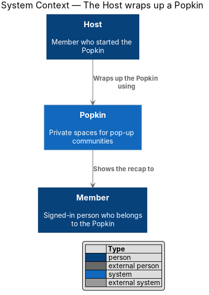
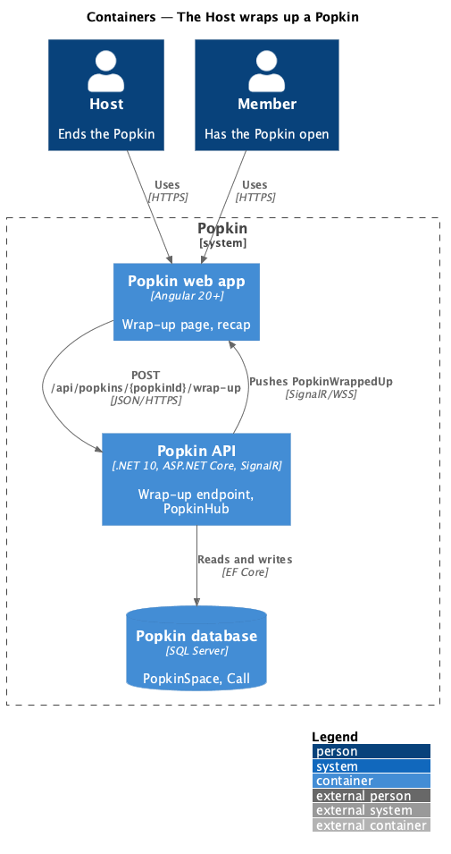
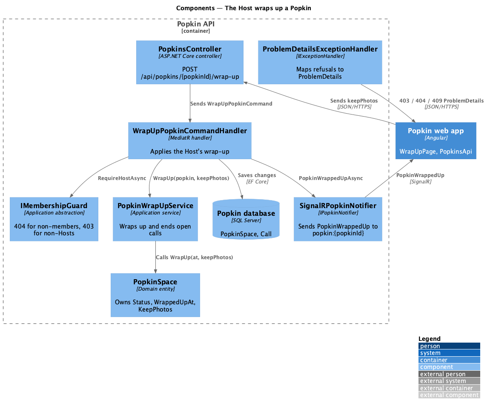
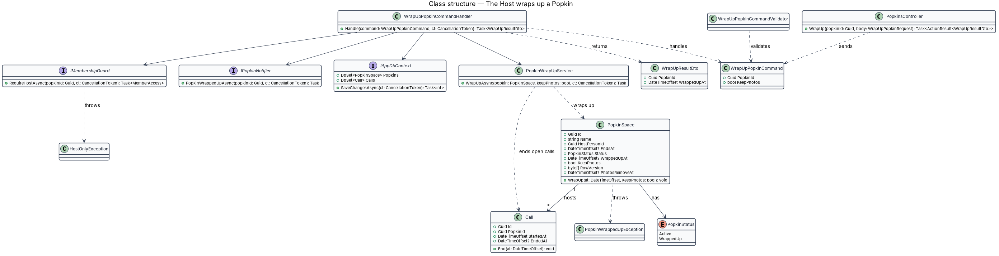
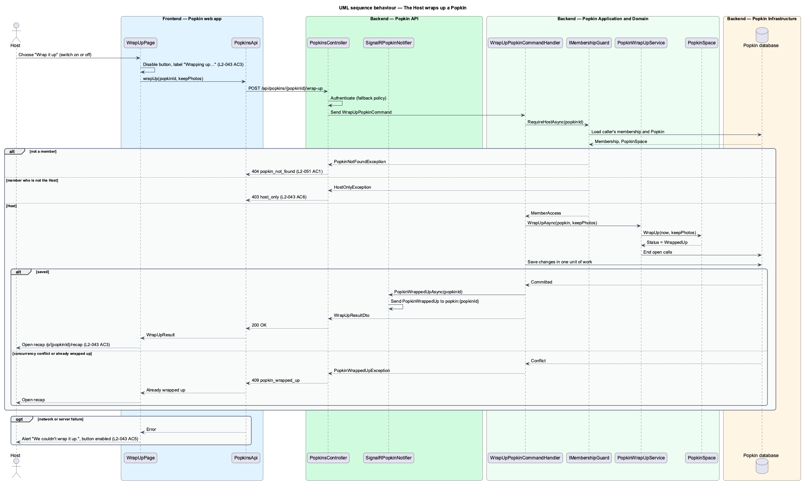
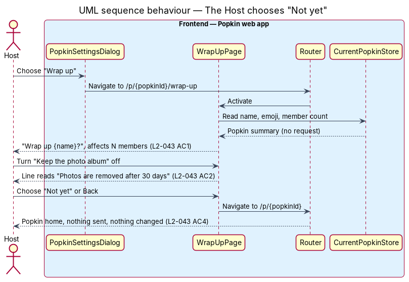

# The Host wraps up

## Overview

A Popkin is a private space for one group, with a name, an emoji, a colour, members and a length.
Every Popkin ends. It ends either by itself, when its end date arrives (see
[Time is up](../time-is-up/README.md)), or on purpose, when its Host wraps it up. This feature
covers the second path.

**Host** — member who started a Popkin and the only member allowed to change or end it

**wrap up** — act of ending a Popkin, after which it is read-only and has a recap

**keep the photo album** — Host's choice, made at wrap-up, of whether the Popkin's photos stay
after it ends or are removed 30 days later

The Host opens "Wrap up" from the Popkin settings menu on the Popkin home (L2-020 AC1). A
full-screen page asks "Wrap up {name}?", states how many members the decision affects and
explains what follows: everyone gets a recap and the chat goes quiet. Beside the question, from
768 px, it shows the recap the wrap-up will make. One switch decides whether the photo album is
kept. "Wrap it up" ends the Popkin and opens the recap; "Not yet" and "Back" return to the
Popkin home and change nothing.

Wrapping up is a state change on the Popkin, not a deletion. Messages, photos, experiences and
members stay; only new contributions stop (see [Read-only Popkin](../read-only-popkin/README.md))
and the [Recap](../recap/README.md) becomes the Popkin's front page. A call under way ends with
the Popkin. A member who is not the Host cannot wrap up a Popkin; the API refuses the request
with `403`.

Journey 9, Wrap up, built this design. Where the build differs from what was first designed,
the sections below say what was built, and [Built in journey 9](#built-in-journey-9) lists the
differences.

## Description

The slice runs from the wrap-up page in the Popkin web app to the `PopkinSpace` row in the Popkin
database, and ends with a real-time event to every member who has the Popkin open.

### Screens and states

- `docs/mocks/pages/wrap-up/default.html` — the question, the lede "Every good Popkin ends.
  Here’s what happens next for all 14 of you.", two facts ("Everyone gets a recap", "Chat goes
  quiet"), the "Keep the photo album" switch on with the line "Members can keep browsing and
  saving", "Wrap it up" and "Not yet"; beside them from 768 px, the recap to come: some of the
  Popkin's photos, its emoji, its name and "The recap everyone gets · 48 photos, 1,286 messages"
  (L2-043 AC1, AC2).
- `docs/mocks/pages/wrap-up/album-off.html` — the switch off, the line reads "Photos are removed
  after 30 days" (L2-043 AC2).
- `docs/mocks/pages/wrap-up/submitting.html` — "Wrap it up" disabled and reading "Wrapping up…"
  (L2-043 AC3).
- `docs/mocks/pages/wrap-up/error.html` — danger alert "We couldn't wrap it up." with "Lakeside
  Weekend is still open and nothing has changed. Try again in a moment." and "Wrap it up" enabled
  again (L2-043 AC5).
- `docs/mocks/pages/wrapped-up/host.html` — the recap the Host lands on after success (L2-043 AC3).
- `docs/mocks/dialogs/popkin-settings/host-now.html` — the Host's settings menu as journey 9
  built it, with "Wrap up", the entry point (owned by
  [Popkin settings](../../popkins/popkin-settings/README.md)).

The mock manifest marks the page's loading and empty states as not applicable. The page does
read before it shows (see below); until the answers arrive it shows its top bar and nothing
else, and when they do not arrive it says "We couldn’t open this", "Nothing has changed. Check
your connection and try again." with "Try again" and "Not yet". That state has no mock.

### API

- `GET /api/popkins/{popkinId}/wrap-up` — `200 OK` with `WrapUpPreviewDto` (`memberCount`,
  `photoCount`, `messageCount`): how many members the wrap-up affects, counted as the home's
  header counts them, and the photos and messages the recap will count, counted as the recap
  counts them (L2-043 AC1). For the Host of an active Popkin only: `403` `host_only`, `404`
  `popkin_not_found`, `409` `popkin_wrapped_up`.
- `POST /api/popkins/{popkinId}/wrap-up` with body `{ "keepPhotos": true | false }` — `200 OK`
  with `WrapUpResultDto`.
  - `400` `validation_failed`, naming the field `keepPhotos` — `keepPhotos` missing (L2-052 AC1).
  - `403` `host_only` — the caller is a member but not the Host (L2-043 AC6, L2-051 AC4).
  - `404` `popkin_not_found` — the caller is not a member, or the Popkin does not exist (L2-051
    AC1).
  - `409` `popkin_wrapped_up` — the Popkin is already wrapped up (L2-045 AC2), or its time ran
    out in the same moment.
- Real time: `PopkinWrappedUp(popkinId)` to the group `popkin:{popkinId}`, after `CallEnded` for
  a call the wrap-up ended.

### Frontend — Popkin web app

- **`WrapUpPage`** (`frontend/projects/popkin/src/app/pages/wrap-up/wrap-up.page.ts` and
  `wrap-up.page.html`, selector `pk-wrap-up-page`, OnPush). Route `/p/:popkinId/wrap-up` with
  data `{ shell: 'bare', page: 'wrap-up' }`, behind `signedInGuard`. It reads three things
  together before it shows: the Popkin (`getHome`), the preview (`getWrapUpPreview`) and the
  photos summary, whose pictures are decoration, so the screen opens without them. It holds the
  signals `keepPhotos` (first `true`), `busy` and `failed`. The preview's refusal decides who
  sees the screen: `host_only` sends a member who is not the Host to the Popkin home, and
  `popkin_wrapped_up` opens the recap; a `404` shows the not-found screen. The API still
  refuses a forged request (L2-043 AC6).
- **Composition** — the page is a container. It composes `pk-screen` (`layout="split"`, with the
  Popkin's tile, the heading "Wrap up {name}?" and the lede), `pk-split-aside` (the recap to
  come), `pk-top-bar` (Back), `pk-facts` with two `pk-fact`, `pk-setting-row` (the switch and
  its line), `pk-alert` (shown when `failed` is true), and two `pk-button`s: primary "Wrap it
  up" (busy label "Wrapping up…") and quiet "Not yet". The switch's line is bound to
  `keepPhotos`, so the state is written as text, not carried by colour alone.
- **Text** — `wrap-up-text.ts` in the `api` library, with unit tests: `wrapUpLede(memberCount)`
  ("Every good Popkin ends. Here’s what happens next for all 14 of you.", "for both of you" for
  two, and neither for one), `recapPreviewLine(photoCount, messageCount)` and
  `keepAlbumLine(keepPhotos)` ("Members can keep browsing and saving" or "Photos are removed
  after 30 days").
- **`PopkinsApi`** / **`POPKINS_API`** / **`HttpPopkinsApi`**
  (`frontend/projects/api/src/lib/api/popkins/`) — gained `getWrapUpPreview(popkinId)` and
  `wrapUp(popkinId, keepPhotos)`. The page injects `POPKINS_API`, never `HttpPopkinsApi`.
- **`WrapUpResult`**, **`WrapUpPreviewView`** (`frontend/projects/api/src/lib/models/recap.ts`).
- **Behaviour** — "Wrap it up" sets `busy`, disables the button and the switch and calls
  `wrapUp` (L2-043 AC3). On success the page navigates to `/p/:popkinId/recap` with
  `replaceUrl`, so Back does not return to a wrap-up page for an ended Popkin. On failure it
  clears `busy` and shows the alert "We couldn’t wrap it up." with "{name} is still open and
  nothing has changed. Try again in a moment."; the choice of the switch stays (L2-043 AC5). A
  `409 popkin_wrapped_up` is treated as success: the Popkin has already ended, for example
  because its time ran out a moment earlier, and the recap opens. "Not yet" and Back navigate to
  `/p/:popkinId` and send nothing (L2-043 AC4).

### Backend — Popkin API

- **`PopkinsController`** (`backend/src/Popkin.Api/Controllers/PopkinsController.cs`) — actions
  `GetWrapUpPreview(Guid popkinId)` and `WrapUp(Guid popkinId, WrapUpPopkinRequest request)`.
  Each requires an authenticated caller through the fallback policy, sends one MediatR request
  and returns `200`. Neither holds a business rule.
- **`SignalRPopkinNotifier`** — sends `PopkinWrappedUp(popkinId)` to the group
  `popkin:{popkinId}`. Every member with the Popkin open moves to the recap without a reload
  (L2-044 AC4, [Time is up](../time-is-up/README.md)).

### Backend — Popkin Application and Domain

- **`WrapUpPopkinCommand`** — `PopkinId: Guid`, `KeepPhotos: bool?`; returns `WrapUpResultDto`
  (`PopkinId`, `WrappedUpAt`).
- **`WrapUpPopkinCommandHandler`** — calls `IMembershipGuard.RequireHostAsync(popkinId)`, which
  answers `404` for a non-member, `409` for a wrapped-up Popkin and `403` for a member who is
  not the Host, in that order; refuses a missing `KeepPhotos` with `400`; then hands the Popkin
  to `PopkinWrapUpService`. There is no validator class: a handler checks and throws
  `ProblemException`, as everywhere in Popkin.
- **`GetWrapUpPreviewQuery`** / **`GetWrapUpPreviewQueryHandler`** — the same guard, then the
  members who have not left and the counts of `RecapCounts`, which the recap uses too
  ([Recap](../recap/README.md)).
- **`PopkinWrapUpService`** (`Popkin.Application/WrapUp/`) — shared by this handler and by
  `WrapUpDuePopkinsCommandHandler` ([Time is up](../time-is-up/README.md)). In one unit of work
  it calls `PopkinSpace.WrapUp(now, keepPhotos)` with `TimeProvider.GetUtcNow()` and ends every
  call under way in the Popkin with `Call.End`, which takes each participant off the call, so no
  call outlives the Popkin (L2-045 AC1). It saves, and after the commit sends `CallEnded` for
  each call it ended, then `PopkinWrappedUp`. It answers `false`, with nothing changed, when
  another wrap-up of the same Popkin was saved first; the Host's handler then answers `409`
  `popkin_wrapped_up`.
- **`PopkinSpace`** (entity) — `WrapUp(DateTimeOffset at, bool keepPhotos)` sets `Status =
  PopkinStatus.WrappedUp`, `WrappedUpAt = at` and `KeepPhotos = keepPhotos`, and raises
  `Version`. A Popkin wraps up once: the method throws for one that has wrapped up, and the
  guard answers the `409` before it is reached. The entity also exposes `PhotosRemoveAt`, which
  is `WrappedUpAt + 30 days` when `KeepPhotos` is false and `null` otherwise (L2-043 AC2,
  L2-045 AC4).
- **`Call.End(participants, now)`** — ends the call for everyone on it and raises its version.
  A change of microphone or camera afterwards answers `409` `popkin_wrapped_up`:
  `SetCallMediaCommandHandler` now asks for an active Popkin.

### Backend — Popkin Infrastructure

- **`PopkinSpaceConfiguration`** — maps `Version` as a concurrency token. It is a counter the
  entity raises, not a `rowversion`, so SQL Server, SQLite and the tests' InMemory provider all
  refuse the second of two wrap-ups alike. The index on `(Status, EndsAt)` that the Worker reads
  is declared here as well.
- **Migration** `AddWrapUp` — the columns of `PopkinSpace` and the tables `AlbumExports` and
  `CrewInvites` of [Recap](../recap/README.md).

### Tests

- `Popkin.Api.Tests/WrapUp/`: `HostWrapsUpTests`, `WrapUpPreviewTests` and `WrapUpLiveTests`,
  which connects a SignalR client and awaits `CallEnded` and `PopkinWrappedUp`.
  `Popkin.Application.Tests/WrapUp/PopkinSpaceWrapUpTests` tests the entity directly.
- Playwright: `e2e/tests/wrap-up.spec.ts` and `wrap-up-live.spec.ts`, with the page object
  `e2e/pages/wrap-up.page.ts`.

### Built in journey 9

Everything above. What differs from the design as it first stood:

- The screen reads before it shows. The design had it read nothing, from a `CurrentPopkinStore`
  the home would have filled; there is no such store, and the screen needs counts the home does
  not hold. `GET /api/popkins/{popkinId}/wrap-up` was added for them.
- The lede under the question, "Every good Popkin ends. Here’s what happens next for all {n} of
  you.", was chosen in the build; L2-043 AC1 asks only that the screen states how many members
  the decision affects. The mock was changed first.
- The route has no `memberGuard`, and there is none: the reads answer `404` for someone who is
  not a member, and the screen shows the not-found screen.
- The facts are `pk-facts` and `pk-fact`, and the switch is `pk-setting-row`, where the design
  named `pk-list-row` and `pk-switch` in its setting-row form.
- There are no validator or exception classes (`WrapUpPopkinCommandValidator`,
  `PopkinWrappedUpException`, `HostOnlyException`): handlers throw `ProblemException` with the
  code.
- The concurrency token is a counter, not a `rowversion`.
- The wrap-up ends the call under way and tells its participants (known gap 30, settled).

The diagrams below were not redrawn (gap 53). They show `CurrentPopkinStore`, the validator and
exception classes, and a wrap-up that reads nothing first.

### Open points

- The copy of the system message, if any, that the Everyone thread shows when a Popkin wraps up:
  `<TO SUPPLY>`. The mocks show none, and none is written.

## Requirements

| L2 ID | Refines (L1) | Requirement |
|-------|--------------|-------------|
| `L2-043` | `L1-011` | The Host wraps up a Popkin: The Host ends a Popkin on purpose, knowing what follows. |
| `L2-051` | `L1-012` | Popkins are private to their members: Membership decides everything a person sees. |

`L2-051` is listed because the endpoint enforces its AC1 (`404` for a non-member) and AC4 (`403`
for a member who is not the Host).

## Diagrams

### System context

The Host ends a Popkin through Popkin; every member of the Popkin sees the result. No external
system takes part.

### Containers

The web app sends the wrap-up request to the Popkin API, which writes the Popkin database and
pushes the change to members' web apps over the `PopkinHub` connection.

### Components

Inside the Popkin API, `PopkinsController` sends `WrapUpPopkinCommand`; the handler checks the
caller is the Host through `IMembershipGuard`, applies the wrap-up through `PopkinWrapUpService`
and `PopkinSpace`, and notifies members through `IPopkinNotifier`.

### Class structure

`WrapUpPopkinCommandHandler` depends on the guard, the shared `PopkinWrapUpService` and the
notifier. `PopkinSpace` owns the state transition and the photo-removal date; `Call` is ended by
the service.

### Behaviour — the Host wraps up a Popkin

The page disables "Wrap it up" while the request is in flight (L2-043 AC3). The handler refuses a
member who is not the Host with `403` (L2-043 AC6), applies the transition in one unit of work,
then notifies members. A failure leaves the Popkin active and re-enables the button (L2-043 AC5).

### Behaviour — the Host says "Not yet"

"Not yet" and Back send nothing and return to the Popkin home (L2-043 AC4).

