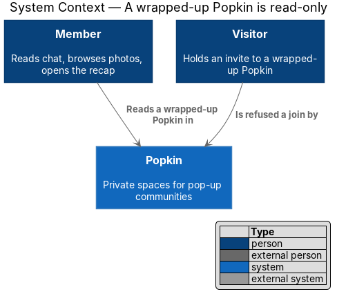
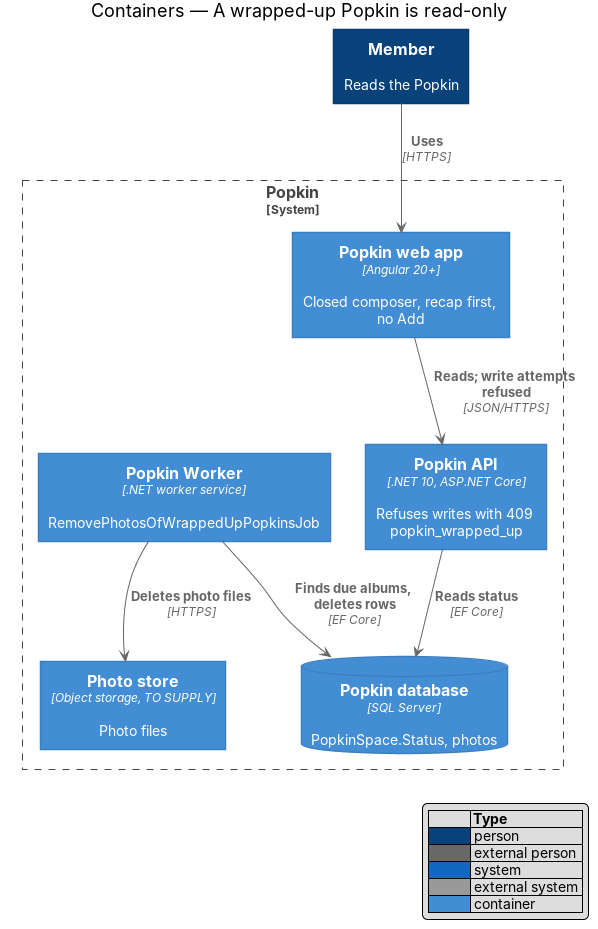
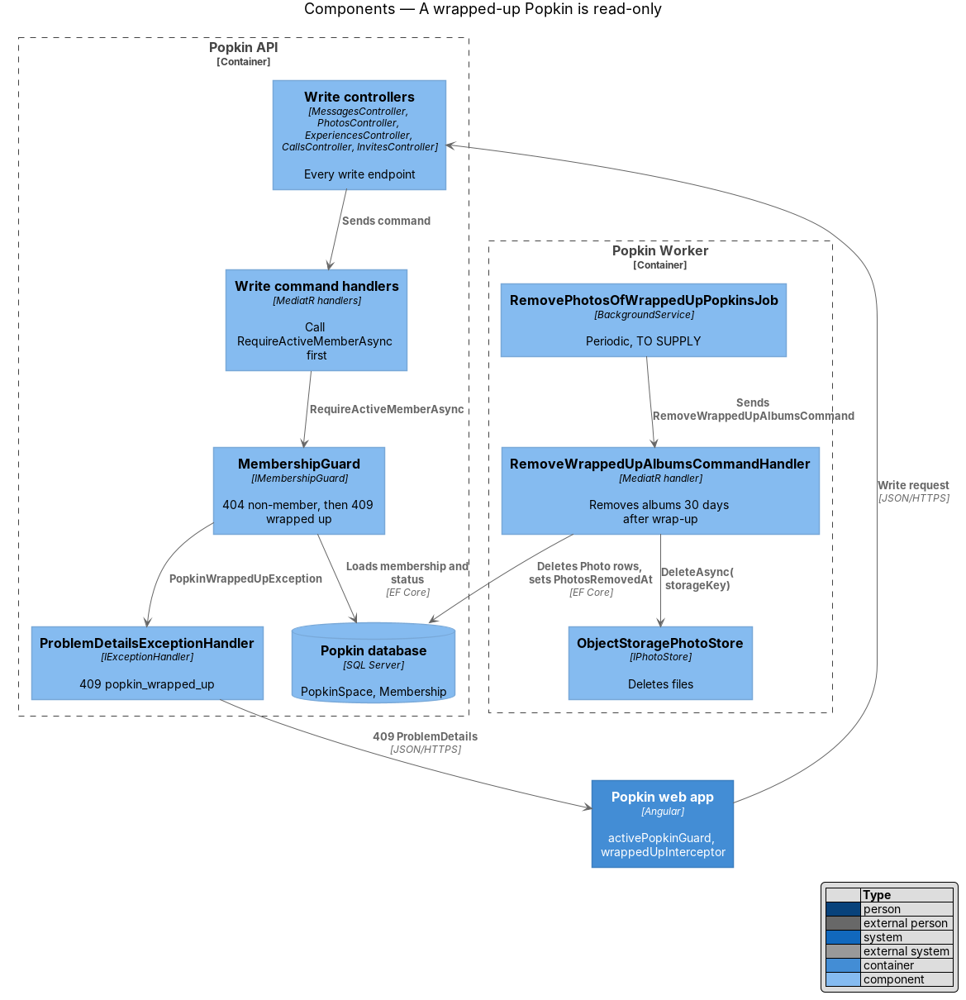
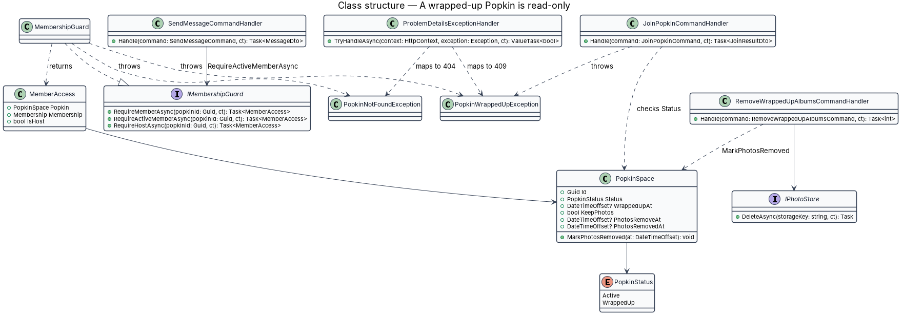
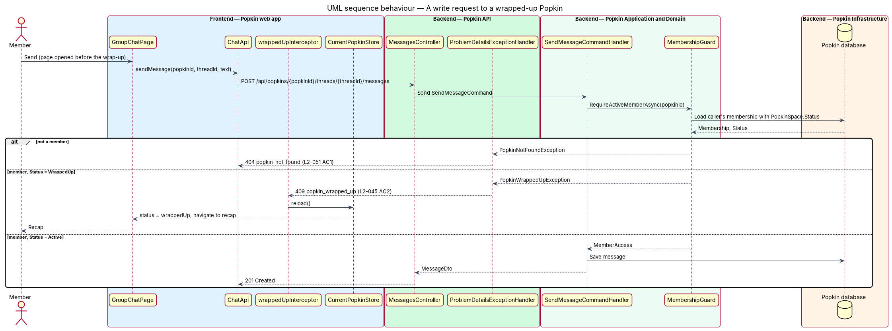
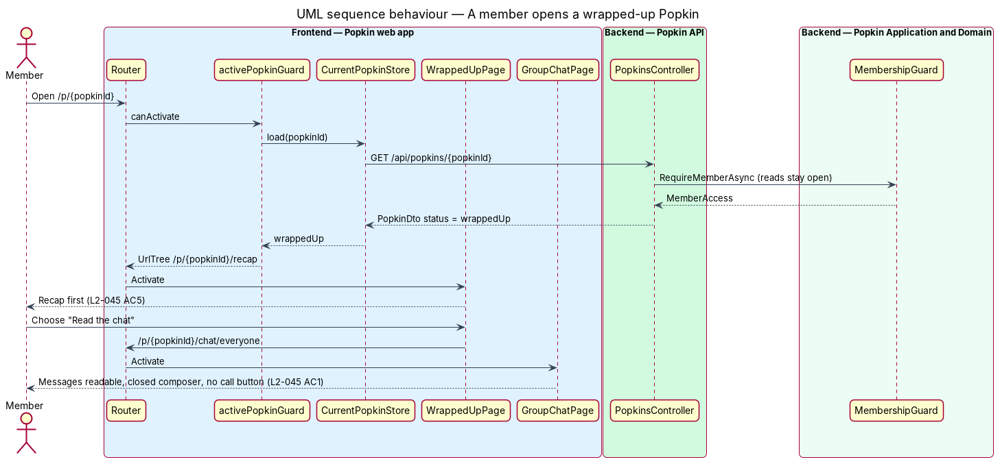
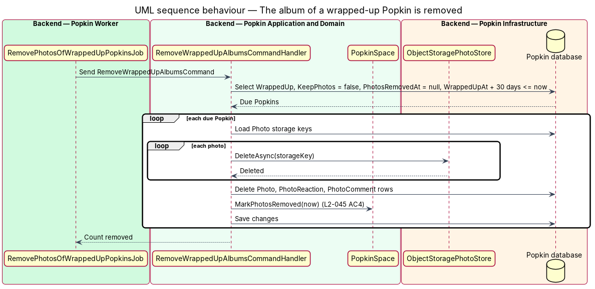

# Read-only Popkin

## Overview

A Popkin is a private space for one group. Once it wraps up, either because its Host ended it
([The Host wraps up](../host-wraps-up/README.md)) or because its end date arrived
([Time is up](../time-is-up/README.md)), nothing new is added to it. Members keep what the group
made together: they read the chat, browse and save the photos and open the recap. They cannot
post, react, comment, rate, share, add photos or start a call, and nobody can join.

**wrapped-up Popkin** — Popkin whose `PopkinSpace.Status` is `WrappedUp`

**write request** — API request that adds or changes content in a Popkin: a message, a photo, an
experience, a rating, a comment, a reaction, a keen, a call or a join

**album removal date** — instant 30 days after wrap-up at which a Popkin wrapped up without
keeping its album loses its photos

The rule has two halves. The API refuses every write request to a wrapped-up Popkin with `409`
and the code `popkin_wrapped_up`, whichever screen or client sends it. The web app does not offer
the actions in the first place: the chat composer is replaced by a closing line, Photos has no
"Add", Experiences has no "Share one", and opening the Popkin shows its recap first. This
feature defines both halves; the features that own each write endpoint apply the refusal
described here.

Journey 9, Wrap up, built this design for everything that exists: a write that is not built yet
(a reaction, a comment on a photo, keen, a direct message) is refused when its journey builds
it. The sections below say what was built, and [Built in journey 9](#built-in-journey-9) lists
what differs from the design as it first stood and what waits.

## Description

### Screens and states

- `docs/mocks/pages/group-chat/read-only.html` — the Everyone thread with every message readable,
  the subtitle "Wrapped up Sun 13 Sep", no call button, Back labelled "Recap", and the composer
  replaced by "This Popkin has wrapped up. Messages stay, but nobody can post new ones." (L2-045
  AC1).
- `docs/mocks/notifications/banner/persistent.html` — on the recap of a Popkin wrapped up without
  its album, a warning banner "Photos go in 12 days. Save the album to keep them." with a "Save"
  action (L2-045 AC4).
- `docs/mocks/pages/wrapped-up/default.html` — the recap a member sees first when opening a
  wrapped-up Popkin (L2-045 AC5).
- `docs/mocks/pages/join-invite/wrapped.html` — the invite of a wrapped-up Popkin, with no "Join"
  (owned by [Preview an invite](../../invitations/preview-invite/README.md), L2-016).
- `docs/mocks/pages/photo-album/wrapped.html`, `going.html` and `removed.html` — Photos of a
  wrapped-up Popkin: browsing with no "Add photos"; the notice "Photos go in 12 days. Save the
  album to keep them." with "Save"; and "The photos were removed" (L2-045 AC3, AC4). Drawn for
  journey 9.
- `docs/mocks/pages/experiences/wrapped.html` and `docs/mocks/pages/experience-detail/wrapped.html`
  — Experiences with no "Share one", and an experience with its score and comments and nothing
  to rate, say or change. Drawn for journey 9.

### API

No endpoint is added. Every write endpoint below, owned by the feature named, answers `409`
`popkin_wrapped_up` for a wrapped-up Popkin (L2-045 AC2). A non-member still receives `404`
`popkin_not_found` first, so the `409` never discloses that a Popkin exists (L2-051 AC1).

| Endpoint | Owner |
|----------|-------|
| `POST /api/popkins/{popkinId}/threads/{threadId}/messages` | [Send a message to everyone](../../chat/send-message-to-everyone/README.md) |
| `POST /api/popkins/{popkinId}/threads` (open a direct thread) | [Direct messages](../../chat/direct-messages/README.md) |
| `PUT`/`DELETE .../messages/{messageId}/reactions/{emoji}` | [React to a message](../../chat/react-to-message/README.md) |
| `POST /api/popkins/{popkinId}/photos` | [Add photos](../../photos/add-photos/README.md) |
| `PUT`/`DELETE .../photos/{photoId}/reactions/{emoji}` | [React to a photo](../../photos/react-to-photo/README.md) |
| `POST .../photos/{photoId}/comments` | [Comment on a photo](../../photos/comment-on-photo/README.md) |
| `POST /api/popkins/{popkinId}/experiences` | [Share an experience](../../experiences/share-experience/README.md) |
| `PUT .../experiences/{experienceId}/rating` | [Rate an experience](../../experiences/rate-experience/README.md) |
| `POST .../experiences/{experienceId}/comments` | [Comment on an experience](../../experiences/comment-on-experience/README.md) |
| `PUT .../experiences/{experienceId}/keen` | [Say you are keen](../../experiences/say-keen/README.md) |
| `POST /api/popkins/{popkinId}/calls` and joining a call | [Group call](../../calls/group-call/README.md) |
| `POST /api/invites/{code}/join` | [Join a Popkin](../../invitations/join-popkin/README.md) |
| `PATCH /api/popkins/{popkinId}` (name, look, length) | [Popkin settings](../../popkins/popkin-settings/README.md) |
| `POST /api/popkins/{popkinId}/wrap-up` | [The Host wraps up](../host-wraps-up/README.md) |

Exact paths are those of the owning designs; the table lists them for traceability. Built and
refusing today: sending a message; adding a photo; sharing, editing and deleting an
experience, rating it and commenting on it; starting and joining a call and changing the
microphone or camera; joining by invite; and wrapping up again.
`Popkin.Api.Tests/WrapUp/ReadOnlyPopkinTests` sends every write that exists to a wrapped-up
Popkin, as a member (`409`) and as someone who is not one (`404`). The rest of the table is
refused when it is built. Marking a thread read and leaving a call are not refused: neither
adds anything to the Popkin.

Reads stay open to members: the Popkin, members, threads, messages, photos and their file
addresses, experiences and the recap. What only a wrapped-up Popkin has answers `409`
`popkin_active` for one that has not wrapped up ([Recap](../recap/README.md)). Whether a member
may still leave a wrapped-up Popkin is `<TO SUPPLY>`; the settings menu is not reachable once
the home opens the recap (known gap 52).

### Backend — Popkin Application and Domain

- **`IMembershipGuard.RequireActiveMemberAsync(popkinId)`**
  ([Membership authorisation](../../security/membership-authorisation/README.md)) — first proves
  membership (`404` `popkin_not_found`), then checks `PopkinSpace.Status` and answers `409`
  `popkin_wrapped_up` when it is `WrappedUp`. Every handler of a write request calls it as its
  first step, before any validation of state or any write. `RequireHostAsync` asks the same and
  then for the Host. Read handlers call `RequireMemberAsync`, which does not check the status.
- **Join** — `JoinPopkinCommandHandler` acts for a person who is not yet a member, so it cannot
  use the member guard. It looks the Popkin up by invite code and refuses a wrapped-up one
  itself (L2-045 AC2).
- **One code** — `MembershipGuard.WrappedUp()` makes the one `ProblemException`, `409`
  `popkin_wrapped_up`, that every refusal throws. There is no exception class of its own.
- **The choice of explicit guard calls** — the design calls the guard in each handler rather than
  in a MediatR pipeline behaviour keyed on a marker interface. The explicit call keeps the order
  "membership, then status" visible in each handler, and the test of every write proves each
  `409`.
- **`PopkinSpace`** — gained `PhotosRemovedAt: DateTimeOffset?` and `PhotosRemovedCount: int?`,
  set by `RemovePhotos(at, photoCount)` when the album is removed, so Photos can say the photos
  were removed (L2-045 AC4) and the recap can still count them. `PhotosRemoveAt` (computed,
  from [The Host wraps up](../host-wraps-up/README.md)) gives the removal date.
- **`RemoveWrappedUpAlbumsCommand`** / **`RemoveWrappedUpAlbumsCommandHandler`** — selects
  Popkins with `Status == WrappedUp`, `KeepPhotos == false`, `PhotosRemovedAt == null` and
  `WrappedUpAt + 30 days <= now`, 100 at a time. For each, it deletes every photo's two files
  and the zip of any album export through `IPhotoStore.DeleteAsync`, the files first, because a
  file whose photo is gone could never be found again; then it deletes the `Photo` and
  `AlbumExport` rows and records the removal, saving each Popkin alone. One that fails is logged
  with its id and tried again on the next tick. The pictures of experiences stay: they are not
  photos of the album. Photos sent in chat (L2-026) are not built; whether they go with the
  album is decided with them.

### Backend — Popkin Worker

- **`RemovePhotosOfWrappedUpPopkinsJob`** — sends `RemoveWrappedUpAlbumsCommand` every hour,
  which is close enough for a rule of 30 days
  ([Time is up](../time-is-up/README.md) describes what a job of the Worker is).

### Backend — Popkin API

- **`PopkinHomeDto`** (from `GET /api/popkins/{popkinId}`) — carries `status`, `wrappedUpAt`,
  `keepPhotos`, `photosRemoveAt` and `photosRemovedAt`, which the web app needs to render the
  read-only states. The Everyone thread's read carries `readOnly` and `endsAt`, and an
  experience's read carries `canRate` and `canEdit`, each false once the Popkin has wrapped up.

### Frontend — Popkin web app

- **The recap first** — there is no route guard. `PopkinHomeStore` reads the Popkin; when its
  `status` is `WrappedUp` the store's state is `wrapped-up`, and `PopkinHomePage` navigates to
  `/p/:popkinId/recap` with `replaceUrl` (L2-045 AC5). A member's invite link to a wrapped-up
  Popkin therefore opens its recap too. The chat, Photos and Experiences stay readable at their
  own addresses.
- **`PopkinFrame`** (`api` library, with unit tests) — what every screen inside a Popkin shows of
  it around its own content. It gained `wrappedUp`, `isHost`, `wrappedUpOn` ("Wrapped up Sun 13
  Sep"), `photosGo`, `photosRemoved` and the last-hour `warning`
  ([Time is up](../time-is-up/README.md)); the time left is not shown for a wrapped-up Popkin.
- **`GroupChatPage`** — for a wrapped-up Popkin it renders `pk-composer` in its closed form
  with the line "This Popkin has wrapped up. Messages stay, but nobody can post new ones.",
  hides "Start group call", greys the tile in the top bar, sets the subtitle to "Wrapped up
  {date}" and labels Back "Recap", pointing it at the recap (L2-045 AC1). The Popkin's tile in
  the bar is greyed too.
- **`PhotoAlbumPage`** — hides "Add photos", in the header, floating and in the empty states,
  and keeps browsing (L2-045 AC3). While `photosRemoveAt` lies ahead it shows a `pk-banner`
  (warning) "Photos go in {n} days." or, under a day, "Photos go today.", with "Save the album
  to keep them." and the action "Save", which opens the recap, where the album is saved. When
  `photosRemovedAt` is set the header reads "No photos", the filter is gone, and a
  `pk-empty-state` says "The photos were removed", "The album wasn’t kept when {name} wrapped
  up, so its photos went after 30 days. The chat and the experiences are still here.", with
  "See the recap" (L2-045 AC4).
- **`ExperiencesPage`** and **`ExperienceDetailPage`** — Experiences offers no "Share one", in
  its header, floating or in its empty states; an experience offers no rating panel, no "Add a
  comment" and no "Experience actions", because its flags are false. The score and the comments
  stay readable. This settles known gap 36.
- **A member who acts in the moment the Popkin wraps up** is refused with `409`
  `popkin_wrapped_up`. No HTTP interceptor reacts to that code. The screen that was refused answers
  for itself: the Everyone thread drops the message that waited and closes its composer, as it
  has since journey 3 (`MessageOutbox.wrappedUp$`), and a dialog shows its general failure
  ("We couldn’t share that."). `WrapUpWatch` then moves the member to the recap: at once when the Host wrapped the Popkin up, at
  its next reading when the time ran out
  ([ADR 0015](../../../adr/0015-the-worker-sends-no-hub-events.md),
  [Time is up](../time-is-up/README.md)).

### Tests

- `Popkin.Api.Tests/WrapUp/`: `ReadOnlyPopkinTests` and `RemoveAlbumTests`;
  `Popkin.Api.Tests/Popkins/PopkinHomeTests` for the header's fields.
- Unit tests of `PopkinFrame` and `wrap-up-text.ts` (ADR 0011).
- Playwright: `e2e/tests/read-only-popkin.spec.ts`.

### Built in journey 9

Everything above. What differs from the design as it first stood, and what waits:

- **No `wrappedUpInterceptor`.** An interceptor that reloads on every `409` `popkin_wrapped_up`
  would be a second way to learn what `WrapUpWatch` already carries, and there is no
  `CurrentPopkinStore` for it to tell.
- **No `activePopkinGuard`.** The home's own read decides, so a wrapped-up Popkin costs no
  extra request before its recap. The wrap-up screen and the call screen have no guard either:
  the wrap-up screen's read answers `409` and opens the recap, and the call was ended.
- The wrap-up ends the call under way (known gap 30, settled by
  [The Host wraps up](../host-wraps-up/README.md)).
- The mocks of Photos, Experiences and an experience in a wrapped-up Popkin were drawn first.
  The text of the removed album was chosen in the build, not taken from the requirements.
- "Save" on the notice in Photos opens the recap; the album is saved there
  ([Recap](../recap/README.md)).
- Waiting for their journeys: the photo view's "Save" (journey 14), the message actions sheet
  with "Copy" only (journey 12), `DirectMessagePage` (journey 11), and the refusals of the
  writes not built yet.
- Photo reactions and comments have no rows to delete with the album, because they are not
  built.

The diagrams below were not redrawn (gap 53). They show `activePopkinGuard`,
`wrappedUpInterceptor`, `CurrentPopkinStore` and `PopkinWrappedUpException`.

## Requirements

| L2 ID | Refines (L1) | Requirement |
|-------|--------------|-------------|
| `L2-045` | `L1-011` | A wrapped-up Popkin is read-only: Nothing new is added to a Popkin that has ended. |
| `L2-051` | `L1-012` | Popkins are private to their members: Membership decides everything a person sees. |

`L2-051` is listed because the guard proves membership before it checks the status, so the
`409` is never shown to a non-member.

## Diagrams

### System context

Members read a wrapped-up Popkin through Popkin; Popkin refuses anything new.

### Containers

The web app hides write actions; the Popkin API refuses write requests; the Popkin Worker removes
an album 30 days after wrap-up when the Host did not keep it.

### Components

Every write handler in the Popkin API calls `IMembershipGuard.RequireActiveMemberAsync` first;
`ProblemDetailsExceptionHandler` turns `PopkinWrappedUpException` into `409`. The Worker's job
removes due albums through `IPhotoStore`.

### Class structure

`MembershipGuard` returns a `MemberAccess` or throws one of two exceptions; each write handler
(represented by `SendMessageCommandHandler`) depends on it. `PopkinSpace` carries the status and
the album dates.

### Behaviour — a write request to a wrapped-up Popkin

A representative write, sending a message, passes the membership check and is refused with
`409 popkin_wrapped_up` (L2-045 AC2). The same order applies to every write endpoint.

### Behaviour — a member opens a wrapped-up Popkin

The home opens the recap (L2-045 AC5), as built from its own read and not from a route guard;
the chat opens with the closed composer (L2-045 AC1).

### Behaviour — the album is removed

Thirty days after a wrap-up without the album kept, the Worker deletes the photo files and rows
and records the removal (L2-045 AC4).

