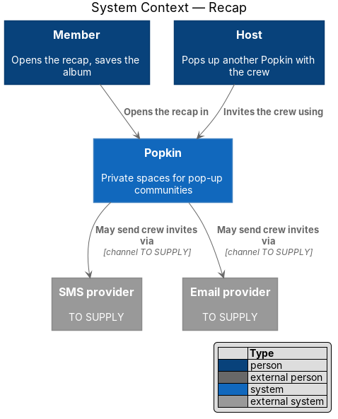
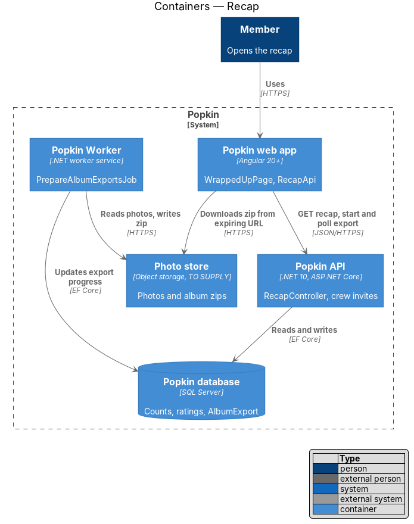
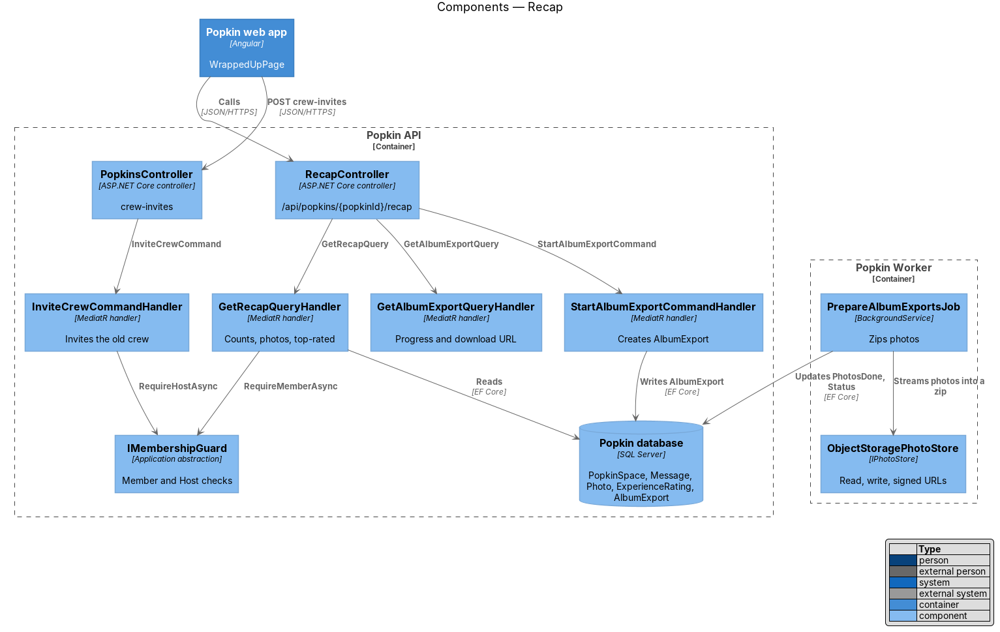
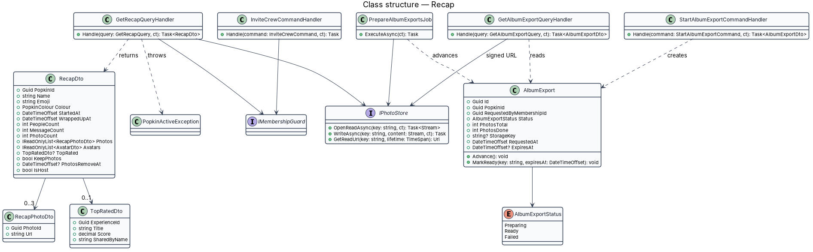
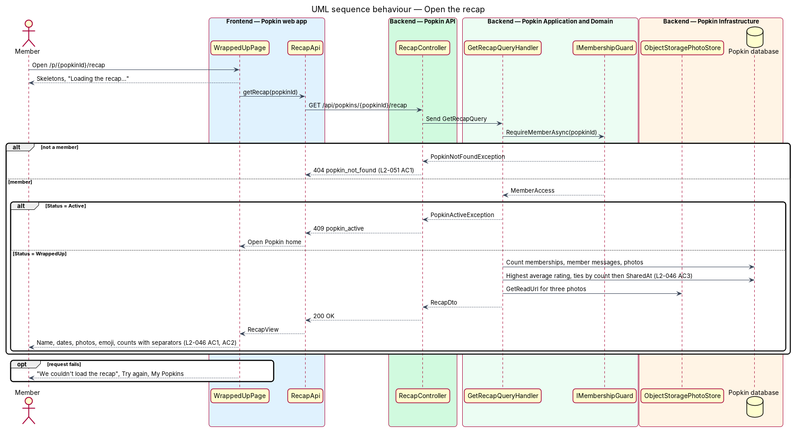
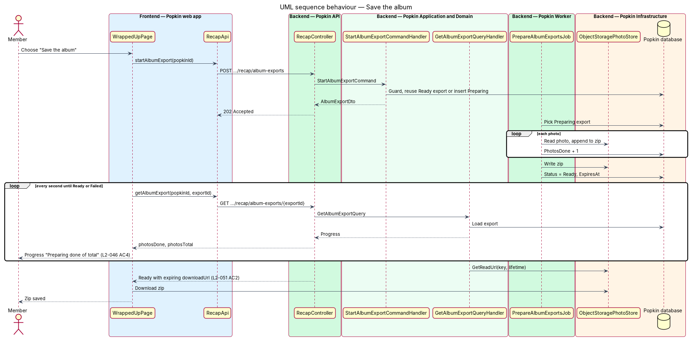
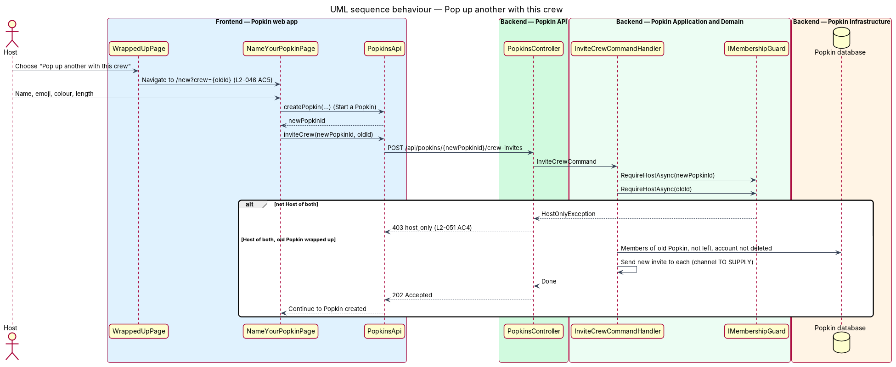

# Recap

## Overview

A Popkin is a private space for one group, and every Popkin ends. When it wraps up, its members
get a recap: a send-off page that says the Popkin wrapped up, names it, gives the dates it ran,
shows three of its photos and its emoji, counts the people, messages and photos, and names the
top-rated moment.

**recap** — summary of a wrapped-up Popkin: its people, messages, photos and top-rated moment

**top-rated moment** — experience of the Popkin with the highest group score, shown with its
score and the member who shared it

**album export** — zip file of every photo in a Popkin, prepared on request and downloaded once
ready

The recap is the front page of a wrapped-up Popkin (L2-045 AC5) and the destination of the
"Recap" entries in My Popkins (L2-018 AC2). It also looks forward. A member who is not the Host
can choose "Start your own Popkin"; the Host can choose "Pop up another with this crew", which
starts a new Popkin and sends its invite to every member of the old one. While the album is
there, "Save the album" prepares a zip of every photo and downloads it.

Journey 9, Wrap up, built this design. The sections below say what was built, and
[Built in journey 9](#built-in-journey-9) lists what differs from the design as it first stood
and what waits.

## Description

### Screens and states

- `docs/mocks/pages/wrapped-up/default.html` — a member's recap: "This Popkin wrapped up. What a
  time.", "Lakeside Weekend · Fri 11 – Sun 13 Sep", three photos and the emoji, "14 people showed
  up" with avatars, the stats "1,286 messages sent" and "48 photos shared", the "Top-rated
  moment" card, "Save the album", "Start your own Popkin" and "Read the chat" (L2-046 AC1, AC2,
  AC3, AC4, AC6).
- `docs/mocks/pages/wrapped-up/host.html` — the Host's recap, with "Pop up another with this
  crew" in place of "Start your own Popkin" (L2-046 AC5).
- `docs/mocks/pages/wrapped-up/exporting.html` — while the album is prepared: the button reads
  "Preparing the album…" and is disabled, with `pk-progress` and "Preparing 12 of 48" under it
  (L2-046 AC4). Drawn for journey 9.
- `docs/mocks/pages/wrapped-up/plain.html` — a recap without photos and without a rated
  experience: no collage, no "Top-rated moment" and no "Save the album" (L2-046 AC3). Drawn for
  journey 9.
- `docs/mocks/pages/wrapped-up/loading.html` — "Loading the recap…" with skeletons (L2-056 AC1).
- `docs/mocks/pages/wrapped-up/error.html` — "We couldn't load the recap" with "Try again" and
  "My Popkins" (L2-056 AC2).
- `docs/mocks/notifications/banner/persistent.html` — the recap with "Photos go in 12 days. Save
  the album to keep them." when the album was not kept (L2-045 AC4).
- `docs/mocks/pages/name-your-popkin/default.html` and `docs/mocks/pages/name-your-popkin/blank.html`
  — the screens "Pop up another with this crew" and "Start your own Popkin" open (owned by
  [Start a Popkin](../../popkins/start-popkin/README.md)).

The manifest marks the recap's empty state as not applicable: a wrapped-up Popkin always has its
people and dates, and the top-rated card is left out when nothing was rated (L2-046 AC3).

### API

Every endpoint answers `404` `popkin_not_found` to someone who is not a member (L2-051 AC1).

- `GET /api/popkins/{popkinId}/recap` — `200 OK` with `RecapDto`.
  - `409` `popkin_active` — the Popkin has not wrapped up; the web app opens the Popkin home.
- `POST /api/popkins/{popkinId}/recap/album-exports` — `202 Accepted` with `AlbumExportDto`
  and a `Location` header. An export that is being prepared, or is ready and has not expired,
  answers again; otherwise a new one starts.
  - `409` `album_removed` once the photos were removed; `409` `popkin_active`.
- `GET /api/popkins/{popkinId}/recap/album-exports/{exportId}` — `200 OK` with `AlbumExportDto`
  (`id`, `status`: `Preparing`, `Ready` or `Failed`, `photosDone`, `photosTotal`, `downloadUrl`
  once ready). `404` `export_not_found` for an export of another Popkin, and for one that has
  expired.
- `POST /api/popkins/{newPopkinId}/crew-invites` with `{ "fromPopkinId": "…" }` — `202 Accepted`
  with no body. Sent by the web app once the new Popkin exists.
  - `400` `validation_failed`, naming `fromPopkinId`, when it is missing.
  - `403` `host_only` — the caller is not the Host of both Popkins (L2-051 AC4).
  - `404` `popkin_not_found` for either Popkin; `409` `popkin_active` when the old Popkin has
    not wrapped up; `409` `popkin_wrapped_up` when the new one has.
- `GET /api/files/{key}?expires=…&download={file name}&signature=…` — the address a ready
  export's `downloadUrl` names. The file name is signed with the rest, the address expires
  after an hour as every photo address does (L2-051 AC2), and the answer is an attachment under
  that name.

### Backend — Popkin API

- **`RecapController`** (`/api/popkins/{popkinId}/recap`) — actions `Get`, `StartAlbumExport`
  and `GetAlbumExport`. Each sends one MediatR request and maps the result.
- **`PopkinsController.InviteCrew`** — `POST /api/popkins/{popkinId}/crew-invites`.
- **`FilesController.Get`** — takes `download`; with it, the file is sent as an attachment under
  that name.

### Backend — Popkin Application and Domain

- **`IMembershipGuard`** — gained `RequireWrappedUpMemberAsync` and `RequireWrappedUpHostAsync`:
  membership first (`404`), then, for the Host's, the role (`403`), then the state: an active
  Popkin answers `409` `popkin_active`.
- **`GetRecapQuery`** / **`GetRecapQueryHandler`** — `RequireWrappedUpMemberAsync`, then:
  - `PeopleCount` — every `Membership` of the Popkin, including members who left, because they
    showed up.
  - `MessageCount` — the messages members wrote in the Everyone thread and did not delete
    (`RecapCounts.MessagesAsync`). The notes Popkin writes itself, such as "popped in", are not
    counted. Journey 11 built direct messages and left this count as it was: a direct message
    is private to its two members, and nothing of it reaches the recap.
  - `PhotoCount` — the photos of the album (`RecapCounts.PhotosAsync`). Once the album was
    removed it stays as it was: the number the album held then, kept on the Popkin as
    `PhotosRemovedCount`, because the photos were shared all the same.
  - `Photos` — the latest three, each a thumbnail at an address that expires. None once the
    album was removed.
  - `Avatars` — at most five members, the Host first, as the mock draws them.
  - `TopRated` — the rated experience with the highest average; of several, the one more
    members rated, then the one shared first (`TopRatedMoment.Pick`). It carries `ExperienceId`,
    `Title`, `PictureUrl` (the thumbnail of its picture at an address that expires, or null),
    `Average`, `RatingCount` and `SharedBy` (a first name, also of a member who has left). It is
    `null` when no experience is rated, and the card is not shown (L2-046 AC3). Something the
    group wants to do is never rated.
  - `StartedAt` (`PopkinSpace.CreatedAt`), `WrappedUpAt`, `KeepPhotos`, `PhotosRemoveAt`,
    `PhotosRemovedAt` and `IsHost`, with `Id`, `Name`, `Emoji` and `Colour`.
- **`AlbumExport`** (entity) — `Id`, `PopkinId`, `RequestedByMembershipId`, `Status`:
  `AlbumExportStatus` {Preparing, Ready, Failed}, `PhotosTotal`, `PhotosDone`, `StorageKey?`,
  `RequestedAt`, `ExpiresAt?`. A ready export is kept for 24 hours (`AlbumExport.Lifetime`),
  then prepared afresh when a member asks again.
- **`StartAlbumExportCommand`** / **`…Handler`** — `RequireWrappedUpMemberAsync`, then refuses
  an album that was removed. It answers the latest export of the Popkin that can still be used,
  one in preparation or a ready one that has not expired, whoever asked for it; otherwise it
  adds an `AlbumExport` with `Status = Preparing` and `PhotosTotal` set.
- **`GetAlbumExportQuery`** / **`…Handler`** — `RequireMemberAsync`, then the export's progress
  and, when `Ready`, `IPhotoStore.GetDownloadUrl(storageKey, fileName)`. The file name is the
  Popkin's name with `.zip` (`AlbumExportFiles.ZipName`): a hyphen stands for each character no
  file name may hold, and a name with nothing left is "Popkin.zip".
- **`PrepareAlbumExportsCommand`** / **`…Handler`** — removes the exports that expired, with
  their zips, then prepares each export that waits, the oldest request first. It streams each
  photo's display image from `IPhotoStore` into a zip, oldest photo first, named `001.jpg`,
  `002.jpg` and so on, stored without compression because photos are compressed already. The zip
  is built in a temporary file, so an album is never held in memory, then written to the photo
  store under `popkins/{popkinId}/exports/`. `PhotosDone` is saved after each photo. An export
  that cannot be prepared is logged with its id only and set to `Failed`.
- **`InviteCrewCommand`** / **`InviteCrewCommandHandler`** — `RequireHostAsync` on the new
  Popkin, then `RequireWrappedUpHostAsync` on the old one. It sends the new Popkin's invite (its
  name, the Host's first name and its invite link) to every person who is a member of the old
  Popkin and has not left it, still has an account, is not the Host, is not already a member of
  the new Popkin, and has not been sent this Popkin's invite before. Each goes to the contact
  detail the person signs in with: the phone number, or the email where there is none
  (L2-046 AC5).
- **`CrewInvite`** (entity, table `CrewInvites`) — `PopkinId` (the new Popkin), `PersonId`,
  `SentAt`, unique on the pair. It is the record that an invite was sent, so a person is sent a
  Popkin's invite once however often the Host asks. An invite that could not be sent is not
  recorded, so it goes out when the Host asks again.
- **`ICrewInviteSender`** — one per channel. Where the channel's provider is configured,
  `EmailCrewInviteSender` and `SmsCrewInviteSender` send it by Azure Communication Services
  ([ADR 0021](../../../adr/0021-codes-and-invites-by-azure-communication-services.md)) and throw
  `CrewInviteNotSentException` when the service refuses. Otherwise `DevelopmentCrewInviteSender` sends nothing: it
  writes one log line that names the channel. `UnconfiguredCrewInviteSender`, outside
  Development, throws `CrewInviteNotSentException`, so nothing is sent or recorded and the
  request is accepted all the same (known gap 51). No destination, link or name is logged
  (L2-054 AC3).
- **`IPhotoStore`** — gained `SaveAsync` from a stream and `GetDownloadUrl(key, fileName)`;
  `PhotoUrlSigner.DownloadUrl` signs the key, the expiry and the file name together.

### Backend — Popkin Worker

- **`PrepareAlbumExportsJob`** — sends `PrepareAlbumExportsCommand` every 2 seconds, so a member
  who chose "Save the album" sees it begin almost at once
  ([Time is up](../time-is-up/README.md) describes what a job of the Worker is). The Worker
  must reach the same photo store as the API: the zip it writes is the file the API hands out
  ([`docs/deployment.md`](../../../deployment.md)).

### Frontend — Popkin web app

- **`WrappedUpPage`** (`pages/wrapped-up/wrapped-up.page.ts` and `.html`, selector
  `pk-wrapped-up-page`). Route `/p/:popkinId/recap`, data `{ shell: 'bare', page:
  'wrapped-up' }`, behind `signedInGuard`. A container: it provides `RecapStore` and composes
  `pk-screen` (`body="recap"`), `pk-top-bar` (back to My Popkins), `pk-banner` (the photos-go
  notice, with "Save"), `pk-recap`, `pk-progress`, `pk-empty-state` (the failure) and
  `pk-button`s. `pk-recap` holds the headline, the collage (`pk-polaroids`), the avatars with
  "+N", the two stats (`pk-stat-pair`), the top-rated moment (`pk-experience-row`, linking to
  the experience) and the actions, and draws its own skeletons while loading. From 1024 px the
  pictures sit beside the numbers and the actions.
  - "Save the album" calls `store.saveAlbum()`. While the zip is prepared the button reads
    "Preparing the album…" and is disabled, and `pk-progress` shows "Preparing {done} of
    {total}". When it is ready the page assigns its address to the document's location: the
    answer is an attachment, so the browser saves it and the recap stays (L2-046 AC4). A
    failure shows a danger toast, "We couldn’t prepare the album", "The photos are still
    there.", with "Try again". The button is shown only when there are photos and they were not
    removed.
  - "Pop up another with this crew" (Host) links to `/new?crew={popkinId}` (L2-046 AC5).
  - "Start your own Popkin" (member) links to `/new` (L2-046 AC6).
  - "Read the chat" links to `/p/:popkinId/chat/everyone`, whose Back reads "Recap" and returns
    here ([Read-only Popkin](../read-only-popkin/README.md)).
  - `not-found` shows the not-found screen; `active`, a Popkin that has not wrapped up, opens
    its home with `replaceUrl`.
- **`RecapStore`** (`frontend/projects/api/src/lib/api/wrap-up/recap-store.ts`, with unit tests;
  one per screen) — reads the recap and turns it into what the screen shows; holds the state
  `loading`, `ready`, `error`, `not-found` or `active`. `saveAlbum()` starts the export, then
  asks for its progress each second until it is `Ready`, when it emits the address on
  `download$`, or anything else, when it emits on `exportFailed$`. A second "Save" while one is
  followed does nothing.
- **Text** — `wrap-up-text.ts`, with unit tests: `count` (thousands separators, "1,286",
  L2-046 AC2), `ranDates` ("Fri 11 – Sun 13 Sep" on the device's clock; each end names its
  month, and its year, only where the two differ; one day for a Popkin that began and ended on
  it), `peopleLine` ("14 people showed up", "1 person showed up"), `statLabel` ("messages
  sent", "photos shared", in the singular for one), `topRatedBy` ("shared by Mara"), `photosGo`
  ("Photos go in 12 days.", "Photos go today." under a day, with "Save the album to keep
  them.") and `exportProgress`.
- **`RecapApi`** / **`RECAP_API`** / **`HttpRecapApi`**
  (`frontend/projects/api/src/lib/api/wrap-up/recap-api.ts`) — `getRecap`, `startAlbumExport`,
  `getAlbumExport`. View models `RecapView` and `AlbumExportView` (`models/recap.ts`).
- **Pop up another** — `NameYourPopkinPage` reads `?crew=` and keeps it in the draft
  (`NewPopkinDraft.crewOf`). It is kept through Back from the second step and dropped when a
  Popkin is started any other way. `HowLongPage`, which creates the Popkin, then calls
  `PopkinsApi.inviteCrew(newPopkinId, crewOf)` and opens the created screen without waiting:
  the new Popkin is there either way. A success toast says "Invites are on their way",
  "Everyone from the last Popkin gets one."; a danger toast says "We couldn’t invite the crew",
  "Share the code or the link with them instead."

### Tests

- `Popkin.Api.Tests/WrapUp/`: `RecapTests`, `AlbumExportTests` and `CrewInviteTests`.
  `Popkin.Application.Tests/WrapUp/`: `TopRatedMomentTests` and `AlbumZipNameTests`, one case
  per row of each rule.
- Unit tests of `RecapStore` and `wrap-up-text.ts` (ADR 0011).
- Playwright: `e2e/tests/recap.spec.ts` and `pop-up-another.spec.ts`, with
  `e2e/pages/recap.page.ts`.

### Built in journey 9

Everything above. What the build decided where the design said `<TO SUPPLY>`, and what differs
from the design as it first stood:

- The people counted include members who left. The messages counted are those of the Everyone
  thread. The photo count stays as it was after the photos are removed. The photos shown are
  the latest three.
- `Avatars` holds at most five, not four, as the mock draws five.
- `TopRated` carries `PictureUrl`, `Average` and `RatingCount`, and `SharedBy` as an object with
  a first name; the design had a `Score` and a `SharedByName`. The web app writes the average
  to one decimal.
- The album's refusal is `409` `album_removed`, not `album_not_kept`: an album that was not
  kept can be saved for 30 days, until its photos go.
- An export in preparation is reused, as a ready one is. The zip downloads as
  `{Popkin name}.zip` from a signed address that expires after an hour; the export itself is
  kept a day. No limit on the zip's size was set.
- Crew invites go to the contact detail a person signs in with. There is no in-app invitation.
  The `CrewInvites` table gives idempotency, and people already in the new Popkin are skipped.
  Since ADR 0021 an invite goes out by Azure Communication Services wherever the channel's
  provider is configured (known gaps 1 and 51, closed).
- The copy chosen in the build, not taken from the requirements: "Preparing the album…", "We
  couldn’t prepare the album" and "The photos are still there.", "Invites are on their way"
  and "Everyone from the last Popkin gets one.", "We couldn’t invite the crew" and "Share the
  code or the link with them instead.", and "Photos go today."
- The route has no `memberGuard`; the read's `404` shows the not-found screen.
- `HowLongPage`, not `NameYourPopkinPage`, sends the crew invites, because it is the step that
  creates the Popkin.
- The screen's logic is in `RecapStore`, in the `api` library, not in the page (ADR 0011).
- Outside Development an album export fails for want of a photo store (known gap 9).
- Nothing keeps two Worker instances from preparing one export twice; the Worker is one
  instance (ADR 0015).

The diagrams below were not redrawn (gap 53). They show `album_not_kept`, an invite that may go
by an in-app invitation, and a page that holds the logic the store now holds.

### With journey 13, Photos in chat

- The album's zip, the recap's photo count and its latest photos read only the photos in the album (`Photo.InAlbum`): a photo sent in a direct message is never in the zip, and neither is a chat photo whose message was never sent ([Send photos in chat](../../chat/send-photos-in-chat/README.md)).
- The removal of an album that was not kept (`RemoveWrappedUpAlbumsCommandHandler`) removes every photo of the Popkin, those of direct messages and uploads never sent with it; `PhotosRemovedCount`, which the recap goes on showing, counts only those that were in the album. A message whose photo went then reads "Photo removed" (journey 14; known gap 74, closed).

## Requirements

| L2 ID | Refines (L1) | Requirement |
|-------|--------------|-------------|
| `L2-046` | `L1-011` | Recap: The recap is the send-off. |
| `L2-051` | `L1-012` | Popkins are private to their members: Membership decides everything a person sees. |

`L2-051` is listed because the recap and its album export are refused to non-members with `404`
(AC1), the download address expires (AC2), and only the Host may invite the crew (AC4).

## Diagrams

### System context

Members and the Host open the recap through Popkin. The crew invite may reach members through the
SMS or email provider, depending on the channel still to be decided.

### Containers

The web app reads the recap from the Popkin API. The Popkin Worker prepares the album zip in the
photo store, and the browser downloads it from there.

### Components

`RecapController` sends `GetRecapQuery`, `StartAlbumExportCommand` and `GetAlbumExportQuery`;
`PrepareAlbumExportsJob` in the Worker writes the zip through `IPhotoStore`.

### Class structure

`RecapDto` aggregates the counts, photos and the optional `TopRatedDto`. `AlbumExport` tracks
the zip's progress.

### Behaviour — open the recap

The handler proves membership, refuses an active Popkin and assembles the counts and the
top-rated moment (L2-046 AC1, AC2, AC3).

### Behaviour — save the album

The export is prepared in the Worker while the page shows progress, then downloaded from an
expiring address (L2-046 AC4).

### Behaviour — pop up another with this crew

The Host starts a new Popkin from the recap; once it exists, the web app asks the API to invite
every member of the old one (L2-046 AC5).

