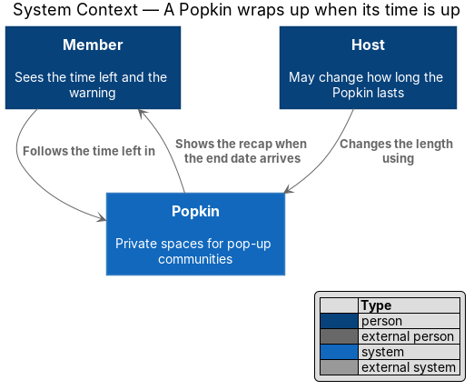
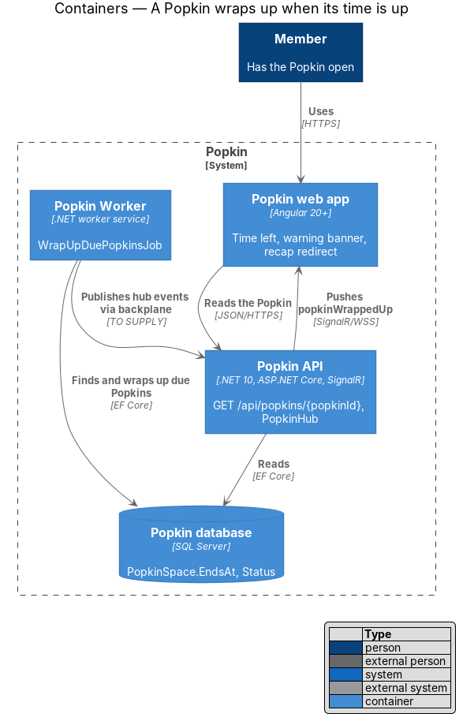
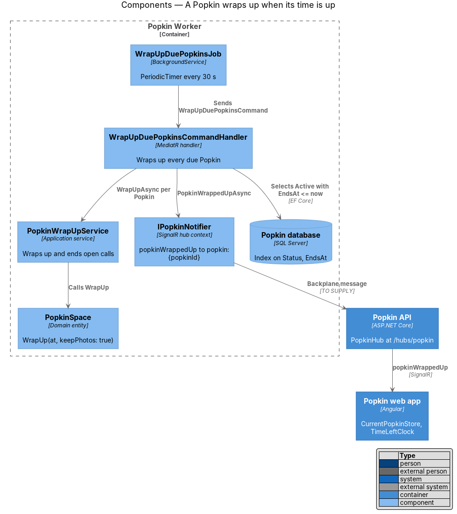
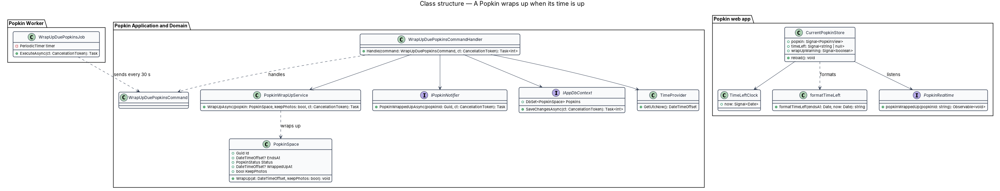
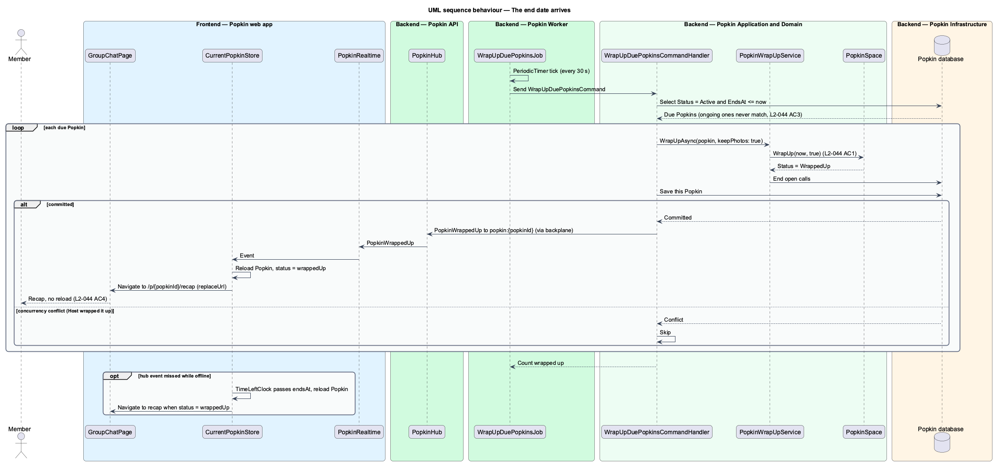
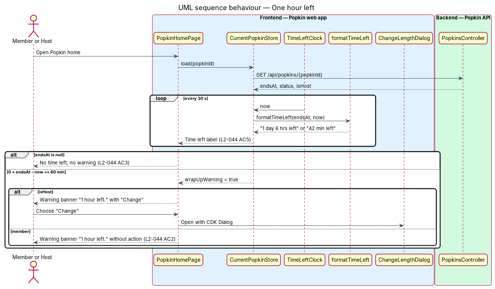

# Time is up

## Overview

A Popkin is a private space for one group. When the Host starts it, the Host chooses how long it
lasts (L2-009). A Popkin with an end date ends by itself when that date arrives. A Popkin with no
end date, called ongoing, lasts until its Host wraps it up (see
[The Host wraps up](../host-wraps-up/README.md)).

**end date** — instant, stored as `PopkinSpace.EndsAt`, at which a Popkin wraps up by itself

**ongoing Popkin** — Popkin whose `EndsAt` is empty and which never wraps up by itself

**time left** — interval from now to the end date, shown in its largest two units ("1 day 6 hrs
left", "42 min left")

**wrap-up warning** — banner shown inside a Popkin when one hour or less is left

This feature covers four things. A background job in the Popkin Worker wraps up every Popkin
whose end date has passed, within one minute, with its photo album kept. Every member sees the
time left on the Popkin home, updated at least once a minute. When one hour is left, every member
sees a warning banner; the Host's banner offers to change the length. A member who has the Popkin
open when it wraps up moves to the recap without reloading.

Journey 9, Wrap up, built this design, with one decision that changed its shape: the Worker
sends no hub events ([ADR 0015](../../../adr/0015-the-worker-sends-no-hub-events.md)). The
sections below say what was built, and [Built in journey 9](#built-in-journey-9) lists what
differs from the design as it first stood and what waits.

## Description

The slice spans the Popkin Worker, the Popkin API's real-time hub and the Popkin web app. It adds
no endpoint: the web app reads `endsAt` and `status` from the Popkin home's existing
`GET /api/popkins/{popkinId}` (see [Popkin home](../../popkins/popkin-home/README.md)), and the
Everyone thread's read carries `endsAt` and `readOnly` too.

### Screens and states

- `docs/mocks/pages/popkin-home/default.html` — header time-left pill "1 day 6 hrs left · Wraps
  up Sun, 6 pm" (L2-044 AC5, L2-019 AC1).
- `docs/mocks/pages/popkin-home/ongoing.html` — the same home with no time-left pill, for a
  Popkin with no end date (L2-044 AC3).
- `docs/mocks/pages/popkin-home/last-hour.html` and `last-hour-member.html` — the home in its
  last hour, for the Host, whose banner offers "Change", and for any other member, whose banner
  does not (L2-044 AC2). Drawn for journey 9.
- `docs/mocks/notifications/banner/warning.html` — warning banner "1 hour left. Lakeside Weekend
  wraps up at 6 pm." with the Host's "Change" action and a Dismiss button (L2-044 AC2).
- `docs/mocks/dialogs/change-length/default.html` — the dialog the Host's banner action is to
  open (owned by [Popkin settings](../../popkins/popkin-settings/README.md)); built in journey 16.
- `docs/mocks/pages/wrapped-up/default.html` — the recap a member lands on when the Popkin wraps
  up while open (L2-044 AC4).

The mock's banner action reads "Change"; L2-044 AC2 names it "Change how long it lasts". The
design gave the action the visible label "Change" and the accessible name "Change how long it
lasts", which contains the visible label (WCAG 2.5.3). Journey 9 built the visible label only;
journey 16 gave it the accessible name, through `pk-banner`'s `actionLabel` (known gap 47).

### API and real-time

- `GET /api/popkins/{popkinId}` — existing in [Popkin home](../../popkins/popkin-home/README.md);
  this slice relies on its `endsAt` (nullable), `status` and `viewerRole` fields.
- Hub event `PopkinWrappedUp(popkinId)` on group `popkin:{popkinId}` of `PopkinHub` — sent by
  the API after the Host wraps a Popkin up. A fact, and final; `GET /api/popkins/{popkinId}`
  recovers it. **It is not sent when a Popkin's time is up**: the Worker wraps that Popkin up,
  and the Worker sends no hub events (ADR 0015).
- A change of length reaches every member as `PopkinChanged`, journey 16, which carries the
  look and the length together; no `PopkinLengthChanged` was built
  ([Popkin settings](../../popkins/popkin-settings/README.md)).

### Backend — Popkin Worker

- **`PeriodicJob<TResponse>`** (`backend/src/Popkin.Worker/Jobs/PeriodicJob.cs`) — what every job
  of the Worker is: a `BackgroundService` that runs a `PeriodicTimer` built from the injected
  `TimeProvider` (`new PeriodicTimer(period, clock)`), so a test advances `FakeTimeProvider` and
  the job ticks at once. Each tick opens a DI scope and sends one command through MediatR. A
  tick that throws is logged and the next one runs. When stopping is asked, the tick in hand
  finishes, no other starts, and the job logs that it stopped.
- **The job is the loop alone.** It decides nothing: what is due, what happens to it and who is
  told all belong to the handler, which the acceptance tests reach through MediatR without a
  timer.
- **`WrapUpDuePopkinsJob`** (`Jobs/WrapUpDuePopkinsJob.cs`) — sends `WrapUpDuePopkinsCommand`
  every 30 seconds. A 30-second period keeps the delay between an end date and its wrap-up under
  one minute (L2-044 AC1), with one tick of slack for a slow run.
- **Heartbeat** — a Worker that stops ticking fails silently: Popkins stop wrapping up and the
  Worker has no HTTP surface to probe. After each tick the job records the time it finished in
  the gauge `popkin.wrap_up.last_tick` (seconds since the Unix epoch), and for each Popkin
  wrapped up the handler records the lateness, `WrappedUpAt` minus `EndsAt`, in the histogram
  `popkin.wrap_up.lateness` ([ADR 0012](../../../adr/0012-opentelemetry.md)). A lateness over
  one minute is also logged as a warning with the Popkin's id, because it breaks L2-044 AC1.
- **`Program.cs`** (Worker) — registers the three jobs the Worker hosts, this one,
  `RemovePhotosOfWrappedUpPopkinsJob` ([Read-only Popkin](../read-only-popkin/README.md)) and
  `PrepareAlbumExportsJob` ([Recap](../recap/README.md)), next to `AddApplication()` and
  `AddInfrastructure(...)`, and gives the handlers what the API gives them and the Worker has
  none of (`WorkerServices.cs`): `SilentPopkinNotifier`, which drops every event,
  `NoPopkinConnections`, and `NoCurrentPerson`, which throws if a handler asks who is signed in.
- **One instance.** The version counter on `PopkinSpace` keeps a second from wrapping a Popkin
  up twice ([`docs/deployment.md`](../../../deployment.md)).
- **Locally**, `eng/Start-E2eWorker.ps1` runs the Worker beside the API of
  `eng/Start-E2eApi.ps1`, on its SQLite file and its photo folder.

### Backend — Popkin Application and Domain

- **`WrapUpDuePopkinsCommand`** — no fields; returns the number of Popkins wrapped up.
- **`WrapUpDuePopkinsCommandHandler`** — reads `now` from `TimeProvider`, selects every
  `PopkinSpace` with `Status == Active`, `EndsAt != null` and `EndsAt <= now`, the earliest end
  first, in batches of 100. For each, it calls `PopkinWrapUpService.WrapUpAsync(popkin,
  keepPhotos: true)` (L2-044 AC1), which saves that Popkin on its own, so one failure does not
  hold back the others; a Popkin that fails is logged with its id and tried again on the next
  tick. A Popkin its Host wrapped up in the same moment is passed over: the Host's choice
  stands. An ongoing Popkin never matches the filter, so it stays active (L2-044 AC3). Once
  stopping is asked, no new batch is begun.
- **`PopkinWrapUpService`** and **`PopkinSpace.WrapUp`** — shared with
  [The Host wraps up](../host-wraps-up/README.md). The service calls `IPopkinNotifier` after the
  commit; in the Worker that is `SilentPopkinNotifier`, and nothing is sent.

### Backend — Popkin Infrastructure

- **`PopkinSpaceConfiguration`** — index on `(Status, EndsAt)`, so the due query reads only
  active Popkins with an end date.

### Frontend — Popkin web app

- **`timeLeft(endsAt, now)`** (`frontend/projects/api/src/lib/api/popkins/time-left.ts`) — the
  pure helper built with the Popkin home. It returns the largest two non-zero units: days and
  hours ("1 day 6 hrs left"), hours and minutes ("1 hr 5 min left") or minutes ("42 min left")
  (L2-044 AC5). Under one minute it says "1 min left", and nothing once the end has passed.
- **`WrapUpWatch`** (`frontend/projects/api/src/lib/api/wrap-up/wrap-up-watch.ts`, provided in
  root, with unit tests) — the one place that knows a Popkin wrapped up while it was open, and
  that redraws what reads the time. It ticks every 30 seconds.
  - `look(popkinId, endsAt)` — a screen that has read an active Popkin says which one is on the
    screen and when it ends; `look(null, null)` for a wrapped-up one. `PopkinHomeStore`,
    `PopkinFrame` (Photos, Experiences) and `ThreadStore` (the Everyone thread) call it.
  - On a tick after that end has passed, it reads the Popkin (`getHome`); when `status` reads
    `WrappedUp`, it reports the Popkin. A read that fails is made again on the next tick.
  - `wrappedUp$` — the id of a Popkin that has just wrapped up: the hub's `PopkinWrappedUp`
    merged with what the clock check reports.
  - `warningFor(popkinId, name, endsAt)` and `dismissWarning(popkinId)` — the banner of the last
    hour, below.
- **Wrap-up warning** — `wrapUpWarning(name, endsAt, now)` in `wrap-up-text.ts`, with unit
  tests: nothing with more than an hour left, with none left, and for a Popkin that keeps going;
  otherwise a lead and the line "{name} wraps up at {time}." The lead is "1 hour left." for the
  first minute of the last hour, because the banner comes on a tick a moment after the hour,
  then the time left: "59 min left." and so on. The home, the Everyone thread, Photos and
  Experiences each render it as `pk-banner` (warning) with Dismiss. Dismissing it hides it for
  that Popkin, on all four screens, until the app is loaded again. On the home only, the Host's
  banner carries the action "Change" (L2-044 AC2). Since journey 16 it opens "Change how long it
  lasts", named so for assistive technology (known gap 47).
- **The move to the recap** — the root component `App` subscribes to `WrapUpWatch.wrappedUp$`.
  When the Popkin that wrapped up is the one on the screen (the address is `/p/{popkinId}` or
  under it, and is not the recap already), it closes every open dialog and navigates to
  `/p/:popkinId/recap` with `replaceUrl` (L2-044 AC4). A member looking at another Popkin is
  left alone.
- **How long it takes** — a wrap-up by the Host moves every open screen at once, over the hub.
  A wrap-up by time is carried by the clock check alone: the Worker wraps the Popkin up within
  a minute of its end, on a tick of 30 seconds, and the watch reads within its own 30 seconds
  after that, so the member moves within about a minute and a half of the end; 90 seconds,
  measured by hand (known gap 50). A member who acts in that gap is refused with `409` `popkin_wrapped_up`, the
  screen they are on answers for itself, and the watch moves them at its next reading ([Read-only Popkin](../read-only-popkin/README.md)).

### Tests

- `Popkin.Api.Tests/WrapUp/TimeIsUpTests` sends `WrapUpDuePopkinsCommand` through MediatR with
  `FakeTimeProvider` set before and after an end date (L2-044 AC1, AC3).
- `Popkin.Worker.Tests/JobTests` hosts the jobs with `FakeTimeProvider`: advancing a period
  sends one command; a tick that throws is followed by the next; stopping the host ends the
  loop. No test sleeps ([ADR 0010](../../../adr/0010-the-hub-in-tests.md)).
- Unit tests of `WrapUpWatch` and `wrap-up-text.ts` in the `api` library (ADR 0011).
- Playwright: `e2e/tests/last-hour.spec.ts` and `wrap-up-live.spec.ts`, with
  `e2e/pages/wrap-up-banner.ts`. "moves to the recap, without the hub, once its time is up"
  proves the clock check.

### Built in journey 9

Everything above. What differs from the design as it first stood, and what waits:

- **The Worker sends no hub events** (ADR 0015, known gaps 13 and 14, settled). The design had
  it send `PopkinWrappedUp` over a backplane shared with the API, with the clock check as the
  cover for a lost event. The clock check is now the only carrier of a timed wrap-up.
- `CurrentPopkinStore`, `TimeLeftClock` and its token, and `formatTimeLeft` were not built.
  Their work is done by `WrapUpWatch`, by the stores of the screens and by `timeLeft`. Nothing
  corrects for a wrong device clock: a device whose clock is behind reads late by as much, and
  one that is ahead asks early and keeps asking.
- The banner under one hour reads the time left; the design left its copy to supply.
- The Host's "Change" shows on the home only (known gap 47). Journey 16 made it open
  `ChangeLengthDialog`, with the accessible name "Change how long it lasts"; a new end reaches
  every member's banner and time left through `PopkinChanged`.
- The batch of the due query is 100.
- The exporter of ADR 0012 is not set up, so the two instruments are recorded and not exported.

The diagrams below were not redrawn (gap 53). They show a backplane between the Worker and the
hub, `CurrentPopkinStore`, `TimeLeftClock` and `formatTimeLeft`.

## Requirements

| L2 ID | Refines (L1) | Requirement |
|-------|--------------|-------------|
| `L2-044` | `L1-011` | A Popkin wraps up when its time is up: A Popkin with an end date ends by itself. |

## Diagrams

### System context

Members see the time left and the warning; Popkin ends the Popkin by itself when its end date
arrives. No external system takes part.

### Containers

The Popkin Worker finds due Popkins in the Popkin database and wraps them up. As built, no
event leaves the Worker: members' web apps read the Popkin once its end has passed (ADR 0015).

### Components

Inside the Popkin Worker, `WrapUpDuePopkinsJob` sends `WrapUpDuePopkinsCommand` every 30 seconds;
the handler wraps up each due Popkin through `PopkinWrapUpService` and notifies members.

### Class structure

The job depends on MediatR only; the handler depends on the database context, the time
provider, the shared wrap-up service and the notifier. On the web app side, `TimeLeftClock` and
`formatTimeLeft` feed `CurrentPopkinStore`.

### Behaviour — the end date arrives

A tick finds the due Popkin and wraps it up with the album kept (L2-044 AC1). As built it sends
nothing: `GET /api/popkins/{popkinId}`, the recovery read of `PopkinWrappedUp`
([Live messages](../../chat/live-messages/README.md#events-and-their-recovery-reads)), is what
the web app's clock check makes, and a member with the Popkin open moves to the recap without a
reload (L2-044 AC4).

### Behaviour — one hour left

The web app's clock redraws the time left at least once a minute (L2-044 AC5) and shows the
warning banner when one hour is left; only the Host's banner offers "Change" (L2-044 AC2), and
as built it opens Popkin settings.

